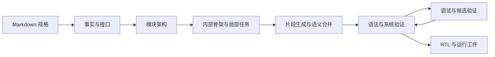

# RPG-ZeroRepo

RPG-ZeroRepo 是一个从规格文档生成代码、并结合工具检查和修复结果的 Agent 项目。当前主要使用 **RTL Spec-to-RTL** 流程：读取 Markdown 硬件规格，规划模块结构和局部任务，生成 Verilog/SystemVerilog，再进行语法检查、系统验证和调试。

仓库也保留了基于 Repository Planning Graph（RPG）的通用软件仓库生成代码。下面的环境和运行说明以当前 `rtl_planner` 主线为主。

网页 demo 和交互工作台已拆分至 `/home/mokita/RTL-Studio`。本仓库负责 Agent 核心、CLI、规格数据和原始运行工件；Studio 通过 Python 包依赖调用这里的 Agent。详见 [迁移说明](docs/rtl-studio-migration.md)。

## 项目功能

| 环节 | 主要工作 |
| --- | --- |
| 规格解析 | 从 Markdown 提取设计事实、来源依据和顶层接口 |
| 架构规划 | 建立责任清单，提出并选择模块划分，记录层次和模块间约束 |
| 模块与任务分解 | 检索模块相关规格，生成内部骨架、代码块和局部实现任务 |
| RTL 生成与合并 | 逐任务生成代码片段及实现契约，合并成完整模块 |
| 检查与调试 | 调用语法检查器和配套验证脚本，结合日志、波形、KG 进行定位和修复 |
| 恢复与记录 | 保存阶段工件、输入指纹、候选修改和检查结果，支持经核验的断点恢复 |



规划主线包含 Stage1—Stage6。Stage1—Stage4 准备事实、架构、骨架和任务；随后按模块执行 Stage5 片段生成和 Stage6 合并。源码中的阶段完成状态、语法通过状态和功能验证结果需要分别查看。

规划使用责任细化流程：Stage2 保存可核验原文、类型化依赖、状态所有权与三种架构候选；Stage3 生成 JSON 结构块和行为义务草稿，程序补齐来源及继承契约，并渲染 Markdown；Stage4 确定性组装局部任务，不调用模型。规划门控重新读取实际 JSON，核验责任、来源、状态、义务、块和任务关系，通过后才进入 Stage5/Stage6。门控检查追踪与分配完整性，功能正确性仍由 RTL 验证判断。

当前规划策略为 `planning_harness_v2`，节点检查点为 `planning_node_v2`；Stage3 骨架及 Stage4 计划使用 v3 schema。首次升级需要重新执行 Stage1—Stage4，旧失败草稿不会自动导入。新版本按阶段模板、模型配置、规格内容及实际上游产物核验恢复。`skeleton.json` 是骨架权威数据，`skeleton.md` 是可重建阅读视图；手工编辑 Markdown 不改变规划。旧时序兼容字段继续为空。

更详细的实现说明见 [RTL Agent 功能、架构与实现说明](docs/rtl_agent_system_description.md)。该文档包含迁移前的产品层描述，网页路径以本 README 和迁移说明为准。

## 在当前机器上运行

已有 Agent 环境位于仓库根目录的 `.zerorepo/`。在仓库根目录执行：

```bash
cd /home/mokita/RPG-ZeroRepo
source .zerorepo/bin/activate

# 当前机器的 RealBench 环境中提供了 Verilator。
export PATH="/home/mokita/miniconda3/envs/realbench/bin:$PATH"

python --version
verilator --version

# 以 AES 加密规格为例，启动真实的规划、生成和配置中启用的调试。
bash scripts/run_main.sh rtl_dataset/aes_cipher_hard/aes_cipher_system_hard.md
```

运行前确认 [configs/zerorepo_config.yaml](configs/zerorepo_config.yaml) 中的模型、服务地址、凭据、KG 和调试后端适合本次任务。启动生成会调用配置的模型服务。

当前配置选择了 `rtl_kg.enabled: true`、`rtl_kg.mode: required` 和 `rtl_debug.backend: codex`，因此需要 Neo4j 可连接，以及相应调试后端可用。新环境可以先使用下文的最小配置，再接入这些能力。

本机环境核对日期：**2026-11-03**。`.zerorepo/` 使用 Python **3.12.3**；`uv pip check --python .zerorepo/bin/python` 已确认当前安装的 213 个包依赖兼容。这是现有环境检查，不等同于全新安装或真实模型任务验收。

## 新建 Python 环境

### 系统工具

以下命令按 Linux / Bash 编写。

| 工具 | 用途 |
| --- | --- |
| Python | 包元数据要求 Python ≥ 3.11；下方环境步骤使用与本机一致的 3.12 系列 |
| `uv` | 创建虚拟环境、安装和检查 Python 依赖 |
| C/C++ 编译工具、`make` | 编译 tree-sitter 语法库，以及构建 HDL 仿真程序 |
| Verilator | RTL 语法检查和部分系统仿真 |
| Icarus Verilog / `vvp` | 按具体测试脚本需要安装 |
| Neo4j | 启用 RTL KG 时使用；仓库提供 Docker Compose 配置 |
| 外部调试 CLI | 选择 `codex` 调试后端时需要；`repo_react` 使用 Python 侧模型工具循环 |

普通 Agent CLI 不需要 Node.js 或网页的 Python 环境。系统验证还依赖对应任务的测试脚本、TB 和参考资源，详见后文。

### 创建环境并安装 RTL 依赖

在仓库根目录创建独立环境，保留已有 `.zerorepo/`：

```bash
uv venv --python 3.12 .venv-rtl

uv pip install --python .venv-rtl/bin/python \
  "openai==2.24.0" "pydantic==2.12.5" "PyYAML==6.0.3" \
  "agentscope==1.0.7" "mcp==1.27.0" \
  "tree-sitter==0.25.2" "tree-sitter-verilog==1.0.3" \
  "neo4j==6.1.0" "vcdvcd==1.0.6" \
  "httpx==0.28.1" "tiktoken==0.12.0" "json-repair==0.59.5" \
  "networkx==3.6.1" "numpy==2.4.2" \
  "sqlalchemy[asyncio]==2.0.48" "python-dotenv==1.2.2" \
  "pytest==9.0.2"

uv pip install --python .venv-rtl/bin/python --no-deps -e .
uv pip check --python .venv-rtl/bin/python
source .venv-rtl/bin/activate
```

上述直接依赖版本取自当前兼容的 Agent 环境，面向 OpenAI 兼容接口的 RTL 主线；传递依赖未全部锁定，这组命令本次未在空环境中重装验证。选择其他模型 provider 时，还需要相应 SDK；运行通用软件生成、向量检索或评测代码时，需要按其模块补充依赖。

`pyproject.toml` 提供 `zerorepo-agent` 的包注册，目前没有声明完整运行依赖，因此仅执行 `pip install -e .` 不会自动配齐环境。

仓库现有依赖文件的范围如下：

| 文件 | 当前用途与注意事项 |
| --- | --- |
| `requirements.txt` | 历史完整依赖集合，包含 ML、评测和旧版 LlamaIndex 等依赖 |
| `requirements_fixed.txt` | 另一组历史通用依赖，仍保留部分旧版本约束 |
| `zerorepo/rtl_impl/rtl_kg/requirements.txt` | KG 子项目的历史依赖说明，tree-sitter 约束与当前环境不同 |

这些文件不构成当前 RTL 环境的统一锁文件。不要将它们与上面的版本集合混合安装到已有环境中。

## 模型与运行配置

主配置为 [configs/zerorepo_config.yaml](configs/zerorepo_config.yaml)，主要字段如下：

| 配置项 | 作用 |
| --- | --- |
| `llm` | 模型 provider、名称、凭据、服务地址和生成参数 |
| `rtl_module_planner.retrieval_limits` | 规格检索的输入和上下文规模限制 |
| `rtl_module_planner.request_policy` | 按检索、生成及具体阶段控制模型请求等待与重试策略 |
| `rtl_kg` | 是否启用 KG、失败策略和 Neo4j 连接 |
| `rtl_debug` | 是否启用调试、调试后端、验证资源根目录和尝试预算 |
| `prop_level` / `impl_level` / `code_generation` | 通用软件生成及旧流程相关配置 |

### 最小配置示例

可以把下面内容保存为 `/tmp/zerorepo-rtl-basic.yaml`，并替换模型名称和服务地址。此配置用于先运行规划、生成与模块语法检查，关闭 KG 和系统级调试。

```yaml
llm:
  provider: openai
  model: "<your-model>"
  base_url: "<your-openai-compatible-base-url>"
  api_key: "${ZEROREPO_API_KEY}"
  max_tokens: 16384
  temperature: 0.6
  stream: true
  stream_include_usage: true

rtl_kg:
  enabled: false

rtl_debug:
  enabled: false
  backend: repo_react
```

```bash
export ZEROREPO_API_KEY="<your-api-key>"
```

`llm` 的字符串字段支持 `${环境变量名}` 展开。模型、服务地址及参数应与实际提供方支持的配置匹配；`--llm-config` 也可以覆盖模型配置，格式由 `LLMConfig.from_source()` 处理。

CLI 不会自动加载 `.env` 文件，环境变量需要在启动进程前导出。现有主配置按文件中的值读取；设置环境变量只会影响引用该变量的配置或相应 provider 的环境变量回退。README 不包含本机真实凭据。

### 配置 RTL KG

使用仓库提供的开发 Compose 配置启动 Neo4j：

```bash
docker compose -f zerorepo/rtl_impl/rtl_kg/docker-compose.dev.yml up -d neo4j
```

然后在实际使用的 YAML 配置中设置：

```yaml
rtl_kg:
  enabled: true
  mode: required
  neo4j:
    uri: "bolt://127.0.0.1:7687"
    user: "neo4j"
    password: "<与 Neo4j 服务一致的密码>"
```

`mode: required` 会在 KG 初始化失败时停止流程；不需要 KG 的任务可显式配置 `enabled: false`。Neo4j 密码当前按 YAML 原值读取，不使用 `llm` 的环境变量展开逻辑。

规划图谱按阶段批量同步：Stage3、Stage4 的逐模块进度先原子保存到本地，阶段结束后向 Neo4j 提交一次完整投影。同一次运行中，已成功同步且内容未变的投影不再重复提交；同步失败不会标记为成功，后续可以重试。每次启动或恢复运行至少重新同步一次，避免数据库重建后遗漏数据。日志中的节点、边数量表示本次提交规模，不表示新增数量。

RTL 解析器使用 `zerorepo/rtl_impl/rtl_kg/third_party/tree-sitter-verilog/` 中的语法源码。首次调用 `VerilogTreeSitter.get_parser()` 时，如果共享库不存在，会尝试编译到 `zerorepo/rtl_impl/rtl_kg/build/rtl_langs.so`，需要可用的 C 编译器。

| 环境变量 | 用途 |
| --- | --- |
| `RTL_TS_GRAMMAR_DIR` | 指定 tree-sitter Verilog 语法源码目录 |
| `RTL_TS_LANG_SO` | 指定已经编译的语法共享库 |
| `RTL_TS_CACHE_DIR` | 调整语法库构建和缓存目录 |

可单独检查解析器：

```bash
python - <<'PY'
from zerorepo.rtl_impl.rtl_kg.rtl_file_graph_builder import VerilogTreeSitter
tree = VerilogTreeSitter.get_parser().parse(b"module smoke; endmodule")
assert not tree.root_node.has_error
print("Verilog parser OK")
PY
```

更多 KG 操作见 [Neo4j 入库说明](zerorepo/rtl_impl/rtl_kg/README_neo4j_ingest.md)。

### 配置系统验证与调试

完整的系统验证需要匹配当前设计的验证脚本、TB、激励和参考资源。当前适配包含 RealBench 目录约定，默认根目录是 `/home/mokita/RealBench`，它是仓库外的依赖，不会随本仓库自动安装。

```yaml
rtl_debug:
  enabled: true
  backend: repo_react
  oracle_root: "/path/to/RealBench"
  toolchain_bin: "/path/to/verilator/bin"
  max_trials: 30
  allow_failure: false
```

系统验证器会结合规格路径中的项目名和顶层模块名查找 `system_task/<项目或顶层>/verify_test/` 下的配套资源。自定义规格要接入相应验证资源，不能仅靠修改 `oracle_root` 就获得功能验证。

可选调试后端为 `repo_react` 和 `codex`。后者需要可用的外部 CLI、所选 profile 和认证配置；其 Agent 侧接入说明见 [Codex RTL Debug MCP](docs/codex_debug_mcp.md)。普通 CLI 不需要安装 RTL Studio。

常用调试环境变量覆盖项：

| 环境变量 | 作用 |
| --- | --- |
| `ZEROREPO_RTL_DEBUG` | 开关调试，例如 `false` |
| `ZEROREPO_RTL_DEBUG_BACKEND` | `repo_react` 或 `codex` |
| `ZEROREPO_RTL_DEBUG_ORACLE_ROOT` | 覆盖验证资源根目录 |
| `ZEROREPO_RTL_DEBUG_TOOLCHAIN_BIN` | 覆盖调试使用的工具链目录 |
| `ZEROREPO_RTL_DEBUG_MAX_TRIALS` | 覆盖调试尝试预算 |

语法门控失败时的模块修复仍可能使用 RepoReAct；系统调试后端的选择不表示所有模型调用都切换为该后端。

## 运行方式

### 使用现有启动脚本

在仓库根目录、已激活的 Python 环境中执行：

```bash
# 单个规格文件
bash scripts/run_main.sh rtl_dataset/aes_cipher_hard/aes_cipher_system_hard.md

# 将一个目录中的规格作为一个规划任务输入
bash scripts/run_main.sh rtl_dataset/sdc

# 不传参数，按文件名排序处理 rtl_dataset 顶层的 .md 文件
bash scripts/run_main.sh
```

脚本默认选择 `RTL_PIPELINE_MODE=planner`，并附带 `--resume`。不传参数时不会递归枚举所有子目录中的案例；如果要运行某个子目录，请显式传入目录或文件路径。

### 按阶段停止与继续

`--plan`、`--generate` 表示累计执行到指定边界；前置阶段仍按现有规则校验和复用。两者互斥，仅适用于 `rtl_planner`，可放在规格参数之前或之后。

```bash
# Stage1—Stage4：规划门控通过后停止，不生成代码
bash scripts/run_main.sh rtl_dataset/sdc --plan

# 继续逐模块生成、合并、语法检查与有限次数修复，系统 debug 前停止
bash scripts/run_main.sh rtl_dataset/sdc --generate

# 继续未解决的语法修复及系统功能 debug
bash scripts/run_main.sh rtl_dataset/sdc

# 批量案例同样支持断点
bash scripts/run_main.sh --plan
```

模块语法修复达到次数上限后，会记录失败并继续处理其他模块。**生成阶段结束允许存在待修复语法问题**；摘要会列出待处理模块，具体结果位于 `generate/metadata/stage6_merge.json` 的 `debug_files`。规划门控失败、代码生成或合并失败仍报告错误。语法检查被配置关闭时，结果明确标为 `disabled`，不会计为通过。

后续运行原命令会重新检查模块，给未通过模块新一轮现有修复预算，然后进入系统 debug。来源及内容指纹完全匹配的已有模块可以直接进入修复，无需重新合并；修改规格、规划、合同或代码仍会触发现有缓存失效规则。`--generate` 不启动系统 debug，也不会将历史系统 debug 结果显示为本次结果。

脚本固定使用 `configs/zerorepo_config.yaml`。使用其他配置或进一步控制参数时，直接运行 `main.py`。

### 直接调用 CLI

使用上文的最小配置：

```bash
python main.py \
  --config /tmp/zerorepo-rtl-basic.yaml \
  --checkpoint rtl_outputs/aes_cipher_system_hard/plan/state/kg \
  --repo rtl_outputs/aes_cipher_system_hard \
  --phase rtl_planner \
  --rtl-spec rtl_dataset/aes_cipher_hard/aes_cipher_system_hard.md \
  --resume
```

本命令会进行真实模型调用。查看参数帮助使用 `python main.py --help`。

当前 RTL 分支实际将各案例工件写入**当前工作目录**下的 `rtl_outputs/<规格名或目录名>/`，因此建议始终从仓库根目录启动。`--repo` 和 `--checkpoint` 是 CLI 必填参数，但不能据此假定它们会覆盖 RTL 分支内部的案例输出目录。

`--resume` 会核验已有输入和工件后复用阶段结果，不表示已有文件一律跳过。需要重新构建时可使用 `--force-rebuild`，并事先保留需要的运行工件。

直接调用 CLI 时，在上面的 `--phase rtl_planner` 命令末尾添加 `--plan` 或 `--generate` 即可选择停止位置；分阶段续跑时仍需带上 `--resume`。不加断点参数执行完整流程，`--force-rebuild` 优先于 `--resume`。

**当前 `--dry-run` 的提前返回位于通用软件生成分支；RTL 分支会先执行，因此不能将 `--phase rtl_planner --dry-run` 当作不调用模型的预检命令。**

### 其他保留入口

`main.py` 还提供 `all`、`design`、`implementation`、`rtl`、`rtl_phase1`、`rtl_phase2` 等阶段入口。它们对应通用软件生成或旧 RTL 流程，依赖范围和行为与 `rtl_planner` 不同；上面的轻量 RTL 环境说明不构成这些路径的完整运行保证。

## 输出与恢复

新运行使用按阶段组织的布局。以 `aes_cipher_system_hard` 为例：

```text
rtl_outputs/aes_cipher_system_hard/
├── run.json                         # 布局版本、任务与留存策略
├── run.log                          # 运行进度和诊断摘要
├── plan/
│   ├── stage1/contracts.json        # 规格事实与顶层接口
│   ├── stage2/                      # 责任分解、候选架构与模块切片
│   ├── stage3/
│   │   ├── module_skeletons.json
│   │   └── modules/<module>/        # skeleton.md、skeleton.json、spec_context.json
│   ├── stage4/
│   │   ├── module_plans.json
│   │   ├── spec_blocks.json
│   │   ├── planning_gate_report.json
│   │   └── modules/<module>/        # plan.json、spec_refs.json
│   ├── state/                      # 检索缓存和规划 KG 检查点
│   └── traces/                     # 请求与格式修复诊断
├── generate/
│   ├── rtl/                        # 最终 RTL 与必要的 HDL 头文件
│   ├── fragments/                  # Stage5 HDL 片段
│   ├── metadata/                   # Stage5/6 清单、契约、宏清单与合并报告
│   ├── state/                      # 恢复检查点、不可变版本与合并输入指纹
│   └── traces/                     # 合并过程诊断
└── debug/
    ├── modules/<module>/           # 模块语法修复与仿真
    ├── system/<top>/               # 系统仿真、候选与调试会话
    ├── memory/                     # RTL 修复经验
    └── state/                      # 修复来源与接受记录
```

Python 接口中，`PlannerRunner.output_root` 指向案例根目录；阶段文件路径统一由 `ArtifactLayout(case_root)` 提供。

程序调用可用 `runner.run(task, end_stage="stage4")` 停在规划门控后，或用 `runner.run(task, end_stage="stage6", run_system_debug=False)` 停在模块语法处理后。`run_system_debug` 默认 `True`，保持完整流程；续跑仍使用 `resume=True`，停止目标不参与规划和代码内容指纹。

交付代码位于 `generate/rtl/`；接受的修复也发布到这里。`rtl/` 和 `fragments/` 只保存 HDL 文件，契约、指纹与检查点分别存入 `metadata/`、`state/`。产物清单中的内部文件路径相对案例根目录保存。

留存策略由配置控制：

```yaml
rtl_module_planner:
  artifacts:
    retention: compact   # compact | full
```

默认 `compact` 保留权威规划、规划门控、当前生成、恢复与修复回滚依据；阶段结果落盘后清理成功请求的临时响应、已完成的格式修复草稿、无引用的生成版本和合并过程。失败请求保留最近一次诊断，未完成请求继续保留。`full` 额外保留完整提示词、响应、合并过程和之前的仿真材料。合并报告与全局宏清单在两种模式下都只写一份。

恢复时保留整个案例目录，并用同一命令附加 `--resume`；缓存仍核验实际内容与来源，切换留存策略不会改变生成语义。排查问题时优先查看 `run.log`、`plan/stage4/planning_gate_report.json` 和 `debug/`。CLI 默认按案例写入 `run.log`，批量运行不创建 `_temp/.zerorepo`；仍可显式传入 `--log-file` 增加指定位置的运行日志。

请求大小与重复上下文排查见[上下文审计与优化记录](docs/context_efficiency_audit.md)。`plan/state/request_usage.jsonl` 的新请求记录包含提示词分项及结构化上下文分项的字符数；`scripts/audit_planning_context.py` 可对已完成的规划做不调用 API 的同输入回放比较。

需要检查 Stage5 不可变版本时，可运行 `python scripts/recover_planner_stage5.py --output-root <案例根目录> --module <模块名>`；默认只检查，增加 `--apply` 才恢复片段和契约。恢复后的正常运行仍需通过 `--resume` 的当前来源校验。

已有案例不会迁移或清理，旧布局不会进入新布局的恢复路径。仓库根目录的 `.zerorepo/` 仍是本机 Python 环境，不属于案例输出目录。

### 规划请求监督与局部恢复

Stage1、Stage2、Stage3 共用持久化 JSON 节点循环：准备上下文 → 请求 → 结构与领域校验 → 保存候选和反馈 → 修正或提交。Stage4 不再产生模型请求。三种架构候选、双轮排序和分歧裁定仍由原有选择流程执行。

`RequestExecutor` 是唯一传输监督层。默认生成请求总预算 600 秒、首正文等待 240 秒；Stage3 单独使用 1200/480 秒及 900 秒推理等待。正文/推理空闲上限 120 秒；传输重试及退避共用原截止时间。鉴权、配置错误直接失败。工作台只订阅规划事件，不改变提示词、超时、重试或模型输出。

```yaml
rtl_module_planner:
  execution_policy:
    node_timeout_seconds: 1800
    max_api_attempts: 10
    max_prompt_chars: 256000
```

节点不再叠加 Stage3 固定三次内容尝试。连续两次候选及错误集合均无变化时返回 `needs_repair` 并停止当前运行；预算耗尽明确报错。`--resume` 为未完成节点分配本轮预算，保留累计消耗；先重验保存的候选和待提交响应，再请求剩余修正。非法实体替换与截断响应不能覆盖候选。`--force-rebuild` 不读取旧检查点。

所有新来源引用使用 `EV_...`，目录位于 `plan/state/evidence_registry.json`。模型选择证据 ID，程序核验并展开原文、段落、行号和文件哈希。Stage3 义务仅能引用父 RU 或合法适用约束绑定的证据。缺少绑定时可显式请求一次来源补充；程序仅追加已验证关联，重验责任表和模块切片，不改变行为、所有权、划分或义务。补充后保存的新指纹仍可恢复当前候选。

修复返回同一 JSON schema 的指定完整实体，例如 `{"behavioral_obligations":[{...}]}`，不使用 Markdown 围栏修复或通用字段路径补丁。Stage4 从义务映射组装责任、状态契约及任务依赖，按证据映射选择全部对应规格块；声明和实例任务分别补充接口/状态及边界证据。没有合法映射时明确失败，不将全部规格分配给每个任务作为降级。

完整契约不受简短 `constraints` 三条限制；新任务的 `description` 取结构块 `purpose`，`constraints` 默认为空。Stage5、Stage6 读取骨架 JSON，Stage5 提示词和缓存来源包含任务义务与契约。

`plan/state/request_usage.jsonl` 与 `plan/metrics.json` 保存实际请求、重试、修复、耗时、字符量及服务端 usage。缺失 token 用量标记为未知；缓存与推理 token 不额外重复累计到总量，不用字符数估算 token 或费用。`compact` 保留未完成节点及恢复数据，成功提交后才清理临时诊断；`full` 额外保存请求与响应过程。

真实模型验收入口（使用当前配置，输出至独立目录）：

```bash
python scripts/accept_planning.py aes --root rtl_outputs/_acceptance/current
python scripts/accept_planning.py e203 --root rtl_outputs/_acceptance/current
# 中断后对同一目录显式续跑
python scripts/accept_planning.py aes --root rtl_outputs/_acceptance/current --resume
```

验收通过时还会重新运行一次规划，验证有效产物无需新 API 请求。离线历史响应回放可使用 `scripts/replay_planning.py`，它不会成为正常恢复路径，也不能替代真实模型验收。执行原理见 [规划执行与恢复](docs/planner_local_repair.md)，本次状态见 [验收报告](docs/planning_json_acceptance.md)。

## 代码目录

| 路径 | 内容 |
| --- | --- |
| `main.py`、`scripts/run_main.sh` | CLI 和常用启动脚本 |
| `configs/` | 模型、规划、KG、调试和通用流程配置 |
| `rtl_dataset/` | Markdown 规格及部分配套测试 |
| `rtl_outputs/` | 各案例的原始运行输出 |
| `zerorepo/rtl_impl/module_planner/` | Stage1—Stage6 编排、agents、schemas 和 prompts |
| `zerorepo/rtl_impl/retrieval_agent/` | 模块、代码块和合并阶段的规格检索 |
| `zerorepo/rtl_impl/kg_agent/`、`rtl_kg/` | 规划语义图、RTL 结构解析和 Neo4j 集成 |
| `zerorepo/rtl_impl/debug_agent/`、`repo_react/`、`codex_debug/` | 检查、仿真适配和调试后端 |
| `zerorepo/rtl_impl/rtl_memory/` | 调试经验、版本和使用记录 |
| `zerorepo/rpg_gen/`、`rpg_encoder/`、`code_gen/` | 通用 RPG 与代码生成组件 |
| `tests/` | Agent 单元和回归测试；网页测试已迁至 Studio |
| `docs/` | 系统说明、设计报告和迁移记录 |
| `langfuse_local/` | 单独的本地观测示例，说明见其 README |

## 开发检查

已激活 Agent 环境后，可先检查导入和 CLI：

```bash
python main.py --help
python -c 'from zerorepo.rtl_impl.module_planner import PlannerRunner; print("Planner import OK")'
uv pip check --python "$(command -v python)"
```

一组无需提交真实模型任务的回归测试：

```bash
python -m pytest \
  tests/test_runtime_integration.py \
  tests/test_planner_json_escapes.py \
  tests/test_llm_streaming.py \
  tests/test_codex_debug_resume.py \
  tests/test_codex_debug_mcp.py \
  tests/test_codex_memory_adapter.py -q
```

这组测试使用受控输入或模型替身，不代替真实模型、Neo4j 和 HDL 系统验证。更多 planner 测试位于 `tests/test_rtl_module_planner.py`、`tests/test_planner_resume_sources.py` 等文件。

## 常见问题

| 现象 | 检查方向 |
| --- | --- |
| 缺少 `agentscope`、`neo4j` 等模块 | 确认激活的解释器，以及是否只注册了 editable 包而没有安装运行依赖 |
| tree-sitter API 或语言库加载错误 | 核对实际版本、语法源码和共享库；不要混装历史 requirements 中的 tree-sitter 约束 |
| KG 初始化即退出 | 当前是否为 `mode: required`；核对 Neo4j 服务、地址、密码和解析器 |
| 找不到 Verilator | 核对 `PATH`；模块语法检查也需要工具可被直接找到 |
| 找不到系统验证器或参考资源 | 核对 RealBench 路径、规格所属项目和顶层模块对应的验证目录 |
| 模型认证或参数错误 | 核对实际生效的 `llm` 配置、环境变量引用和提供方参数要求 |
| 没有处理期望的案例 | 无参数运行只遍历 `rtl_dataset` 顶层 Markdown；显式指定目标文件或目录 |
| 找不到 `zerorepo.rtl_web` | 网页模块已迁至 RTL Studio；本仓库普通 Agent CLI 不依赖网页模块 |

## 相关文档

- [常用命令](run_command.md)
- [RTL Agent 系统说明](docs/rtl_agent_system_description.md)
- [Planner 局部修复](docs/planner_local_repair.md)
- [RepoReAct 设计说明](docs/reporeact-design-report.md)
- [Codex 调试集成](docs/codex_debug_mcp.md)
- [RTL Studio 迁移说明](docs/rtl-studio-migration.md)
- [MIT License](LICENSE)
