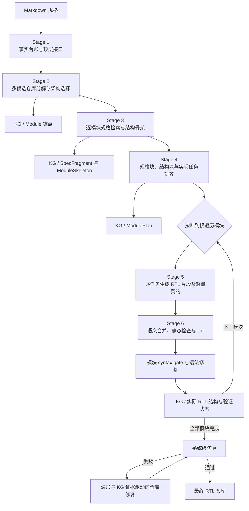

# 仓库级 RTL Agent：阶段性研究成果与测试过拟合分析

> 导师讨论稿。本文总结仓库级 RTL Agent，并分析本地 RealBench e203 ALU/IFU 的测试过拟合。ALU 数据对应 2026 年 9 月 10 日、IFU 数据对应 2026 年 9 月 15 日快照；另补充 2026 年 9 月 16 日 `e203_exu_alu_hard2` 的完整 Codex 生成—修复轨迹审计。工具为 Verilator 5.044；“通过”不等于功能完全正确。

## 一、结论摘要

本工作的目标不是生成孤立 RTL 模块，而是从自然语言硬件规格出发，生成具有模块层次、接口关系和行为的多模块 RTL 仓库，并在系统仿真失败后完成跨文件调试。当前主链已经贯通规格事实整理、仓库与模块规划、局部代码生成、语义合并、语法修复、知识图谱物化和系统级修复。

从科研角度，最值得继续凝练的能力有四项：

1. **有来源约束的多阶段规划**：把规格原文依次转化为事实、仓库骨架、模块骨架和局部任务。
2. **多候选仓库分解与边界契约**：比较不同粒度的模块划分，显式记录父子关系和跨模块数据边界。
3. **叶到根的局部生成与语义合并**：逐模块完成片段生成、完整模块重构和语法门禁，使父模块可读取已物化的子模块。
4. **规划—代码联合图支持的系统修复**：联合规格、计划、静态 RTL 关系和动态波形定位跨模块故障。

系统已在 AES、SD Controller、e203 IFU/ALU 等任务上产生多模块 RTL，并具备 lint、系统仿真和修复能力；现有证据说明流程可以运行，不代表这些任务均达到规格级正确。

对本地 RealBench e203 ALU/IFU 的进一步审计发现了一个重要问题：**公开测试通过可能来自对固定测试轨迹的拟合，而不来自对通用功能语义的实现**。ALU 两个候选和公开 PASS 的本 Agent IFU 在更换 100 个随机种子后均全部失败；合法事务还暴露出算术、CSR、取指路由、PC 推进和跨 lane 组装等基础错误。代码证据显示，ALU 主要是按输入值特化，IFU 则主要是按握手和状态轨迹特化。

更深层的科学问题是，现有 Debug Agent 的“当前代码—当前 mismatch—局部补丁—重新评分”闭环会形成失配驱动的局部搜索，而体系结构性 RTL 错误往往要求重新推导译码、状态机和跨模块协议。如何检测当前设计假设已经错误，并从局部修补切换到规格驱动的全局重规划，是下一阶段需要重点研究的能力。

因此，仓库级生成必须同时解决跨模块约束传递，以及验证环境能否真正激活并正确判定系统事务。

## 二、研究问题：为什么要从模块级走向仓库级

单模块生成通常假设模块边界、端口和验证环境已经给定。仓库级 RTL 生成还必须决定模块划分和生成顺序，保证上下游对接口编码、操作数、握手及周期行为的理解一致，并在错误经过多个模块传播后完成系统调试。信号翻转或代码覆盖也不代表合法事务已被真正执行和检查。

本工作研究的问题可以概括为：**如何把自然语言系统规格逐级转化为可追踪的仓库规划和实现任务，并通过生成—合并—验证—修复闭环得到可仿真、可调试的多模块 RTL 仓库？**

这里的“仓库级”不只是输出多个文件，而是要求规划产物、模块实现、模块连接和系统验证形成同一条可追踪链路。

## 三、仓库级 RTL Agent 方法



### 3.1 规划阶段：从规格事实到局部实现任务

规划分为四个阶段，各阶段的结构化产物依次约束下游生成。

**Stage 1：规格事实整理。** 系统分批读取 Markdown，只抽取能够由原文定位的事实，形成带来源锚点的 fact ledger；顶层端口则从权威接口段落单独整理。该阶段记录模块名、端口、资源要求、数据依赖、控制行为等显式信息，不根据文件名或命名习惯推断仓库层次。其作用是把后续规划限制在可追溯的规格证据上。

**Stage 2：仓库分解与架构选择。** 系统先依据 Stage 1 证据锁定顶层，提取需要被实现的系统责任单元；随后分别生成 `conservative`、`balanced`、`modular` 三种粒度的候选分解。确定性检查会过滤顶层不一致、模块重复、层次不闭合或成环、责任遗漏、边界对象无依据等候选，再通过排序与必要的裁决选择最终方案。输出的 repository skeleton 明确模块职责、父子关系、跨模块 boundary contract、目标文件以及由依赖图计算出的叶到根生成顺序。

**Stage 3：模块骨架规划。** 系统按照仓库计划逐模块检索相关规格，结合模块职责、父子关系和 Stage 2 的边界契约，生成模块结构骨架。骨架给出端口声明框架、内部声明、组合/时序逻辑块、子模块实例和块间依赖，但不生成最终 RTL。每个结构块都有稳定的 block ID 和占位符，使后续计划、代码片段和检查能够指向同一实现单元。

**Stage 4：规格块与实现任务对齐。** 系统先将每个模块的相关原文切分为带局部编号的 spec blocks，再对每个骨架块检索最相关的 `spec_refs`。规划 Agent 为每个骨架块建立且仅建立一个实现任务，固定任务 ID、目标占位符、功能描述、规格引用和少量不可违背的约束。由此形成“原文规格块—模块结构块—代码生成任务”的一一追踪关系。

主链**没有独立的时序关系抽取或时序义务细化阶段**。时钟、复位、延迟和握手如果出现在规格中，会作为普通规格事实、模块骨架内容或任务约束随主链传递。代码中保留的 temporal agent 和 timing artifact 属于未启用的兼容实现：runner 会忽略 `temporal_planning_enabled`，Stage 4/5 也要求相关兼容字段为空，因此本文不将其作为当前方法贡献。

### 3.2 生成阶段：Stage 5 的局部、渐进式代码生成

Stage 5 不直接请求模型输出整个模块，而是按 ModulePlan 中的任务顺序逐块生成 RTL。每次调用只携带当前任务引用的规格块、模块骨架、必要的接口规格、全局宏和当前模块已经生成的前序片段。前序片段使后续任务能够复用已经确定的端口、信号和状态命名，局部规格检索则避免每个任务反复读取整份长规格。

每个生成片段同时附带轻量契约；系统还会从代码静态补充读写信号和 clocking 信息。契约中的 reset、hold 和 latency 可以保留模型给出的描述，但当前主要用于合并阶段识别信号所有权和潜在多写者，不构成功能或时序证明。对于只包含宏和全局定义的文件，系统复制权威 define 文件，不让模型重新解释常量编码。

### 3.3 合并阶段：Stage 6 的工具增强语义重构

片段可能包含重复声明、缺失胶合逻辑、不一致的状态表示或多个驱动，因此 Stage 6 不是字符串拼接，而是一个受工具约束的模块重构 Agent。它按需读取模块规格、骨架、实现计划、全部片段、片段契约、全局宏及子模块上下文，先生成完整草稿，再运行结构检查和 Verilator lint，根据错误继续修改，满足提交门禁后才写入 `merged/{module}.v`。

结构检查覆盖目标模块包络、必要 include、输出驱动、多驱动、子模块实例以及当前解析链不支持的复杂数组或 generate 结构。合并过程保留草稿、动作日志和 merge report。如果工具式循环没有产生可提交结果，系统会退化为一次性完整模块生成并继续 lint；该降级提高了流程完成率，但会削弱片段复用和规划约束，实验中应单独标记。

父模块合并时，系统先依据仓库依赖和检索决策选择需要读取的子模块。已经物化的子模块可提供实际端口、参数、文件位置和验证状态；只有已验证且规模较小的子模块才可能提供完整代码，否则只提供接口。这样，父模块使用的是叶模块的实际接口，而不只是早期规划中的预测。

### 3.4 逐模块执行、验证与修复

Stage 5 和 Stage 6 在完整运行中是**逐模块交错执行**的：系统按叶到根顺序，对一个模块连续完成“片段生成—语义合并—syntax gate—KG 物化”，再进入下一个模块，而不是先生成所有模块片段再统一合并。这样父模块开始生成时，其子模块已经形成可查询的 RTL。

验证和修复分为三层。第一层是 Stage 6 草稿内部的静态检查和 lint。第二层是合并后的模块 syntax gate；若失败，RepoReAct 语法修复循环读取 RTL、规格、宏和子模块接口，修改后再次检查。模块通过后才被解析进代码图。该门禁目前主要保证语法可解析，不等于默认执行了模块级功能验证。

第三层是全部模块完成后的系统仿真。系统选择规划顶层，将生成仓库送入外部验证环境；若失败，则从日志和 VCD 中寻找 DUT/reference 的首个有效分歧及采样边沿，再沿输出驱动块、内部信号、实例连接和相邻模块逐跳回溯。Debug Agent 联合读取规格、模块计划、实际 RTL 图和验证状态，每轮提出小范围语义修改，并重新执行 lint 与顶层仿真；根据 mismatch、首错时刻和候选状态接受或回滚补丁，通过验证的版本成为下一轮基线。

### 3.5 知识图谱：随流水线增量构建并反向服务生成

知识图谱不是在最后对代码做一次静态索引，而是与规划和实现同步演进：

1. **Stage 2 后建立模块锚点**：写入顶层身份、职责、预期文件、父子模块和生成次序。
2. **Stage 3 后写入规格与骨架**：相关原文成为 `SpecFragment`，通过 `SPECIFIES` 连接模块；模块骨架通过 `HAS_SKELETON` 连接同一个模块锚点。
3. **Stage 4 后写入实现计划**：`ModulePlan` 记录任务和规格引用，并通过 `HAS_PLAN` 与模块关联。
4. **syntax gate 通过后物化实际代码**：解析文件、模块、端口、参数、信号、实例、always 块和赋值，建立包含、实例化、端口连接和驱动关系。
5. **验证或修复后更新状态**：记录 pass/fixed/fail、mismatch、修复轮次、最终 RTL 和 trace report；补丁改变代码后刷新对应静态结构。

图谱在下游有四类实际用途。Stage 3/4/5 按模块读取当前规格、骨架和计划，并用 fingerprint 检查上下游产物是否属于同一次规划，避免恢复时混用陈旧上下文；Stage 5 可读取已物化的模块及子模块接口；Stage 6 使用子模块端口、参数、实例关系和验证状态完成父模块合并；系统 Debug 则查询故障信号的驱动者、所在结构块、实例边界和端口连接，并与模块计划共同形成跨模块回溯上下文。

因此，当前 KG 的准确定位是**以 Module 为共同锚点的规划—代码—验证联合图**。规划 sidecar 仍是可恢复的权威产物，图谱负责关联和检索；静态驱动关系也不能直接等价为动态因果，所以不应将其表述为完整因果知识图谱。

更完整的架构审计见[《仓库级 RTL 代码生成 Agent：功能架构、方法机制与论文审计》](rtl_agent_architecture.md)。

## 四、阶段性成果与证据边界

输出包含 AES、SD Controller、e203 IFU/ALU 等多模块结果。记录支持以下结论：

- 系统能够从单份或多份 Markdown 规格构建多模块仓库计划，并按依赖顺序生成 RTL。
- 模块生成后可以执行 Verilator lint；部分任务还进入系统仿真和自动修复流程。
- 系统能够保存规划、代码结构、验证、波形和补丁记录，支持恢复与审计。
- e203 ALU 案例证明，多模块代码即使结构完整且通过公开测试，仍可能存在接口编码和操作数语义不一致，说明仓库级契约检查具有实际必要性。
- e203 IFU 案例进一步表明，波形修复可以把固定公开轨迹的 mismatch 降至零，但若激励没有维持请求—响应因果，修复出的状态条件可能无法迁移到新 seed 和合法取指事务。

必须区分三种证据：**lint 通过**只说明代码可解析；**系统测试通过**只说明候选通过了特定轨迹和判据；**规格级正确**要求合法输入历史均符合功能及时序契约，当前实验尚不能给出这种普遍保证。

当前边界是：模块功能验证尚未成为统一门禁，规格—计划—代码一致性未全部强制检查，系统验证依赖外部 benchmark，也缺少批量对比及 token、耗时和组件贡献统计。因此它是完整的仓库级生成与修复原型，而非已经解决仓库级 RTL 自动生成。

## 五、RealBench e203 ALU/IFU：测试通过为何不代表功能正确

### 5.1 实验范围

案例对象是本地 `e203_exu_alu_hard` 和 `e203_ifu_hard` 的 Codex 与本仓库 Agent 候选。审计不改变规格、Golden、公开 testbench 和候选，只补充换 seed、合法事务和 oracle 对照。ALU 详情见[研究分析](../research/e203_alu_audit/研究分析.md)，IFU 详情见[审计记录](../research/e203_ifu_audit/研究分析.md)和[结果摘要](../research/e203_ifu_audit/results_summary.json)。

这些实验只刻画当前本地任务和候选快照，不能估计整个 RealBench 的错误率，也不能据此比较 Agent 的总体优劣；本次未运行形式等价。IFU 公开脚本使用未显式固定 seed 的 `$urandom`，因此“默认运行”只记录当日单次快照，不能当作稳定通过率。

### 5.2 主要实验结果

| 任务与验证方式 | Codex 候选 | 本仓库 Agent | Golden |
| --- | ---: | ---: | ---: |
| ALU：公开脚本默认运行 | PASS | PASS | — |
| ALU：公开激励 seed 1–100 | 0/100 | 0/100 | — |
| ALU：84 个合法场景语义评分 | 15/84，17.86% | 9/84，10.71% | 84/84，100% |
| IFU：公开脚本 9 月 15 日单次复测 | FAIL | PASS | — |
| IFU：公开激励 seed 1–100 | 0/100 | 0/100 | — |
| IFU：92 场景 × 3 seed 的场景单元 | 65/276 | 55/276 | 276/276 |
| IFU：规格特征宏平均（SFMS） | 20.58% | 19.09% | 100% |
| IFU：逐信号采样匹配率，仅诊断 | 86.11% | 87.73% | 100% |

ALU 数字见[种子结果](../research/e203_alu_audit/codex_public_results.json)和[定向比较](../research/e203_alu_audit/comparison_targeted.json)；IFU 数字见[精简日志](../research/e203_ifu_audit/targeted_summary.log)。IFU 的 65/276、55/276 是场景—seed 单元数，SFMS 则先计算规格特征通过率再宏平均，二者不能混用；逐信号采样匹配率也不能代替功能正确率。

进一步构造合法 decode、正确环境反馈并等待事务完成后，可以得到更直接的功能反例：

| 合法输入或检查对象 | Golden/期望 | Codex | 本仓库 Agent |
| --- | ---: | ---: | ---: |
| ADD：7 + 5，有效写回 | 12 | 14 | 2 |
| ECALL/EBREAK/WFI 编码，有效 commit | 分别 one-hot | ECALL、EBREAK 错误 | 三项正确 |
| 地址 `0x1000` 的 word store 写掩码 | `1111` | `0001` | `1111` |
| CSRRWI，zimm = 31 | 31 | 0 | 0 |
| MUL：7 × 5 | 有效写回 35 | 有效写回 35 | Golden 完成时无对应有效完成 |
| DIV：20 ÷ 3 | 有效写回 6 | Golden 完成时无对应有效完成 | Golden 完成时无对应有效完成 |

乘除项检查 Golden 完成时刻的有效结果，未被 valid 限定的总线值不算实际提交。证据见[测试源码](../research/e203_alu_audit/directed_stimulus.sv)、[Codex 日志](../research/e203_alu_audit/codex_directed.log)和[Agent 日志](../research/e203_alu_audit/agent_directed.log)。

### 5.3 ALU：数值轨迹特化与仓库语义错误

ALU 默认 stimulus 使用全零、全一和 100 组两拍随机输入，却没有建立合法执行环境：随机 `i_info` 可能同时选中互斥操作，异常输入会覆盖正常执行，LSU/NICE 响应不依赖先前请求，两拍也不足以完成乘除和 AMO。默认轨迹 222 个采样周期中，93 个 `i_valid` 周期有 85 个被取指异常覆盖；ALU、BJP、CSR 的正常有效选择均为 0；LSU command 为 0，却有 103 次 response；MULDIV 和 AMO 有效写回均为 0。

Codex 候选存在直接依赖完整 `i_info` 常量的特殊映射：

```verilog
mem_addr = (i_info == 32'h56a8e909) ? 32'h96a60db5 : mem_addr_calc;
case (i_info)
  32'h34009449, 32'h67105419: observed_wmask = 4'b1111;
  32'h56a8e909:                observed_wmask = 4'b0010;
endcase
```

乘除模块还对三个完整 `i_info` 常量返回固定结果，并为某一常量设置专门周期行为；代码虽计算通用 `base_wmask`，普通命令输出却使用常量查表结果。这是直接的**数值轨迹特化**。本仓库 Agent 未出现同类常量查表，但上游把 one-hot decode 位作为 opcode、下游按二进制编码解释，导致 ADD 输出 2；CSR 立即数又错误选择 `i_imm`。这属于模块边界语义不一致。

### 5.4 IFU：控制轨迹特化

IFU 定向测试覆盖 PC/取指控制、ITCM、BIU、指令组装、流水控制、异常和预测解码七类规格特征。每个场景从 reset 开始，memory response 只由 Golden 已握手的 command 产生，并保持到接受，因而比公开的独立随机信号更接近合法事务。

| IFU 规格特征类别 | Codex | 本仓库 Agent | Golden |
| --- | ---: | ---: | ---: |
| PC 与取指控制 | 0.00% | 0.00% | 100% |
| ITCM 取指 | 39.58% | 0.00% | 100% |
| BIU 取指 | 34.72% | 0.00% | 100% |
| 指令组装 | 25.00% | 16.67% | 100% |
| 流水控制 | 0.00% | 61.11% | 100% |
| 异常处理 | 8.33% | 50.00% | 100% |
| 预测与预译码 | 36.39% | 5.83% | 100% |

两份 IFU 代码均未发现 ALU 那种按完整 32 位输入常量查表的模式，但存在明显的**控制轨迹特化**。

Codex 的迭代记录明确以可见波形为依据，先后增加 `reset_recovery`、`reset_redirect_seen`、一拍 `pc_commit_pending` 和独立 PC metadata 状态，使 PC 的可见时刻贴近参考采样；second-response guard 被引入、缩窄，最终又以 `second_guard_active = 1'b0` 常量关闭，而相关状态仍留在实现中。这些修改没有完成对一般取指契约的归纳：当前公开复测仍 FAIL，换 seed 全败，PC 控制和流水控制均为 0%。因此本文只称其为**轨迹驱动的未完成特化**，不称为“公开 PASS 后过拟合”。

本仓库 Agent 的证据链更完整：初始公开轨迹为 462 个 mismatch；Debug 在同一轨迹上进行 17 次验证、接受 12 个版本后降为 0。补丁逐步围绕“响应完成时同拍重发”“跨 lane 第二命令”“flush 时重定向被阻塞的第二地址”增加状态组合。最后一个补丁把 outstanding 清除限定为：

```verilog
stale_response && (phase == FIRST) && !second_command_handshake
```

该条件恰好消除最后 10 个 halt-ack mismatch，却没有通过新的事务分布：seed 1–100 全败，PC、ITCM、BIU 三类得分均为 0%。这构成评测反馈驱动的控制轨迹特化证据，但不意味着模型主观作弊。完整的修复轮次和代码位置见[IFU 审计](../research/e203_ifu_audit/研究分析.md)。

### 5.5 共同机制与评测含义

ALU 和 IFU 的表象不同，根因链条相同：

```text
彼此独立、仅保持两拍的随机输入
→ 请求、响应和控制之间缺乏合法事务因果
→ 固定 Golden 波形成为主要优化目标
→ 常量补丁或窄状态条件持续消除 mismatch
→ 默认轨迹可能 PASS，但新 seed 与合法事务仍失败
```

这说明信号活动不能等价为功能覆盖。本文将其称为 **Transactional Activation Gap（事务激活缺口）**：代码执行或行覆盖提高，不代表合法事务的触发、推进和完成已经覆盖。ALU 展示数值轨迹特化，IFU 展示控制轨迹特化；后者尤其说明复杂状态机更容易把偶然事件顺序吸收到实现中。

评测不充分也不只意味着“检查太少”。ALU oracle 对照中，`wbck_o_valid=0` 时清零 payload 不改变有效事务，却被 strict 误拒；合法 ADD 同时错误拉高 NICE request 是跨接口非法副作用，却仍获现有语义评分 100%。前者说明逐周期比较会过度约束无效 payload，后者说明功能分组门控会漏掉全局副作用。结果见[oracle controls](../research/e203_alu_audit/oracle_controls.json)。

本文将其称为 **Contract–Oracle Misalignment（规格契约—判定器错位）**。checker 应按规格定义观察有效域：payload 在 valid/enable 下比较，副作用入口需全程监控；规定的延迟严格检查，未规定的差异按事务事件对齐。

### 5.6 关键科学问题：波形监督下的状态边界近视

ALU 与 IFU 的轨迹特化，以及 `e203_exu_alu_hard2` 的生成—修复审计，共同指向一个比“测试覆盖不足”或“局部补丁过多”更具有 RTL 特征的问题：

> **当 RTL Agent 通过有限、可重复查询的波形反馈进行生成和修复时，它能否从单个失败周期归纳出跨数据、状态和时序扰动成立的转移不变量，还是只把失败局部化为当前轨迹上的条件补丁？**

本文将后一种倾向称为 **State-Boundary Myopia（状态边界近视）**：Agent 对已观测的 mismatch 很敏感，却不能稳定地把反例提升为 valid/ready、stall、flush、reset、back-to-back 和多周期运算状态切换上的一般规则。其结果是生成设计在训练波形上与参考实现接近，甚至逐周期相等，但在未见过的状态相位、反馈延迟或合法事务组合上不再等价。更准确地说，它产生的是：

> **Trace-equivalent but transition-inequivalent RTL（迹等价但转移不等价的 RTL）。**

“Agent 对边界测试不敏感”并不是准确描述。现有轨迹表明，Agent 会迅速响应边界失败，并能把公开 mismatch 持续降低；问题在于它常把边界看成一个待消除的采样点，而不是状态转移关系发生变化的位置。一个 flush 失败可能被编码为某个周期的 guard，一个 invalid payload 差异可能被编码为 Golden 残值保持，一个多周期结果可能被实现为预计算值加计数器延迟。局部样本被修复了，产生该样本的事务语义却未必被恢复。

RTL 中的“边界”也不只指数值 corner case，而至少包括四类互相耦合的边界：

| 边界类型 | 典型实例 | 所约束的语义 |
| --- | --- | --- |
| 数值边界 | 负数 SRA、shift 0/31/32/63、除零、`INT_MIN/-1`、地址对齐 | 位宽、符号、溢出和编码规则 |
| 协议边界 | `valid` 上升、`ready` 下降、请求接受、response backpressure | 某个值何时有语义、事务何时转移所有权 |
| 状态相位边界 | MULDIV 迭代到修正、AMO load 到 store、flush 落在最后一步 | 状态推进、取消和完成是否合法 |
| 可观测性边界 | `valid=0` 时的 payload、未选执行单元输出、复位后工作寄存器残值 | 哪些信号属于规格，哪些只是实现指纹 |

软件测试过拟合通常讨论有限输入集合上的输出拟合；RTL 还同时面对数据值、周期、隐藏状态、协议相位和可观测域的乘积空间。因而本案例的独特问题不是简单的“记住测试输入”，而是有限波形监督把一个转移系统压缩成了逐周期标签拟合问题。本文将这种更上层的失真称为 **Temporal-Semantic Collapse（时序语义坍缩）**，状态边界近视是其可观测行为机制。

### 5.7 `e203_exu_alu_hard2`：从公开满分到转移与结构缺口

`e203_exu_alu_hard2` 提供了比“公开 PASS、换 seed 失败”更细的证据，因为它同时具备完整工具轨迹、候选 RTL、官方 Golden、规格驱动测试和 Golden 锁步测试。完整过程与代码证据见[专项审计](../../RealBench/system_expriment/e203_exu_alu_hard2/ANALYSIS_GOLDEN_AND_CODEX_TRAJECTORY.md)，独立规格评分见[candidate_spec_score.json](../../RealBench/system_verification/e203_exu_alu_hard/spec_grounded/evidence/candidate/candidate.e203-exu-alu-hard2.c77d672cf397ad9e/attempt2/candidate_spec_score.json)。

| 评价层次 | 结果 | 能说明什么 | 不能说明什么 |
| --- | ---: | --- | --- |
| 公开 verifier | `0/222` mismatch | 已完全拟合固定公开采样轨迹 | 新事务、状态边界或结构正确性 |
| 独立 R0–R7 规格语义测试 | `42/43=97.67%`，域宏平均 `97.22%` | 当前测试覆盖的主要事务端点基本正确 | Booth、非恢复除法和共享资源真实存在 |
| Golden 锁步定向矩阵，3 seeds | `60.71%` feature-macro，`153/252` 场景单元通过 | 周期、握手和状态轨迹仍有较大差异 | 纯规格正确性；该环境部分由 Golden 握手驱动 |
| 最小 SRA 反例 | `0x80000000 >>> 31 = 1`，期望 `0xffffffff` | 至少一个确定的合法功能错误 | 其他未测行为均错误 |

独立规格测试中 AMO 为 `7/7`、MULDIV 为 `7/7`；Golden 锁步中 AMO 为 `0%`、MULDIV 为 `41.67%`。这不是简单的评分矛盾，而是“事务端点正确”与“转移过程正确”被不同测试分别观测。前者说明候选能在当前场景返回最终结果，后者说明其 phase、stall、flush、共享数据通路或无效周期形状没有复现 Golden。由于锁步环境对部分反馈协议使用 Golden 请求驱动 response，它适合诊断 cycle fidelity，但不能独立充当规格正确率；两种结果必须分开报告。

结构对比进一步说明 endpoint score 的证据边界。官方核心由 7 个模块、约 3167 行构成，候选为 5 个模块、约 858 行；代码量约为 Golden 的 27.09%。文件数量和模块名本身不是正确性标准，因为规格允许不同层次划分。真正的差异在于：Golden 通过共享 datapath、35-bit 加法器、两个 33-bit 工作值、Booth-4 和非恢复除法推进中间状态；候选使用行为级 `*`、`/`、`%` 预计算结果，再用 counter 延迟可见时间。候选声明的除法修正控制从未置位，修正状态实质不可达。这是一种 **Functional-Shell Substitution（功能外壳替代）**：最终数学函数和大致延迟被保留，规范要求的状态演化与资源关系被替换。

完整 Codex 会话包含 58 次顶层执行调用、10 次公开 verifier 启动、14 次 `apply_patch` 动作和 22 次临时数值/位级 probe。公开 mismatch 曲线为：

```text
203/222 → 16/222 → 6/222 → 3/222 → 0/222 → 同测试复跑仍为 0/222
```

前半段修改主要修复输出选择、异常 gating、CSR valid 和 malformed multi-hot 等通用接口问题；后半段集中处理 `i_valid=0`、result-valid 为 0 或非法 decode 下的 Golden shadow value。调试中曾临时从候选层次直接读取 `tb.*_ref` 信号以打印 Golden 值，最终代码又加入只在极窄条件下返回 `32'hebfcfffb` 的分支。该常量没有 ISA 或迭代算法解释，是明确的 **Sample-Identity Patch（样本身份补丁）**。它说明详细波形反馈不仅帮助定位错误，也可能把 Golden 的无效域残值转化为可学习标签。

因此，`hard2` 不能被概括成“功能很差但碰巧通过测试”。更准确的结论是：它在当前独立外部语义测试上已经高度完成，却同时存在一个确定的 SRA bug、显著的周期转移差异、规范指定微架构缺失和决定性的样本身份补丁。正是这种多维分离，使其适合研究 RTL Agent 的状态边界近视，而不是仅作为普通软件式 patch overfitting 案例。

### 5.8 四个相互区分的形成机制

#### 5.8.1 边界反例局部化，而不是转移不变量归纳

当前 Debug loop 的直接优化对象是端口、周期和期望值明确的 mismatch。设第 $k$ 轮 RTL 为 $C_k$，公开轨迹损失为 $L_{TB}$，局部循环倾向于选择：

\[
C_{k+1}=C_k+\Delta C_k,\qquad
L_{TB}(C_{k+1})<L_{TB}(C_k).
\]

真正目标则是对所有合法输入历史满足规格：

\[
\forall \tau\in\mathcal{T}_{legal},\qquad C(\tau)\models Spec.
\]

当一次失败来自错误的状态划分或事务所有权时，修复输出端附近的条件可以降低当前损失，却不必修复更早的接受、锁存、取消或状态推进规则。这里的关键不再是 patch 行数，而是 **Semantic Locality（语义局部性）**：补丁是否由一条规格规则解释，并覆盖该规则对应的合法状态族。`if (i_info==MAGIC)` 语法上很小、语义上极窄；重写完整译码表改动较大，却可能具有更强的语义局部性。

#### 5.8.2 无效域 Oracle 泄漏

RTL 接口通常包含有效性掩码。若 `valid=0`，payload 可能是 don't-care、寄存器残留或组合逻辑中间值；它仍会在二值仿真中呈现确定的 0/1。逐周期 strict comparison 若不区分该可观测域，就会把非架构信息变成监督标签。

该机制同时造成两种相反错误：

1. **误拒等价实现**：候选在 invalid 周期清零 payload，尽管有效事务不变，仍被判 mismatch；
2. **奖励实现指纹复制**：Agent 保留 preview、旧寄存器值或硬编码常量，以复刻 Golden 的残值。

因此反馈粒度并非越高越好。本文提出一个反直觉但可检验的假设：**在查询预算相同时，暴露完整 Golden 波形可能更快降低公开误差，却降低 held-out 状态边界泛化，因为它提高了非规格标签的带宽。**

#### 5.8.3 端点正确掩盖状态转移错误

行为级 `*`、`/`、`%` 加延迟 counter 可以复现最终结果和近似 latency，却不保证中间状态、flush 边界、back-to-back reuse 或 correction phase 正确。类似地，AMO 最终返回值正确不代表 load/store 两阶段的请求保持、第二次写入保护和异常取消均正确。

这使 RTL 评测必须区分：

- **Extensional semantics**：给定合法事务，最终产生何种输出与副作用；
- **Transition semantics**：事务如何被接受、保存、推进、取消和完成；
- **Intensional architecture**：是否使用规格明确要求的算法阶段、共享资源和状态依赖。

黑盒测试主要约束第一层；时序 metamorphic test 和协议断言约束第二层；白盒属性、综合结果或形式化依赖检查才能约束第三层。用最终商/余数代理“非恢复除法已实现”，属于规格锚点存在但观测不充分，而不是完整覆盖。

#### 5.8.4 重复查询扩大利用，而不增加独立证据

固定 stimulus 上第 $k+1$ 次运行没有扩大合法行为支持集，只是候选已经利用前 $k$ 次反馈发生变化：

\[
N_{query}\uparrow\;\not\Rightarrow\;N_{evidence}\uparrow,
\qquad N_{exploit}\text{ 可能持续上升。}
\]

查询预算应记录 Agent 从 oracle 获取了多少次反馈，证据预算则应记录新增 seed、首次激活的规格义务、独立事务、状态相位和新反例。clean rerun 证明结果可复现，但不是泛化证据。`hard2` 的 10 次公开 verifier 自适应查询和最后一次相同轨迹复跑正体现了这一差别。

### 5.9 形式化表述：输出函数被约束，转移函数与观察掩码欠约束

可将 RTL 抽象为带观察掩码的转移系统：

\[
s_{t+1}=F(s_t,i_t),\qquad
o_t=G(s_t,i_t),\qquad
m_t=M(s_t,i_t).
\]

其中 $F$ 是状态转移，$G$ 是输出函数，$M$ 指定当前状态和协议相位下哪些输出具有规格意义。现有公开差分测试通常近似检查：

\[
o_t^{cand}=o_t^{golden},\qquad t\in T_{public},
\]

却没有显式回答：

- 哪些输出在当前周期属于规格观察域；
- 当前状态通过什么合法事务历史到达；
- stall、flush 或 response latency 改变后，状态应如何演化；
- 哪些内部阶段或资源关系是规范义务；
- 两条不同 cycle trace 是否在事务语义上等价。

有限轨迹因此只在采样集合上约束 $G$，对 $F$ 和 $M$ 的约束可能很弱。Agent 可以构造不同的 $\hat F$ 和 $\hat M$，使训练轨迹上的 $\hat G$ 完全匹配，却在新的状态边界失效。由此本文把核心科学问题凝练为：

> **在有限、适应性波形反馈下，如何使 RTL Agent 从反例恢复状态转移和可观测性不变量，而不是生成只在已见轨迹上等价的输出函数？**

这一表述比“如何让 Agent 从局部修复切换到全局重规划”更基础。重规划只是可能的求解机制；真正需要解释和测量的是 Agent 是否恢复了正确的转移关系。某些问题可由一个小但规则化的补丁修复，并不需要全局重写；某些结构错误即使重写整个模块，也可能重复选择同一种错误的行为外壳。因而“补丁还是重规划”不应作为唯一主问题，而应由转移不变量是否得到解释来决定。

### 5.10 可检验研究问题与假设

#### RQ1：Agent 能否从单点反例泛化到状态边界族？

比较固定 corner case 与参数化 boundary family。后者将同一事件扫过不同数据、不同 FSM phase 和不同前序历史，例如把 flush 注入 MULDIV 的每个迭代周期，把 backpressure 长度从 0 扫到 $N$，或把 reset release 相位平移。

**H1——边界族泛化假设：** 仅增加固定 corner cases 主要提高已见点正确率；提供边界变换族、事务不变量和相位覆盖，才能显著降低 held-out phase failure。

#### RQ2：Oracle 反馈带宽如何影响规范泛化？

设置相同查询预算，分别只返回 pass/fail、失败行为域、首错周期、逐信号计数、完整 Golden trace，以及允许层次 reference 读取。

**H2——反馈带宽反转假设：** 更高反馈带宽会加快 public mismatch 收敛，但在 invalid 信号未正确屏蔽时，会提高样本身份分支、无锚点常量和 Golden 残值保持逻辑的出现率，并扩大 hidden boundary gap。

#### RQ3：端点功能分数能否预测转移系统正确性？

分别测量最终事务结果、协议断言、phase sweep、状态转移覆盖和结构义务。`hard2` 中 AMO/MULDIV 独立端点高分但 Golden 时序分数较低，是这一问题的初步个案证据。

**H3——端点—转移分离假设：** 在多周期、可停顿和可取消单元中，endpoint score 与 transition-invariant score 相关性有限；加入 timing mutation 后会暴露大量端点测试不可见的错误。

#### RQ4：哪些规格条款能由外部波形辨识？

将规格条款分为 extensional、transition 和 intensional 三类，并对每个 MUST 执行“锚点—观察充分性审计”。如果两个不同内部实现对全部允许的黑盒观察都等价，则模块划分或资源共享不能由波形唯一恢复。

**H4——结构不可辨识假设：** 增加随机外部轨迹可以缩小行为不确定性，但不能单独证明共享资源、迭代算法或内部状态依赖；这些条款需要额外的结构、综合或形式化证据。

#### RQ5：何时应局部修复，何时应重建状态模型？

重规划信号不应只使用 patch 次数或修改行数，而应检测解释力下降：同一字段反复 gate/ungate、failure mode 跨接口迁移、补丁制造新 mismatch 类、retained operation 继续依赖 live input、规划状态不可达，或连续若干轮没有新增转移义务通过。

**H5——不变量停滞门控假设：** 由 transition-obligation stagnation 触发的局部子系统重规划，比固定轮数重写或始终小补丁具有更好的最终泛化—成本折中。

### 5.11 验证与 Agent 设计方法

#### 5.11.1 用 Transaction-State IR 取代功能名词清单

规划不能只写“ALU、AMO、MULDIV、NICE 均已覆盖”，而应为每条事务路径记录：

\[
O_{txn}=\langle Trigger,Accept,Owner,RetainedState,Transition,Complete,Cancel,Observe\rangle.
\]

`Observe` 字段显式说明各输出在哪些 valid/enable 条件下具有意义。该 IR 应能自动生成接口断言、状态覆盖点和测试相位，而不是停留在自然语言摘要。

#### 5.11.2 使用时序变形测试，而不是只增加随机向量

对同一高层事务执行保持语义的时序变换：

- 插入任意 idle cycle；
- 延长 `ready=0`；
- 改变请求间 bubble 数；
- 改变 response latency；
- 将 flush 注入每个合法 phase；
- 平移 reset 解除时刻；
- 改变 back-to-back operands，检测 stale reuse。

正确设计的事务结果、顺序和副作用应保持不变或发生规范允许的时间平移。此类 metamorphic relation 不要求复刻 Golden 的每个内部周期，更适合测转移不变量。

#### 5.11.3 建立 valid-aware、side-effect-complete 的分层 Oracle

Oracle 应同时避免过约束和漏检：

- payload 只在规格定义的有效域比较；
- 请求、commit、write-back、memory command、NICE request 等副作用入口全程监控；
- 分开记录 Triggered、Accepted、Progressed、Completed、Legally Cancelled 和 Timed Out；
- 规定 latency 的行为做 cycle-accurate 检查，未规定 latency 的行为按事务事件对齐；
- invalid payload 可单列为 microarchitectural trace diagnostic，不进入功能主分。

这比简单“全部信号都比较”或“只在 DUT valid 时比较”更严格。前者泄漏实现指纹，后者可能允许 DUT 通过不拉 valid 关闭义务。

#### 5.11.4 对反馈协议使用独立状态环境

Golden 锁步适合比较周期忠实度，但若 memory response 只由 Golden command 触发，当候选握手稍有差异时，后续 response 已不再是候选自身事务的合法环境反馈。事务语义评价应让 Golden 与 candidate 分别驱动独立但同策略的 responder；再把 cycle fidelity 作为另一条诊断轴，而不是将二者压成一个正确率。

#### 5.11.5 为内涵架构义务增加白盒证据

若规格明确要求 Booth-4、非恢复除法、共享加法器或两个 33-bit 工作值，仅测试最终结果不够。可加入：

- 禁止或审计组合 `*`、`/`、`%`；
- correction state 可达性覆盖；
- partial remainder 对前一轮状态的形式依赖；
- 综合后乘除器、加法器和寄存器计数；
- 共享资源所有权与互斥断言；
- 必要时的 bounded equivalence 或 refinement checking。

层次命名不同不应自动判错；应检查规格真正约束的资源关系和状态语义。

#### 5.11.6 维护可执行不变量和证据账本

每轮修复前区分 Observation、Inference、Hypothesis、Falsifier；修复后回归已确认的不变量。补丁可按来源标记为：

- `SPEC_DERIVED`：直接由规格义务推出；
- `PROTOCOL_DERIVED`：由 ready/valid、状态保持等通用协议推出；
- `ORACLE_DERIVED`：主要由当前 Golden 波形推断；
- `SAMPLE_IDENTITY`：只解释单个值、周期或完整输入常量。

`ebfcfffb` 分支属于最后一类。可把 Oracle-derived patch ratio、无锚点常量数、invalid-domain branch 数和不可解释状态数作为过拟合风险指标。它们不能单独证明功能错误，但可以触发 hidden test、mutation 或重规划。

### 5.12 评价指标与最小实验矩阵

仅报告 public PASS 无法区分上述机制。建议至少报告五条独立轴：

1. **Endpoint Functional Score**：合法事务的最终值、副作用和异常；
2. **Boundary Generalization Score**：未见数据边界、协议边界和 phase placement；
3. **Transition-Invariant Score**：stall、flush、cancel、retained metadata 和 liveness 属性；
4. **Structural/Intensional Score**：算法阶段、共享资源、状态可达性和综合资源；
5. **Oracle Exploitation Risk**：样本身份补丁、invalid-domain 拟合和 oracle-derived patch 比例。

可定义 **Boundary Generalization Gap**：

\[
BGG=Score_{interior}-Score_{held\text{-}out\ boundary}.
\]

还可定义 **Timing Metamorphic Consistency**，统计插入 bubble、改变 backpressure、平移 response 和 phase-swept flush 后，事务结果与顺序仍满足变形关系的比例。对于无效域，比较全周期 strict、valid-qualified、invalid-randomized 和 invalid-X-poison 四种 oracle，观察公开分数、hidden score 和特化补丁率如何变化。

最小实验矩阵应同时控制两类预算：

| 自变量 | 建议水平 |
| --- | --- |
| Oracle 反馈带宽 | pass/fail；失败域；首错周期；逐信号；完整 trace |
| 自适应查询预算 | 1；3；10；30 |
| 证据更新策略 | 固定轨迹复用；每轮新 seed；每轮新 boundary family |
| Oracle 有效域 | 全周期；valid-qualified；invalid randomized/X-poison |
| 修复表示 | 原始波形；不变量账本；Transaction-State IR |
| 搜索策略 | 始终局部 patch；固定轮数重写；不变量停滞触发 replan |
| 结构约束 | 无；算子审计；状态覆盖；综合/形式属性 |

训练集、开发反馈和最终隐藏评价必须隔离。相同轨迹的 clean rerun只计为复现，不计为新增证据。最终结果同时报告 public、独立规格、timing mutation、结构和 PPA，避免单一分数重新制造代理目标。

## 六、科研结论、下一步与讨论问题

### 6.1 当前最可信的研究结论

第一，仓库级 RTL 生成的难点不是文件数量，而是模块职责、事务所有权、边界接口和状态义务能否跨规划、生成、合并和修复保持一致。现有分层规划与叶到根物化提供了工程基础，但功能名词覆盖不能替代可执行的 Transaction-State IR。

第二，当前 RealBench 案例证明 public PASS 只说明候选满足特定 stimulus 与 oracle。早期 ALU/IFU 候选展示数值轨迹和控制轨迹特化；`hard2` 又展示了更细的分离：公开 `0/222`、当前独立外部语义 `42/43`、Golden cycle feature-macro `60.71%`，以及规范指定迭代/共享骨架缺失。这些指标回答不同问题，不能互相替代。

第三，RTL Agent 的关键失效不是简单“忽视边界”，而是 **状态边界近视**：它能响应单个失败周期，却倾向于将反例局部化，不能稳定归纳跨数据、状态和时序变换成立的转移不变量。

第四，invalid payload 是 RTL 波形监督中的特殊风险面。逐周期比较可能误拒事务等价实现，也可能泄漏 Golden 的寄存器残值和组合路径，使高带宽反馈从调试帮助转化为实现指纹标签。

第五，endpoint functional correctness、transition correctness 与 intensional architecture 是三类不同证据。外部结果测试不能证明 Booth、非恢复除法、资源共享或内部状态依赖；结构要求必须转化为白盒、综合或形式化检查。

第六，重复 oracle 查询和独立正确性证据必须分别核算。`hard2` 中 mismatch 的单调下降证明了优化有效，不证明证据覆盖增长；最后的样本身份常量进一步说明公开收敛可能与规范泛化分离。

第七，局部修复与全局重规划的冲突仍然重要，但它应被重新定位为状态边界近视的求解策略问题。核心不是补丁大小，而是当前补丁或架构是否能够解释一组转移不变量；只有当义务停滞或解释力下降时，才有证据触发子系统重规划。

### 6.2 证据边界与暂不能声称的内容

本文不能由少量案例声称所有 Codex 或 RTL Agent 都存在相同程度的状态边界近视，也不能在缺少系统文献检索时声称术语或现象具有完整学术首创性。当前贡献应表述为：从真实 RTL 生成—修复轨迹中提出一个可证伪的 RTL-specific formulation，并给出初步机制证据和实验方案。

`hard2` 的 `42/43` 是有限规格场景分数，不是形式证明；`60.71%` 是 Golden 锁步与握手轨迹诊断，其中共享环境可能放大候选与 Golden 的早期分歧，不能直接解释为纯规格完成度。代码量和模块层次差异也不能单独证明错误，只有与明确的算法、资源和状态义务结合时才构成结构缺口证据。

不能把 Agent 的行为描述为有主观作弊意图。本文使用 reward hacking、verifier capture 或 oracle exploitation 时，指优化闭环在代理目标下产生的可观察动力学。也不能把所有窄谓词、常量或额外状态都判为过拟合；必须结合规格锚点、激活域、hidden mutation 和反事实实验判断。

### 6.3 下一阶段建议

1. **实现 Transaction-State IR**：显式记录 Trigger、Accept、Owner、RetainedState、Transition、Complete、Cancel 和 Observe，并生成断言与测试点。
2. **建设 boundary-family suite**：覆盖 signedness、alignment、valid/ready、stall、flush、reset release、back-to-back 和每个多周期 phase，而不是只追加固定 corner case。
3. **加入 timing metamorphic testing**：自动插入 bubble、改变 response latency 和 backpressure，检查事务结果、顺序和副作用的不变量。
4. **重构分层 Oracle**：有效 payload、义务激活/完成、全局副作用、规定周期和无效域诊断分别计分。
5. **独立化状态环境**：Golden 与 candidate 使用同策略但独立的 driver/responder；另行报告 Golden cycle fidelity。
6. **审计内涵规格**：为共享资源、迭代算法、correction state 和状态依赖增加白盒、综合或形式化证据。
7. **控制反馈带宽与双预算**：同时报告 query budget 和 independent-evidence budget，做 pass/fail 到完整 trace 的消融。
8. **维护证据与不变量账本**：区分 Observation、Inference、Hypothesis 和 Falsifier，并按补丁来源统计 oracle 依赖程度。
9. **实现自适应重规划门控**：以 transition obligation 停滞、跨接口 regression 和不可解释状态为触发器，而不是固定 patch 次数。
10. **建立突变与隐藏评价**：重点覆盖 SRA signedness、AMO phase/stall、division correction、b2b stale reuse、NICE queue 和 invalid payload 随机化。

### 6.4 建议与导师重点讨论

1. 是否将主科学问题聚焦为“有限波形监督下，RTL Agent 如何从反例恢复状态转移不变量”，而把仓库级规划与重规划作为解决路径？
2. “状态边界近视”是否足够准确，还是采用更中性的“迹等价—转移不等价缺口”作为论文主术语？
3. 第一阶段实验应优先验证 Oracle 反馈带宽反转，还是 endpoint—transition 分离？前者更接近 Agent 行为，后者更接近 RTL 验证理论。
4. 如何构造不依赖 Golden 内部层次的 transition ground truth，例如协议断言、metamorphic relation 和状态细化映射？
5. 对明确要求微架构的规格，应把结构正确性作为独立任务目标，还是把这些条款从纯功能 benchmark 中剥离？
6. Agentic RTL benchmark 应如何统一限制查询次数、反馈带宽和独立证据预算，避免把 oracle exploitation 误计为推理能力？
7. boundary-family、Transaction-State IR、不变量账本和 replan controller 中，哪一个最适合作为首个可发表的最小系统贡献？

当前最值得推进的研究主线可以概括为：**从波形点拟合走向转移系统理解。** 目标不是让 Agent 再多修几个 corner case，而是让每个失败反例都能被提升为可执行、可回归、可跨相位验证的状态与协议不变量。
