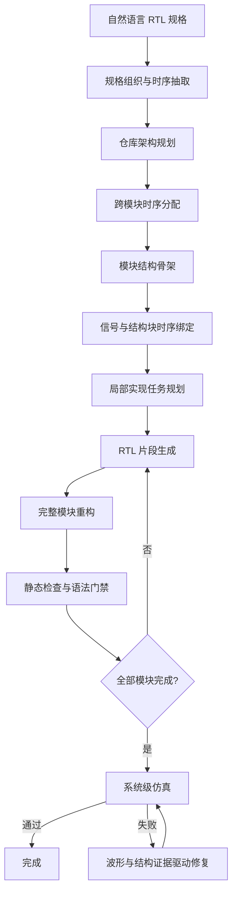

# 仓库级 RTL 代码生成 Agent：功能架构、方法机制与论文审计

> 本报告从系统功能、阶段协作和论文方法三个层面描述当前 RTL Agent。为突出整体设计，正文不展开源码文件、函数、类和变量名。

## 1. 审计范围与结论概览

### 1.1 系统目标

该系统处理的不是单模块代码补全，而是仓库级 RTL 生成：输入可能是一份统一系统规格，也可能是多份模块规格；输出包含若干相互实例化的 Verilog/SystemVerilog 模块。生成结果需要同时满足模块职责、端口连接、位宽、握手、复位、数据语义和周期关系，并在外部 testbench 下表现正确。若验证失败，系统还要利用日志、波形和结构依赖修改一个或多个 RTL 文件。

因此，系统的目标可以概括为：**将自然语言硬件规格逐步转化为仓库结构、模块结构、周期约束、局部实现任务和完整 RTL，再通过仿真反馈完成仓库级修复。**

### 1.2 整体架构

当前系统采用“固定规划流水线 + 局部自主 Agent”的混合架构。固定流水线负责规格组织、时序抽取、仓库规划、模块规划、代码生成顺序、产物保存和恢复；模块整合、语法修复和系统功能修复则采用 ReAct 式循环，Agent 可以主动读取证据、运行检查、修改代码并反复验证。

主流程依次完成：

1. 读取和组织规格，抽取全局时序事实；
2. 规划顶层、模块集合、层次和叶到根生成顺序；
3. 将跨模块时序要求分配到模块、信号和结构块；
4. 为每个模块建立结构骨架并拆成局部实现任务；
5. 逐任务生成 RTL 片段，再重构为完整模块；
6. 对模块做静态检查和语法门禁；
7. 对完整仓库做系统仿真；
8. 失败时从首个真实波形分歧开始进行跨模块修复。

### 1.3 核心结论

系统目前最成熟的能力有五项。第一，仓库、模块和实现任务构成逐层收窄的规划链。第二，自然语言中的事件、相位、延迟和跨模块周期关系会逐步绑定到模块、物理信号和局部代码块。第三，模块按叶到根顺序生成，使父模块能够看到已经物化的子模块接口。第四，完整模块不是机械拼接片段，而是由整合 Agent 结合规格、计划、子模块和静态检查进行重构。第五，系统级失败会被转化为 DUT 与参考设计的首个真实分歧，并沿驱动关系和端口边界逐跳追踪。

主要不足也很明确：规划约束尚未全部程序化强制；模块级主流程以语法门禁为主，功能验证主要集中于系统级；系统验证依赖外部 benchmark；时序和规划—代码一致性错误通常只告警；长期记忆能够写入但自动召回没有闭环；没有形式验证，也缺少成熟的批量实验、token 和耗时统计。

### 1.4 论文主线

最适合的论文主线是：**面向仓库级 RTL 生成的分层架构规划与周期约束细化，结合叶到根模块实现，以及由波形首分歧驱动的仓库级修复。**

这条主线包含三个相互支撑的贡献：从系统规格建立多模块仓库结构；将跨模块周期语义逐级细化到局部实现；用动态波形与静态结构证据修复生成错误。

## 2. 仓库结构与核心入口

### 2.1 功能边界

与 RTL 主流程直接相关的能力可以分为七类：

| 子系统 | 主要职责 |
| --- | --- |
| 任务入口 | 解析规格来源、运行模式、模型、恢复选项和外部服务 |
| 规格与规划 | 将 Markdown 规格转成仓库结构、模块骨架和实现任务 |
| 时序建模 | 抽取事件、阶段、延迟、逻辑值及跨模块周期义务 |
| 代码生成与整合 | 生成局部片段，再重构为完整模块 |
| 知识图谱 | 保存规划关系、模块层次和实际 RTL 静态结构 |
| 验证与 Debug | 执行 lint、仿真、波形分析、补丁验证和回滚 |
| 长期记忆 | 保存成功补丁、失败方向和规划修正经验 |

仓库中还有通用软件生成和评测组件，但它们不属于当前 RTL 主链。早期遗留的其他 RTL 入口也不再完整，当前推荐方式是直接运行仓库级 RTL Planner。

### 2.2 输入与输出

输入可以是单个 Markdown、包含多份 Markdown 的目录或一个项目名，并可附带模型配置、恢复开关、知识图谱配置、时序规划配置和外部验证环境。入口能够发现规格中的图片路径，但当前规划 Agent 没有真正消费这些图片，因此图示规格理解尚未形成有效能力。

输出包括仓库计划、时序约束、模块骨架、模块实现计划、局部片段、完整 RTL、模块语法结果、系统仿真结果，以及 Debug 产生的波形、首分歧报告、补丁历史和长期记忆。

### 2.3 恢复与任务隔离

每个任务拥有独立工作区。多个规划和生成阶段保存已完成模块、执行位置、输入内容指纹和模块级结果。恢复时不仅检查文件是否存在，还检查上游输入是否变化、结构是否合法、依赖文件是否完整，从而避免盲目复用陈旧结果。

## 3. 系统整体执行流程

### 3.1 顶层流程



### 3.2 分阶段设计的作用

一次性生成整个仓库时，模型很难同时维持全局模块关系和局部 always 块细节；各模块即使单独合理，也可能在连接、位宽或周期上不一致；失败后更难判断问题来自规格理解、模块划分、局部实现还是顶层集成。

分阶段设计为每个层次建立明确中间表示：仓库层描述模块和层次，时序层描述周期关系，模块层描述代码结构，任务层描述局部实现，代码层描述实际 RTL，验证层描述动态行为差异。这些产物既是下一阶段输入，也是恢复、审计和 Debug 的证据。

### 3.3 固定流程与自主 Agent

固定流程决定阶段顺序、模块顺序、恢复规则和验证时机；自主 Agent 则用于处理不适合一次性预测的任务，包括模块重构、lint 修复和系统功能修复。这种结构比完全自主 Agent 更可控，又比纯流水线更能应对复杂错误。

### 3.4 逐模块交错执行

系统不是先生成所有片段、再统一整合所有模块，而是对每个模块连续执行“片段生成—完整模块重构—语法门禁—结构更新”，然后进入下一个模块。由于顺序是叶到根，父模块整合时可以读取已经物化的子模块接口和代码。

## 4. 规格处理与结构化表示

### 4.1 规格组织

系统递归读取任务范围内的 Markdown，保存来源、名称和正文。统一系统规格会在后续为不同模块选择不同片段；多文件规格则会综合当前文件和同目录相关材料。

规格切分优先利用 Markdown 标题、子标题、编号章节和粗体编号段落，而不是简单固定长度切块。系统先形成带来源的章节块，再依据模块名、职责、父子关系和实例用途排序。模型选出的文本必须能在源规格中找到，否则结果会被拒绝，并退化为启发式选择。

### 4.2 模块规格块

模块相关原文会被进一步拆成较细的规格块，并赋予模块局部编号。这些块用于绑定模块结构块、限定代码生成上下文、形成可追踪的实现任务，并在 Debug 时重新定位需求。正常情况下，每个任务只携带相关规格；检索失败时则退化为使用当前模块的全部规格块，以召回率换取上下文成本。

### 4.3 全局时序事实

系统单独抽取主时钟、复位方式、关键事件、协议或算法阶段、事件先后关系、周期延迟、逻辑值序列、不变量、规格歧义和暂不支持的时序特性。这些内容组成与具体信号名相对解耦的逻辑时序模型，随后被仓库规划、模块划分和局部代码生成共同消费。

### 4.4 旧版完整契约的真实状态

系统中曾设计过更广泛的接口、参数、状态转移、控制信号、数据通路、寄存器和子模块契约，部分生成逻辑仍然存在。但当前主流程并不先生成一套完整契约；真正贯穿主链的是原始规格片段、仓库结构、模块骨架、时序事实与模块实现计划。

因此，当前系统不能被描述为“先建立完整形式化规格契约，再生成 RTL”，更准确的说法是“用结构化规划和时序中间表示逐步约束生成”。

### 4.5 覆盖性与冲突处理

当前系统能够验证来源文本、对象引用、模块层次、规格引用和结构块—任务对齐，但尚未实现规格条款全覆盖率、多文档冲突求解、同一信号跨章节语义冲突检测、图示与文本交叉验证，以及对未解决问题的强制阻断。

因此，它能够保证“选出的信息有来源、结构引用基本一致”，但不能保证“所有规格要求均被完整且无冲突地理解”。

## 5. 仓库级规划

### 5.1 仓库骨架

仓库规划回答五个问题：顶层是什么、需要哪些模块、每个模块负责什么、模块如何实例化、模块按什么顺序生成。结果包含顶层、模块列表、目标文件、模块角色和类型、父子关系、实例用途、共享模块、全局时钟复位、数据约定、跨模块对齐要求和未解决问题。

模块集合主要依据规格中的明确模块名、功能分区、数据通路边界、独立控制职责、重复使用功能、顶层实例化描述和文件结构建议产生。模型给出候选结构后，系统确定性检查顶层归属、模块唯一性、父子关系闭合、层次无环和生成顺序完整性。

### 5.2 叶到根生成

叶模块先于父模块生成。叶模块通过语法门禁后，实际接口和静态代码结构进入共享知识；父模块随后基于这些实际信息整合，而不是完全依赖先验计划猜测子模块。

叶到根顺序能够降低父子接口漂移，但当前叶模块在进入父模块前通常只保证语法可解析，不一定已经通过模块级功能仿真。

### 5.3 三层规划


仓库骨架约束模块之间的关系，模块骨架约束模块内部组织，实现计划约束局部生成。仓库计划还会直接影响规格检索、子模块上下文、系统顶层选择、知识图谱关系和 Debug 时的模块邻接。

### 5.4 时序规划与周期约束细化

RTL 正确性依赖数据在哪个边沿采样、状态何时更新、输出是组合还是寄存可见、子模块结果在当前还是下一周期使用，以及握手信号之间相隔多少周期。因此系统将时序建模独立为三层：

| 层级 | 表达内容 |
| --- | --- |
| 全局逻辑时序 | 事件、阶段、延迟、逻辑对象、值标签和不变量 |
| 架构时序分配 | 状态所有者、事件处理者、跨模块传输、可见与采样时刻 |
| 物理实现绑定 | 逻辑对象对应的信号、结构块以及局部读写时刻 |

完成绑定后，系统检查模块覆盖、生产者和消费者、逻辑对象与物理信号、义务与结构块、边沿后写入位置以及同边沿跨模块传输。相关义务会继续进入局部实现任务，使模型知道当前任务应在什么时刻读取、写入或组合输出数据。

该链路已经进入主流程，但严重错误通常只形成告警，最终 RTL 也没有逐条证明所有义务已实现。因此它提供的是显式建模和传播，而不是严格的时序正确性保证。

### 5.5 当前规划局限

仓库架构仍主要由一次模型推理决定，没有系统搜索多个候选，也没有把面积、接口复杂度、验证成本等作为优化目标。未解决问题不会自动触发重规划，端口级跨模块契约仍较弱，很多模块职责还是自然语言而非可执行约束。

## 6. 知识图谱设计与实际使用

### 6.1 图谱内容

系统将规划信息与实际代码结构组织到共享图中。规划侧保存模块、相关规格片段、模块骨架、实现计划、层次和预期文件；代码侧保存文件、模块、端口、参数、信号、实例、always 块、连续赋值、函数及其包含、实例化、连接和驱动关系。

规划和代码使用同一个模块身份，因此单个模块节点可以同时连接“规格要求、计划结构、实际 RTL 和验证状态”。Debug 可以从一个模块入口比较“计划是什么”和“代码实际是什么”。

### 6.2 更新时间与消费方式

仓库规划完成后创建模块锚点；模块规格、骨架和实现计划随后逐步关联；模块通过语法门禁后解析实际 RTL；验证完成后记录状态。模块整合使用图谱获取子模块接口、实例、端口连接和验证状态，Debug 使用它查找端口、实例、信号驱动、父子边界和模块规划语义。

### 6.3 能力边界

当前图谱更适合称为“模块锚点统一的规划—代码联合索引”，而不是完整因果知识图谱。规划侧尚未把每个端口、信号和结构块建成细粒度节点，规格条款与具体 RTL 赋值之间没有精确边，驱动关系主要来自静态语法，波形因果也不直接存储在图中。跨模块回溯仍依赖 Agent 逐跳查询。

## 7. 模块级代码生成

### 7.1 模块规格检索与骨架

为每个模块生成代码前，系统根据模块名、职责、父子模块、实例用途和时序义务选择相关规格。随后生成模块骨架，其中包括模块声明框架、预期端口和参数形式、内部声明、子模块实例化、时序逻辑、组合逻辑、辅助结构以及各块之间的依赖。

每个结构块不仅标明代码种类，还描述功能职责、涉及的状态和信号、必须出现的对象、允许出现的对象、后续检索重点，以及不能发生的行为偏移。模块骨架还保存控制风格、状态对象、已决定与暂缓的设计选择和潜在风险。

### 7.2 从结构块到实现任务

每个结构块对应一个局部实现任务。任务携带目标结构、功能描述、相关规格块、少量关键约束、时序义务和逻辑值标签。声明任务必须包含接口相关规格；若块级检索失败，则使用当前模块全部规格。

这种“一结构块一任务”设计将完整模块生成拆成边界明确的局部问题，但任务边界仍由模型规划，没有形式化最优性。

### 7.3 局部 RTL 生成

局部任务按顺序生成。每次调用可以看到当前任务、相关规格、模块声明框架、前序片段、时序要求、宏定义和必要的子模块信息。后续任务能够复用前面已经决定的信号、状态表示和端口命名，从而形成模块内渐进共享。

每个片段还带有轻量契约，描述读写信号、时钟、复位、保持行为、延迟和假设。系统会从实际代码中提取读写信息进行补充，这些契约主要用于多驱动检查、信号所有权分析和模块整合，并不构成功能正确性的形式化证明。

### 7.4 全局宏与定义文件

只包含宏、常量或全局参数的文件不能按普通模块处理。系统会识别这类定义文件，维护 include 清单，并在生成、lint 和仿真时加入。当前还可以从外部基准工程复制权威定义文件，这解决了实际任务中的宏一致性问题，但也带来对特定目录布局的依赖。

### 7.5 生成重试与恢复

结构化输出会经历解析和质量检查；模型输出不符合格式或违反局部约束时可重试。模块级产物独立保存，恢复时可以跳过已经完成且输入一致的模块。当前只有单次调用的输出上限，没有统一的任务级 token、费用和时间预算。

## 8. 局部生成与代码整合

### 8.1 为什么需要重构

局部片段可能出现重复声明、不完整模块包装、多驱动、状态表示冲突、reset 与正常路径不一致、子模块端口错误或缺少胶合逻辑。因此完整模块不能靠机械拼接得到。

整合 Agent 可以读取模块规格、骨架、实现计划、全部片段、片段契约、宏定义、父子关系、子模块实际接口和必要代码。其典型过程是：阅读上下文，检查片段和信号所有权，生成完整草稿，检查模块和实例结构，运行静态规则和 lint，根据错误修改，最后提交。

### 8.2 子模块上下文

父模块整合时，已通过语法门禁且规模较小的子模块可以提供实际声明、参数、端口和必要代码；尚未验证或较大的模块通常只提供接口，以控制上下文和错误传播。是否读取子模块上下文由合并前的上下文选择决定。

### 8.3 静态检查

整合阶段检查目标模块唯一性、模块名、必要 include、输出驱动、多驱动、片段多写者、不支持的复杂构造、可疑赋值风格和子模块结构。每次草稿修改保留前后快照和操作日志，lint 通过后才提交。

### 8.4 降级与语义边界

若工具增强整合未能提交，系统会降级为一次完整模块生成，提高流程完成率，但削弱片段复用、结构追踪和规划约束。正式实验应区分正常整合与降级整合。

当前机制明显强于文本拼接，但仍不是严格语义合成：Agent 可以重写或丢弃片段，系统没有证明每个实现任务和时序义务都体现在最终代码中。最准确的名称是“基于规划、规格和静态检查的工具增强模块重构”。

## 9. 编译、仿真与验证

### 9.1 模块语法门禁

每个完整模块都会立即进行 Verilator lint。通过后，模块进入已物化状态，实际 RTL 结构写入共享知识；失败时启动语法修复 Agent，读取 lint、源码、宏和子模块接口，修改后重新检查。

系统内部存在模块级 testbench 仿真和功能修复能力，但当前仓库主流程没有对所有模块默认执行。因此叶模块被父模块使用前通常只保证语法可解析，部分局部功能错误会在系统级仿真时才暴露。

### 9.2 系统级验证

所有模块完成后，系统确定规划顶层，在外部 benchmark 中寻找验证目录，复制生成 RTL，运行验证脚本，完成编译和仿真，并收集 pass/fail、mismatch、日志、波形和覆盖文件。若逻辑顶层名与验证顶层不同，系统可以选择唯一可验证候选；存在多个候选时拒绝猜测。

| 验证类型 | 当前状态 |
| --- | --- |
| Verilator lint 与语法修复 | 已进入主流程 |
| 模块功能仿真 | 有能力，但未作为默认门禁 |
| 系统功能仿真 | 已进入主流程，依赖外部 benchmark |
| assertion 仿真与 VCD | 工具支持 |
| 行覆盖 | 可生成原始数据，未统一统计 |
| 形式验证 | 未实现 |

### 9.3 完成判定

当前流程即使系统验证失败，也可能保存生成结果并结束。因此必须区分流程完成、模块语法通过、系统编译通过、初始仿真通过和 Debug 后通过。论文实验不能用“程序正常结束”代替功能成功。

## 10. Debug、回溯与代码修复

### 10.1 首分歧而非最终 mismatch

最终 mismatch 最大的信号不一定是根因：早期状态错误会传播到大量输出，testbench 计数器可能早于真实输出变化，稳定值相同也可能因边沿采样顺序不同而失败。因此系统先识别 DUT 和参考实例、比较输出、时钟与采样事件，再从 VCD 中寻找最早真实不一致。

首分歧会记录信号、时间、期望值、实际值和采样方式，并区分 DUT 提前、DUT 延后、稳定值错误、边沿活跃区差异以及波形无法解析等情况。

### 10.2 边沿采样与局部回溯

系统结合 testbench 采样边沿、blocking/nonblocking 赋值、边沿前后稳定值和驱动块类型，分析 active region 与 NBA 可见性差异。这是普通软件 Debug 不具备的 RTL 特有能力。

随后分析错误输出的直接驱动、右侧依赖、更新条件、多驱动和当前波形值。典型判断包括：右侧已经正确但左侧仍旧，可能是更新时机问题；左侧正确反映错误右侧，应继续向上游；条件阻止更新，应优先追踪条件；存在多驱动或缺少波形时，应补充结构证据。

### 10.3 跨模块单跳追踪

跨模块分析采用“一模块一跳”。系统先定位当前模块直接驱动；若值来自子模块输出，则返回实例和端口映射；若信号是子模块输入，则返回父模块实际连接；最后推荐下一次应在哪个模块追踪哪个信号。Agent 逐跳推进，避免一次加载整个仓库依赖图。

### 10.4 规划证据与编辑对象

Agent 可以按模块读取规格块、模块骨架、实现任务、实际端口和可编辑 RTL 块，并查看规划块与实际代码块的启发式对齐。系统明确区分“计划中的结构块”和“当前代码解析出的块”，防止把规划编号误当成代码编辑目标。

### 10.5 补丁、验证和回滚

功能修复可以修改单文件或多文件中的多个区间，也可以替换完整 always/assign 块；原始规格、testbench、参考设计、验证脚本和规划产物禁止修改。

每个补丁会保存前置快照，先运行 lint，必要时做有限语法修正，再运行模块或系统仿真并重新生成首分歧。决策不仅比较总 mismatch，还比较逐信号 mismatch、首次失败时间、真实首分歧以及是否修复目标却破坏其他输出。

仿真通过或明显改善通常保留，明显回归则回滚；局部改善但总体变差的补丁可以作为中间步骤保留，但必须记录风险。回滚目前是候选补丁级，而不是整个仓库级事务，因此长时间 Debug 最终失败时可能保留一个“有所改善但未通过”的版本。

### 10.6 规划修正

当 Debug 发现问题根源是错误接口、错误模块计划、错误时序或错误检索时，可以记录规划修正及证据。但这些修正目前主要用于持久化和审计，尚未被规划阶段自动读取并触发重规划。

## 11. 上下文管理与记忆机制

### 11.1 分阶段收窄

| 阶段 | 主要上下文 |
| --- | --- |
| 仓库规划 | 全部规格 |
| 模块骨架 | 模块相关规格、仓库角色和时序切片 |
| 实现任务 | 当前结构块和相关规格块 |
| 局部生成 | 当前任务、接口和前序片段 |
| 模块整合 | 片段、计划和按需子模块信息 |
| Debug | 初始失败摘要与按需工具读取 |

Debug 初始 Prompt 不直接塞入完整规格、规划、RTL 和历史记忆，只提供任务身份、压缩失败日志、首分歧种子和可读取产物类型。Agent 随后通过文件搜索、模块语义、知识图谱、VCD、trace 和验证工具主动补充证据。

### 11.2 首分歧门禁与读取预算

功能修复若已有明确首分歧，系统要求 Agent 先完成对应的一跳信号追踪，再开放更宽泛的代码和波形读取。这减少了无目标浏览和仅凭最终 mismatch 猜测补丁的情况。

连续只读操作有预算。如果 Agent 长时间只读不改，会被要求汇总证据、明确下一步、应用可验证补丁或停止。代码修改会重置连续观察预算。

### 11.3 多级压缩

系统采用轻量整理、检查点压缩和深度压缩。触发因素包括连续只读次数、工具结果体积、补丁次数、已有压缩次数和剩余动作预算。深度压缩只保留首分歧、当前假设、关键证据、已接受补丁和必须保护的约束。

会话状态还保存当前 RTL 指纹、最新仿真、信号追踪、补丁历史、改进与失败方向、受保护不变量、不安全修改方向和规划修正，用于恢复与回滚。

### 11.4 长期记忆

系统能够将成功修复、指标改善、回归方向、语法失败、规划修正和模块整合经验写成带适用条件的长期记忆。每条记忆包含模块或模块族、信号、失败类型、首分歧特征、补丁模式、结果、不适用条件、风险信号和来源证据。

目前经验写入已实现，自动召回未闭环。记忆选择主要依赖独立上下文路由器，而该路由器没有成为主 Debug Agent 的默认入口；主 Agent 虽能读取指定记忆，却不一定知道应选择哪一条。

### 11.5 上下文路由器

已有路由设计可以根据失败选择规格、代码、波形、图谱和历史证据，形成紧凑证据包、选择长期记忆并给出推荐工具。但当前主 Debug 仍主要直接调用底层工具，因此路由器更适合作为后续实验功能，而不是已部署核心贡献。

## 12. Agent、工具和中间产物

### 12.1 Agent 分工

| 角色 | 职责 | 当前状态 |
| --- | --- | --- |
| 中央调度器 | 阶段顺序、恢复、产物管理和模块循环 | 主流程 |
| 全局时序 Agent | 抽取事件、阶段和周期关系 | 主流程 |
| 仓库规划 Agent | 决定顶层、模块、层次和顺序 | 主流程 |
| 架构时序 Agent | 分配跨模块传输和模块义务 | 主流程 |
| 模块骨架与绑定 Agent | 规划结构块并绑定物理时序 | 主流程 |
| 规格检索与实现计划 Agent | 选择规格并形成局部任务 | 主流程 |
| 片段生成 Agent | 按任务生成 RTL 片段 | 主流程 |
| 模块整合 Agent | 重构完整模块并反复检查 | 主流程 |
| 语法修复与仓库 Debug Agent | 处理 lint 和系统功能失败 | 条件进入 |
| 上下文路由 Agent | 选择证据和长期记忆 | 已实现但未默认接入 |
| 旧版完整契约和旧 Debug Agent | 早期设计 | 不在当前主链 |

工具分为只读、修改和记录三类。只读工具负责代码、规格、计划、图谱、VCD、lint 和仿真；修改工具负责多区间、多文件补丁和完整 RTL 块替换；记录工具负责补丁、快照、规划修正和长期记忆。Agent 之间没有开放消息总线，主要通过结构化产物、共享 RTL、知识图谱和日志交换状态。

### 12.2 关键中间产物

| 产物 | 核心内容 | 主要作用 |
| --- | --- | --- |
| 全局时序事实 | 事件、阶段、延迟和不变量 | 保存周期语义 |
| 仓库骨架 | 模块、层次、文件和顺序 | 定义全局架构 |
| 架构时序契约 | 跨模块传输和模块义务 | 分配周期责任 |
| 模块规格上下文 | 相关原文和来源 | 限定局部证据 |
| 模块骨架 | 声明框架、结构块、职责和风险 | 定义模块内部结构 |
| 物理时序绑定 | 逻辑对象到信号和结构块 | 传播时序要求 |
| 规格块与实现计划 | 局部需求、任务和约束 | 驱动片段生成 |
| RTL 片段与契约 | 局部代码及其读写关系 | 支持整合和所有权分析 |
| 完整 RTL 与合并报告 | 模块代码、静态检查和 lint | 形成可验证候选 |
| 仿真与 Trace | mismatch、首分歧和驱动候选 | Debug 动态证据 |
| 补丁与规划修正 | 修改效果、回滚和计划问题 | 会话记忆与审计 |
| 长期记忆 | 成功案例和负面模式 | 跨任务经验 |

## 13. 关键调用链

### 13.1 完整任务

```text
读取规格与任务
→ 全局时序抽取
→ 仓库架构规划
→ 跨模块时序分配
→ 模块骨架与物理绑定
→ 局部任务和片段生成
→ 完整模块重构
→ 模块语法门禁
→ 系统仿真
→ 失败时仓库级修复
→ 保存最终 RTL 与审计产物
```

### 13.2 单模块

```text
读取模块角色
→ 检索相关规格
→ 生成结构骨架
→ 绑定时序义务
→ 选择结构块规格
→ 生成局部片段
→ 读取子模块实际接口
→ 重构完整模块
→ 静态检查与 lint
→ 更新共享代码结构
```

### 13.3 Debug

```text
系统仿真失败
→ 识别 DUT 与参考输出
→ 定位首个真实分歧
→ 追踪直接驱动和条件
→ 沿实例端口逐跳跨模块
→ 读取相关规格与计划
→ 形成局部修复假设
→ 应用单文件或多文件补丁
→ lint 与重新仿真
→ 比较总量、逐信号和首分歧
→ 保留或回滚
```

## 14. 已实现、部分实现与计划功能

### 14.1 已进入主流程

已进入主流程的能力包括多 Markdown 读取、仓库划分、叶到根顺序、全局与跨模块时序、物理信号绑定、模块规格检索、模块骨架、一块一任务、局部片段生成、工具增强重构、静态检查、Verilator lint、模块语法修复、规划—代码联合索引、系统仿真、VCD 首分歧、单跳信号追踪、多文件补丁、补丁验证与候选级回滚，以及补丁经验持久化。

### 14.2 部分实现或未完整接入

规格图片理解、完整接口/控制/数据通路契约、模块级功能仿真默认门禁、多候选仓库架构评分、时序错误自动重规划、最终 RTL 义务覆盖、规划—代码一致性阻断、上下文路由、长期记忆自动召回、规划修正反馈、自动多跳因果搜索及统一成本统计，均属于部分实现。

### 14.3 未实现

当前没有形式验证、CDC 专项分析、综合后 PPA 优化、规格覆盖证明、规划约束下的语义正确性证明、自动测试生成、成熟的批量实验管理，也没有多 Agent 并行协商式仓库设计。

## 15. 面向论文的方法抽象

研究问题可定义为：给定一个描述多模块硬件系统的自然语言规格，如何生成结构一致、周期关系合理且能够通过系统验证的 RTL 仓库，并在失败时利用动态和静态证据进行自动修复？

建议将方法抽象为五个阶段：

| 阶段 | 输入与输出 | 核心机制 |
| --- | --- | --- |
| 仓库架构归纳 | 规格 → 模块、层次、文件和顺序 | 将系统描述转成可执行仓库计划 |
| 时序约束细化 | 全局事件 → 传输、义务、物理绑定 | 将周期语义传播到局部实现 |
| 证据约束的模块分解 | 模块规格 → 骨架和局部任务 | 用结构块降低生成复杂度 |
| 叶到根代码实现 | 局部任务 → 片段和完整模块 | 基于已物化子模块逐层整合 |
| 首分歧驱动修复 | 仿真失败 → 多文件补丁 | 用波形和结构证据闭环验证 |

与普通 Coding Agent 相比，该系统不以函数和堆栈为主要单位，而以模块、结构块和时序义务为单位；反馈不只是编译和单元测试，还包括 DUT/reference 波形、边沿采样和跨模块端口传播；补丁评价也不只看测试通过，而要比较 mismatch、首分歧和周期语义。

## 16. 候选创新点及证据强度

### 16.1 层次化周期约束细化

自然语言中的周期关系容易在多模块生成中丢失。系统将全局事件和阶段逐步转化为跨模块传输、模块义务、物理信号、结构块和局部任务，使时序要求成为可引用、可检查、可传播的对象，而不是一段笼统提示。

该机制的实现证据较强，是最适合作为主贡献的部分。论文前仍需让严重错误触发重试或阻断，检查最终 RTL 的义务实现情况，并完成有无时序细化的消融。

### 16.2 叶到根增量物化

父模块生成时若子模块尚未稳定，接口很容易漂移。系统先物化叶模块，再将实际接口和结构提供给父模块，区别于所有文件独立生成后统一拼接。

该机制证据中等偏强。需要比较 leaf-first、top-down 和随机顺序，并量化接口错误、父模块返工、token 与时间成本。

### 16.3 结构块对齐的生成与重构

模块骨架、一块一任务、局部片段和工具增强重构构成可追踪的实现链。它比一次性完整模块生成更容易控制局部职责，也比文本拼接多了规格、时序、所有权和 lint 检查。

该机制证据中等。论文前应增加最终代码对任务和规格的覆盖检查，并与一次性生成、纯片段拼接进行对比。

### 16.4 边沿感知的首分歧修复

系统不是从最终 mismatch 开始猜测，而是识别真实 DUT/reference 首分歧，分析稳定值与活跃区差异，再沿直接驱动和端口边界逐跳追踪。这是当前最鲜明的 RTL 特有能力。

代码和流程证据较强，但复杂多行分支的驱动抽取仍存在不完整情况。论文前需要首分歧标注、根因命中率、多跳定位准确率，以及日志 only、普通波形窗口和首分歧方法之间的对比。

### 16.5 规划—代码联合索引

同一模块身份同时连接规格、骨架、计划、接口、实例、驱动和验证结果，使生成与 Debug 可以比较预期结构和实际结构。它比纯代码图多了规划来源，但当前仍是工程雏形，不应夸大为完整因果图。

需要进一步建立规格条款—时序义务—结构块—RTL 的细粒度关系，实现自动跨模块路径，并通过 KG 开关消融证明收益。

### 16.6 上下文路由与长期记忆

证据路由、多级压缩和成功/失败记忆针对长 Debug 的上下文膨胀问题，但当前自动召回没有闭环，因此不适合作为已验证主贡献。接入主链后，应记录候选记忆、实际读取、决策引用、token 节省、成功率和污染风险。

## 17. 当前局限与实现风险

方法层面的主要问题是：仓库结构由单次模型规划；端口级契约较弱；时序和规划一致性错误不一定阻断；整合 Agent 可以重写片段；跨模块根因搜索依赖逐跳决策；首分歧映射依赖 testbench 与 VCD 命名；长期记忆召回未闭环；最终失败缺少整个仓库级事务回滚。

工程层面的主要问题是：外部知识图谱和验证环境依赖本机服务，多处路径与 benchmark 布局绑定；配置的安全性和可移植性不足；历史产物缺少统一源码版本；旧流程和新流程并存；流程完成与功能通过没有完全分离。

测试覆盖规划、时序、知识图谱、检索、生成、语法门禁、首分歧、信号追踪、补丁和系统验证，但整个测试套件目前无法无错误地完成收集，存在遗留测试、缺少依赖和接口漂移。核心定向测试大多数通过，但复杂多行条件分支的驱动抽取有已知失败，说明因果回溯完整性仍需加强。

## 18. 实验与消融设计支持

### 18.1 现有指标

当前日志可统计模块语法通过率、系统仿真通过率、总 mismatch、逐信号 mismatch、首次失败时间、首个真实分歧时间、Debug 动作与补丁次数、回滚次数、补丁改善/回归比例、模块 lint 结果、时序检查问题，以及规划模块、实例和实际代码的差异。

尚需补充每阶段 token、耗时和费用，规格覆盖率，时序义务最终实现率，模块级功能通过率，首分歧定位准确率，根因命中率，知识图谱查询收益，上下文路由节省量，长期记忆命中与污染率，以及综合后的面积、频率和资源使用。

### 18.2 建议消融

| 研究问题 | 对比设置 |
| --- | --- |
| 时序规划是否有效 | 有时序细化 vs 无时序细化 |
| 叶到根是否有效 | leaf-first vs top-down vs 随机 |
| 局部生成是否有效 | 结构块片段 vs 一次完整模块 |
| 工具整合是否有效 | ReAct 重构 vs 单次合并 |
| 知识图谱是否有效 | 开启 vs 关闭 |
| 实际子模块上下文是否有效 | 实际接口/代码 vs 仅规划信息 |
| 首分歧是否有效 | 日志 only vs 普通波形窗口 vs 首分歧 |
| 规划语义是否帮助 Debug | 有模块语义读取 vs 无 |
| 多级压缩是否有效 | 无压缩 vs 固定压缩 vs 多级压缩 |
| 长期记忆是否有效 | 无记忆 vs 全量历史 vs 检索记忆 |

### 18.3 建议最小埋点

正式实验应为每次运行记录源码版本、工作树状态、配置、模型、数据集、工具版本和起止时间；为每次模型调用记录阶段、模块、token、耗时、重试和质量状态；为每个工具调用记录结果体积、耗时和是否影响下一补丁；为每个时序义务记录计划、绑定、最终实现和验证结果；为每次记忆检索记录候选、选中、实际引用和最终效果。

## 19. 论文叙事与章节组织建议

### 19.1 叙事顺序

论文可以先说明单模块代码生成无法解决仓库层接口、层次和周期一致性；随后指出长规格必须转化为可传递的仓库结构和时序对象。方法部分依次介绍仓库架构归纳、时序细化、模块分解、叶到根实现、工具增强重构和首分歧修复。实验分别验证时序建模、生成顺序、局部任务、知识图谱和 Debug 证据的贡献。

### 19.2 建议章节

```text
3 Method
3.1 Repository-Level RTL Generation Problem
3.2 Framework Overview
3.3 Repository Architecture Induction
3.4 Hierarchical Temporal Constraint Refinement
3.5 Evidence-Grounded Module Decomposition
3.6 Leaf-to-Root Fragment Synthesis
3.7 Tool-Augmented Module Reconstruction
3.8 Edge-Aware First-Divergence Localization
3.9 Repository-Level Repair and Verification
```

### 19.3 表述边界

不建议声称“保证跨模块时序正确”“完整形式化契约驱动”“完整因果知识图谱”“自动根因定位”“最小充分上下文”“所有模块均经过功能验证”或“形式验证闭环”。

更准确的表述是：显式建模并传播跨模块时序要求；使用模块锚点统一的规划—代码联合索引；由首分歧和逐跳结构证据引导修复；采用渐进式按需上下文；通过系统级仿真驱动仓库修复。

## 20. 待确认问题

正式论文和实验前需要确认：

1. 当前开发工作树是否就是正式实验版本，以及是否固定模型、知识图谱、Verilator、外部 benchmark 和 Python 环境；
2. 是否恢复完整接口、控制和数据通路契约，并将模块级功能仿真纳入默认门禁；
3. 严重时序错误是否阻断生成或触发重规划，最终 RTL 是否增加规格、结构块和时序义务覆盖检查；
4. 模块整合降级为一次性生成时如何标记，上下文路由和长期记忆是否接回主链；
5. 规划修正由哪个阶段消费，Debug 最终失败后保留最佳中间版本还是整体回滚；
6. 本地验证器与外部 benchmark 哪个是权威，是否加入形式验证或综合后 PPA；
7. 如何建立首分歧和根因定位的 ground truth，并记录完整复现实验元数据。

## 总结

当前系统已经形成一条完整的仓库级 RTL 生成原型链：

```text
长规格
→ 仓库架构
→ 周期约束
→ 模块骨架
→ 局部实现任务
→ RTL 片段
→ 完整模块
→ 系统仿真
→ 波形引导修复
```

它区别于普通代码生成的关键，不是简单增加 Agent 数量，而是显式处理多模块层次、周期级时序、并发驱动、子模块物化顺序、DUT/reference 波形、边沿采样、跨模块信号传播以及有验证和回滚的多文件修改。

从论文角度看，最成熟的贡献是“层次化周期约束细化”和“首分歧驱动的仓库级修复”；规划—代码联合索引可以作为重要支撑；上下文路由和长期记忆目前更适合作为后续增强。正式发表前最需要补强的是最终约束覆盖、模块级功能门禁、可复现实验记录和核心组件消融。
