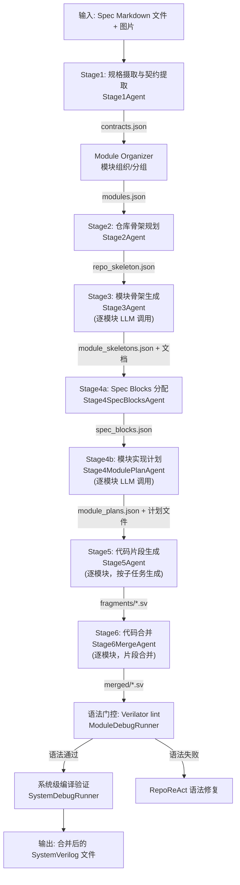
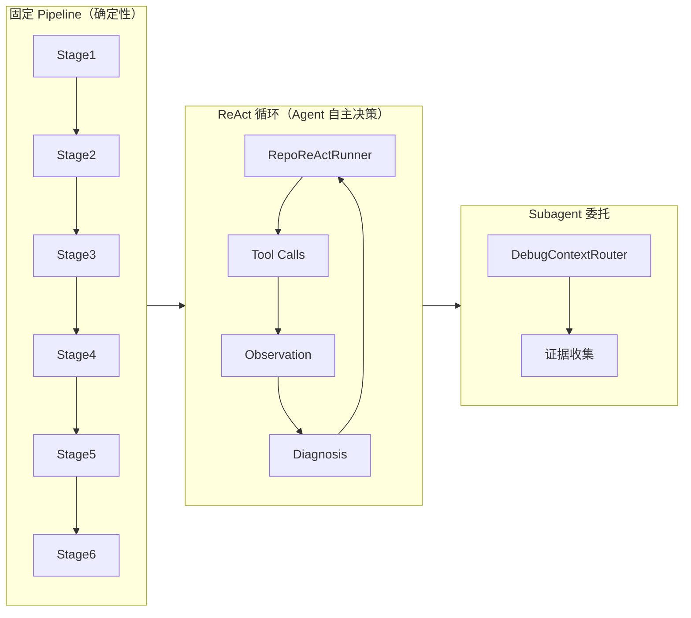
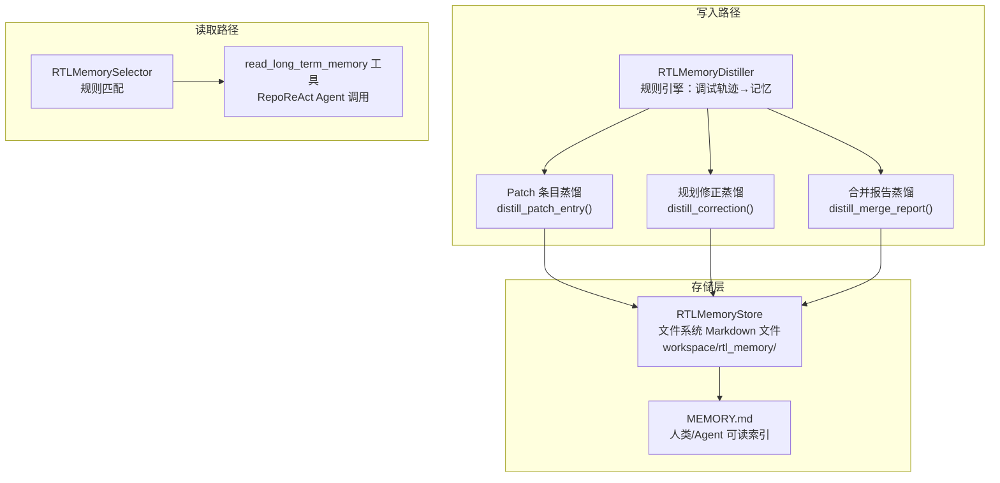
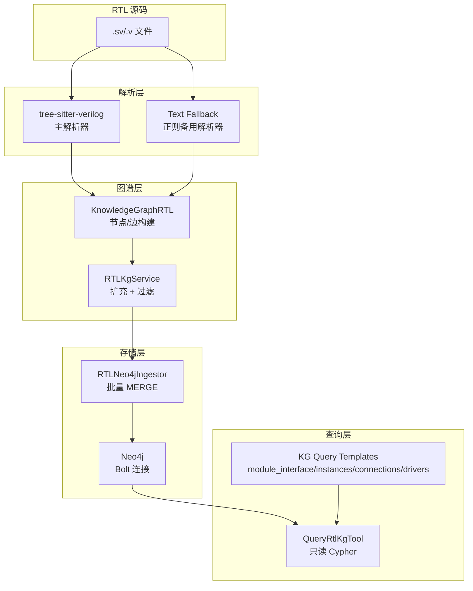
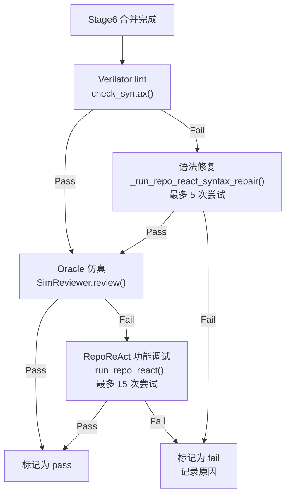
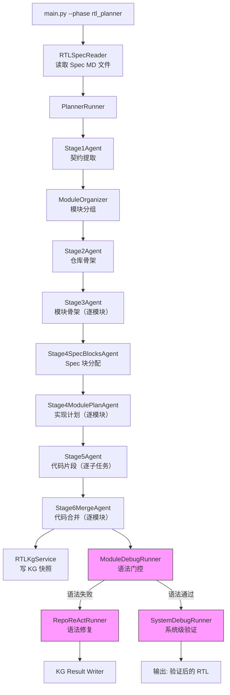
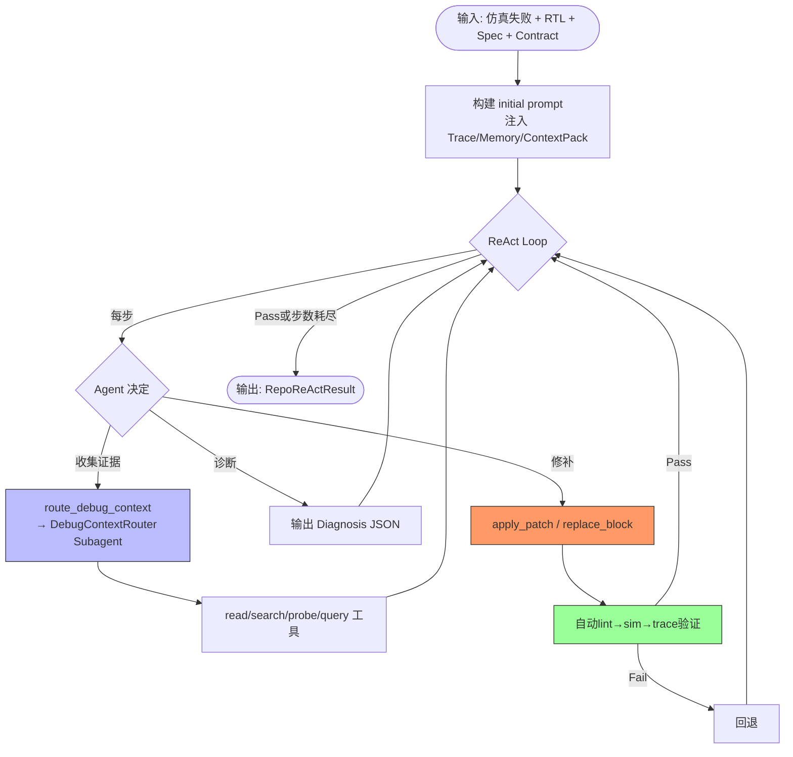

# RTL-Agent 系统架构审计报告

> 生成日期：2026-07-10
> 仓库：RPG-ZeroRepo（main 分支）
> 分析方法：基于真实代码调用链追踪，区分当前实现、实验代码和废弃代码

---

## 目录

1. [仓库和主入口概览](#1-仓库和主入口概览)
2. [当前真实端到端流程](#2-当前真实端到端流程)
3. [Agent 与流程编排](#3-agent-与流程编排)
4. [工具系统](#4-工具系统)
5. [Prompt 系统](#5-prompt-系统)
6. [上下文管理](#6-上下文管理)
7. [记忆管理](#7-记忆管理)
8. [知识图谱与 RTL 专用机制](#8-知识图谱与-rtl-专用机制)
9. [验证、定位与修复流程](#9-验证定位与修复流程)
10. [当前代码、实验代码和废弃代码的区分](#10-当前代码实验代码和废弃代码的区分)
11. [当前架构的优势、问题和技术债务](#11-当前架构的优势问题和技术债务)
12. [可供后续科研提炼的设计线索](#12-可供后续科研提炼的设计线索)
13. [关键文件、类和函数索引](#13-关键文件类和函数索引)
14. [待人工确认的问题](#14-待人工确认的问题)

---

## 1. 仓库和主入口概览

### 1.1 仓库顶层结构

| 目录/文件 | 角色 | 状态 |
|-----------|------|------|
| `main.py` | **唯一 CLI 入口**（argparse），调度所有子流程 | 当前活跃 |
| `scripts/run_main.sh` | Bash 启动脚本，封装 `main.py` 参数 | 当前活跃 |
| `configs/zerorepo_config.yaml` | 主配置文件（LLM、KG、代码生成等） | 当前活跃 |
| `zerorepo/zerorepo.py` | `ZeroRepo` 类：prop→impl→codegen 完整流程编排器 | 当前活跃 |
| `zerorepo/rtl_impl/` | **RTL-Agent 核心实现**（模块规划器、调试、KG、记忆等） | 当前活跃 |
| `zerorepo/rpg_gen/` | 通用代码生成层（prop_level + impl_level） | 当前活跃 |
| `zerorepo/rpg_encoder/` | RPG 编码/解析（与 RTL 流程关联较弱） | 实验性/部分活跃 |
| `zerorepo/code_gen/` | Docker 内代码生成执行器 | 当前活跃 |
| `zerorepo/utils/` | 通用工具（日志、文件、repo_index 等） | 当前活跃 |
| `repocraft/` | 独立的 RepoCraft 评估框架（非 RTL-Agent 核心） | 独立子系统 |
| `rtl_dataset/` | RTL 规格输入数据集 | 数据 |
| `rtl_outputs/` | RTL 生成输出目录 | 数据 |
| `tests/` | 测试文件 | 测试 |

### 1.2 主入口调用路径

**确认为事实：** 系统当前只有一个 CLI 入口 `main.py`，通过 `--phase` 参数切换三条主要路径：

```
main.py (argparse)
├── --phase rtl_planner       → PlannerRunner（模块规划器，6 阶段固定流水线）
├── --phase rtl | rtl_phase1 | rtl_phase2  → 旧版 RTL 流水线（Phase1→Phase2→impl_level）
└── --phase all | design | implementation  → ZeroRepo 通用流水线（prop→impl→codegen）
```

**关键发现：** `run_main.sh` 中默认 `RTL_PIPELINE_MODE=planner`（第 16 行），说明当前**推荐路径**是 `rtl_planner`。

---

## 2. 当前真实端到端流程

### 2.1 当前推荐路径：Module Planner Pipeline

这是当前实际运行的、代码完整的主路径。入口为 `main.py` → `--phase rtl_planner`。



### 2.2 各阶段输入/输出详表

| 阶段 | 输入 | 输出 | 调用方式 | LLM 调用粒度 |
|------|------|------|----------|-------------|
| **Stage1** | Spec MD 文件 + 图片列表 | `contracts.json`（接口、端口、寄存器、时序等契约） | 单次 LLM | 单次（可能分块） |
| **Module Organizer** | `contracts.json` | `modules.json`（模块分组） | 纯代码逻辑 | 无 |
| **Stage2** | `contracts.json` + `modules.json` | `repo_skeleton.json`（顶层模块、层次边、时钟模型） | 单次 LLM | 单次 |
| **Stage3** | `contracts.json` + `modules.json` + `repo_skeleton.json` | `module_skeletons.json` + Markdown 文档 + JSON 导出 | 逐模块增量 | 每模块 1 次 |
| **Stage4a** | 上述全部产物 | `spec_blocks.json`（每模块的 Spec 块分配） | 模型驱动（非 LLM） | 0 次（由 Stage4SpecBlocksAgent 使用确定性逻辑） |
| **Stage4b** | 上述全部 + `spec_blocks.json` | `module_plans.json` + 每模块独立 plan JSON | 逐模块增量 | 每模块 1 次 |
| **Stage5** | 上述全部产物 | `fragments/<module>.sv`（代码片段） | 逐模块 per-subtask | 每子任务 1 次 |
| **Stage6** | Stage5 片段 + 全部上下文 | `merged/<module>.sv`（合并文件） | 逐模块 | 每模块 1 次 |
| **Syntax Gate** | 合并后的 `.sv` | 语法检查结果 | Verilator + RepoReAct | 仅在语法失败时 |
| **System Debug** | 全部合并文件 | 系统级仿真/编译结果 | SystemDebugRunner | 可选 |

### 2.3 旧版 RTL 流水线（phase=rtl/rtl_phase1/rtl_phase2）

**确认为事实：** 此流程在 `main.py` 第 472–628 行仍有完整代码逻辑，但存在以下问题：

- `phase1_spec_parsing` 和 `phase2_module_graph` 模块在仓库中**仅有 `.pyc` 缓存文件**，源代码 `.py` 文件不存在
- `prop_level_adapter.py` 和 `rtl_impl_builder.py` 同样仅有 `.pyc` 文件
- `run_main.sh` 默认模式已设为 `planner`（第 16 行）

**合理推断：** 旧版 RTL 流水线的源代码可能在本地工作区修改中（git status 显示多个 Modified 文件），尚未提交。当前仓库中的 `.pyc` 文件是历史运行的缓存残留。该路径当前**无法实际运行**，属于待迁移或废弃状态。

---

## 3. Agent 与流程编排

### 3.1 Agent 清单

#### 3.1.1 规划阶段 Agent（固定 Workflow）

| Agent 类 | 文件 | 职责 | 类型 |
|----------|------|------|------|
| `Stage1Agent` | `module_planner/agents/stage1_agent.py` | 规格摄取→契约提取（接口、端口、寄存器、时序等） | 固定 Pipeline |
| `Stage2Agent` | `module_planner/agents/stage2_agent.py` | 仓库骨架规划（顶层模块、层次结构、时钟模型） | 固定 Pipeline |
| `Stage3Agent` | `module_planner/agents/stage3_agent.py` | 模块骨架生成（状态机、数据通路、控制逻辑） | 固定 Pipeline + 增量 |
| `Stage4SpecBlocksAgent` | `module_planner/agents/stage4_spec_blocks_agent.py` | 将 Spec 语义块分配到各模块 | 固定 Pipeline |
| `Stage4ModulePlanAgent` | `module_planner/agents/stage4_module_plan_agent.py` | 生成模块实现计划（子任务列表、候选方案评分） | 固定 Pipeline + 增量 |
| `Stage5Agent` | `module_planner/agents/stage5_agent.py` | 按子任务生成 SystemVerilog 代码片段 | 固定 Pipeline + 增量 |
| `Stage6MergeAgent` | `module_planner/agents/stage6_merge_agent.py` | 代码片段合并为完整模块（含语义合并能力） | 固定 Pipeline |

#### 3.1.2 调试阶段 Agent（ReAct + Subagent）

| Agent 类 | 文件 | 职责 | 类型 |
|----------|------|------|------|
| `RepoReActRunner` | `repo_react/runner.py` | **核心调试 Agent**：基于 ReAct 范式，通过工具调用读写 RTL、运行仿真、分析波形 | ReAct 循环 |
| `DebugContextRouter` | `repo_react/context.py` | **只读证据收集 Subagent**：在每次修补前，根据当前调试目标收集相关证据 | Subagent（被 RepoReActRunner 调用） |
| `SafeReActAgent` | `debug_agent/agents.py` | 封装 agentscope 的 ReActAgent，提供安全的内存清理 | 基础组件 |
| `PreDebugSyntaxRepair` | `debug_agent/debug_runner.py` 内部定义 | **语法修复 Agent**：在仿真调试前修复语法/Lint 错误 | 受限 ReAct（max_iters=3） |

#### 3.1.3 检索与知识 Agent

| Agent 类 | 文件 | 职责 | 类型 |
|----------|------|------|------|
| `BlockSpecRetriever` | `retrieval_agent/block_spec_retriever.py` | 为每个 Stage3 骨架 Block 选择相关 Spec 块 | 单次 LLM 调用 |
| `MergeContextRetriever` | `retrieval_agent/merge_context_retriever.py` | 为 Stage6 合并选择上下文 | 单次 LLM 调用 |
| `ModuleSpecContextRetriever` | `retrieval_agent/module_spec_context_retriever.py` | 为模块 Spec 上下文选择 | 单次 LLM 调用 |
| `KGRetriever` | `kg_agent/kg_retriever.py` | 通过 Cypher 查询 RTL KG | 固定模板查询 |

#### 3.1.4 记忆管理 Agent

| 类 | 文件 | 职责 | 类型 |
|-----|------|------|------|
| `RTLMemoryDistiller` | `rtl_memory/distiller.py` | 将调试轨迹蒸馏为结构化长期记忆（Markdown 文件） | 规则引擎（非 LLM） |
| `RTLMemorySelector` | `rtl_memory/selector.py` | 从记忆存储中选择相关记忆 | 规则引擎 |
| `RTLMemoryStore` | `rtl_memory/store.py` | 记忆的 CRUD 操作和索引管理 | 文件系统操作 |

### 3.2 流程编排模式

**确认为事实：** 系统采用了**混合架构**：



| 维度 | 实现 |
|------|------|
| **规划阶段** | 固定 Multi-Stage Pipeline（Stage1→Stage6），每阶段有明确输入/输出契约 |
| **调试阶段** | ReAct 循环（max_steps 可配置，默认 15-30），Agent 自主选择工具 |
| **Subagent** | `DebugContextRouter` 是一个**只读**的独立 Agent，在每次补丁前收集证据 |
| **语言无关** | 规划阶段使用 system+user prompt，调试阶段使用 agentScope 的 ReActAgent |
| **控制流** | 规划阶段：`PlannerRunner.run()` 顺序调用；调试阶段：`RepoReActRunner.chat()` 异步事件循环 |

### 3.3 重试、终止和回退控制

| 机制 | 位置 | 描述 |
|------|------|------|
| **Resume/Checkpoint** | `PlannerRunner.run()` | 每阶段的 JSON 产物写入后支持断点续跑；通过 `--resume` 参数激活 |
| **增量处理** | `Stage3Agent.run_incremental()`、`Stage4ModulePlanAgent.run_incremental()` | 逐模块生成，中断后可从中断位置继续（resume_cursor） |
| **Read-only Budget** | `RepoReActRunner._readonly_budget_exceeded_response()` | 在每次写操作后强制限制只读调用次数（默认 16 次，可通过环境变量调整） |
| **Compact Checkpoint** | `RepoReActRunner._compact_decision()` | 三级压缩策略（light→checkpoint→deep），基于只读调用计数和工具返回字符数触发 |
| **回退** | `RepoReActTools.apply_patch()` | 每次修补后自动 lint/sim/trace 验证，失败时 rollback |
| **max_steps** | `RepoReActRunner.chat()` | 硬性步数上限（默认 30），达到后终止 |
| **allow_failure** | `RtlDebugConfig` | 控制调试失败是否阻断流水线（默认不阻断） |
| **Syntax Gate 修复循环** | `_run_repo_react_syntax_repair()` | 最多 5 次语法修复尝试（pre_debug_syntax_max_attempts=5） |

---

## 4. 工具系统

### 4.1 工具清单（RepoReAct 调试 Agent）

工具定义在两个位置：(a) `repo_react/runner.py` 中的 JSON Schema 注册；(b) `repo_react/tools.py` 中的实际实现。

#### 4.1.1 只读工具（Read-only）

| 工具名 | 功能 | 关键参数 | 返回 | 文件 |
|--------|------|----------|------|------|
| `read_context` | 读取仓库树、文件、行范围、Spec、Testbench、Stage 产物、Trace 报告、修复日志 | `kind`, `path`, `start`, `end`, `artifact_name` | JSON（content/status） | `tools.py` |
| `search_context` | 在 RTL/TB/Spec/全部中正则搜索 | `pattern`, `scope`, `file_glob` | JSON（matches） | `tools.py` |
| `query_rtl_kg` | 查询 Neo4j RTL 知识图谱（module_interface/instances/connections/drivers） | `query_type`, `module_name`, `signal_name` | JSON（rows） | `tools.py` + `kg_query_templates.py` |
| `read_spec` | 读取原始 Spec 文档或当前模块 Spec 摘录 | `module_name`, `path` | JSON（content） | `tools.py` |
| `retrieve_spec_block` | 从 `spec_blocks.json` 中按 ID 或查询检索 Spec 块 | `module_name`, `query`, `block_id` | JSON（blocks） | `tools.py` |
| `read_long_term_memory` | 读取选定的长期记忆 Markdown 文件 | `path`, `max_chars` | JSON（content） | `tools.py` |
| `list_vcd_signals` | 列出 VCD 信号名（支持模式匹配和 Scope 过滤） | `pattern`, `scope`, `limit` | JSON（signals） | `tools.py` |
| `probe_vcd` | 采样 VCD 信号值（单时间点/时间窗口/边沿过滤） | `signals`, `time`, `time_range`, `edge`, `mode` | JSON（rows） | `tools.py` |
| `run_check` | 运行 Lint/模块仿真/系统仿真/Trace 摘要/首次发散/波形窗口 | `mode`, `module_name`, `signals`, `time_window` | JSON（results） | `tools.py` |
| `route_debug_context` | **委托 Subagent** 收集证据上下文包 | `goal`, `focus_signals`, `focus_blocks` | JSON（context_pack） | `runner.py` |

#### 4.1.2 写工具（Write/Modify）

| 工具名 | 功能 | 关键参数 | 验证 | 文件 |
|--------|------|----------|------|------|
| `apply_patch` | 应用行范围级 RTL 补丁（支持多 patch 原子应用） | `patches`, `reason`, `expected_effect`, `verify`, `rollback_on_fail` | lint→sim→trace 三级验证 | `tools.py` |
| `replace_block` | 替换一个完整的 always/assign 块 | `block_id`, `new_code`, `reason`, `verify`, `rollback_on_fail` | lint→sim→trace 三级验证 | `tools.py` |
| `record_correction` | 记录规划修正覆盖（不编辑原始 Stage 产物） | `correction_type`, `module_name`, `problem`, `evidence`, `override` | 无自动验证 | `tools.py` |

#### 4.1.3 禁用工具

| 工具名 | 状态 | 原因 |
|--------|------|------|
| `read_memory` | 已禁用（代码注释，第 297-326 行） | 返回约 45KB 冗余 JSON，加速 compact checkpoint 且不增加决策价值；context_pack 已注入等价信息 |

### 4.2 工具设计观察

**确认为事实的问题：**

1. **`read_context` 粒度过粗**：一个工具承担 8 种不同 `kind`，Schema 中的可选参数组合复杂（`path`、`start`、`end`、`artifact_name` 等），LLM 容易混淆
2. **`run_check` 模式过多**：同时覆盖 lint、module_sim、top_sim、trace_summary、first_divergence、wave_window 六种模式，返回格式差异大
3. **`search_context` 返回可能过长**：`max_results` 默认 50，无强制上限，在高密度匹配时可能产生超大返回
4. **工具副作用不透明**：`apply_patch` 和 `replace_block` 会自动运行 lint/sim/trace，但这些副作用未在工具描述中显式说明
5. **VCD 工具强依赖仿真环境**：`list_vcd_signals` 和 `probe_vcd` 需要 VCD 文件存在，在仅语法修复模式下不可用但未被禁用

---

## 5. Prompt 系统

### 5.1 Prompt 文件组织

| 模块 | Prompt 文件 | 用途 |
|------|-----------|------|
| `module_planner/prompts/stage1_ingest_extract.py` | Stage1 系统+用户 Prompt | 规格→契约提取 |
| `module_planner/prompts/stage2_repo_skeleton.py` | Stage2 Prompt | 仓库骨架规划 |
| `module_planner/prompts/stage3_module_skeleton.py` | Stage3 Prompt | 模块骨架生成 |
| `module_planner/prompts/stage3_module_synthesis.py` | Stage3 合成 Prompt | 模块合成 |
| `module_planner/prompts/stage4_module_plan.py` | Stage4 Prompt | 模块实现计划 |
| `module_planner/prompts/stage4_checklist_eval.py` | Stage4 评估 Prompt | 候选项评估清单 |
| `module_planner/prompts/stage4_critic.py` | Stage4 Critic Prompt | 计划批判/改进 |
| `module_planner/prompts/stage4_pairwise_tiebreak.py` | Stage4 平局打破 Prompt | 候选项比较 |
| `module_planner/prompts/stage5_finalize.py` | Stage5 Prompt | 最后修正 |
| `module_planner/prompts/stage5_subtask_codegen.py` | Stage5 代码生成 Prompt | 子任务代码生成 |
| `module_planner/prompts/stage6_merge.py` | Stage6 Prompt | 代码合并 |
| `repo_react/prompt.py` | RepoReAct 系统+用户+继续+压缩 Prompt | 调试 Agent 的完整 Prompt 集 |
| `retrieval_agent/prompts/block_spec_select.py` | Spec 块选择 Prompt | Block→Spec 检索 |
| `retrieval_agent/prompts/merge_context_select.py` | 合并上下文选择 Prompt | 合并上下文检索 |
| `retrieval_agent/prompts/module_spec_context_select.py` | 模块 Spec 上下文 Prompt | 模块上下文检索 |

### 5.2 Prompt 构建模式

**确认为事实：**

1. **Stage Prompt**：每个 Stage 有独立的 Python Prompt 模块，通过 `.build_prompt()` 或类似的构建函数生成
2. **RepoReAct Prompt**：四类 Prompt 分别在不同阶段使用：
   - `build_initial_prompt()` — 初次进入调试时（注入 Spec、Contract、Trace、Memory、Context Pack）
   - `build_continue_prompt()` — 每个 ReAct step 结束后继续（注入 Memory Summary、预算状态）
   - `build_compact_prompt()` — checkpoint/deep 压缩后恢复（注入 LLM 生成的压缩记忆）
   - `SYSTEM_PROMPT` — 系统角色固定文本
3. **Context Router Prompt**：`context.py` 中的 `ROUTER_SYSTEM_PROMPT`（79 行，详细定义分析流程和输出格式）
4. **Compact Prompt**：`compact.py` 中的 `COMPACT_SYSTEM_PROMPT`（要求严格 JSON，禁止虚构）

### 5.3 Prompt 设计观察

**合理推断：**

- Prompt 未使用模板引擎（如 Jinja2），采用 Python f-string 拼接，在复杂上下文注入时容易出现格式错误
- Stage 间的 Prompt 独立设计，可能导致不同 Stage 对同一概念使用不同术语
- RepoReAct 的 initial prompt 一次性注入全部上下文（Spec + Contract + Sim Log + Trace + Memory + Context Pack），可能造成上下文膨胀

---

## 6. 上下文管理

### 6.1 各阶段上下文注入

| 阶段 | 注入内容 | 注入方式 | 潜在问题 |
|------|---------|---------|---------|
| **Stage1** | Spec MD 全文 + 图片 OCR 摘要 | 一次性全量 | Spec 过大时可能超 token 限制 |
| **Stage2** | Stage1 契约 + 模块组织结果 | 结构化 JSON | 合理 |
| **Stage3** | Stage1+2 全部 + 当前模块上下文 | 按模块增量 | 每个模块独立调用，上下文不累积 |
| **Stage4** | Stage1-3 全部 + Spec Blocks | 结构化输入 | 全量传递所有先前产物 |
| **Stage5** | Stage1-4 全部 + 当前子任务 | 按子任务 | 子任务间上下文不共享 |
| **Stage6** | Stage5 片段 + 全局定义 + KG 子模块上下文 | 按模块合并 | 使用 `retrieval_agent` 选择相关上下文 |
| **RepoReAct initial** | Spec 全文(截断至 4000 字符) + Contract JSON(截断至 4000 字符) + Sim Log 摘要 + Trace Report + Memory Brief + Context Pack | 一次性全量 | **正是上下文膨胀点** |
| **RepoReAct continue** | Memory Brief + 只读调用预算状态 + Context Pack(可选) | 按步增量 | 合理 |
| **RepoReAct compact** | LLM 生成的压缩记忆（checkpoint/deep 模式） | 替换式 | 信息损失风险 |

### 6.2 上下文管理机制

**确认为事实：**

1. **Context Pack 路由**：`DebugContextRouter` 是一个独立的 Subagent，负责在 ReAct 循环的观测和修补之间收集**最相关的证据**。它返回一个结构化的 `DebugContextPack`（包含 system_triage、timing_evidence、evidence_pack、causal_memory 等字段），主 Agent 基于此做出修补决策
2. **三级紧凑化**：
   - `light`：轻量整合（阈值：8 次只读调用 或 24000 字符工具返回）
   - `checkpoint`：中等压缩（阈值：3 次写操作 或 96000 字符；保留更多证据）
   - `deep`：深度压缩（阈值：2 次 checkpoint 或预算<20% 或 320000 字符；激进裁剪）
3. **Compact Memory LLM**：`compact.py` 中的 `build_llm_compact_memory()` 使用 LLM 将 Journal + Memory Snapshot + Context Pack 压缩为结构化 JSON，再注入回 Agent
4. **只读预算限制**：每次写操作后重置计数器，默认允许 16 次只读调用（`repo` 模式下 32 次），防止 Agent 陷入无限阅读

### 6.3 上下文设计问题

**确认为事实：**

- Spec 和 Contract 在 `_build_pre_debug_syntax_repair_prompt()` 中被截断至 4000 字符（`clip_text(spec_text, max_chars=4000)`），可能丢失关键细节
- 每个 Stage 都全量传入所有先前 Stage 的产物，在 6 个 Stage 的累积下，后期 Stage 的 Prompt 可能包含大量结构化 JSON
- 子任务（Stage5 Subtask）之间不共享上下文：每个子任务独立调用 LLM，无法利用兄弟子任务的代码成果

---

## 7. 记忆管理

### 7.1 记忆系统架构



### 7.2 记忆类型

| 类型 | 目录 | 内容 | 写入触发 |
|------|------|------|---------|
| `repair_outcome` | `cases/` | 成功的补丁/修复模式 | `distill_patch_entry()` 当 effect 为 passed/improved |
| `negative_direction` | `patterns/` | 失败/退化的修复方向（反例） | `distill_patch_entry()` 当 effect 为 regressed/syntax_failed |
| `planning_correction` | `corrections/` | 规划阶段的修正覆盖 | `distill_correction()` 每次 `record_correction` 调用后 |
| `merge_rule` | `rules/` | Stage6 合并经验规则 | `distill_merge_report()` 每次合并报告生成后 |

### 7.3 记忆格式

每条记忆是一个独立的 Markdown 文件，带有 YAML frontmatter：

```yaml
---
memory_id: debug_aes_cipher_core_state_err_passed_3
type: repair_outcome
stage: debug
module: aes_cipher_core
module_family: aes
signals: [state_err, next_state]
failure_type: local_logic_bug
outcome: pass
confidence: 0.9
verified_by: [lint, module_sim, trace]
description: "aes_cipher_core: state_err 补丁成功; ..."
---
## 触发条件
...
## 不适用条件
...
```

**确认为事实：**
- 记忆以文件系统为存储后端（非向量数据库、非 Neo4j）
- 记忆选择器（`RTLMemorySelector`）基于规则匹配（模块名、信号名、failure_type、alignment 等）
- 没有向量嵌入或语义检索

### 7.4 记忆系统限制

**确认为事实：**
- 记忆为**文件级**，不跨项目共享
- 记忆写入由**规则引擎**而非 LLM 驱动（`RTLMemoryDistiller` 是纯 Python 逻辑）
- 记忆选择采用**精确/前缀匹配**，无模糊语义检索
- 无记忆遗忘/淘汰机制
- 无跨 Session 的记忆累积（记忆存储在 workspace 下，每次任务使用不同 workspace）

---

## 8. 知识图谱与 RTL 专用机制

### 8.1 RTL KG 架构



### 8.2 KG 实体类型

**确认为事实（基于 `rtl_knowledge_graph.py` 和 `graph_types_rtl.py`）：**

- `Repo` — 仓库根节点（repo_uid 隔离）
- `File` — SystemVerilog 文件
- `Module` — 模块定义
- `Port` — 端口
- `Param` — 参数/宏
- `Signal` — 内部信号
- `AlwaysBlock` / `Assign` — 逻辑块（always/assign）
- `Instance` — 模块实例化
- `Package` — SV Package（如包含 `import` 的文件）
- 关系：`DEFINES`, `HAS`, `DRIVES`, `INSTANTIATES`, `OF_MODULE`, `CONNECTS`, `INCLUDES`, `IMPORTS`

### 8.3 KG 构建阶段

| 阶段 | 触发点 | 方法 |
|------|--------|------|
| **Post-Skeleton** | ImplBuilder 完成骨架规划后 | `sync_plan_snapshot(stage="post_skeleton")` |
| **Post-Graph** | ImplBuilder 完成函数设计后 | `refresh_repo_files(stage="post_graph")` |
| **Post-Batch** | 每个代码生成批次完成后 | `refresh_repo_files(stage="post_batch")` |
| **Post-Module-Syntax** | 模块语法门控后 | `ModuleResultWriter.record_module_result()` |
| **Post-Debug-Sim** | 每次仿真运行后 | `_record_initial_kg_module_result()` |

### 8.4 KG 过滤机制

**确认为事实：** `_filter_snapshot_to_planned_skeleton()` 方法通过计划骨架中定义的文件路径集合（`_planned_kg_file_paths()`）过滤 KG 快照，只保留与当前规划相关的文件和模块。非计划内的文件/模块不会被导入 Neo4j。

### 8.5 KG 查询模板

**确认为事实（基于 `kg_agent/kg_query_templates.py`）：**

- `module_interface` — 查询模块的端口和参数
- `module_instances` — 查询模块内实例化的子模块
- `instance_connections` — 查询实例的端口连接
- `signal_drivers` — 查询信号的驱动源（always/assign 块）

### 8.6 其他 RTL 专用机制

| 机制 | 实现 | 位置 |
|------|------|------|
| **全局定义处理** | `global_defines.py`：提取 `include 和宏定义，确保合并时不丢失 | `module_planner/agents/global_defines.py` |
| **接口契约检查** | `contract_linter.py`：检查生成的 RTL 接口与契约的一致性 | `debug_agent/contract_linter.py` |
| **RTL 块解析** | `trace_slicer.py`：将 RTL 解析为 always/assign 块，提取时钟/信号依赖 | `debug_agent/trace_slicer.py` |
| **Trace Report** | `trace_report.py`：构建 Trace 报告（首次发散、价值回溯链、嫌疑块） | `debug_agent/trace_report.py` |
| **VCD 分析** | `trace_report.py` + `tools.py`：VCD 信号列表、采样、发散检测 | 多处 |
| **Verilator 集成** | `bash_tools.py` + `sim_reviewer.py`：Lint 和仿真执行 | `debug_agent/` |

---

## 9. 验证、定位与修复流程

### 9.1 模块级验证



### 9.2 RepoReAct 调试循环内幕

**确认为事实（基于 `runner.py` 的 `chat()` 方法）：**

1. 收到初始仿真失败日志和 mismatch_count
2. `build_trace_report()` 分析仿真输出，生成 Trace 报告（first_divergence、value_backtrace 等）
3. 构建 `build_initial_prompt()` — 注入 Spec、Contract、Sim Log、Trace、Memory Brief
4. Agent 进入 ReAct 循环（最多 `max_steps` 步）：
   - Agent 决定下一步动作（调用只读工具 → 诊断 → 调用写工具）
   - `DebugContextRouter` 在需要时委托收集证据
   - 每次写操作后自动验证（lint→sim→trace）
   - 失败时 rollback
5. 条件检查（每步后评估是否需要 compact/checkpoint）
6. 退出条件：sim 通过 或 步数耗尽

### 9.3 系统级验证

**确认为事实（基于 `system_debug_runner.py`）：**

- `SystemDebugRunner.run_system()` 执行以下步骤：
  1. 将所有合并后的模块文件复制到工作目录
  2. 检查 Oracle 目录中的验证脚本（`*.py` Python 验证脚本）
  3. 运行 `system_verify_wrapper.py` 执行验证
  4. 收集仿真结果（mismatch count、pass/fail）
  5. 如果失败，可选地委托给 RepoReAct 进行系统级调试

### 9.4 验证工具链

| 工具 | 用途 | 集成方式 |
|------|------|---------|
| **Verilator** | Lint（`--lint-only`）和仿真 | `bash_tools.py` 中的 `run_bash_command()` |
| **vcdvcd** | Python VCD 解析库 | `trace_report.py` 中用于信号值提取 |
| **Oracle Testbench** | 外部验证目录中的参考 Testbench | `_select_testbench()` 选择匹配的 TB 文件 |
| **System Verify Script** | Python 验证脚本（项目级） | `SystemSimReviewer` 通过 subprocess 运行 |

---

## 10. 当前代码、实验代码和废弃代码的区分

### 10.1 当前活跃实现

| 模块/文件 | 证据 | 状态 |
|-----------|------|------|
| `main.py` | CLI 入口，所有路径由此分发 | **当前活跃** |
| `zerorepo/rtl_impl/module_planner/` | PlannerRunner 完整 6 阶段实现，run_main.sh 默认使用 | **当前活跃** |
| `zerorepo/rtl_impl/debug_agent/` | ModuleDebugRunner + SystemDebugRunner + sim_reviewer 被 PlannerRunner 调用 | **当前活跃** |
| `zerorepo/rtl_impl/repo_react/` | RepoReActRunner 被 debug_runner 调用 | **当前活跃** |
| `zerorepo/rtl_impl/rtl_kg_service.py` | RTLKgService 被 PlannerRunner 和 ZeroRepo 使用 | **当前活跃** |
| `zerorepo/rtl_impl/rtl_kg/` | KG 构建和 Neo4j 摄入 | **当前活跃** |
| `zerorepo/rtl_impl/rtl_memory/` | 被 repo_react 工具调用 | **当前活跃** |
| `zerorepo/rtl_impl/retrieval_agent/` | 被 module_planner agents 调用 | **当前活跃** |
| `zerorepo/rtl_impl/kg_agent/` | 被 module_planner 和 debug_runner 调用 | **当前活跃** |
| `zerorepo/zerorepo.py` | ZeroRepo 类，被旧版流水线调用 | **活跃**（但主要用于旧版路径） |
| `zerorepo/rpg_gen/impl_level/` | ImplBuilder 被 ZeroRepo 调用 | **活跃**（用于通用软件生成和旧版 RTL 路径） |
| `zerorepo/rpg_gen/prop_level/` | PropBuilder 被 ZeroRepo 调用 | **活跃**（主要用于通用软件生成） |
| `zerorepo/code_gen/` | IterativeCodeGenerator 被 ZeroRepo 调用 | **活跃** |
| `configs/zerorepo_config.yaml` | 被 main.py 加载 | **活跃** |
| `scripts/run_main.sh` | 启动脚本 | **活跃** |
| `zerorepo/rtl_spec_reader.py` | 被 main.py 在 rtl_planner 路径中使用 | **活跃** |

### 10.2 实验性/阶段性实现

| 模块/文件 | 证据 | 判断 |
|-----------|------|------|
| `zerorepo/rpg_encoder/` | RPG 编码/解析/演化；未被 rtl_planner 路径调用；在 `rebuild_repo.py` 中有独立入口 | **实验性**：RPG 编码器是独立研究线，与 RTL-Agent 并行开发 |
| `zerorepo/utils/repo_index/` | 代码索引、嵌入模型、FAISS 向量库；仅在 rpg_encoder 中使用 | **实验性**：为 RPG 编码器服务的索引系统 |
| `repocraft/` | 独立的 RepoCraft 评估框架，有自己的 `run.py`、benchmark、evaluation | **独立子系统**：非 RTL-Agent 核心 |
| `zerorepo/rpg_gen/prop_level/refactor_feature/` | 特征重构 Agent；仅在 prop_level "feature" 模式下使用；配置默认使用 "simple" 模式 | **实验性**：多 Agent 模式被 single-agent 模式替代 |

### 10.3 疑似废弃实现

| 模块/文件 | 证据 | 判断 |
|-----------|------|------|
| `zerorepo/rtl_impl/phase1_spec_parsing/` | 在 main.py 中被导入但**.py 源文件不存在**（仅有 .pyc 缓存） | **废弃/未提交**：`SpecFactsDesigner` 类在 main.py 中引用但实现不可用 |
| `zerorepo/rtl_impl/phase2_module_graph/` | 同上，仅有 .pyc | **废弃/未提交**：`Phase2Designer` |
| `zerorepo/rtl_impl/prop_level_adapter.py` | 仅有 .pyc | **废弃/未提交**：`RTLPropLevelAdapter` |
| `zerorepo/rtl_impl/rtl_impl_builder.py` | 仅有 .pyc | **废弃/未提交**：`RTLImplBuilder` |
| `parse_rpg.py` | 独立脚本，无 import 关系 | **疑似废弃**：旧版 RPG 解析工具 |
| `rebuild_repo.py` | 独立脚本，调用 rpg_encoder | **边缘活跃**：RPG 编码器的独立入口 |

### 10.4 无法确认、需人工判断的实现

| 项目 | 问题 |
|------|------|
| `zerorepo/rpg_gen/base/` | 基础类型定义（RPG, RepoSkeleton, LLMConfig 等），被多个模块引用。`__init__.py` 内容未知 — 可能包含额外的抽象 |
| `zerorepo/utils/data_flow.py` | 数据流分析工具，用途不明 |
| `zerorepo/rpg_gen/impl_level/file_design.py` 和 `func_design/` | ImplBuilder 的子模块，确认被调用但内部架构未详细分析 |
| `Accurate_Records/` | 准确记录目录，内容未知，可能是实验数据 |

---

## 11. 当前架构的优势、问题和技术债务

### 11.1 架构优势

1. **清晰的阶段分离**：Stage1→Stage6 分工明确，每阶段有独立的输入/输出 JSON Schema（使用 Pydantic 验证）
2. **完善的断点续跑**：每阶段产物写入后支持恢复，`resume_cursor` 机制允许从中间位置继续处理
3. **调试 Agent 设计成熟**：RepoReAct 实现了完整的 ReAct 循环，包含预算控制、三级紧凑化、Subagent 委托和自动验证/回退
4. **RTL 专用 KG 集成**：从树解析到 Neo4j 存储到只读查询的完整链路，支持模块接口、实例连接、信号驱动源查询
5. **记忆系统有结构**：区分了修复结果、负面方向、规划修正和合并规则四种记忆类型，使用 YAML frontmatter 实现可读性
6. **工具验证链**：写操作的自动 lint→sim→trace 三级验证降低了 Agent 引入新错误的风险

### 11.2 架构问题

1. **两套流水线并存**：Module Planner Pipeline 和旧版 RTL Pipeline 的代码同时存在，旧版依赖不存在的模块，造成混淆
2. **上下文全量传递**：每个 Stage 都全量传入所有先前 Stage 产物，在后期 Stage 的 Prompt 中可能包含数万 token 的结构化 JSON
3. **Spec 截断过狠**：调试阶段 Spec 和 Contract 被截断至 4000 字符，可能丢失关键 RTL 实现细节
4. **子任务间无上下文共享**：Stage5 的每个子任务独立调用 LLM，无法获知同一模块其他子任务生成的信号名、端口声明等
5. **无跨 Session 记忆**：RTL 记忆存储在 workspace/rtl_memory 下，每个项目使用独立 workspace，调试经验无法跨项目复用
6. **记忆检索无语义匹配**：基于精确/前缀规则匹配，当信号名或模块名变化时无法找回相关记忆
7. **KG 依赖外部服务**：Neo4j 需要手动启动（docker-compose），增加了系统部署复杂度
8. **工具 `read_context` 粒度过粗**：一个工具承载 8 种读取模式，增加了 LLM 选择正确参数的难度

### 11.3 技术债务

| 债务 | 影响 | 优先级 |
|------|------|--------|
| `.pyc` 缓存残留（phase1/phase2/prop/impl_builder） | 误导代码审查者 | 高 |
| main.py 中 import 不存在的模块 | 旧版 RTL 路径无法运行 | 高 |
| 两套流水线语义重叠 | 维护复杂度高 | 中 |
| Prompt 使用 f-string 拼接（无模板引擎） | 格式错误风险 | 中 |
| 无单元测试覆盖核心流程 | 回归风险 | 中 |
| KG Text Fallback 与 tree-sitter 主解析器的数据重复 | 混合数据源可能导致不一致 | 低 |
| `compact.py` 使用 LLM 压缩记忆（质量不可控） | 压缩后可能丢失关键信息 | 低 |

---

## 12. 可供后续科研提炼的设计线索

### 12.1 已实现、可能具有研究价值的设计

| 设计 | 代码基础 | 可以进一步研究的点 |
|------|---------|------------------|
| **RTL Spec→KG→Code 多阶段流水线** | `module_planner/` 6 阶段架构，每阶段有 Pydantic Schema 验证 | 与单阶段端到端生成的对比实验；中间表示（contracts/skeleton/blocks）的可解释性研究 |
| **ReAct 调试 + Subagent 证据收集** | `repo_react/runner.py` + `context.py` 的 `DebugContextRouter` | Subagent 委托对调试效率的消融实验；Router 推荐的 tool calls 与实际执行的对比 |
| **三级上下文紧凑化** | `repo_react/runner.py` 的 `_compact_decision()` | Light vs Checkpoint vs Deep 对修复成功率和 token 消耗的影响；最优阈值自动化学习 |
| **RTL 知识图谱增强调试** | `rtl_kg_service.py` 的模块接口/实例连接/信号驱动查询 | KG 信息对调试 Agent 决策质量的因果贡献；有 KG vs 无 KG 的 A/B 实验 |
| **结构化长期记忆** | `rtl_memory/` 的四种记忆类型（repair_outcome/negative_direction/planning_correction/merge_rule） | 记忆对跨模块/跨项目调试的迁移效果；记忆遗忘策略的影响 |

### 12.2 已有局部实现、但尚未形成完整方法的设计

| 设计方向 | 现有代码 | 不足 | 需要的补充 |
|---------|---------|------|----------|
| **Spec→Plan 的候选项评分机制** | `Stage4ModulePlanAgent` 使用 checklist/rubric/pairwise_tiebreak 评分 | 评分标准是固定的检查清单，缺乏对 RTL 特性（时序、面积、功耗）的量化评估 | 引入 RTL 特定的多目标优化评分；与综合工具（Yosys/Design Compiler）联动的反馈回路 |
| **代码片段的语义合并** | `stage6_semantic_merge.py` 尝试解决多片段间的信号冲突 | 当前仍大量依赖 LLM 做最终裁决 | 引入形式化验证（如 SymbiYosys）作为合并正确性保证 |
| **记忆的跨任务复用** | `RTLMemoryStore` 存储结构化记忆 | 记忆选择基于规则匹配，无语义检索；无跨 Session 累积 | 引入向量嵌入+语义检索；建立跨项目的全局记忆库 |
| **KG 驱动的代码生成** | `RTLKgService.build_batch_context()` 为代码生成提供 KG 上下文 | 仅提供静态 KG 信息，未利用 KG 做时序/信号流推理 | 引入 KG 路径推理（如信号传播路径分析）作为生成约束 |
| **RTL Block 级解析** | `trace_slicer.py` 将 RTL 解析为 always/assign 块 | 解析粒度固定（always/assign），不支持更细粒度的表达式级分析 | 增强为表达式级数据流图，支持更精确的信号追溯 |

### 12.3 当前架构暴露出的可研究问题

| 可研究问题 | 问题背景 | 可能的探索方向 |
|-----------|---------|--------------|
| **多阶段规划的上下文膨胀** | Stage 间全量传递产物导致后期 Prompt 过长 | 层次化摘要、信息瓶颈压缩、渐进式上下文管理 |
| **调试 Agent 的工具组合策略** | RepoReAct Agent 需在 10+ 工具中选择，容易决策失误 | 工具推荐模型、conditional tool visibility、基于任务阶段动态启用/禁用工具 |
| **Spec 到 RTL 的保真度验证** | 当前仅通过 lint/sim/trace 验证，无法保证 Spec 语义正确性 | 引入基于 Spec 断言的属性检查（SVA）、Spec→RTL 的等价性检查 |
| **多模块接口一致性** | 各模块独立生成，接口不匹配是常见失败模式 | 接口契约的双向验证、自动接口适配生成 |
| **KG 的动态更新策略** | KG 在固定阶段同步，调试过程中的实时 RTL 修改不在 KG 中反映 | 增量 KG 更新、调试阶段的实时 KG 查询 |
| **记忆的可靠性** | 记忆蒸馏是规则引擎（非 LLM），可能遗漏有价值的调试模式 | LLM 驱动的记忆摘要 vs 规则引擎的记忆质量对比 |
| **模块规划的全局最优性** | Stage2 的模块划分是单次决策，后续 Stage 无法修正 | 迭代式模块重新划分、基于 Stage5/6 反馈的规划修正 |

---

## 13. 关键文件、类和函数索引

### 13.1 核心入口和编排

| 文件 | 类/函数 | 行号 | 职责 |
|------|--------|------|------|
| `main.py` | `run_zerorepo()` | 211 | RTL 和通用流程的主调度器 |
| `main.py` | `parse_args()` | 24 | CLI 参数解析 |
| `zerorepo/zerorepo.py` | `ZeroRepo` | 112 | 通用流水线编排器 |
| `zerorepo/zerorepo.py` | `ZeroRepo.run()` | 533 | 完整流水线：prop→impl→codegen |
| `zerorepo/zerorepo.py` | `PersistentTaskExecutor` | 18 | Docker 容器内代码生成执行器 |

### 13.2 模块规划器

| 文件 | 类/函数 | 行号 | 职责 |
|------|--------|------|------|
| `module_planner/planner_runner.py` | `PlannerRunner` | 89 | 6 阶段流水线编排 |
| `module_planner/planner_runner.py` | `PlannerRunner.run()` | 198 | 主入口（支持 end_stage 控制） |
| `module_planner/planner_runner.py` | `PlannerRunner._run_stage6_per_module()` | 636 | Stage5+6+Debug 的逐模块执行 |
| `module_planner/agents/base.py` | （各 Agent 基类） | — | 提供 `model_dump()`, `validate_model()` 等工具 |
| `module_planner/agents/stage1_agent.py` | `Stage1Agent` | — | 规格摄取→契约提取 |
| `module_planner/agents/stage2_agent.py` | `Stage2Agent` | — | 仓库骨架规划 |
| `module_planner/agents/stage3_agent.py` | `Stage3Agent` | — | 模块骨架生成 |
| `module_planner/agents/stage4_spec_blocks_agent.py` | `Stage4SpecBlocksAgent` | — | Spec 块分配 |
| `module_planner/agents/stage4_module_plan_agent.py` | `Stage4ModulePlanAgent` | — | 模块实现计划 |
| `module_planner/agents/stage5_agent.py` | `Stage5Agent` | — | 代码片段生成 |
| `module_planner/agents/stage6_merge_agent.py` | `Stage6MergeAgent` | — | 代码合并 |
| `module_planner/module_organizer.py` | `build_module_organized_artifact()` | — | 模块分组（纯逻辑） |
| `module_planner/schemas/` | （Pydantic Models） | — | 类型定义和验证 |

### 13.3 调试系统

| 文件 | 类/函数 | 行号 | 职责 |
|------|--------|------|------|
| `debug_agent/debug_runner.py` | `ModuleDebugRunner` | 90 | 模块级调试编排 |
| `debug_agent/debug_runner.py` | `ModuleDebugRunner.run_module()` | 116 | 完整模块调试（oracle sim + RepoReAct） |
| `debug_agent/debug_runner.py` | `ModuleDebugRunner.run_module_syntax_gate()` | 295 | 语法门控（仅 lint） |
| `debug_agent/system_debug_runner.py` | `SystemDebugRunner` | — | 系统级调试编排 |
| `debug_agent/sim_reviewer.py` | `SimReviewer` | — | Verilator 仿真执行和 mismatch 分析 |
| `debug_agent/sim_reviewer.py` | `check_syntax()` | — | Verilator lint 检查 |
| `debug_agent/bash_tools.py` | `run_bash_command()` | — | Shell 命令执行封装 |
| `debug_agent/bash_tools.py` | `CommandResult` | — | 命令执行结果模型 |
| `debug_agent/trace_report.py` | `build_trace_report()` | — | Trace 报告构建（first_divergence、value_backtrace） |
| `debug_agent/trace_slicer.py` | `parse_rtl_blocks()` | — | RTL 块解析（always/assign） |
| `debug_agent/config.py` | `RtlDebugConfig` | 23 | 调试配置（env 读取） |
| `debug_agent/agents.py` | `SafeReActAgent` | — | agentscope ReActAgent 安全封装 |
| `debug_agent/adapters.py` | `build_debug_contract_json()` | — | 从 Stage1 契约构建调试用 contract JSON |
| `debug_agent/contract_linter.py` | （contract linting） | — | 接口契约一致性检查 |

### 13.4 RepoReAct（核心调试 Agent）

| 文件 | 类/函数 | 行号 | 职责 |
|------|--------|------|------|
| `repo_react/runner.py` | `RepoReActRunner` | 85 | ReAct 调试 Agent |
| `repo_react/runner.py` | `RepoReActRunner.chat()` | 1439 | 主 ReAct 循环 |
| `repo_react/runner.py` | `RepoReActRunner._compact_decision()` | 744 | 三级压缩决策 |
| `repo_react/runner.py` | `RepoReActRunner.apply_patch()` | 1275 | 补丁工具实现 |
| `repo_react/context.py` | `DebugContextRouter` | — | 只读证据收集 Subagent |
| `repo_react/context.py` | `DebugContextRouter.route()` | — | 路由证据收集 |
| `repo_react/tools.py` | `RepoReActTools` | — | 所有读写工具的实现 |
| `repo_react/tools.py` | `RepoReActToolState` | — | 工具共享状态（sim_reviewer, journal, kg_service, memory） |
| `repo_react/prompt.py` | `build_initial_prompt()` | — | 初始 Prompt 构建 |
| `repo_react/prompt.py` | `build_continue_prompt()` | — | 继续 Prompt 构建 |
| `repo_react/prompt.py` | `build_compact_prompt()` | — | 压缩后 Prompt 构建 |
| `repo_react/prompt.py` | `SYSTEM_PROMPT` | — | 系统角色 Prompt |
| `repo_react/schemas.py` | `RepoReActInput` | 158 | ReAct 输入模型 |
| `repo_react/schemas.py` | `RepoReActResult` | 187 | ReAct 输出模型 |
| `repo_react/schemas.py` | `DebugContextPack` | 133 | 上下文包模型 |
| `repo_react/schemas.py` | `SystemTriage` | 117 | 系统分诊模型 |
| `repo_react/compact.py` | `build_llm_compact_memory()` | — | LLM 驱动的记忆压缩 |
| `repo_react/journal.py` | `RepoReActJournal` | — | 调试日志/轨迹记录 |

### 13.5 知识图谱

| 文件 | 类/函数 | 行号 | 职责 |
|------|--------|------|------|
| `rtl_kg_service.py` | `RTLKgService` | 53 | KG 服务包装器 |
| `rtl_kg_service.py` | `QueryRtlKgTool` | 983 | 只读 Cypher 查询工具 |
| `rtl_kg/rtl_knowledge_graph.py` | `KnowledgeGraphRTL` | — | KG 主构建器 |
| `rtl_kg/rtl_file_graph_builder.py` | `RTLFileGraphBuilder` | — | 单文件 tree-sitter 解析 |
| `rtl_kg/neo4j_ingest.py` | `Neo4jConnection` | — | Neo4j 连接封装 |
| `rtl_kg/neo4j_ingest.py` | `RTLNeo4jIngestor` | — | 批量节点/边导入 |
| `rtl_kg/graph_types_rtl.py` | （类型定义） | — | KG 节点/边类型定义 |

### 13.6 记忆系统

| 文件 | 类/函数 | 行号 | 职责 |
|------|--------|------|------|
| `rtl_memory/store.py` | `RTLMemoryStore` | 109 | 文件级记忆 CRUD |
| `rtl_memory/store.py` | `RTLMemoryStore.upsert_memory()` | 186 | 记忆写入/更新 |
| `rtl_memory/distiller.py` | `RTLMemoryDistiller` | 46 | 规则引擎记忆蒸馏 |
| `rtl_memory/distiller.py` | `RTLMemoryDistiller.distill_patch_entry()` | 54 | 补丁条目→记忆 |
| `rtl_memory/selector.py` | `RTLMemorySelector` | — | 记忆选择器 |

### 13.7 检索系统

| 文件 | 类/函数 | 行号 | 职责 |
|------|--------|------|------|
| `retrieval_agent/block_spec_retriever.py` | `BlockSpecRetriever` | 13 | Spec 块→骨架块映射 |
| `retrieval_agent/merge_context_retriever.py` | `MergeContextRetriever` | — | 合并上下文选择 |
| `retrieval_agent/module_spec_context_retriever.py` | `ModuleSpecContextRetriever` | — | 模块 Spec 上下文选择 |
| `kg_agent/kg_retriever.py` | `KGRetriever` | — | KG 查询检索器 |
| `kg_agent/module_result_writer.py` | `ModuleResultWriter` | — | KG 结果记录写入器 |

---

## 14. 待人工确认的问题

1. **phase1/phase2/prop/impl_builder 模块状态**：这四个模块在 `main.py` 中有 import 但 `.py` 源文件缺失。需要确认这些代码是否存在于其他分支、是否计划重写、还是应彻底删除旧版 RTL 流水线代码

2. **Neo4j 实际使用状态**：KG 配置中 `enabled: true` 和 `mode: "required"`，但 Neo4j 需要独立启动。需要确认在实际运行中 Neo4j 是否真的在运行、KG 数据是否被有效查询

3. **`rtl_agent_root` 配置指向外部路径**：`zerorepo_config.yaml` 中的 `rtl_agent_root: "/home/mokita/RTL-Agent/RTL-Fix-Agent/knowledge_graph"` 指向一个不在本仓库中的路径。需要确认这个外部路径是否存在、与当前代码的关系

4. **`Stage4SpecBlocksAgent` 是否使用 LLM**：从 `planner_runner.py` 看它通过 `self.stage4_spec_blocks.run()` 调用，但需要确认内部实现是 LLM 调用还是确定性逻辑

5. **`DocOrganizationProfile` 和 `ImagePrescan` 的实际使用**：这些 schema 定义在 `module_planner/schemas/` 中，需要确认在 Stage1 规格摄取时是否真的使用了图片内容

6. **`run_main.sh` 中 `RESUME=true` 的默认值**：这意味着每次运行默认都会尝试跳过已完成的阶段。需要确认在生产环境中这是否符合预期

7. **`Accurate_Records/` 目录的用途**：内容未知，需要确认是实验数据、评估结果还是其他

8. **跨项目记忆：`RTLMemoryStore` 的作用域**：记忆存储在 `workspace/rtl_memory/` 下，每次任务使用不同的 workspace。需要确认长期记忆的设计意图（是跨 Session 还是仅本 Session 内）

---

## 附录 A：完整流转示意图



## 附录 B：RepoReAct 调试循环详细图



---

> **分析方法说明**：本文档所有"确认为事实"的结论基于对源代码的直接阅读和调用链追踪；"合理推断"基于代码模式、配置默认值和文件存在性推断；"无法确认"明确标注并列入第 14 节。文件路径和行号均为分析时的快照，可能随代码更新而变化。
