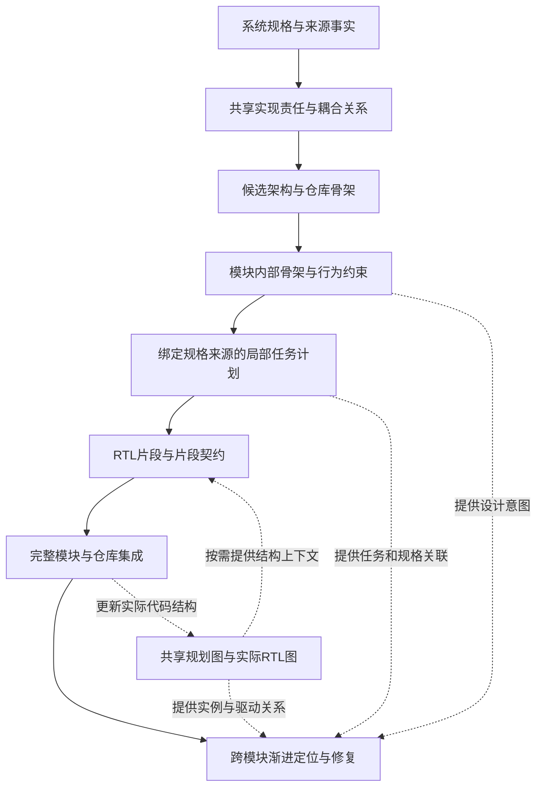

# 骨架引导的长程规划、局部生成与跨模块修复

## 仓库级 RTL Agent 创新点修订稿

修订日期：2026-10-20

本文在原有三项方法的基础上，结合当前代码，将贡献按规划、生成、修复三个阶段重新组织。重点突出骨架拆分和长程计划的作用；知识图谱作为三个阶段共享的结构支撑。仿真、日志和波形只作为修复反馈讨论，不单独提出验证阶段的创新。

文中的方法机制已有代码基础，但效果性表述仍需后续实验支撑。与相关工作的区别限定于已阅读的方法，不作未经充分检索的“首次”声明。

## 1. 论文故事：从局部代码生成走向长程设计意图保持

LLM 已经能够根据局部描述生成 RTL，但仓库级硬件设计要求模型在许多次生成、模块集成和代码修改之间保持一致的设计意图。系统规格中的一项要求，可能需要先影响模块划分，再约束多个代码块，最后体现在跨模块交互中。随着开发过程延长，局部实现容易偏离最初的责任分配、状态组织和接口约定。

硬件的并发性和状态性进一步放大了这个问题。复位、暂停、flush、请求接受和结果提交可能共同作用于同一个状态对象；相关逻辑即使分散在不同代码块中，也必须协调。一个局部片段看起来合理，并不意味着它能与其他片段组成行为一致的模块；多个模块分别合理，也不意味着系统连接和控制关系自洽。

因此，需要同时回答三个问题：**怎样把复杂设计拆成适合实现的骨架，怎样在长程执行中让局部生成遵守整体计划，以及出错后怎样沿实现结构找回相关设计意图。**

本文的方法以分层骨架承载长程计划：先决定模块责任与边界，再形成模块内部结构块和局部任务；生成阶段结合局部规格、行为约束和片段契约完成实现与组合；修复阶段联合实际 RTL 结构、动态失败线索和已有规划，逐步定位并修改相关代码。

这一故事的中心论点是：

> 仓库级 RTL 自动化需要将整体设计意图保存在可持续访问的分层骨架中，使局部生成和后续修复始终能够回到相同的责任、结构与行为约束。

## 2. 三项贡献及其关系

| 阶段 | 方法名称 | 直接对应的问题 |
| --- | --- | --- |
| 规划 | 责任与耦合关系引导的骨架拆分和长程规划 | 模块边界不合理；多轮开发丢失全局设计意图 |
| 生成 | 骨架与行为契约条件化的局部生成和约束合并 | 局部代码缺少组合所需的信息，导致共享状态、接口和控制关系漂移 |
| 修复 | 规划语义与静态、动态证据联合驱动的跨模块渐进修复 | 失败现象与根因位置分离，局部修补缺少系统设计依据 |



图中的规划到修复关联表示上下文复用与定位支持，不表示当前系统已经自动修改高层计划并重新生成全部受影响模块。

## 3. 方法一：责任与耦合关系引导的骨架拆分和长程规划

### 3.1 问题：拆分粒度与长程一致性相互影响

直接让模型从长规格中给出模块列表，容易形成两类结果：过粗的模块积累过多实现责任，增加后续生成负担；过细的模块则切断共享状态和紧密控制关系，引入额外接口与胶合逻辑。

与此同时，一份高层计划如果只说明“有哪些模块”，后续 agent 仍需重新推断模块内部结构、共享对象和实现顺序。随着局部任务推进，模型可能重复声明状态、遗漏特殊路径，或引入与前序实现不一致的约定。

规划阶段需要建立从整体责任到局部实现的连续映射，并使这些决定能在较长的开发过程中持续被访问和使用。

### 3.2 先建立责任基线，再选择模块边界

系统先从规格中提取共享的实现责任清单。每项责任记录行为、输入输出、持有状态、协议、时序类别及责任之间的依赖，并保留来源。

在该清单上产生保守、均衡、细粒度三种架构候选。候选之间共享行为基线，主要改变责任的模块归属和边界组织，而不允许通过删减责任获得更简单的方案。

模块划分需要同时考虑：

- 规格明确给出的模块和层次；
- 状态与控制责任的归属；
- 同周期关系、同一 FSM、复位与 flush 原子性等紧耦合线索；
- 跨模块传递对象、协议和边界信息是否充分；
- 分解后各模块是否具有可独立实现的清晰责任。

当前实现对必要责任的唯一归属、层次合法性和跨模块依赖对应的边界契约执行确定性检查，并将强耦合切分、边界信息不足等风险提供给架构选择器。选择采用顺序相反的两次 LLM 排序，必要时进一步裁决。

这里具有研究意义的机制是：**将需求理解与模块边界决策分开，在同一责任基线上比较架构选择。** 多候选和顺序交换排序是服务于该机制的选择策略。

### 3.3 双层骨架：分别组织硬件边界与代码实现边界

第一层是仓库骨架，组织模块集合、模块责任、父子关系、文件映射、全局约定和生成顺序。

第二层是模块内部骨架，组织声明、实例化、组合逻辑、时序逻辑和辅助结构等代码块。每个块关联局部责任、涉及对象、行为与时序说明、耦合规则和禁止偏离事项；模块层还保存状态组织、全局不变量以及已决定或待定的实现选择。

两种边界分别回答：

| 边界 | 规划问题 |
| --- | --- |
| 硬件模块边界 | 哪些责任适合通过明确接口组织为独立模块？ |
| 模块内部代码块边界 | 哪些实现内容适合由一次局部生成完成，并如何与其他块协调？ |

这使局部生成任务可以更细，而不必为每个任务新建硬件模块。例如，同一寄存器的复位、条件更新和保持要求可以通过骨架统一描述；具体代码的组织仍应符合其更新优先级和驱动关系。

因此，骨架拆分的意义不仅是缩短输出，还在于明确局部实现的责任范围和相互关系。

### 3.4 以骨架承载长程计划

本文所指的长程规划，是跨越多个模块和多个实现步骤的设计承诺与任务组织。它通过持久化的结构化工件实现，而非要求模型始终在对话历史中记住完整设计。

整体关系为：

```text
系统责任与约束
  → 模块架构与生成顺序
  → 模块内部骨架与行为约束
  → 绑定骨架位置和规格来源的局部任务
  → 逐任务执行与后续集成
```

该计划向后续执行持续提供三类信息：

1. **责任连续性**：当前代码块承担什么行为，哪些内容属于其他模块或后续任务。
2. **结构连续性**：当前实现使用哪些共享对象、依赖哪些前序声明与实际子模块接口。
3. **决策连续性**：哪些选择已经确定，哪些事项仍由规格保留实现自由度。

稳定的任务标识、规格引用、结构化工件和依赖顺序，使后续 agent 可以按任务读取相关计划。检查点和恢复机制支持该计划的持续执行，但单独的断点续跑不作为长程规划的新颖性。

当前系统主要是“预先规划、逐步执行、持续读取计划”，尚未实现完整的滚动重规划或自动架构演化，不应将后者写成已完成能力。

### 3.5 可用于论文的方法表述

> 我们提出一种骨架引导的长程 RTL 规划方法，首先在共享实现责任和耦合关系上选择仓库级模块边界，随后构建带行为约束的模块内部骨架，并将其细化为绑定规格来源的局部实现任务。该方法使全局设计承诺能够跨越多轮生成持续作用于局部实现，同时区分硬件模块划分与代码生成粒度。

## 4. 方法二：骨架与行为契约条件化的局部生成和约束合并

### 4.1 问题：局部任务需要保留组合语义

局部生成降低了单次任务复杂度，但同时分散了共享状态和控制关系。独立片段可能重复驱动同一信号，对复位和保持责任作出不同假设，或在合并时改变控制优先级和周期关系。

因此，生成阶段既要限制当前任务的实现范围，也要向后续组合明确交代该片段的行为边界与依赖。

### 4.2 规划条件化的规格选择与局部生成

系统依据模块责任和内部骨架，为实现块选择相关规格原文，再将骨架位置、规格引用和任务描述绑定。规格选择保留来源和原文，不依赖模型重新改写正文形成唯一依据。

每次生成的上下文包含：当前任务的局部行为规格、模块骨架、必要接口约束、已生成片段、相关宏定义，以及可用的子模块接口。不同来源承担不同作用，避免局部生成器自行重定义整个模块或猜测配置。

尤其需要保持两种上下文：局部行为证据帮助完成当前块；模块级结构和接口信息帮助当前块与整体设计保持一致。局部化不能将后者一并丢弃。

### 4.3 联合生成 RTL 片段与片段契约

每个片段同时提供代码及结构化契约：

| 契约字段 | 为组合保留的信息 |
| --- | --- |
| writes / reads | 信号访问范围及潜在冲突 |
| clocking | 时钟或组合更新方式 |
| reset_behavior | 当前片段负责的复位行为 |
| hold_behavior | 非激活条件下的保持要求 |
| latency | 局部实现的时间假设 |
| assumptions | 对其他实现部分的依赖 |

骨架描述该块应该承担的责任，片段契约描述当前代码如何实现及依赖这些责任。两者共同为后续组合提供上下文。

当前实现已经要求显式契约，并核对部分明显赋值目标与 writes 的一致性。保持、延迟等自然语言字段仍作为生成与合并的语义提示，尚未全部转化为可执行约束。

### 4.4 面向整体模块的约束合并与局部修补

合并 agent 结合规格、骨架、任务计划、片段契约、权威宏和实际子模块接口，对声明、驱动关系、实例连接及实现风格进行整合。模块按依赖顺序实现，父模块可以获得已经产生的子模块接口。

该过程允许重构片段，但应保留模块边界及规格要求的行为。片段之间的冲突需要回到共同骨架和来源约束处理，不能仅按文本位置拼接。

结构化产物发生局部错误时，系统限制修补目标，尽量保留未涉及字段和已完成任务。例如，契约字段缺失时可以只修复该字段；代码发生变化时需要同步提供契约，避免代码与描述失去一致性。

### 4.5 可用于论文的方法表述

> 我们提出一种骨架与行为契约条件化的 RTL 局部生成方法，将实现任务绑定到骨架区域和规格证据，联合生成代码片段及其读写、复位、保持和时间假设，并利用整体模块上下文完成约束合并。该方法旨在保留局部生成之间的组合语义，减少共享状态、接口和控制关系在多步实现中的漂移。

该贡献定位于契约辅助的生成与组合；不能据此宣称已经保证组合正确性或完整时序一致性。

## 5. 方法三：规划语义与静态、动态证据联合驱动的跨模块渐进修复

### 5.1 问题：失败位置与修复位置分离

多模块 RTL 的错误会沿数据、控制和实例连接传播。最终输出异常可能来自当前赋值、分支条件、子模块输出或父模块输入。仅修改报错附近的代码容易处理表面现象；一次性加载整个仓库则会增加无关上下文，并使修复范围难以控制。

已有方法已使用 AST 和波形辅助调试。本文进一步关注如何逐步跨越模块边界，以及如何在追踪过程中恢复相关实现的设计责任与行为约束。

### 5.2 从动态失败线索出发逐步扩展调查范围

系统根据日志和波形提取失败信号、时间、观测值及对齐线索，再读取该信号的直接赋值、分支条件和右值依赖。

定位过程根据当前线索选择下一步：条件可能阻止更新时优先调查控制信号；数据可能从上游传播时继续查看右值；信号经实例端口传入或传出时，沿连接关系转到关联模块。

```text
失败信号
  → 直接驱动与分支条件
  → 相关数据或控制信号
  → 实例端口与父子模块连接
  → 下一模块中的相关实现
```

该过程按需扩展调查范围，不要求预先生成完整仓库的跨周期因果图。工具输出的是静态依赖与动态观察支持的定位候选，不应被表述为已经证明的根因。

### 5.3 将长程计划重新用于修复

对被定位线索涉及的模块，系统按关注信号和代码块读取相关规格、骨架行为和任务计划，并提供当前实际 RTL 块。

规划在这里承担修复依据：帮助判断某个更新应该由哪个责任承担，当前实现是否偏离了保持条件、协议或状态组织，以及局部修改是否会影响其他已承担的行为。

骨架块与实际 RTL 块使用不同标识。两者之间的启发式关联用于帮助定位，实际编辑必须指向当前代码对象。这样可以适应合并阶段对原始片段的重构，避免将规划位置直接当作代码位置。

### 5.4 修复决策与可恢复的执行过程

修复 agent 结合规格、代码、当前动态反馈和历史修改决定保留或撤销候选修改。总 mismatch 数是参考信号之一，不能自动等同于修复价值；某次修改可能纠正接口或控制关系，同时暴露新的下游问题。

当前两种后端的具体策略需要分别说明：

| 后端 | 当前机制 | 论文表述边界 |
| --- | --- | --- |
| RepoReAct | 在部分退化或中性补丁情形调用 LLM 判断，并提供规则退化路径 | 不能描述为所有补丁均由独立 LLM Judge 决策 |
| Codex 调试 | 主 agent 依据工具反馈选择接受或回滚；服务端维护候选、基线和证据版本 | 不能套用 RepoReAct 完全相同的证据门控与判断流程 |

两者共享的研究叙述是：以当前证据和设计意图指导局部修改，支持保留中间修复进展，并在状态可恢复的条件下继续调查。版本绑定、快照和回滚是修复执行的支撑机制，不单独作为主要新颖性。

### 5.5 可用于论文的方法表述

> 我们提出一种规划语义辅助的跨模块渐进修复方法，从动态失败线索出发，结合赋值依赖、分支条件和实例连接逐步扩展定位范围，并按需恢复相关模块的规格、骨架行为与实现任务。该方法将长程计划重新用于修复推理，为当前代码对象的选择和修改范围提供设计依据。

当前保存的规划纠错记录可用于后续分析，但尚不能据此宣称已实现自动重规划和依赖模块的完整再生成。

## 6. 知识图谱的定位：三个阶段共享的结构工作空间

原稿将增量知识图谱单列为第二项主贡献。本版将其作为规划、生成和修复之间的共同结构层，以便贡献围绕明确问题展开。

该结构层包含两个视角：规划侧关联模块、规格片段、模块骨架和任务计划；实现侧描述当前 RTL 中的文件、端口、实例、连接和驱动关系。二者通过模块身份及相关工件绑定进行关联。

| 阶段 | 结构层提供的支持 |
| --- | --- |
| 规划 | 保存责任、骨架和任务之间可访问的关联 |
| 生成 | 提供相关规格、实际子模块接口和依赖上下文 |
| 合并 | 帮助读取父子关系、端口和权威配置 |
| 修复 | 支持信号驱动查询、实例边界导航及设计意图恢复 |

应使用“随开发过程更新的仓库结构表示”描述当前能力。当前部分刷新路径仍会重建仓库图，不能仅因提供刷新接口就声称已实现高效的文件级或子图级增量算法。

同样，通用的仓库规划图、代码图导航和意图—实现关联已有 RPG、RPG-Encoder 等基础。本文应突出它们如何服务于 RTL 的责任边界、局部组合和跨实例修复，而非将使用图表示本身作为新颖性。

## 7. 与已有工作的比较逻辑

以下比较是方法定位，不构成性能优越性结论。

| 工作 | 已有核心能力 | 本文应着重说明的增量 |
| --- | --- | --- |
| Spec2RTL-Agent | 规格理解、渐进代码转换及跨阶段反思，最终经 HLS 生成 RTL | 面向直接 RTL 实现，显式区分模块边界与模块内部代码块，并以骨架持续组织实现任务 |
| QiMeng-ChipV-RTL | 信息局部性、规格检索、骨架和片段生成、合并及 AST 辅助调试 | 将局部生成放入多模块仓库的责任与耦合规划中，强调骨架行为和片段组合信息 |
| VeriGraphi | 用 HDA 表达层次、接口、连接并指导层次 RTL 生成 | 进一步明确边界选择机制、模块内部骨架及跨多步实现的计划传递 |
| Hierarchical IRs | 用架构与操作 IR 组织多模块设计，并进行探针辅助调试 | 聚焦代码块粒度的责任和共享对象组织，以及规划块到当前 RTL 块的修复关联 |
| HORIZON | 仓库级持续迭代、状态管理和可执行反馈 | 在通用仓库演化流程中引入硬件专属的骨架规划、局部组合和跨实例定位机制 |

原稿中的 LocalV 比较在本版以本轮阅读的 QiMeng-ChipV-RTL 为主要依据。应描述其目标模块和任务组织方式，避免将“IP-level”简单等同于“只处理小模块”，或把仓库级作为唯一差异。

对 Hierarchical IRs 尤其需要避免泛泛声称“我们也使用层次 IR”。本文需要解释代码形态骨架、任务绑定与片段契约如何组成可持续执行的计划，并在修复阶段继续发挥作用。

参考文献：

1. [Spec2RTL-Agent](https://arxiv.org/html/2506.13905v2)
2. [QiMeng-ChipV-RTL](https://arxiv.org/html/2602.00704v2)
3. [VeriGraphi](https://arxiv.org/html/2604.14550)
4. [LLM-based Hardware Development with Hierarchical IRs and End-to-End Multi-Agent Workflow](https://arxiv.org/html/2608.30659)
5. [HORIZON: Agentic Hardware Design as Repository-Level Code Evolution](https://arxiv.org/html/2606.28279)
6. [RPG: A Repository Planning Graph for Unified and Scalable Codebase Generation](https://arxiv.org/abs/2509.16198)
7. [Closing the Loop: Universal Repository Representation with RPG-Encoder](https://arxiv.org/abs/2602.02084)

## 8. 可直接用于论文的引言与贡献草稿

### 8.1 引言动机

Recent advances in LLM-based RTL generation have improved specification understanding, hierarchical implementation, and tool-assisted debugging. However, repository-level hardware development still requires maintaining coherent design intent across a long sequence of planning, local generation, integration, and repair steps. Decomposing a design reduces the complexity of each generation task, but introduces additional obligations for state ownership, interface consistency, and coordinated control. These obligations may be weakened when architectural decisions are passed between agents as loosely connected descriptions.

We study skeleton-guided long-horizon RTL development. Our approach first organizes specification requirements into a shared responsibility baseline and uses coupling information to guide repository decomposition. It then refines the repository architecture into module-internal skeletons and source-grounded implementation tasks. These persistent planning artifacts guide local RTL generation and contract-assisted composition, and are reused during repair to relate observed failures to design intent and editable code.

### 8.2 三项贡献

1. **骨架引导的长程规划。** 提出责任与耦合关系引导的双层骨架规划方法，在共享责任基线上选择仓库模块边界，并细化为带行为约束、绑定规格来源的局部任务，使整体设计承诺能够跨越多步实现持续被使用。
2. **保留组合语义的局部生成。** 提出骨架与行为契约条件化的 RTL 片段生成和约束合并方法，联合传递局部实现及其读写、复位、保持和时间假设，为跨片段共享状态和接口协调提供明确上下文。
3. **规划辅助的跨模块渐进修复。** 提出联合动态失败线索、静态代码关系和规划语义的修复方法，沿赋值、条件及实例边界逐步定位相关实现，并将设计意图关联到当前可编辑 RTL 块以指导修改。

上述贡献描述方法机制。诸如降低错误率、提高成功率、减少 token 或缩短修复时间等结果，应在获得对应证据后另行补充。

## 9. 当前实现依据与主张边界

| 机制 | 代码依据 | 当前可支持的描述 |
| --- | --- | --- |
| 共享责任与边界契约 | [stage2_decomposition.py](../zerorepo/rtl_impl/module_planner/schemas/stage2_decomposition.py) | 显式表达责任归属、依赖、耦合与边界信息 |
| 多粒度架构选择 | [stage2_agent.py](../zerorepo/rtl_impl/module_planner/agents/stage2_agent.py) | 确定性排除致命结构问题，再结合风险进行选择；尚未证明最优 |
| 模块骨架与行为覆盖层 | [module_skeleton.py](../zerorepo/rtl_impl/module_planner/schemas/module_skeleton.py) | 结构块附着行为、共享对象与决策说明；自然语言约束并非全部被强制执行 |
| 来源绑定与局部任务 | [stage4_module_plan_agent.py](../zerorepo/rtl_impl/module_planner/agents/stage4_module_plan_agent.py) | 保持任务与骨架、规格引用的关联 |
| 片段契约生成 | [stage5_agent.py](../zerorepo/rtl_impl/module_planner/agents/stage5_agent.py) | 显式契约和部分赋值目标检查；时间语义仍未完全程序化 |
| 约束合并 | [stage6_semantic_merge.py](../zerorepo/rtl_impl/module_planner/agents/stage6_semantic_merge.py) | 利用规格、骨架、片段、宏和可用子模块信息整合代码 |
| 计划持续访问与版本绑定 | [planning_graph.py](../zerorepo/rtl_impl/kg_agent/planning_graph.py) | 关联规划工件并检查部分来源版本关系 |
| 跨模块语义读取与追踪 | [tools.py](../zerorepo/rtl_impl/repo_react/tools.py) | 按关注对象选择上下文，提供依赖与实例边界定位线索 |
| 代码块级受限修补 | [local_repair.py](../zerorepo/rtl_impl/module_planner/utils/local_repair.py) | 限制工件修改目标，保留未涉及内容 |
| 修复候选与当前证据绑定 | [session.py](../zerorepo/rtl_impl/codex_debug/session.py) | 区分工作区、候选和基线版本，防止陈旧证据被当作当前证据 |

另有四项边界需要在写作中保留：

- 当前主流程已停用独立时序规划支路，不能依据遗留文件宣称已完成跨模块时序义务的完整抽取与绑定。
- 模块骨架对规格来源的保存不等于需求完整提取，也不保证所有状态责任均正确分配。
- 长程计划当前以持久化工件和固定阶段执行为主，不包含已完成的自动架构重规划算法。
- 修复经验与记忆属于辅助机制。“具有记忆”“使用知识图谱”或“支持回滚”不单独作为主要创新。

## 10. 相对原稿的主要改动

| 原稿 | 本版调整 | 调整目的 |
| --- | --- | --- |
| 方法一概括整个规划、生成和合并链 | 将骨架拆分与长程计划独立为第一贡献，生成与组合成为第二贡献 | 明确各阶段的研究问题，突出骨架规划的价值 |
| 双层结构规划主要列举对象 | 增加共享责任基线、耦合风险和候选边界选择 | 说明模块如何划分以及选择依据 |
| 规格责任分配的说法较强 | 改为计划条件化的来源绑定，并保留需求完整性的限制 | 对齐当前检索与引用机制 |
| 增量知识图谱独立成项 | 调整为规划、生成、修复共享的结构工作空间 | 避免将通用图索引与刷新直接当作核心算法创新 |
| 补丁评价统一描述为 LLM Judge | 区分 RepoReAct 与 Codex，保留各自退化路径和决策机制 | 避免将单一路径推广为整个系统的实现 |
| 动态回溯与静态关系容易被理解为完整因果分析 | 强调逐跳定位候选和规划语义恢复 | 明确定位能力与因果证明之间的边界 |
| AES 时序讨论依赖本地图片并包含较强解释 | 转为共享状态、事件顺序和模块协同的通用研究动机 | 移除不可访问图片，不把动机推断写成实验结论 |

