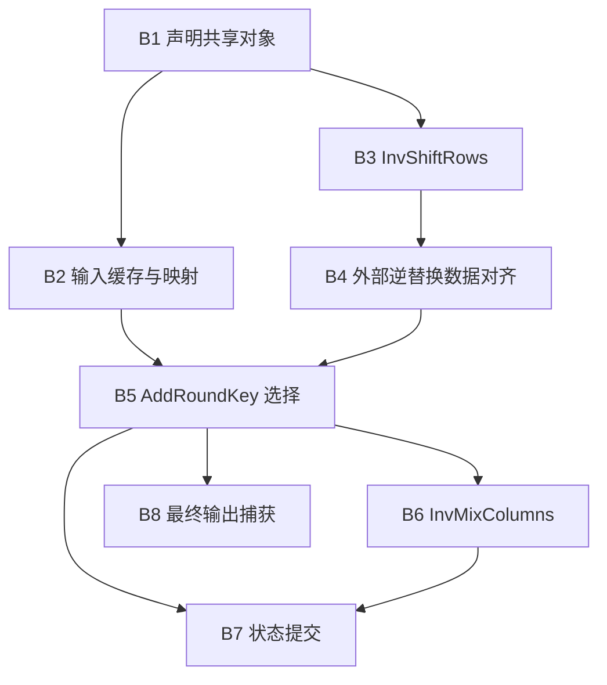
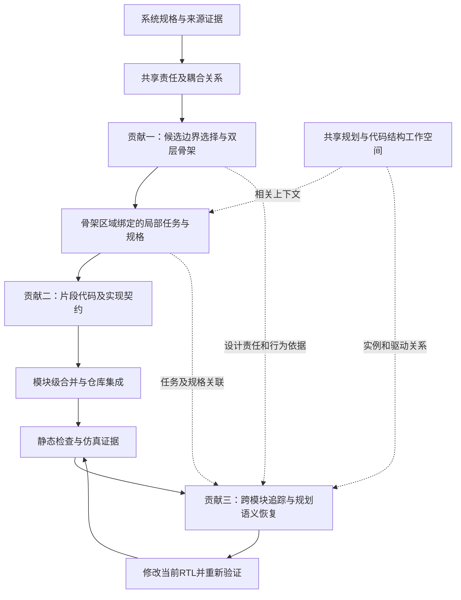

# 面向仓库级 RTL 的长程设计意图保持：自主骨架规划、契约辅助生成与规划依据修复

> 本版根据导师的五点反馈与所附 GPT 分析，核对当前工作区代码、已有运行工件及相关论文。文中的“贡献”是候选研究主张，是否构成充分创新仍需对照实验支持。§2.6、§4.6 引用本地 AES 运行工件，其余例子为机制示意；历史工件不代表当前代码重新运行的结果。核对日期：2026-11-01。

## 0. 组织建议：保留统一问题，调整第三点的定位

**建议采用“责任与耦合感知的自主骨架规划 → 契约辅助局部生成与组合 → 规划语义辅助跨模块修复”作为当前论文的三个方法贡献。** 对应同一个问题：任务局部化以后，硬件设计责任及行为约定怎样在后续多步实现中继续有效。

对所附 GPT 方案的具体取舍如下：

| GPT 的建议 | 本次判断 | 落实到论文的方式 |
| --- | --- | --- |
| 以“长程设计意图保持”组织全文 | 采用，但要定义可观察对象 | 用责任归属、状态更新、事件优先级和接口／周期约定解释“意图”，用跨阶段漂移评价它 |
| 双层骨架连接全局规格与局部任务 | 采用 | 展示真实骨架、责任划分选择和任务绑定，不能只画一个模块树 |
| 用分层契约约束小块组合 | 作为重点研究方向；当前实现只部分支撑 | 区分上层预期义务、下层实现自报与独立检查，优先补齐显式传递 |
| 第三点直接命名为反馈驱动自主规划 | 当前收紧为规划语义辅助修复 | 自主架构选择已有代码，放入第一点；动态任务重规划需补实现与实验才能升格 |
| 知识图谱作为共享工作空间 | 采用 | 放在方法总览中，作为规格、计划和当前代码的共享关联表示，不再单列贡献 |

推荐题目：**《面向仓库级 RTL 生成的长程设计意图保持：自主骨架规划与契约辅助实现》**。跨模块修复是实现过程的一部分，可在摘要和方法中展开。若后续实现动态重规划，再据实验决定是否将“闭环自主规划”放入题目。

当前最值得投入的增量是**把已有设计义务可靠地传给局部执行，并用独立证据检验它**。直接增加完整架构重规划，会同时引入任务失效、产物版本、依赖再生成及终止策略，研究范围明显扩大。

从当前证据看，第一点的决策机制最清楚；第二点是把全文主张做实的关键，但传递与检查仍有缺口；第三点能连接前两点，独立研究价值还需修复消融支持。三个阶段不自动等于三个充分创新点。若规划语义对修复没有可测增益，应将其作为系统能力报告，而不是强行列成独立方法贡献。

## 1. 先回答：这篇论文究竟解决一个什么问题？

建议把全文收束到一个问题：

> **在仓库级 RTL 的多步开发中，怎样使早期确定的责任归属、状态组织与交互约定，持续约束后续的局部生成、模块组合和错误修复？**

可以将其称为“长程设计意图保持”。但这个问题本身不是首次提出：已有 RTL 工作也关注跨 agent 的语义漂移与接口一致性。本文需要证明的增量在于：**如何把硬件责任与耦合关系细化成代码块任务，如何传递组合所需的约束，以及如何在代码重构后恢复相应规划依据。**

这里有一条具体的问题链：

1. **规划时，分解会改变责任边界。** 仅按功能名称拆模块，可能把共享状态、同一控制优先级或紧耦合更新关系切开，产生难以实现的接口。
2. **执行时，局部化会削弱整体约束。** 小块分别实现正确，仍可能对同一个状态的复位、保持、更新与提交作出不同解释。
3. **修复时，代码变化会打断原有对应关系。** 合并后的实际代码块可能不再对应原始占位符；只读错误附近的代码，无法确定应该恢复哪一项设计责任。

三个创新点应依次回应这三个障碍：

| 贡献 | 需要回答的研究问题 | 候选方法主张 |
| --- | --- | --- |
| 一：自主骨架规划 | 怎样选择不会破坏关键硬件耦合关系的实现边界，并把架构细化到局部任务？ | 共享责任基线上的候选边界选择，以及仓库／模块内部双层骨架 |
| 二：契约辅助的局部生成与组合 | 怎样让小块生成仍保有与其他块协作所需的责任、读写和行为信息？ | 任务与规格绑定，片段代码与契约联合生成，模块级约束合并 |
| 三：规划依据的跨模块修复 | 怎样把失败现象关联回当前代码及原始责任，减少无依据的局部改写？ | 动静态证据渐进追踪，按需恢复规格、骨架和任务语义 |

**“自主规划”和“骨架”归入同一贡献：自主规划是产生设计决策的过程，骨架是这些决策供后续执行使用的载体。** 把它们拆成两个独立创新点，容易重复。知识图谱作为三者共享的结构工作空间，不再单列成第四个创新点。

本文使用“设计意图”时，应具体指四类可回溯内容：某项行为由谁负责；某个状态由谁更新及怎样复位／保持；多个事件发生时怎样选择；模块之间传递什么以及何时有效。其中，规格明确要求是必须满足的事实，planner 在规格允许范围内选择的实现方式是可修订决策。后者不能覆盖前者，也不要求修复后保留所有代码形态和中间信号名称。

## 2. RTL 骨架到底是什么样的？它与长程规划是什么关系？

### 2.1 先区分四个对象

| 对象 | 回答的问题 | 本仓库中的形式 |
| --- | --- | --- |
| 架构决策 | 哪项行为由哪个模块承担，哪些依赖跨越模块边界？ | 责任清单、候选架构、逻辑边界契约、选择记录 |
| 骨架 | 已选择的架构和模块内部实现，组织成什么结构？ | 仓库骨架 JSON；模块骨架 Markdown 及结构化导出 |
| 任务计划 | 接下来实现哪个区域，需要哪些原始规格？ | 按骨架位置绑定的 `subtasks`，包含 `id/target/description/spec_refs/constraints` |
| 实际 RTL | 最终有哪些声明、驱动块和实例连接？ | 片段与合并代码，以及从实际代码提取的结构图 |

因此，**骨架属于 agent 的外部计划表示，也是一种面向 RTL 代码形态的中间表示**。它提供结构与行为约束，不是已经实现的完整 RTL，也不等同于一个文件目录。

### 2.2 第一层：仓库骨架组织硬件边界

仓库骨架保存：

- 模块集合、责任描述、类型与文件位置；
- 父子模块关系、实例提示、复用情况；
- 时钟复位、数据约定及跨模块对齐说明；
- 模块生成顺序及顶层集成说明。

责任归属和逻辑边界契约的详细记录还保存在 `stage2_decomposition.json`，不能把全部字段都说成位于 `repo_skeleton.json`。

例如，一个假设的迭代计算系统可以有如下规划：

```text
stream_top                         ← 系统集成、外部请求与结果接口
├── iteration_ctrl                ← 接受请求、推进迭代、发出提交控制
└── transform_datapath            ← 按控制更新数据、提供计算结果

生成顺序：iteration_ctrl、transform_datapath、stream_top
边界义务：明确传递对象、方向、协议、时序类别、时钟与复位语义
```

这不是要求任何设计都拆成控制和数据通路。若两者共享状态且无法形成自然接口，规划器应考虑保留在同一模块；规格明确规定的模块和层次也应受到尊重。

### 2.3 第二层：模块内部骨架组织代码生成边界

当前 Stage3 先产生 `MODULE_SKELETON_DOC v1` Markdown，再解析为结构化导出，包含五部分：

| 部分 | 具体内容 | 对后续 agent 的意义 |
| --- | --- | --- |
| Module Identity | 模块、文件、规格与仓库骨架引用 | 确认当前任务的来源和范围 |
| Module Frame | ANSI 模块声明和端口，以及代码块占位符 | 固定模块外部边界、提供填充位置 |
| Structural Skeleton | `block_id/block_kind/purpose/code_shape/depends_on` 等 | 指明代码块形态、责任和依赖 |
| Behavioral Overlay | 模块状态模型、不变量；块级责任、时间语义、共享对象、耦合与禁止偏离项 | 保存只靠占位符无法表达的设计要求 |
| Decision Ledger | 已定决策、待定事项、结构及行为风险 | 区分必须遵守的承诺与仍可选择的实现细节 |

以下是**示意模块框架**，保留签名与占位符，不提前实现状态机或赋值：

```verilog
module iteration_ctrl (
    input wire clk,
    input wire rst_n,
    input wire flush,
    input wire stall,
    input wire start,
    input wire step_done,
    output wire busy,
    output wire commit
);

// <block: decl_control_objects>
// <block: seq_control_update>
// <block: comb_status_outputs>

endmodule
```

对应的结构化信息可以如下表达。下面只展示导出中的部分字段，省略文件、来源、占位符正文等内容：

```json
{
  "module": "iteration_ctrl",
  "structural_blocks": [
    {
      "block_id": "B1",
      "block_label": "decl_control_objects",
      "block_kind": "decl",
      "purpose": "声明控制状态与共享控制对象",
      "code_shape": "declaration group",
      "depends_on": []
    },
    {
      "block_id": "B2",
      "block_label": "seq_control_update",
      "block_kind": "seq",
      "purpose": "统一承担控制状态的复位、清除、保持与推进",
      "code_shape": "clocked state-update region",
      "depends_on": ["B1"]
    },
    {
      "block_id": "B3",
      "block_label": "comb_status_outputs",
      "block_kind": "comb",
      "purpose": "从内部控制对象导出外部状态与提交信号",
      "code_shape": "combinational output region",
      "depends_on": ["B1", "B2"]
    }
  ],
  "module_behavior": {
    "control_style": "undecided",
    "global_invariants": [
      "flush 后不得提交被取消的事务",
      "stall 时保持迭代进度，但不阻止更高优先级的 flush"
    ],
    "open_semantic_questions": ["具体状态编码由后续实现决定"]
  },
  "block_behavior_overlays": [
    {
      "block_id": "B2",
      "responsibilities": ["负责控制状态的完整生命周期"],
      "timing_semantics": ["在 clk 上升沿更新；rst_n 为低有效异步复位"],
      "touched_objects": ["control_state", "iteration_progress", "commit_pending"],
      "coupling_rules": ["复位优先于 flush，flush 优先于 stall，stall 优先于普通推进"],
      "forbidden_drift": ["不得在其他时序块再次驱动这些状态对象"]
    }
  ],
  "decision_ledger": {
    "chosen_decisions": [
      {
        "topic": "控制状态更新归属",
        "decision": "相关状态由 B2 的统一更新区域负责",
        "reason": "保留复位、清除、保持与推进之间的优先级"
      }
    ],
    "deferred_decisions": ["规格未指定的状态编码"]
  }
}
```

该例**假设规格已经规定上述复位形式和事件优先级**。实际规划必须从规格取证，不能因为例子这样写就为其他设计添加相同规则。共享状态的生命周期宜统一归属；把复位和普通更新随意分给不同 writer，会制造多驱动问题。

由此可见，模块内部骨架提供的是“结构位置＋行为承诺”。**代码块拆分也不等于新建硬件模块**：B1、B2、B3 可以由不同生成任务完成，最终仍组成一个 `iteration_ctrl`。

### 2.4 从骨架变成实际可执行的任务

上述 B2 可被细化为如下计划项，字段对应当前 `ModulePlanSubtask`：

```json
{
  "id": "B2_seq_control_update",
  "target": "<block: seq_control_update>",
  "description": "实现控制状态更新，统一处理复位、flush、stall 与普通迭代推进",
  "spec_refs": ["S_reset", "S_flush", "S_iteration"],
  "constraints": [
    "遵守规格规定的事件优先级",
    "保持这些状态对象的单一时序更新归属",
    "不得擅自增加流水级"
  ]
}
```

`spec_refs` 在这里是示意标识，真实任务应引用对应模块中实际存在的规格块。当前 Stage4 会检查任务数、标识、目标与骨架块的对应，以及引用与检索结果的一致性。

骨架规定“有哪些区域及其设计义务”，任务规定“本次执行做什么以及依据哪段原文”。后续生成可以围绕这一任务读取上下文，而不是每次重新理解全部设计。

### 2.5 为什么这是长程规划，而不只是长代码生成？

本文的“长程”指 **agent 开发过程中跨多个模块、多个任务、集成与修复轮次的决策依赖**。它不同于 RTL 运行时的 clock cycle：一个组合电路也可能需要很长的开发轨迹，一个运行很多周期的小计数器却可能一次生成完成。

长程性体现在：早期状态归属和模块接口决策，要在若干步骤后约束父模块集成；合并改变代码布局后，修复仍需找到相关设计责任。骨架把这些跨步骤依赖保存为外部工件。

可将计划概括为：

```text
责任及其耦合关系
  → 模块归属与逻辑边界
  → 仓库骨架
  → 模块内部结构与行为骨架
  → 绑定规格来源的局部任务
  → 片段生成、模块合并与集成
```

这是**持久化分层计划支持的长程执行**。检查点只解决恢复执行位置；JSON 只提供表达形式。论文需要研究的是：哪些设计承诺被保存，它们怎样影响后续决策，以及遗漏这些承诺会产生什么错误。

### 2.6 用仓库已有 AES 工件说明“自主决定什么、骨架长什么样”

本地 [AES 解密划分记录](../rtl_outputs/aes_inv_cipher_system_hard/.zerorepo/module_planner/outputs/stage2_decomposition.json) 保存了同一份 **13 项责任、22 条依赖**上的三个候选：

| 候选 | 模块数 | 跨模块依赖数 | 强耦合切分数 | 逻辑边界契约数 |
| --- | --- | --- | --- | --- |
| conservative | 1 | 0 | 0 | 0 |
| balanced | 6 | 13 | 8 | 13 |
| modular | 11 | 20 | 15 | 20 |

两次交换呈现顺序的排序都选中 balanced。工件中的理由包括：保留逆变换数据通路的紧耦合关系，把密钥缓存与轮密钥选择放在一起，同时保留可复用 S-box 和轮常量模块。这是模型的选择解释，**不是更高功能成功率的实验结论**；该记录的状态为 `selected_with_degradation`，还保留了强耦合切分和边界信息等风险。

这个例子说明：规划并非“模块越多越好”，也并非“切分越少越好”。保持一个硬件模块的内部耦合，仍然可以通过代码块任务降低单次生成复杂度。

选中的 `aes_inv_cipher_datapath` 具有 [Markdown 骨架](../rtl_outputs/aes_inv_cipher_system_hard/.zerorepo/module_planner/outputs/module_skeleton_docs/aes_inv_cipher_datapath.md)及 [JSON 导出](../rtl_outputs/aes_inv_cipher_system_hard/.zerorepo/module_planner/outputs/module_skeleton_json/aes_inv_cipher_datapath.json)，包含八个区域：



上图逐项对应 JSON 中的 `depends_on`，表达规划层块依赖，不是完整电路网表。骨架还保存“最终轮省略 InvMixColumns”“保持列优先字节映射”等模块不变量；[局部任务计划](../rtl_outputs/aes_inv_cipher_system_hard/.zerorepo/module_planner/outputs/module_plan_json/aes_inv_cipher_datapath.json)再把区域对应到具体 `target` 和 `spec_refs`。

向导师展示时，建议并排放三张图：候选划分对比、选中模块的八块骨架、某个块的任务与片段契约。这样可以直接展示架构选择、计划表示和局部执行的区别。

## 3. 自主规划的创新点具体在哪里？

### 3.1 自主的是哪些决策？

| 内容 | 当前系统如何处理 | 应如何定位 |
| --- | --- | --- |
| 阶段顺序 | 开发者预设 Stage1—Stage6 的流程 | 工程工作流，不作为自主规划创新 |
| 顶层与明确模块 | 从规格证据锁定或解析，检查明确层次要求 | 受规格约束的规划前提 |
| 责任清单 | 提取行为、输入输出、持有状态、协议、依赖及来源 | 建立可比较的共同需求基线 |
| 候选模块边界 | 在同一责任清单上产生 conservative、balanced、modular 候选 | 自主提出不同粒度的责任分配方案 |
| 候选选择 | 确定性排除致命错误，结合风险做 LLM 排序与必要裁决 | 约束下的架构决策 |
| 模块内部组织 | 产生代码形态骨架、共享对象、行为约束与决策记录 | 自主把架构细化为局部实现区域 |
| 局部任务 | 绑定骨架位置、相关规格与任务说明 | 形成可执行的细化计划 |

因此，“自主”不意味着可以改变规格或任意发明接口，而是**在规格允许的设计空间内，自主决定责任边界、实现组织与任务细化**。

### 3.2 候选选择的可讲述机制

当前 Stage2 的机制可以写成以下过程：

1. 提取一份共享责任清单，保留状态归属、依赖强度、交互对象与规格来源。
2. 在同一清单上提出三种粒度的候选；规格明确规定的模块与层次应被保留。
3. 检查顶层身份、责任唯一归属、层次合法性以及跨模块依赖是否具有边界契约；致命违规候选不能入选。
4. 把强耦合切分、边界信息不足、缺少来源、过多胶合关系等作为风险交给选择器。
5. 对有效且不同的候选进行正反呈现顺序的两次 LLM 排序；分歧时进一步裁决，并记录降级路径。
6. 把选中架构转为仓库骨架，再向模块内部骨架和局部任务细化。

**强耦合切分目前是风险项，不是必然拒绝项。** 字段名 `hard_violations` 容易产生误解：当前选择逻辑主要以 `fatal_violations` 排除候选，其余风险保留给 LLM 判断。没有实现一个可证明求最优的划分求解器，也没有通过未来仿真 rollout 比较全部架构。

研究主张应落在：

> **把“需求责任是什么”与“责任应该如何分配”分开，在共享责任基线上显式考虑状态和控制耦合，再把选出的架构细化到代码块任务。**

三候选采样、交换排序顺序和断点续跑是实现策略，单独都不足以承担主要创新。

### 3.3 与普通 planner 的差异应怎样写？

普通的“先列步骤再执行”也能产生模块列表。本文需要显示额外处理了硬件特有的分解问题：**共享状态归谁、什么更新不能随意拆开、跨边界必须传什么、细粒度生成是否一定要引入新模块**。

可用如下贡献句：

> 我们提出责任与耦合关系引导的自主骨架规划方法，在共享规格责任基线上比较候选模块边界，并将选中架构细化为模块内部结构、行为义务及来源绑定的局部任务，使硬件架构决策能够在多步实现中持续被访问。

### 3.4 当前还不能称为完整的闭环自主重规划

现有主流程主要是预先规划、按阶段执行、读取计划，并在生成和调试中进行局部修补。代码存在规划纠错日志与 override 工件，但这不等于已经打通：

```text
执行证据 → 判断计划失效 → 修改骨架／责任边界
        → 使受影响任务和产物失效 → 重生成依赖模块 → 重新验证
```

如果论文希望把“反馈驱动自主规划”作为更强主张，上述链路需要补齐。不能把补丁回滚、重复生成或记录纠错都称为架构重规划。

所附 GPT 分析中的“Implementation Task DAG＋验收条件＋动态状态”也应标为建议设计。当前 `ModulePlanSubtask` 主要含 `id/target/description/spec_refs/constraints`，骨架有 `depends_on`，Stage5 则按 `module_plan.subtasks` 顺序生成。模块、检查点和调试层已有状态记录，但不能据此声称已有统一的、随失败证据更新依赖的任务 DAG 调度器。

当前已有输入指纹、片段复用检查和失效后重生成；这些是重要的工程基础。它们判断“当前产物是否仍适用于当前输入”，与根据失败证据判断“责任划分或任务内容应该怎样改”是不同机制。

## 4. 契约在 agent 中属于什么？怎样呈现？有什么不同？

### 4.1 契约是外部约束工件，不是一个独立智能体

在这里，契约属于 agent 的**外部任务状态与约束表示**。planner 或生成器产生它，检索器、生成器、合并器或检查工具读取它。它可以用 JSON 字段、Markdown 行为覆盖层或工具返回值呈现，并通过 prompt 进入模型上下文。

只有接入程序检查的部分，才形成对应的强制门控。把“必须保持一个周期”写进自然语言字段，并不自动得到时序证明。

当前代码中要区分以下几类内容：

| 层次／类型 | 表达的约束 | 当前表示与主要消费位置 |
| --- | --- | --- |
| 规格事实与模块接口 | 原文依据、端口、位宽、时钟复位及功能描述 | `contracts.py` 中的事实／契约 schema，规格工件；供规划与后续接口上下文使用 |
| 架构边界契约 | 跨模块责任、传递对象、方向、协议、时间类别与来源 | `LogicalBoundaryContract`；用于 Stage2 候选检查，相关模块的 Stage3 也读取选中边界 |
| 模块与块级规划约束 | 全局不变量、状态模型、局部责任、共享对象和禁止偏离 | `module_behavior`、`block_behavior_overlays`、任务 `constraints`；用于骨架细化及规格选择 |
| 片段实现契约 | 当前生成代码的读写、时钟、复位、保持、延迟和依赖假设 | `FragmentContract`；随代码产生，保存到 `fragments/<module>_contracts.json`，供合并分析 |
| 实际子模块接口 | 当前已实现子模块的完整端口信息 | 代码接口提取与规划图上下文；约束父模块实例连接 |

其中“块级规划约束”是对现有字段的研究归纳，并不是代码里已经存在一个统一的 `HierarchicalContract` 类。几类工件的来源和权威性也不同，不能混称为一份已完全形式化的契约。

### 4.2 一份片段契约具体是什么样？

假设示例任务 B2 生成了控制更新片段，它同时返回：

```json
{
  "subtask_id": "B2_seq_control_update",
  "target": "<block: seq_control_update>",
  "spec_refs": ["S_reset", "S_flush", "S_iteration"],
  "contract": {
    "writes": ["control_state", "iteration_progress", "commit_pending"],
    "reads": ["clk", "rst_n", "flush", "stall", "start", "step_done", "control_state", "iteration_progress", "commit_pending"],
    "clocking": "posedge clk",
    "reset_behavior": "rst_n 低有效异步复位，清除控制状态及待提交标志",
    "hold_behavior": "正常运行时 stall 保持进度；复位和 flush 按更高优先级处理",
    "latency": "状态在当前有效时钟边沿后更新；不额外引入流水级",
    "assumptions": ["B3 从这些内部对象导出外部状态，不再次时序写入它们"]
  }
}
```

这是完整代码响应中的契约部分，省略了 `task_id/module/code` 等字段。`writes/reads` 是生成器报告的访问集合，不是独立证明结果；`clocking` 的简写也不能代替 `reset_behavior` 中的异步复位说明。

规划约束表达“这个块应承担什么”；片段契约报告“这份代码声称怎样实现，以及依赖其他块什么”。**下层自报契约不能推翻上层规格要求**。即使代码与它自己生成的契约一致，两者仍可能一起偏离规格。

### 4.3 与其他 RTL agent 用契约的区别

必须正面承认：**契约、多 agent 对齐、接口和复位时序约定均已有先例。**

[Veri-Sure](https://arxiv.org/html/2601.19747v1#S3.SS2) 在 §3.2 和附录 B.1 中用共享 JSON 设计契约表达接口、时钟复位、输出延迟和功能要求，并服务于生成、调试与验证。因此，不能把“用契约减少跨 agent 语义漂移”单独当作本文新增机制。

[QiMeng-ChipV-RTL](https://arxiv.org/html/2602.00704v2#S3.SS3) 在 §3.3 中已经包含骨架占位符、任务分解、局部规格检索、片段生成及合并。因此，“把 RTL 分成小块再生成”也不是充分差异。

本文值得检验的区别，是以下链路是否被显式连接并有效使用：

```text
规格及责任边界
    ↓ 约束局部责任与共享对象
模块／块级骨架义务
    ↓ 绑定具体任务与原文来源
局部 RTL ＋ 实现契约
    ↓ 汇总依赖和冲突
依据共同模块约束进行合并
```

可以称为**面向局部生成与组合的分层约束传递**。关键不在多了一种 JSON 格式，而在：生成前限制局部任务的责任和允许修改范围，生成后显式交代其写入对象与协作假设，合并时重新依据共同规格处理冲突。

例如，B2 契约声明负责 `iteration_progress`，另一个片段又声明写入它，这可以成为合并时的冲突线索；若某片段声称“stall 时无条件保持”，上层却要求 flush 优先，则需要用上层行为义务纠正它。前者已有部分程序支持，后者目前主要依赖模型语义判断。

这还不是形式化的 assume-guarantee 组合证明。不能从所有片段各自通过检查，推出整个模块功能正确。

### 4.4 核对代码后，必须收紧的一处主张

**当前存在“骨架保存了行为信息”与“局部执行完整读到了行为信息”之间的缺口。**

- Stage3 保存模块行为与块级覆盖层，Stage4 的块规格检索会读取块级结构和行为信息，任务规划也可读取骨架文档。
- Stage5 的 `_read_module_skeleton_context()` 当前返回 `_extract_module_frame_section(text)`，也就是模块框架，并不返回完整行为覆盖层。
- Stage5 的紧凑规划图序列化主要提供模块、工件绑定、规格关联和接口，未直接序列化完整 `module_behavior` 与 `block_behavior_overlays`。
- Stage6 的专用骨架读取同样提取 Module Frame；它另有任务计划、规格、片段契约及依赖上下文，但这些不等于显式获得全部上层行为义务。

因此，当前能支持的是：**骨架行为参与前序规划与检索，局部生成依据任务和规格执行，片段契约辅助组合。** 还不能声称每个片段都受到完整、显式、可审计的分层行为约束。

若要把“分层约束传递”提升为充分落地的主贡献，最直接的补强是：按当前 `block_id` 向生成器与合并器显式传入相关 overlay、必要的模块不变量和已定决策，记录传入来源，并检查片段访问范围与上层责任是否冲突。该补强是建议工作，本次文档修改没有改动代码。

### 4.5 当前已有的约束强度

| 检查 | 当前能力 | 不能推出的结论 |
| --- | --- | --- |
| 片段身份与规格绑定 | 检查任务、模块、目标和 `spec_refs` 一致性 | 引用存在不等于引用内容足够完整 |
| 显式片段契约 | 无显式契约不能提交生成片段 | 有契约不等于契约符合规格 |
| 部分代码／契约一致性 | 用启发式匹配发现明显赋值目标未列入 `writes` | 不是完整 AST 访问分析或形式化证明 |
| 合并冲突 | 语义合并路径利用契约写集合报告多 writer 提示，并检查部分实际驱动问题 | 片段写集合交叉不必然代表最终代码非法；合并可以重构 |
| 复位、保持、延迟 | 自然语言描述供生成与合并推理 | 尚未全部转为可执行的时序约束 |

可用的当前贡献句是：

> 我们提出面向骨架任务的契约辅助局部生成与组合方法，将任务绑定到代码区域与规格证据，联合生成片段代码及其读写、复位、保持和时间假设，并在模块级上下文中分析片段依赖与冲突。

### 4.6 一个真实的责任歧义：声明块为什么也开始写状态？

同一 AES 工件提供了比假设 FIFO 更直接的研究动机：

1. [骨架 JSON](../rtl_outputs/aes_inv_cipher_system_hard/.zerorepo/module_planner/outputs/module_skeleton_json/aes_inv_cipher_datapath.json)将 B1 标为 `decl`，其行为覆盖层写明 `Declaration only; no update semantics.`。
2. [任务计划](../rtl_outputs/aes_inv_cipher_system_hard/.zerorepo/module_planner/outputs/module_plan_json/aes_inv_cipher_datapath.json)给 B1 的描述又包含 `with reset-to-zero semantics`。这使“声明状态”与“实现状态复位”之间出现歧义。
3. [B1 生成片段](../rtl_outputs/aes_inv_cipher_system_hard/.zerorepo/workspace/fragments/aes_inv_cipher_datapath_fragments.v)除了声明，还生成时序复位块，写入 `text_in_r`、`sa00`—`sa33`、`text_out_r`。
4. [片段契约](../rtl_outputs/aes_inv_cipher_system_hard/.zerorepo/workspace/fragments/aes_inv_cipher_datapath_contracts.json)也报告这些写入，并假设合并器会将它们与其他块的正常更新逻辑合并。B2、B7、B8 同时分别承担这些状态的更新。
5. [合并报告](../rtl_outputs/aes_inv_cipher_system_hard/.zerorepo/module_planner/outputs/merge_reports/aes_inv_cipher_datapath_merge_report.json)记录了对应的多 writer 提示；报告中的静态检查为 pass、lint 为通过，最终 `signal_ownership` 将这些状态分别关联到实际驱动块。

这条记录说明：**实现契约可以如实报告代码做了什么，却仍不足以保证它遵守骨架分配的责任。** 当前流程可以把协调工作留给合并器；若要声称分层约束已经限制局部生成，还需检查下层实现相对于上层预期是否越界。

该例不能证明最终 RTL 功能失败，也不能证明问题必然由 Stage5 未收到完整 overlay 导致：任务细化本身已有歧义。它适合作为待验证的漂移案例，推动检查同时覆盖 **Stage3→Stage4 的责任细化**和 **Stage4→Stage5 的实现约束**，而不只核对代码与自报契约是否一致。

论文中可据此明确两个方向：预期义务由规格和规划给定，不能让生成器自行放宽；实现契约用于报告并检查当前片段，不能代替预期义务。声明对象与时序写入对象也需区分，`touched_objects` 不能直接当成允许写入集合。

## 5. 第三个创新点为什么是同一故事的后半段？

### 5.1 前向实现之后，仍要找回设计责任

骨架到 RTL 不是逐字替换：合并器可能把片段重组为新的驱动块。出现系统级失败后，必须同时回答：

- 失败信号现在由哪个真实代码块或子模块驱动？
- 该块原本应承担什么责任，依据哪段规格？
- 修改这里是否会破坏其他状态更新或跨模块义务？

这自然承接前两项贡献：**规划保存设计承诺，局部生成落实承诺，修复重新取回承诺并校正当前实现。**

### 5.2 当前可讲的机制

从失败日志和波形得到时间、信号及观测线索，再沿直接驱动、分支条件、右值依赖和实例端口逐步扩展调查范围。针对关注模块、信号和代码块，读取相关规格、骨架行为和任务计划，并与当前 RTL 对照。

```text
失败的顶层输出
  → 实际驱动块及分支条件
  → 上游数据／控制信号
  → 实例端口连接
  → 相关子模块中的当前代码
  → 取回该模块的规格、骨架义务和任务说明
  → 生成并验证局部修补
```

在示例中，症状可能是 flush 后仍产生 `commit`。修复需要检查真实提交信号的驱动路径，以及 `commit_pending` 的取消行为；同时取回“flush 后不得提交被取消事务”的原始义务。仅在输出处添加屏蔽条件，可能掩盖内部待提交状态未清除的问题。这个例子是待验证的诊断场景，不表示现有工具能自动证明根因。

### 5.3 与已有定位／修复能力的关系

AST、波形辅助定位、静态切片和局部补丁已有先例。候选增量应聚焦：**跨实例边界按需扩展定位，并在合并重构后的实际代码上恢复相关的规划语义**。

骨架块 ID 与实际 RTL 块 ID 不能视为同一个标识。当前关联含有启发式成分，最终编辑必须指向当前代码对象。RepoReAct 还具有修补前的实现、失败及设计／结构证据门控；其他调试后端应分别核对，不能一概声称使用同一门控或补丁评价算法。

可用贡献句是：

> 我们提出规划语义辅助的跨模块渐进修复方法，结合动态失败线索、静态驱动关系与实例连接按需扩展调查范围，并恢复相关规格、骨架行为和实现任务，为当前代码的修改提供设计依据。

这构成验证反馈驱动的**实现修复**，尚不构成反馈驱动的完整**架构重规划**。

## 6. 参考长程规划与 VLA：借鉴什么，不能直接搬什么？

### 6.1 长程规划与 VLA 的机制对照

| 工作 | 原文中的机制 | 对本文写作的启发 | 与当前系统的界限 |
| --- | --- | --- | --- |
| [Plan-and-Act，§3](https://arxiv.org/html/2503.09572v1#S3) | Planner 产生高层计划，Executor 落实动作；动态版本根据执行状态更新计划 | 明确计划表示、执行动作及反馈分别是什么 | 当前不能声称已有逐步动态重规划；规划／执行分离本身也已有先例 |
| [ADaPT，§3](https://arxiv.org/html/2311.05772v2#S3) | Executor 无法完成时，按需递归分解任务 | 讨论任务粒度与执行能力的关系，而不只说“拆得更细” | 当前 Stage2 候选划分不等于失败驱动的递归再分解 |
| [Hi Robot，§4.1—4.2](https://arxiv.org/html/2502.19417v2#S4) | 高层 VLM 根据任务、观察和交互产生语言子命令，低层 VLA 执行动作 | 讲清楚高低层之间传什么，以及反馈如何影响后续行为 | 本系统不包含其机器人训练、高低频策略或具身观察机制 |
| [SayCan，Approach](https://say-can.github.io/) | 把语言提出的任务与技能可执行性结合 | “计划合理”还需结合下层是否能执行；对应检查边界和代码生成可行性 | 它是具身规划的相关前驱，并非 VLA；本系统没有学习到的技能价值函数 |
| [VLA-OS](https://arxiv.org/abs/2506.17561) | 在统一架构系列中控制比较规划范式与表示，分析分层方式的效果及成本 | 将“表示保存了什么信息”和“多一层 planner”分开消融，并报告额外推理成本 | 不能用机器人中的优劣结论替代 RTL 实验 |
| [MindExplore，ICCV 2025](https://openaccess.thecvf.com/content/ICCV2025/html/Li_Towards_Long-Horizon_Vision-Language-Action_System_Reasoning_Acting_and_Memory_ICCV_2025_paper.html) | reasoning 产生 meta-action，acting 调用技能专家，memory 连接执行反馈与后续调整 | 逐一说明两层之间的命令、状态和反馈怎样传递 | 本系统的纠错工件尚不等于已闭合的动态重规划链路 |
| [HiAgent，ACL 2025](https://aclanthology.org/2025.acl-long.1575/) | 用子目标组织工作记忆，以摘要替换已完成子目标的冗余动作观察 | 区分持久化设计承诺与可压缩执行历史，检验必要约束是否在压缩后保留 | 它是通用长程 agent 的记忆方法，不应归类为 VLA |

这些是机制对照与写作启发，不意味着机器人实验可以证明 RTL 方法有效。

### 6.2 把 VLA 的写法映射到 RTL

Hi Robot 的论证是把复杂指令到低层动作之间的决策分开，并明确中间语言命令如何被执行。借鉴到 RTL，应具体定义以下接口，而不是仅引用 System 1／System 2 的名称。下表是本文的分析映射。

| VLA 分层问题 | RTL 对应问题 | 本文应给出的对象 |
| --- | --- | --- |
| 高层决定下一子任务 | 决定模块责任及待实现代码区域 | 仓库骨架、模块内部骨架与局部任务 |
| 中间命令连接两层 | 向生成器交代局部目标和必须保留的约束 | `target/spec_refs/constraints`；若补强则加入显式行为切片 |
| 低层落实动作 | 生成片段、合并模块、应用补丁 | 当前 RTL 及相应工具操作 |
| 观察环境与进度 | 查看代码、接口、lint、仿真及波形 | 实现状态与验证证据 |
| 用反馈调整后续子任务 | 判断是实现偏差还是计划本身失效 | 当前有局部修复；完整计划失效与重规划链路仍待补齐 |

机器人技能主要沿时间顺序执行；RTL 模块会并发运行并共享状态约束。因此，RTL 的中间计划还必须表达**状态归属、并发交互和事件优先级**。这是领域特征带来的研究切口，仍需与已有硬件分层 IR 正面对比。

### 6.3 长程创新应如何验证？

不能只说“模块更多、代码更长、运行更久”。应在固定任务定义下记录：实现任务数、模块层次、跨模块依赖，以及一个早期设计决策要经过多少后续任务才被使用或检验。重试次数可以作为成本，但不能人为堆出任务的长程难度。

核心假设是：随着跨步骤依赖加深，保存并传递设计承诺能减少后续责任、接口和行为漂移。需要观察这类错误随开发进度的变化，以及完整系统相对合理基线是否更稳。该假设还没有实验结论。

## 7. 相关工作对比：把最接近的工作放在前面

以下是基于本轮阅读的机制定位，不是“对方绝对没有某能力”或性能优越性判断。最终投稿前还需逐项核查论文版本与公开代码。

| 工作 | 已有机制 | 本文需要展示的具体增量 |
| --- | --- | --- |
| [Veri-Sure](https://arxiv.org/html/2601.19747v1) | 共享设计契约、时间追踪、局部修补及形式化验证 | 契约如何服务于责任—代码块—片段的局部生成和组合；不能把共享意图或契约本身当作新增点 |
| [QiMeng-ChipV-RTL](https://arxiv.org/html/2602.00704v2) | 信息局部性、骨架、片段任务、局部检索、合并及 AST 辅助调试 | 共享责任基线上的架构选择、块级行为组织与片段实现契约；不能只用“也有骨架、小块生成”区分 |
| [VeriGraphi](https://arxiv.org/html/2604.14550) | HDA 表达层次、接口、连接与依赖，支持渐进生成 | 为什么需要进一步做责任与耦合边界选择，以及模块内部的共享状态义务如何下传 |
| [Hierarchical IRs](https://arxiv.org/html/2608.30659) | Architectural Sketch 与 Operational Specification，及多 agent 调试 | 本文的代码块粒度、任务绑定和片段组合机制增加了什么；“两层 IR”本身不足以区分 |
| [RPG](https://arxiv.org/abs/2509.16198) | 用仓库规划图组织代码库生成 | 硬件特有的边界约束和行为组合问题怎样被处理；图表示本身不单列为新颖性 |
| [CodePlan](https://arxiv.org/abs/2309.12499) | 结合增量依赖分析、修改影响分析与自适应规划组织多步编辑 | 若增加重规划，需展示 RTL 状态、接口和周期约束怎样决定失效及再验证范围 |
| [HORIZON](https://arxiv.org/html/2606.28279) | 在隔离仓库中围绕可执行评估演化代码，以 Git 保存接受版本与过程记录 | 仿真反馈、版本保存和反复修补本身不是新增点；需要证明规划语义的具体作用 |

“长程设计意图保持”是组织全文的问题，不是回避最近相关工作的口号。最强对比应包括已有骨架和已有契约的基线，检验两者如何连接产生额外作用。

知识图谱在本文中的位置是共享结构工作空间：规划视角关联模块、规格、骨架和任务；实现视角描述真实文件、实例、端口与驱动关系。二者可以供生成和修复按需读取，但当前不应声称已有完整、精确的一一语义映射或高效子图增量更新算法。

## 8. 把三个点串起来：一段可以讲给导师听的故事

> 我们研究仓库级 RTL 自动化中的长程设计意图保持。困难在于：为了让大模型处理复杂设计，必须把系统拆成局部任务；但硬件中的共享状态、事件优先级和跨模块交互不会因为任务拆分而消失。错误的分解会切断关键耦合关系，局部生成会对共同状态作出不一致的解释，而合并和修复又可能进一步偏离早期设计。
>
> 因此，我们先在共享责任清单上考虑状态与控制耦合，自主选择模块边界，再通过仓库骨架和模块内部骨架把架构细化到具体任务。执行时，任务绑定原始规格，生成器同时交付 RTL 片段和实现契约，使合并阶段能够读取片段依赖并处理冲突。出现错误后，修复 agent 沿真实信号驱动和实例连接逐步追踪，再取回相关规格、骨架行为与任务责任，对当前代码进行有依据的修改。
>
> 三部分分别承担建立、落实和恢复设计承诺的作用。知识图谱提供共同的结构上下文。当前实现支持预先分层规划与验证驱动的局部修复；完整的约束显式下传和反馈重规划，是进一步增强方法所需的工作。

统一关系可画为：



图中的循环是实现修复与验证循环，没有画成“自动修改架构并重新规划”的循环。

## 9. 论文贡献与引言草稿

### 9.1 与当前实现相匹配的三项贡献

1. **责任与耦合关系引导的自主骨架规划。** 在共享规格责任清单上提出并选择模块边界，将选中架构细化为仓库骨架、带行为义务的模块内部骨架和来源绑定的局部任务，为长程执行保存设计承诺。
2. **面向骨架任务的契约辅助局部生成与组合。** 将局部任务绑定到代码区域与原始规格，联合生成 RTL 片段及其访问范围、复位保持和时间假设，利用模块级上下文与片段契约支持依赖协调和冲突处理。
3. **规划语义辅助的跨模块渐进修复。** 结合动态失败线索、静态驱动关系与实例连接逐步扩展定位范围，并恢复相关规格、骨架行为与实现任务，为合并后的当前代码提供修复依据。

第二项若补齐显式行为切片传递及对应检查，可进一步强化为“分层约束传递的局部生成与组合”。当前贡献句刻意不宣称已完整实现该能力。

### 9.2 中文引言草稿

现有 LLM 已能够根据局部描述生成 RTL，但仓库级硬件开发要求早期架构决策在多轮局部生成、集成和修复中持续有效。局部化能够减小单次生成的复杂度，却不会消除硬件的并发与状态耦合：同一状态的复位、保持、更新和提交可能分散于不同任务，多个模块也可能对接口与事件顺序作出不一致的解释。因此，问题不仅是如何生成更长的代码，还在于如何使局部实现持续遵循共同的设计责任与交互约定。

本文研究骨架引导的长程 RTL 开发。首先，我们在共享责任基线上利用耦合信息比较模块边界，并将架构细化为模块内部骨架和来源绑定的任务。其次，我们联合生成局部 RTL 与实现契约，为模块组合保留片段访问范围和行为依赖。最后，我们结合实际代码结构与动态失败线索进行跨模块调查，并重新读取相关规划语义，为局部修复提供设计依据。三个环节共同服务于跨步骤设计承诺的建立、落实与恢复。

### 9.3 英文方法定位草稿

Repository-level RTL development requires architectural decisions to remain relevant throughout local generation, integration, and repair. Decomposition reduces the complexity of individual generation tasks, but distributes obligations involving shared state, event priorities, and module interactions across those tasks. Existing skeleton-based generation and shared design contracts provide useful foundations; the remaining question is how to connect responsibility allocation, block-level implementation, and repair of the evolving RTL.

We study skeleton-guided long-horizon RTL development. Our approach compares architectural decompositions over a shared responsibility baseline, refines the selected architecture into module-internal skeletons and source-grounded tasks, and generates local RTL together with implementation contracts for composition. During repair, static structure and dynamic failure evidence guide cross-module investigation, while relevant specifications and planning artifacts provide design context for editing the current implementation.

投稿时应把上述相关工作判断替换为正式文献引用，并用实验结果决定最终主张强度。

### 9.4 正文结构：围绕三个问题展开，不按 Stage1—Stage6 写流水账

| 正文部分 | 应讲清楚的内容 | 建议图表或证据 |
| --- | --- | --- |
| Introduction | 局部化为何让共享状态和跨任务约定更难保持 | 一个贯穿规划、生成和修复的责任漂移案例 |
| Problem & Representation | 定义设计责任、两层骨架、任务、预期义务、实现契约和当前 RTL | 一张表示关系图；区分规格事实与实现选择 |
| Method：自主骨架规划 | 共享责任基线、耦合感知边界选择、块级细化 | AES 三候选及八块骨架，不把候选数作为核心贡献 |
| Method：局部生成与组合 | 约束从哪里来、具体交给谁、检查什么 | 一组预期义务／片段／实现契约／冲突检查结果 |
| Method：跨模块修复 | 从真实驱动关系找到调查范围，再取回相关设计依据 | 一次失败到定位、语义读取、补丁与回归验证的完整轨迹 |
| Experiments | 三个机制各自及联合作用，随依赖距离增加是否更稳 | 相同预算的基线、消融、漂移标注与成本统计 |

正文总览中放知识图谱和执行流程；细节中再映射到 Stage2、Stage3 等工程组件。当前三个标题分别对应“如何分解”“如何落实”“如何校正”，自主性已经体现在第一个问题中，无需把第三个标题写成尚未完成的能力。

## 10. 怎样证明这些是方法贡献，而不是流程拼装？

### 10.1 三个可检验假设

| 假设 | 关键对照／消融 | 主要观测 |
| --- | --- | --- |
| H1：保留硬件耦合关系的分解，更适合后续实现 | 直接模块列表；仅多候选；共享责任＋耦合机制；专家架构可作为参考 | 责任覆盖与唯一归属、关键耦合切分、接口冲突、最终功能成功率、规划成本 |
| H2：约束的层次关联比仅有共享契约或小块生成更有用 | 相同架构与任务下，无片段契约／仅模块级契约／当前片段契约／补强后的显式分层传递 | 共享状态多驱动、复位保持和事件优先级错误、合并修改量、功能回归 |
| H3：在实际结构追踪中恢复规划语义，能提高修复质量 | 相同失败起点与预算下，AST＋波形；再加跨实例导航；再加规划语义 | 定位与修复成功率、无关修改、已通过行为的回归、调查与验证成本 |

补强后的方案属于未来实验版本，不能混入当前系统的已完成结果。

### 10.2 长程主张需要专门的评估

- 按任务数、模块层次、跨模块依赖和早期决策的后续使用距离组织难度，而不只按 RTL 行数分组。
- 记录初始规划、片段生成、合并和修复各阶段的责任／接口／行为漂移，明确错误判定依据，抽样人工复核。
- 对同一批设计比较保留分层计划、仅普通任务列表、移除块级行为信息等设置，观察随步骤增加的退化差异。
- 尽可能固定模型、工具权限、测试环境和总预算；拆分“机制效果”与“多花 LLM 调用”的影响，并报告候选生成与排序开销。
- 多次运行并报告波动；同一设计的高度相关变体应分组分析，避免夸大样本独立性。

H1 的内部清单检查只能验证相对抽取清单的覆盖，仍需独立规格审查来发现清单本身漏掉的要求。H2 也不能只用模型自报契约评估模型自己，应结合实际 RTL 分析及独立测试。若只增加上下文长度就能得到相同改善，则需重新解释“分层组织”的贡献。

### 10.3 优先验证“连接机制”有没有额外作用

为了证明骨架与契约的连接有价值，建议在固定架构、任务和来源规格下设置四组：无显式块级义务／无片段实现契约；仅块级义务；仅实现契约；块级义务与实现契约均有。再对二者均有的设置比较是否开启上下层一致性检查，避免将“提供信息”与“增加检查”混成同一个变量。观察责任越界、合并协调量和独立功能测试结果。由此可以区分“代码附了一份说明”与“生成前后有可核对的责任关系”。这些是待实现的实验设置；当前生成入口要求显式片段契约，不能把这些对照写成已有开关或已有结果。

对 §4.6 的案例，最小对照可固定规格与初始骨架，比较普通任务细化、显式传入行为切片、行为切片加责任一致性检查。分别记录声明块生成时序写入的次数、被拦截或修正的环节、最终合并与功能结果。只有发生受控差异，才能支持约束传递的因果解释。

若要证明第三点使用了前两点，修复消融应保留相同 AST、波形、代码及原始规格访问，只移除块级规划语义；再控制总预算和上下文规模。相比把所有上下文一起删除，这更能检验“早期设计责任对后续修复有额外价值”。

## 11. 当前实现证据与优先补强项

### 11.1 可核查的代码依据

| 机制 | 代码位置 | 支持的描述 |
| --- | --- | --- |
| 责任、耦合与边界契约 | [stage2_decomposition.py](../zerorepo/rtl_impl/module_planner/schemas/stage2_decomposition.py) | 责任状态归属、依赖强度、候选责任映射及逻辑边界信息 |
| 自主候选选择 | [stage2_agent.py](../zerorepo/rtl_impl/module_planner/agents/stage2_agent.py) | 同一责任基线上的三类候选、致命检查、风险与顺序交换排序 |
| 仓库骨架 | [repo_skeleton.py](../zerorepo/rtl_impl/module_planner/schemas/repo_skeleton.py) | 模块、层次、文件、全局约定和生成顺序 |
| 模块骨架及行为层 | [module_skeleton.py](../zerorepo/rtl_impl/module_planner/schemas/module_skeleton.py)、[Stage3 prompt](../zerorepo/rtl_impl/module_planner/prompts/stage3_module_skeleton.py) | 模块框架、结构块、行为覆盖层与决策记录；原始产物为 Markdown |
| 块级行为参与检索 | [block_spec_retriever.py](../zerorepo/rtl_impl/retrieval_agent/block_spec_retriever.py) | 块结构与对应 overlay 参与规格选择 |
| 任务与来源绑定 | [stage4_module_plan_agent.py](../zerorepo/rtl_impl/module_planner/agents/stage4_module_plan_agent.py)、[codegen_plan.py](../zerorepo/rtl_impl/module_planner/schemas/codegen_plan.py) | 任务与骨架区域、规格引用保持对应 |
| 片段及契约联合生成 | [stage5_agent.py](../zerorepo/rtl_impl/module_planner/agents/stage5_agent.py)、[Stage5 prompt](../zerorepo/rtl_impl/module_planner/prompts/stage5_subtask_codegen.py) | 显式契约、身份检查、部分明显赋值目标一致性检查 |
| 生成上下文边界 | [stage5_sources.py](../zerorepo/rtl_impl/module_planner/utils/stage5_sources.py)、[planning_graph.py](../zerorepo/rtl_impl/kg_agent/planning_graph.py) | 紧凑规划上下文与接口；不应据此宣称完整行为覆盖层进入生成 prompt |
| 合并上下文与检查 | [stage6_merge_agent.py](../zerorepo/rtl_impl/module_planner/agents/stage6_merge_agent.py)、[stage6_semantic_merge.py](../zerorepo/rtl_impl/module_planner/agents/stage6_semantic_merge.py) | 模块框架、任务、规格、片段契约和依赖上下文；语义合并路径提供写冲突提示及静态检查 |
| 规划语义恢复与纠错记录 | [repo_react/tools.py](../zerorepo/rtl_impl/repo_react/tools.py) | `read_module_semantics()` 可取回相关规格／骨架／任务；`record_correction()` 主要记录纠错工件 |
| 结构化工件受限修补 | [local_repair.py](../zerorepo/rtl_impl/module_planner/utils/local_repair.py) | 限定修补范围并尽量保留未涉及内容 |
| 调试版本证据 | [codex_debug/session.py](../zerorepo/rtl_impl/codex_debug/session.py) | 候选、工作区与接受基线的区分；不能泛化为所有后端的同一策略 |

### 11.2 若要增强论文，优先补哪两处？

**第一优先：补齐可审计的约束传递。** 为每个任务生成明确的上层行为切片，交给 Stage5 与 Stage6；保留来源，增加必要的访问／状态归属检查，区分确定性结构检查和模型语义判断。这样才能清楚回答“分层约束是如何实际作用的”。

**第二优先：若坚持主打闭环自主规划，补齐计划失效处理。** 可先研究固定模块边界内的任务重规划：根据证据判定某个骨架／任务不再可用，明确受影响的后继任务及产物，更新计划后重新生成和验证，并设置终止及回退条件。架构边界重划分是更强且更复杂的后续问题。

以上是研究建议，本次仅更新文档，没有实现这些功能。若暂时不补第二项，应使用“自主分层规划与规划依据修复”，保留当前方法边界。

具体到下一轮开发，可按以下可验收范围推进：

| 顺序 | 最小补强 | 主要接入位置 | 完成证据 |
| --- | --- | --- | --- |
| P0 | 为当前任务提供相关块 overlay、必要模块不变量和已定决策；保留来源与实际传入记录 | Stage4 任务细化、Stage5 prompt、Stage6 两种合并路径及其来源指纹 | 可从某项上层义务查到哪些任务实际收到它；上下文改变后旧产物不能静默复用 |
| P1 | 区分声明、读、写；检查任务责任与上层义务，并用实际 RTL 提取结果核对实现契约 | 块级义务表示、Stage4／5 校验、合并静态分析 | 声明块擅自新增时序 writer 等案例可被发现；合法的合并重构不会仅因片段写集合相交就被判错 |
| P2 | 在固定模块边界内实现一条证据驱动任务重规划链路 | 调试证据到 planner 的控制入口、任务状态和依赖产物管理 | 同时记录旧／新任务、修改理由、失效范围、重生成与回归结果，且确实改变任务内容或依赖 |

P2 若只重新执行原任务，仍属于重试；若只修改 RTL，仍属于修复。先完成 P0／P1 的对照，更容易证明第二个贡献，也为第三个贡献提供可靠的设计依据。是否继续做 P2，应由论文是否主张动态重规划决定。

### 11.3 论文中应保留的主张边界

- 不宣称首次提出契约、骨架、层次规划、知识图谱或 AST／波形调试。
- 不把 schema 中存在时序字段，写成主流程已有完整时序义务抽取与验证；当前 Stage5 要求兼容时序义务字段为空。
- 不把规格引用与责任唯一归属检查，写成规格完整性保证。
- 不把模型自报契约、启发式访问提取或静态依赖候选，写成组合正确性或根因证明。
- 不把骨架行为信息被保存，写成所有生成和合并调用都完整读取了它。
- 不把纠错日志与补丁循环，写成已实现自动架构重规划。
- 不把图刷新接口，写成已验证的高效文件级／子图级增量算法。

## 12. 对导师五点意见的直接回应

| 导师意见 | 本版回答 |
| --- | --- |
| 讲清 RTL 骨架及其与长程规划的关系 | §2 给出双层骨架、真实字段、代码框架和任务例子，区分结构载体、执行任务、当前代码及 agent 开发步骤 |
| 契约属于哪里、怎样呈现、与已有方法有何不同 | §4 明确其为外部约束工件，区分层次和消费位置，对照 Veri-Sure／ChipV-RTL，并指出显式传递缺口 |
| 自主规划的创新点 | §3 把自主决策定位于共享责任基线上的边界选择与任务细化，区别于固定工作流和完整重规划 |
| 三个点串成一个故事 | §1、§8、§9 统一为设计承诺的建立、落实与恢复，知识图谱归入共享支持层 |
| 参考 VLA 长程规划创新写法 | §6 用 Plan-and-Act、ADaPT、Hi Robot、SayCan 对照计划—执行接口及反馈，明确 RTL 并发与状态约束带来的研究切口 |
