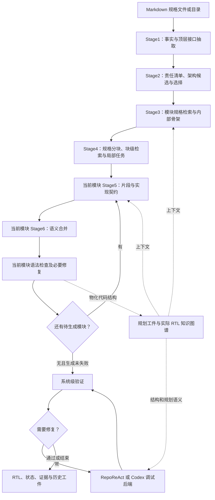

# RTL Agent 功能、架构与实现说明

> 用途：作为独立的系统事实材料交给 ChatGPT 或其他研究者阅读，无需先了解本仓库。本文描述当前功能、表示、调用流程和实现边界，不预设论文创新点，也不进行相关工作优劣比较。
>
> 核对对象：`RPG-ZeroRepo` 当前工作区源码，核对日期为 2026-11-01。工作区包含未提交修改，本文不等同于某个已发布版本。主线为 `rtl_planner`；历史运行工件仅用于展示真实数据形态，不作为本轮重新运行或性能评测的结果。

> 2026-11-06 更新：本文 Stage3 的 Markdown 生成/修复与 Stage4 模型检索/描述生成部分已被 JSON 设计及程序任务组装替换。当前流程以 [规划执行与恢复](planner_local_repair.md) 和 [README](../README.md) 为准；下文相应段落保留作历史架构说明。

## 1. 系统做什么

这是一个将硬件规格文档转化为多模块 RTL，并结合工具进行检查和修复的 LLM agent 系统。主要输入是 Markdown 规格文件或规格目录。主要输出包括架构规划、模块内部骨架、局部生成任务、RTL 片段、片段契约、合并后的 Verilog 文件及调试记录。

系统处理两种粒度的分解：

- **硬件架构粒度**：决定有哪些模块、每个模块承担哪些责任、哪些模块被其他模块实例化，以及跨模块传递什么。
- **代码生成粒度**：在一个硬件模块内部划分声明、实例、组合逻辑、时序逻辑等区域，让模型分次生成，再合成完整模块。代码块任务不必对应新增的硬件模块。

系统保留规格原文和来源关联。生成阶段可以读取局部规格、模块框架、之前生成的片段和子模块接口；调试阶段可以读取当前代码、原始规格、规划工件、仿真日志及波形。

核心算法由模型调用、结构化工件、程序检查和外部工具共同组成。这里的“多个 agent”主要指不同职责的模型调用或工具调用循环，不表示所有角色均使用独立训练的模型，也不表示所有阶段并行运行。

### 1.1 当前入口与旧路径

| 入口 | 作用 | 与本文的关系 |
| --- | --- | --- |
| `scripts/run_main.sh` | 选择规格，组装配置、输出路径和恢复参数；默认 `RTL_PIPELINE_MODE=planner` | CLI 常用启动方式 |
| `main.py --phase rtl_planner` | 创建任务、LLM 客户端、可选 KG 服务、规划与调试 runner | 本文描述的主线 |
| `PlannerRunner.run(...)` | 可停在 Stage1—Stage6 中的指定阶段 | Python 核心入口；CLI 主线请求执行到 Stage6 |
| `zerorepo/rtl_web/` | 工作台、任务输入、后台作业、检查、修复和结果展示 | 产品层入口，另见 §15 |
| `main.py` 中的 `rtl/rtl_phase1/rtl_phase2` 分支 | 代码保留旧的规格解析和实现入口分支 | 本文未核查其完整可运行性，与当前 planner 路径分别看待 |
| `rebuild_repo.py` | 基于已有 RPG 数据重建通用仓库 | 不是当前 RTL planner 的调度入口 |

## 2. 总体架构



此图是正常执行路径概览。实际存在检索降级、模型请求失败、生成失败、依赖阻塞、调试关闭和缺少验证器等分支。

### 2.1 软件组件分工

| 组件 | 核心职责 | 主要目录 |
| --- | --- | --- |
| PlannerRunner | 阶段编排、恢复、按模块生成与合并、调试路由、汇总状态 | `zerorepo/rtl_impl/module_planner/` |
| Stage agents | 事实抽取、架构选择、骨架、任务、片段、合并 | `module_planner/agents/` |
| Schemas 与 prompts | 定义工件结构、模型输入输出及阶段规则 | `module_planner/schemas/`、`prompts/` |
| Retrieval agents | 为模块、代码块和合并阶段选择规格上下文 | `zerorepo/rtl_impl/retrieval_agent/` |
| Planning KG | 将模块与规格片段、骨架、计划关联；按需恢复工件正文 | `zerorepo/rtl_impl/kg_agent/` |
| RTL KG | 从真实代码提取文件、模块、实例、端口、驱动与连接结构 | `rtl_kg/`、`rtl_kg_service.py` |
| Debug infrastructure | 语法检查、仿真适配、失败信号提取、波形和赋值追踪 | `debug_agent/` |
| RepoReAct | 模型通过受控工具调查并修改 RTL | `repo_react/` |
| Codex debug | 外部编码 agent 原生编辑，MCP 管理候选验证与提交 | `codex_debug/` |
| Memory | 调试记忆、经验文件、经验版本与使用事件记录 | `rtl_memory/` |
| Web workbench | 输入、作业、版本、测试、状态、可视化和导出 | `zerorepo/rtl_web/`、`web/rtl-demo/` |

### 2.2 哪些步骤由模型决定

| 操作 | 当前方式 |
| --- | --- |
| 从文档抽取事实、识别责任 | LLM 输出结构化结果，程序解析并检查 |
| 提出与选择模块划分 | 多个 LLM 调用，结合确定性合法性和风险分析 |
| 生成模块内部骨架和局部任务说明 | LLM，辅以结构、引用、接口检查 |
| 选择模块和块所需的原文 | 规则候选筛选加 LLM 选择；结果由程序还原为原文 |
| 对已选原文编号、组装工件和写检查点 | 程序 |
| 生成 RTL、协调片段、决定调试行动 | LLM 或具备工具调用能力的 agent |
| 解析代码、执行 lint／仿真、采样 VCD、计算指纹 | 程序及外部工具 |
| 固定阶段顺序和常规按模块执行循环 | PlannerRunner 中的程序控制流 |

## 3. 输入、输出与执行顺序

### 3.1 任务输入

`PlannerTaskInput` 的字段如下：

| 字段 | 内容 |
| --- | --- |
| `task_id` | 当前项目／任务身份 |
| `spec_md_files` | Markdown 文件或目录路径列表 |
| `spec_images` | 图片路径列表，输入接口保留 |
| `project_type` | 默认 `light_repo_spec2rtl` |
| `notes` | 补充说明 |

CLI 会发现 Markdown 内引用的本地图片及部分 `figures/` 文件；schema 也支持图片 grounding。但是，**当前 Stage1 facts 调用返回的图片参数为空，顶层接口调用同样不发送图片，Stage3 骨架生成也不发送图片**。因此，输入接口和历史图像相关结构的存在，不能直接解释为当前主流程已实际执行多模态读图。

### 3.2 主要输出

| 输出 | 保存内容 |
| --- | --- |
| `contracts.json` | Stage1 事实清单、顶层接口及兼容契约投影 |
| `stage2_decomposition.json` | 责任、候选架构、边界契约、检查和选择过程 |
| `repo_skeleton.json` | 选中的仓库级模块结构和规划顺序 |
| `modules.json` | 根据选中骨架重新组织的逐模块契约视图 |
| `module_skeletons.json` 及逐模块 Markdown／JSON | 模块内部框架、结构块、行为覆盖层和决策记录 |
| `spec_blocks.json` | 按模块组织、带 `Sxxx` 编号的原文规格块 |
| `module_plans.json` 及逐模块计划 | 代码块目标、任务说明、规格引用和约束 |
| `workspace/fragments/` | 片段 RTL、实现契约和检查点 |
| `workspace/merged/` | 当前完整模块 RTL 和必要的宏定义文件 |
| 合并／调试工件 | 草稿、检查结果、波形、追踪、补丁、接受基线和过程日志 |

### 3.3 实际调度

Stage1—Stage4 先准备规划。执行到 Stage6 时，runner 按 `spec_blocks.module_order` 遍历模块，对每个模块执行：

1. 核对该模块的依赖是否已因生成失败而阻塞。
2. 复用经核验的片段，或执行 Stage5。
3. 复用经核验的合并结果，或立即执行 Stage6。
4. 运行该模块语法门控，必要时用 RepoReAct 做语法修复。
5. 语法通过后物化实际代码图，记录结果，然后处理后续模块。

全部模块生成结束后，若存在 failed／blocked 模块，跳过系统调试；否则尝试系统验证和调试。语法失败、异常及质量问题的部分分支采取记录后继续策略，因此必须查看最终逐模块记录和系统验证记录。

模块内部 Stage5 按 `module_plan.subtasks` 列表顺序生成。当前不是一个在运行中自由调整所有任务依赖的通用 DAG 调度器。

## 4. Stage1：规格事实和顶层接口

### 4.1 执行过程

Stage1 读取规格文件，按每批最多五个文件处理，逐批调用模型抽取事实并保存进度。完成事实抽取后，整理结构信息，必要时补充顶层身份，再单独抽取和检查顶层接口。

当前主要抽取轮次是 `facts` 和 `top_interface`。较丰富的 `TimingContract`、`ControlContract` 等 schema 仍存在，但不能据 schema 名称推断每一类内容都执行了独立抽取轮次。

### 4.2 事实和来源

`Stage1FactLedger` 保存事实集合。`ExtractedFact` 包含事实身份、类型、模块、相关实体、内容，以及文本／图像 grounding 等信息。文本 grounding 用于记录原文依据；不同类型事实可进一步投影到接口、结构、控制、数据通路等兼容表示。

顶层接口检查关注端口名、方向、位宽等，并结合原规格的端口描述进行核对。后续 planner 将其作为必须尊重的接口依据。

### 4.3 阶段职责的范围

Stage1 提供从规格抽取出的事实和接口，不直接完成后续架构搜索，也不输出所有局部 RTL。事实抽取结果仍可能遗漏原文要求；相对于事实清单的后续覆盖检查，不等于对原始规格完整性的证明。

实现依据：[stage1_agent.py](../zerorepo/rtl_impl/module_planner/agents/stage1_agent.py)、[contracts.py](../zerorepo/rtl_impl/module_planner/schemas/contracts.py)。

## 5. Stage2：责任建模、模块划分与候选选择

### 5.1 先建立共享责任清单

Stage2 将“设计要完成哪些责任”与“这些责任分配到哪些模块”分别表示。多个架构候选使用同一份责任清单。

`ResponsibilityUnit` 主要字段为：

| 字段组 | 字段示例 | 含义 |
| --- | --- | --- |
| 身份和内容 | `responsibility_id/description/ownership_required` | 责任是什么，是否要求唯一归属 |
| 原文依据 | `evidence_fact_ids/evidence_sections` | 责任来自哪些事实或章节 |
| 状态和交互 | `inputs/outputs/owned_state` | 输入输出和持有状态 |
| 硬件约定 | `clock_domain/reset_behavior/protocol/timing_class` | 时钟、复位、协议和时间类别 |
| 依赖 | `dependencies` | 目标责任、耦合强度、传递对象和原因 |
| 额外属性 | `explicit_module_hint/reusable/iterative` | 明确模块提示、复用和迭代特征 |

依赖强度分为 `strong/medium/weak`。这些是模型抽取或判断后记录的语义信息，不是从尚未生成的电路获得的物理分析结果。

### 5.2 生成三个候选

当前候选风格为 `conservative/balanced/modular`，对应不同划分粒度。每个候选记录：模块集合、各模块的责任 ID、模块层次、跨模块逻辑边界契约、全局约定和待解决问题。

规格明确规定的顶层、模块和层次会成为候选检查依据。模型可在规格允许范围内提出实现划分，不能任意改变明确要求。

### 5.3 逻辑边界契约

`LogicalBoundaryContract` 描述跨模块责任之间的交互，包括：

- 生产者／消费者模块，以及两侧责任 ID。
- 传递对象、方向和协议。
- 时间类别、时钟域与复位行为。
- 位宽是否明确、可推导、未解决或不适用，以及证据。
- 来源事实、章节及边界理由。

此时的传递对象可能仍是逻辑对象，不必已经细化成所有真实 Verilog 端口。实际位宽和接口还需要在后续阶段落实。

### 5.4 检查与选择

程序将问题分为致命违规、其他风险和提示。典型致命违规包括顶层不一致、重复模块、必要责任没有唯一归属、未知责任引用、非法或成环层次、遗漏明确模块／层次，以及跨模块责任依赖缺少对应边界契约。

强耦合切分、边界字段不足、位宽未解决、缺少来源和胶合关系过多等，作为风险参与选择。代码中的 `hard_violations` 在当前策略中并不表示全部强制淘汰；真正用于排除候选的是 `fatal_violations`。

对有效且结构不同的候选，模型进行两次顺序相反的排序。若赢家不一致，可增加裁决；请求失败或裁决失败时有降级选择路径，并记录原因。当前没有先实现每个候选、分别仿真再选择，也不是形式化的最优图划分求解。

### 5.5 输出的仓库骨架

`repo_skeleton.json` 保存选中模块的名称、责任概述、文件、类型、父子关系、实例提示、时钟复位与数据约定，以及生成顺序和集成说明。详细责任和边界记录仍在 `stage2_decomposition.json`。

runner 随后依据选中骨架生成 `modules.json` 的逐模块视图。不能将原始事实中出现的所有模块提示都视为最终硬件模块。

实现依据：[stage2_agent.py](../zerorepo/rtl_impl/module_planner/agents/stage2_agent.py)、[stage2_decomposition.py](../zerorepo/rtl_impl/module_planner/schemas/stage2_decomposition.py)、[repo_skeleton.py](../zerorepo/rtl_impl/module_planner/schemas/repo_skeleton.py)、[module_organizer.py](../zerorepo/rtl_impl/module_planner/module_organizer.py)。

## 6. Stage3：模块内部 RTL 骨架

### 6.1 输入和生成形式

对每个已规划模块，Stage3 先取得相关规格原文，再结合模块契约、仓库结构、全局摘要和涉及该模块的边界契约生成骨架。

原始输出是 `MODULE_SKELETON_DOC v1` Markdown；程序解析并导出 `ModuleSkeletonExport` JSON。Markdown 和 JSON 分别供阅读、后续工具和结构校验使用。

### 6.2 骨架的五部分

| 部分 | 内容 |
| --- | --- |
| Module Identity | 模块名、预期文件、规格与骨架来源 |
| Module Frame | ANSI 模块签名、端口、代码块占位符 |
| Structural Skeleton | 每个块的身份、种类、目的、代码形态、依赖与检索关注点 |
| Behavioral Overlay | 模块行为摘要和逐块行为义务 |
| Decision Ledger | 已定决策、理由、延期决策及结构／行为风险 |

结构块种类为 `decl/inst/seq/comb/helper/meta`。`StructuralBlock` 具有 `block_id/block_label/block_kind/purpose/code_shape/depends_on/placeholder/must_appear/may_appear/retrieval_focus` 等字段。

模块行为摘要包含控制风格、语义模式、状态模型、全局不变量和未解决语义问题。块级 `BlockBehaviorOverlay` 包含：

```text
block_id
responsibilities       本块承担什么
timing_semantics       时间与更新语义
touched_objects        涉及的对象
coupling_rules         与其他块的耦合约定
forbidden_drift        不应发生的偏离
```

`touched_objects` 不区分完整的读、写和声明权限，不能直接当作允许写入集合。

### 6.3 骨架和最终代码的关系

骨架提供模块边界和待实现区域，不是已完成的 RTL。Stage5 生成区域代码，Stage6 可以协调、移动或重组片段，使其组成完整模块。

因此，规划块 B1／B2 与最终解析出的 always／assign 块之间没有天然的一一对应。调试工具区分 `planning_block_id` 和 `rtl_block_id`；修改最终代码时应使用当前代码对象。

Stage3 检查 Markdown 结构、JSON 引用和可确定的接口约束。对共享对象、自然语言时间语义或设计决策的保存，并不意味着已完成形式化行为验证。

实现依据：[stage3_agent.py](../zerorepo/rtl_impl/module_planner/agents/stage3_agent.py)、[module_skeleton.py](../zerorepo/rtl_impl/module_planner/schemas/module_skeleton.py)、[skeleton_doc.py](../zerorepo/rtl_impl/module_planner/utils/skeleton_doc.py)。

## 7. 规格检索与 Stage4 局部任务

### 7.1 模块级规格检索

`ModuleSpecContextRetriever` 从统一规格中为一个模块选择原文。

1. 读取源文件，按标题、段落和长度组织带字符起止位置及父标题的来源块。
2. 根据模块名、责任描述和相关事实等做候选排序。
3. 在字符预算内将候选交给模型，模型选择来源块并给出简短理由。
4. 程序核对来源标识，恢复原文，按来源顺序组织结果；顶层端口章节有强制保留逻辑。
5. 保存来源范围、输入指纹和结果摘要。失败时执行带原因的降级检索。

当前是规则候选筛选与 LLM 选择的组合，不需要由向量数据库完成检索。保存原文范围保证能核对被选文字来自哪里，不能保证所有必要要求都被选中。

### 7.2 Stage4A：规格分块

`Stage4SpecBlocksAgent` 通常复用 Stage3 保存的模块规格上下文，缺失时重新检索；再以确定性处理将原文组织为 `S001/S002/...` 规格块。

这些 ID 在当前模块范围内解释。同名 `S001` 在不同模块中不必指同一原文。规格分块本身不需要模型自由改写原文。

### 7.3 Stage4B：为骨架块选择规格

`BlockSpecRetriever` 同时读取模块骨架、结构化块及对应行为覆盖层，为每个块选择 `spec_refs`。返回的数量、顺序、任务身份、目标占位符和引用都需核对。检索失败可退回让每个块读取当前模块完整规格。

### 7.4 局部任务计划

模型再产生逐块任务说明。`ModulePlanSubtask` 的主要字段如下：

```json
{
  "id": "B2_input_load_mapping",
  "target": "<block: input_load_mapping>",
  "description": "Implement synchronous text_in_r load/update with reset and form column-major load-state byte operands for initial AddRoundKey from text_in[127:120] downward.",
  "spec_refs": ["S003", "S005", "S007"],
  "constraints": [
    "Flatten load-state mapped bytes into explicit scalar byte wires.",
    "Do not update the state matrix or text_out in this block."
  ],
  "timing_obligation_ids": [],
  "logical_value_tags": []
}
```

上述是本地 AES 工件中的真实任务。当前 `constraints` 最多三条；任务身份、目标和来源绑定受程序检查和受限修复约束。

schema 保留两个时间兼容字段；当前 Stage5 要求它们为空。任务本身也没有统一的前置条件、验收谓词和动态依赖状态字段。执行进度另由模块记录与检查点保存。

实现依据：[module_spec_context_retriever.py](../zerorepo/rtl_impl/retrieval_agent/module_spec_context_retriever.py)、[source_context.py](../zerorepo/rtl_impl/retrieval_agent/source_context.py)、[stage4_spec_blocks_agent.py](../zerorepo/rtl_impl/module_planner/agents/stage4_spec_blocks_agent.py)、[block_spec_retriever.py](../zerorepo/rtl_impl/retrieval_agent/block_spec_retriever.py)、[stage4_module_plan_agent.py](../zerorepo/rtl_impl/module_planner/agents/stage4_module_plan_agent.py)。

## 8. Stage5：逐任务生成 RTL 片段和实现契约

### 8.1 每次生成收到什么

| 上下文 | 具体内容 |
| --- | --- |
| 当前任务 | 身份、占位符、说明、规格引用及任务约束 |
| 模块框架 | Module Frame，即模块签名和块占位符 |
| 选中规格 | 当前 `spec_refs` 指向的原文，加必要的接口规格补充 |
| 前置实现 | 同一模块中已验证的前序片段 |
| 宏上下文 | 相关全局宏及 include 约定 |
| 规划／依赖上下文 | 模块责任概述、工件绑定、规格关联及已实现子模块端口等 |

当前 `_read_module_skeleton_context()` 仅提取 Module Frame。紧凑 KG prompt 主要序列化模块、绑定、规格关联和接口，未直接传入完整的 `module_behavior` 与 `block_behavior_overlays`。完整骨架文件的内容可参与来源指纹，但**参与指纹不等于其正文完整进入模型上下文**。

Stage4 可以通过任务说明和规格选择间接传递部分行为要求；当前没有一个在每次生成前必然显式附带全部相关块级义务的统一契约切片对象。

### 8.2 输出和片段契约

每次模型返回 `SubtaskCodeArtifact`，包括任务／模块／目标身份、规格引用、代码，以及显式 `FragmentContract`。

| 契约字段 | 当前含义与形式 |
| --- | --- |
| `writes` | 本片段声称写入的对象列表 |
| `reads` | 本片段声称读取的对象列表 |
| `clocking` | 时钟或组合属性的文字描述 |
| `reset_behavior` | 复位行为文字描述 |
| `hold_behavior` | 保持行为文字描述 |
| `latency` | 延迟／周期行为文字描述 |
| `assumptions` | 对其他片段或环境的假设 |

这里的实现契约随代码产生，描述生成结果及其协作假设。它不同于规格原文，也不同于生成前的责任义务；生成器不能通过自报契约改变规格要求。

### 8.3 校验和保存

程序检查任务身份、模块、目标及引用匹配，要求显式契约，并用受限的赋值模式识别明显漏报的写目标。其他读写提取结果作为启发式提示保存，不自动改写为权威契约。

已验证代码写入 `<module>_fragments.v`，使用 `STAGE5_SUBTASK_BEGIN/END` 标记任务区域；契约写入 `<module>_contracts.json`。检查点绑定任务、输入和内容指纹。

前序片段会进入后序任务 prompt，所以当前任务不是互不相关地生成。一个前序任务失效时，后续片段也可能需要重新生成。

### 8.4 宏和已有文件

系统有专门的全局宏定义管理。部分 define-only 文件或特定项目的规范宏文件可从配置的已有资源复制，记录到 `global_defines_manifest.json`，不让模型重新编写。父模块生成可读取已经实现的子模块接口。

因此，对一次运行是否“全部从规格生成”进行统计时，需要区分模型新生成的功能 RTL 与复制复用的宏／支持文件。

实现依据：[stage5_agent.py](../zerorepo/rtl_impl/module_planner/agents/stage5_agent.py)、[codegen_plan.py](../zerorepo/rtl_impl/module_planner/schemas/codegen_plan.py)、[stage5_sources.py](../zerorepo/rtl_impl/module_planner/utils/stage5_sources.py)、[global_defines.py](../zerorepo/rtl_impl/module_planner/agents/global_defines.py)。

## 9. Stage6：模块级语义合并

Stage6 根据片段和模块上下文形成完整 RTL，不只是逐字拼接占位符。它可以统一声明、处理共享状态、整合复位与正常更新、协调实例接口及 include。

### 9.1 合并上下文

合并阶段重新检索有关规格，并决定是否读取子模块上下文。可用内容包括：全部生成片段、片段契约、模块任务计划、Module Frame、规格原文、子模块接口或按需代码，以及全局宏。

Stage6 的专用骨架读取同样只提取 Module Frame。虽然还可以从任务和规格获得行为要求，但不能把它描述为必然显式接收全部骨架行为覆盖层。

### 9.2 主要合并路径

正常先构造 `Stage6MergeRunner` 和工具，模型按需读取上下文、生成合并草稿、检查结构、运行静态检查和 lint，最后提交草稿。开始时主要提供索引，更多内容通过工具读取。

| 工具 | 作用 |
| --- | --- |
| `read_merge_context` | 读取片段、契约、任务、框架、规格、依赖、宏或既有合并规则 |
| `inspect_rtl_structure` | 查看当前草稿中的块、驱动等结构 |
| `generate_merge_draft` | 创建或更新模块草稿 |
| `run_static_rtl_check` | 检查部分驱动、声明和赋值约定等结构问题，报告契约 writer 重叠 |
| `run_lint` | 执行语法／lint 检查 |
| `commit_merge_draft` | 在规定检查后提交正式文件 |

语义路径中，提交要求已有草稿并观察过结构，静态检查通过；lint 工具不可用有单独跳过分支。若 agent 初始化或执行失败，可退回原始代码输出加修复路径。不同路径的检查和可用工件不能视为完全相同。

### 9.3 合并报告

报告可保存 `signal_ownership`、always 块责任、静态检查与 lint 结果、是否提交草稿和行动次数。片段写集合重叠可成为警告；因为合并允许重构，重叠本身不必意味着最终 RTL 非法。

部分已生成报告还能作为后续模块的合并经验读取。这是运行工件的复用，不是模型权重训练。

实现依据：[stage6_merge_agent.py](../zerorepo/rtl_impl/module_planner/agents/stage6_merge_agent.py)、[stage6_semantic_merge.py](../zerorepo/rtl_impl/module_planner/agents/stage6_semantic_merge.py)、[merge_context_retriever.py](../zerorepo/rtl_impl/retrieval_agent/merge_context_retriever.py)。

## 10. 规划知识图谱与实际代码知识图谱

### 10.1 规划视角

系统以稳定的 Module 身份连接规划与实际实现。规划投影中主要有：

```text
SpecFragment ──SPECIFIES──> Module
Module ──HAS_SKELETON──> ModuleSkeleton
Module ──HAS_PLAN──────> ModulePlan
```

Module 保存预期路径、角色、父子模块和实现状态等。其余节点记录正文所在工件路径、schema、内容摘要及来源指纹。需要正文时，由检索器核对指纹后从工件文件恢复。

详细责任清单、块级任务和契约主要仍保存在 JSON／Markdown 工件内，不能把概念上的“规格→责任→块→任务→契约”链路说成这些对象已经全部作为独立图节点建模。

### 10.2 代码视角

代码图从实际 Verilog／SystemVerilog 提取，主要对象包括 Repo、File、Module、Instance、Port、Signal、Param、AlwaysBlock、Assign、Generate、Func 等。

重要关系包括模块包含、实例归属、实例连接 `CONNECTS` 和驱动 `DRIVES`。代码图的驱动关系主要围绕左值组织，用于定位谁驱动某个对象；更细的右值和分支依赖由调试解析器进一步提取。

语法通过的模块可在后续系统调试前进入实际代码图。规划中的模块身份与物化后的模块联系起来，使父模块能查询子模块接口，调试能查询真实实例和驱动位置。

### 10.3 查询与刷新

供调试模型使用的 `query_rtl_kg` 暴露四类固定查询：`module_interface/module_instances/instance_connections/signal_drivers`。内部另有模块邻居、边界映射和源码位置等查询模板。

KG 服务可以配置为 required，或在相应调用点允许失败后降级到 sidecar／代码读取。并非每个调用都具备完全相同的降级行为。

`refresh_repo_files(changed_paths=...)` 当前构建增强快照并以 full 方式导入；规划投影另有 delta upsert。因此不能把带 `changed_paths` 的刷新接口直接描述为精确的文件级增量重建算法。

实现依据：[planning_graph.py](../zerorepo/rtl_impl/kg_agent/planning_graph.py)、[kg_query_templates.py](../zerorepo/rtl_impl/kg_agent/kg_query_templates.py)、[rtl_kg_service.py](../zerorepo/rtl_impl/rtl_kg_service.py)、[graph_types_rtl.py](../zerorepo/rtl_impl/rtl_kg/graph_types_rtl.py)。

## 11. 语法检查、仿真与系统调试入口

### 11.1 模块语法门控

主流程在每个模块合并后调用 `run_module_syntax_gate()`，而不是为每个子模块自动完成一套功能 testbench 验证。语法问题的修复固定使用 RepoReAct；系统调试后端的选择不改变这一点。

仓库还保留 `ModuleDebugRunner.run_module()` 的模块功能验证入口，但它与当前主流程实际调用的 syntax gate 应分别理解。

### 11.2 系统级验证

CLI 的 `SystemDebugRunner` 为顶层设计查找适配的验证目录和脚本，准备包含整棵生成 RTL 树的工作目录，运行系统级验证。测试资源主要来自配置的外部基准／oracle 目录；缺少资源时存在 skipped／error 等结果。

失败后可选 `repo_react` 或 `codex`。两者可以复用规划语义、KG、波形和信号追踪基础能力，但代码编辑、候选管理与接受策略不同。

### 11.3 失败证据

系统从适配的日志提取 mismatch 数、失败输出和首次失败时间，结合 VCD 读取 DUT／reference 值。代码解析优先使用 Tree-sitter，另有启发式回退，提取 always／assign、赋值类型、右值信号和分支条件等。

这些信息用来构造 trace report、局部依赖和调查候选。静态回溯或同一时刻的值，并不能自动证明时序因果；时序赋值可能需要继续探测相关时钟边沿。

实现依据：[debug_runner.py](../zerorepo/rtl_impl/debug_agent/debug_runner.py)、[system_debug_runner.py](../zerorepo/rtl_impl/debug_agent/system_debug_runner.py)、[trace_report.py](../zerorepo/rtl_impl/debug_agent/trace_report.py)、[trace_slicer.py](../zerorepo/rtl_impl/debug_agent/trace_slicer.py)。

## 12. RepoReAct 调试后端

### 12.1 控制循环

RepoReAct 使用外层 runner 管理会话、预算、状态和压缩，内层工具调用 agent 决定读取什么、追踪哪里和怎样改代码。外层同时记录 agent 回合数、动作数和补丁尝试数，它们不是同一个计数。

模块范围只允许修改当前 RTL；仓库范围允许在被限定的生成 RTL 树中协调修改多个文件。系统级调试使用仓库范围和顶层仿真。

### 12.2 当前直接暴露的工具

| 工具 | 功能 |
| --- | --- |
| `read_context` | 仓库树、文件／行、testbench、阶段工件、trace、修复日志 |
| `search_context` | 在限定的代码、规格或测试范围搜索 |
| `query_rtl_kg` | 通过固定模板查接口、实例、连接、驱动 |
| `read_module_semantics` | 取回相关模块规格、骨架和任务，附当前可编辑代码对象及规划关联 |
| `trace_signal_cause` | 对一个模块信号做一跳驱动、分支、右值和实例边界调查 |
| `read_long_term_memory` | 读取允许范围内的经验文件 |
| `list_vcd_signals/probe_vcd` | 枚举和采样波形信号 |
| `run_check` | lint、模块／顶层仿真、trace、首次分歧及波形窗口等模式 |
| `apply_patch` | 对一个或多个允许文件提交行范围修改 |
| `replace_block` | 替换当前解析出的完整 RTL 块 |
| `record_correction` | 记录上游契约、接口、任务或依赖的纠错 overlay |

以上合计 12 个注册工具。源码还保留其他方法，但存在方法不等于该方法当前已注册给模型。例如 `read_memory` 当前未注册，`route_debug_context` 也没有作为外部元工具暴露。

### 12.3 两个连接规划和当前代码的工具

`read_module_semantics()` 按模块、关注信号和关注块选择规格、结构块与任务，返回来源路径、指纹、语义不变量、实际可编辑 RTL 块及关联信息。匹配不到时有模块级回退，并报告裁剪／告警。

`trace_signal_cause()` 从当前信号查找实际驱动赋值，读取条件与右值，按可用波形给出分类和后续探测建议；它还查询实例端口映射，可以把调查延伸到子模块或父模块。通常由 agent 重复调用形成渐进调查，而不是一次自动证明所有上游根因。

两者返回的规划关联含启发式匹配。`replace_block` 使用实际 `rtl_block_id`，不能直接拿骨架 B1／B2 当作当前代码的编辑地址。

### 12.4 补丁处理

补丁需提供修改理由和预期效果。工具检查范围、路径及重叠行，保存修改前后快照；默认执行 lint、仿真与追踪并根据结果处理接受／回滚。语法失败有受限重试，功能指标包括 mismatch 和首次失败时间。

当前 RepoReAct 还包含结合完整 diff、周围代码、规格证据和指标的模型接受判断。因此不能将它概括成“任何 mismatch 增加都必然立即回滚”的纯确定性策略。参数、修复模式及调用场景也会影响是否验证和回滚。

部分条件下会要求先完成指定失败信号追踪，或在补丁后继续追踪再进行下一次修改；另有连续只读调用预算，防止长期只调查不行动。当前仅 `apply_patch/replace_block` 重置该读预算，记录纠错不等于已经执行代码修复。

### 12.5 纠错记录

`record_correction()` 将问题、证据和 override 写入 `planning_corrections/` 的 journal 及分类文件，不直接改写原始 Stage 工件。后续可读这些记录，但当前没有由此自动触发完整骨架改写、任务失效传播及架构重生成的控制链路。

实现依据：[runner.py](../zerorepo/rtl_impl/repo_react/runner.py)、[tools.py](../zerorepo/rtl_impl/repo_react/tools.py)、[schemas.py](../zerorepo/rtl_impl/repo_react/schemas.py)。

## 13. 上下文管理、调查服务与经验记忆

### 13.1 调试会话的上下文

RepoReAct 同时保存模型对话历史、结构化会话快照和磁盘日志。结构化 `DebugContextPack` 可包含：

- 当前目标、失败时间、候选块、已保护行为和待补证据。
- DUT／reference 时间证据、trace 摘要及证据路径。
- 近期修复效果、失败方向、可继续尝试的方向。
- 活跃工作集：假设、证据、已排除方向和候选编辑位置。
- 规格、RTL、日志、波形和记忆的原始工件引用。

系统有 light、checkpoint、deep 三类整理／压缩：light 更新摘要；checkpoint 重建较完整的恢复上下文；deep 进一步削减工作集。触发由只读调用、工具返回量、行动进度、真实分歧和剩余预算共同决定。

这些阈值属于实现参数。压缩保留结构化状态和路径，不保证保留所有历史推理细节。

### 13.2 内部调查服务

`DebugContextRouter` 可构造上下文包、进行系统分诊和定向读取；必要时调用只读调查子 agent 获取分析结果。它目前作为内部上下文服务使用，而不是要求主 agent 每次先调用的公共路由工具。

### 13.3 经验文件和受审经验版本

仓库有两组相关设施：

| 设施 | 作用 |
| --- | --- |
| `RTLMemoryStore/RTLMemoryDistiller/RTLMemorySelector` | 保存和选择带索引的经验 Markdown，包括修复结果、负面方向、纠错和合并经验；可从运行记录按规则整理 |
| `MemoryLedger/MemoryAdapter` | 保存不可变经验版本、审核状态；向任务冻结可访问快照，记录检索、提供、声明应用、实际文件变更关联及验证事件 |

Codex MCP 有对应的经验查询、读取和应用声明工具。经验命中、声明应用、候选接受及最终功能通过分别记录，不能互相替代。该机制属于外部记忆与工件管理，不等同于训练模型或证明经验一定改善结果。

实现依据：[context.py](../zerorepo/rtl_impl/repo_react/context.py)、[compact.py](../zerorepo/rtl_impl/repo_react/compact.py)、[rtl_memory/](../zerorepo/rtl_impl/rtl_memory/)。

## 14. Codex 调试后端

此后端把有限的规格和生成 RTL 放入独立任务目录，由外部 Codex 进程使用原生文件读取／编辑工具工作。私有目录保存验证器描述、接受基线、候选版本、验证结果和会话状态。

### 14.1 与 RepoReAct 的区别

| 维度 | RepoReAct | Codex 后端 |
| --- | --- | --- |
| 执行主体 | 内置 AgentScope 工具调用循环 | 外部 Codex exec／resume 会话 |
| 编辑方式 | `apply_patch/replace_block` | 原生代码编辑 |
| 验证入口 | 补丁工具默认关联检查 | 编辑后调用 `validate_rtl_changes` |
| 候选处理 | 工具内评估、日志与回滚策略 | 明确的 evaluate／accept／rollback 事务 |
| 上下文整理 | 本仓库的 context pack 和压缩机制 | Codex 会话，配合任务级 MCP 状态和证据 |

### 14.2 MCP 能力

后端提供规划语义读取、固定 KG 查询、信号追踪、VCD 枚举与采样、检查、调试状态，以及经验查询／读取／声明应用工具。

`validate_rtl_changes(action="evaluate")` 对当前修改建立候选快照，执行检查并绑定结果；随后 agent 明确 accept 或 rollback。接受时核对候选身份、内容和检查状态，再更新接受基线。结束时要求工作区处于 `clean_accepted`；未处理的修改可恢复到已接受版本。

**接受候选不要求它已通过全部功能测试。** 在满足对应检查条件时，可接受尚有 mismatch 的中间版本继续调试；最终成功需单独查看客观验证结果。

会话支持跨 episode 和跨启动恢复，绑定配置、来源、代码树和已接受状态，验证次数单独累计。多 agent 是一个可选配置，不表示所有运行都开启并行协作。

实现依据：[codex_debug/runner.py](../zerorepo/rtl_impl/codex_debug/runner.py)、[session.py](../zerorepo/rtl_impl/codex_debug/session.py)、[mcp_server.py](../zerorepo/rtl_impl/codex_debug/mcp_server.py)、[history.py](../zerorepo/rtl_impl/codex_debug/history.py)。

## 15. 局部工件修复、恢复执行和工作台

### 15.1 生成阶段的局部修复

Stage3—Stage5 使用受限次数的生成／检查／修复机制，保存失败原文和诊断，要求模型只修改被允许的目标。

| 阶段 | 典型修复范围 |
| --- | --- |
| Stage3 | 某个 Markdown 章节正文或身份明确的行为条目 |
| Stage4 任务计划 | 特定任务的说明、约束等字段；身份不清时重建相应集合 |
| Stage5 | 当前任务代码、完整契约或指定契约字段 |

程序拒绝未知、重复和重叠补丁目标，并在合并后重新检查完整候选。代码改变时需要相应契约；仅修契约字段时保留未授权修改的代码。结构无法可靠定位时可重建当前生成单元。

这是结构化工件修复，与系统级 RTL 功能调试是两个不同层次。

### 15.2 来源指纹和检查点

各阶段使用输入及内容摘要判断是否复用；不能仅凭文件存在就视为完成。Stage3／4 保存已完成模块和游标。Stage5 保存已验证任务前缀、代码、契约和检查点。

Stage5 的来源包含任务、规格、框架、完整骨架内容绑定、模块责任、子接口、宏和前置代码等。若前序任务失效，其后的生成上下文会改变，后续任务需相应核验或重生成。

片段／契约／检查点存入完整包，候选和历史分开保存，最后切换活动提交标记。新候选失败不应把旧完整包变成半成品；旧包若来源过期，只能作为历史保存。

系统调试后的已接受代码树另外绑定到原生成来源，重启时核验整棵接受树，避免把合法调试修改误判为必须重跑整个生成流程。未知手工修改与已接受调试产物分开处理。

这些机制维护产物与输入的一致性，不等于根据失败语义自动改变高层计划。

### 15.3 Web 工作台

工作台在核心引擎外增加任务保存、输入分析、作业执行、检查、候选版本、历史、问答、规划视图、波形、图结构和导出等设施。

`TaskRuntime` 区分生成任务和已有 RTL 的修复任务。生成任务可调用 PlannerRunner；测试可来自已有测试、仓库比较验证资源，或独立的测试生成／适配服务。没有功能测试时仅能报告相应基础检查状态。

工作台有单独冻结的验证规格、输入／代码版本与测试清单，并将检查结果绑定到版本和工具链。最终复核或可信结果复用也核对这些来源。它还管理运行预算、队列、隔离执行与能力就绪状态。

工作台任务另有文件数、模块数、运行时间及候选次数等范围限制。这些产品入口的约束与 CLI 引擎的能力范围分别配置，不能将某个入口的小规模任务上限直接解释为整个系统的通用上限。

工作台的能力入口存在，不代表当前部署已就绪或完成真实端到端验收。`capabilities()` 将功能可用性与 `acceptance=not_run` 等验收状态分开返回。本文未核验当前服务运行状态。

实现依据：[local_repair.py](../zerorepo/rtl_impl/module_planner/utils/local_repair.py)、[stage5_store.py](../zerorepo/rtl_impl/module_planner/utils/stage5_store.py)、[debug_generation.py](../zerorepo/rtl_impl/module_planner/utils/debug_generation.py)、[task_runtime.py](../zerorepo/rtl_web/task_runtime.py)、[verification.py](../zerorepo/rtl_web/verification.py)、[test_generation.py](../zerorepo/rtl_web/test_generation.py)。

## 16. 一份真实 AES 运行工件的贯穿示例

本节读取已有目录 `rtl_outputs/aes_inv_cipher_system_hard/.zerorepo/`，展示各阶段对象怎样关联。它不是本轮新执行的实验，也不用于推断当前系统平均成功率。

### 16.1 架构选择

该运行保存 13 项责任、22 条依赖和三个候选：

| 候选 | 模块数 | 跨模块依赖 | 强耦合切分 | 边界契约 |
| --- | --- | --- | --- | --- |
| conservative | 1 | 0 | 0 | 0 |
| balanced | 6 | 13 | 8 | 13 |
| modular | 11 | 20 | 15 | 20 |

两次相反呈现顺序的排序都选择 balanced，保存状态是 `selected_with_degradation`，即选择仍伴随风险记录。

六个模块为 `aes_inv_cipher_top/aes_key_expansion/aes_round_constant_gen/aes_forward_sbox/aes_inverse_sbox/aes_inv_cipher_datapath`。

### 16.2 模块内部骨架

数据通路模块的真实 Module Frame 为：

```verilog
module aes_inv_cipher_datapath (
    input wire clk,
    input wire rst,
    input wire [127:0] text_in,
    input wire [127:0] round_key_words,
    input wire [127:0] inverse_substituted_bytes,
    input wire ld_r,
    input wire [3:0] phase_select,
    input wire load_select,
    input wire done,
    output wire [127:0] text_out
);

// <block: decl_state_and_output>
// <block: input_load_mapping>
// <block: inv_shift_rows>
// <block: inv_sub_bytes_external_sink>
// <block: add_round_key_select>
// <block: inv_mix_columns>
// <block: state_commit_update>
// <block: final_output_capture>

endmodule
```

它有八个结构块及对应行为覆盖层，保存列优先映射、最终轮省略 InvMixColumns 等不变量，也保存控制编码与最终输出捕获关系等待确认问题。§7.4 的 B2 任务来自这个模块。

### 16.3 片段、契约和合并的实际关联

本运行 B1 的 overlay 表示仅声明、没有更新语义；B1 任务又描述 reset-to-zero。生成的 B1 除声明外含状态复位时序块，其契约报告写入这些状态，并假设合并器整合其余块的正常更新。

片段契约中，`text_in_r` 由 B1 与 B2 报告写入，状态字节由 B1 与 B7 报告写入，输出缓存由 B1 与 B8 报告写入。合并报告保存多 writer 警告，同时记录最终静态检查 pass 和 lint 通过，并给出实际驱动归属。

这一事实展示了当前行为：阶段间的责任描述可出现歧义，生成片段可将部分协调留给合并器；实现契约能够呈现这种依赖。该报告本身不证明最终系统功能正确或错误。

### 16.4 对应文件

- [责任和候选选择](../rtl_outputs/aes_inv_cipher_system_hard/.zerorepo/module_planner/outputs/stage2_decomposition.json)
- [骨架 Markdown](../rtl_outputs/aes_inv_cipher_system_hard/.zerorepo/module_planner/outputs/module_skeleton_docs/aes_inv_cipher_datapath.md)
- [骨架 JSON](../rtl_outputs/aes_inv_cipher_system_hard/.zerorepo/module_planner/outputs/module_skeleton_json/aes_inv_cipher_datapath.json)
- [任务计划](../rtl_outputs/aes_inv_cipher_system_hard/.zerorepo/module_planner/outputs/module_plan_json/aes_inv_cipher_datapath.json)
- [生成片段](../rtl_outputs/aes_inv_cipher_system_hard/.zerorepo/workspace/fragments/aes_inv_cipher_datapath_fragments.v)
- [片段契约](../rtl_outputs/aes_inv_cipher_system_hard/.zerorepo/workspace/fragments/aes_inv_cipher_datapath_contracts.json)
- [合并报告](../rtl_outputs/aes_inv_cipher_system_hard/.zerorepo/module_planner/outputs/merge_reports/aes_inv_cipher_datapath_merge_report.json)

## 17. 工件目录和结果解释

CLI 常见输出布局如下，部分目录仅在相应路径执行后产生：

```text
rtl_outputs/<task>/.zerorepo/
├── module_planner/outputs/
│   ├── contracts.json
│   ├── stage2_decomposition.json
│   ├── repo_skeleton.json
│   ├── modules.json
│   ├── module_skeletons.json
│   ├── module_spec_context_json/
│   ├── module_skeleton_docs/
│   ├── module_skeleton_json/
│   ├── spec_blocks.json
│   ├── block_spec_retrieval_json/
│   ├── module_plan_json/
│   ├── module_plans.json
│   ├── stage5_codegen.json
│   ├── stage6_merge.json
│   ├── merge_retrieval_json/
│   ├── merge_child_context_json/
│   ├── merge_reports/
│   ├── planning_corrections/
│   ├── .repair_cache/
│   └── .repair_drafts/
└── workspace/
    ├── fragments/
    ├── merged/
    ├── merge_drafts/
    ├── merge_reports/
    ├── .stage5_generations/
    ├── .stage5_candidates/
    ├── .stage5_history/
    ├── debug/
    ├── debug_system/
    ├── repo_react/
    └── rtl_memory/
```

必须分别解释以下状态：

| 状态／证据 | 能说明什么 |
| --- | --- |
| JSON/schema 校验通过 | 工件满足相应结构及程序规则 |
| 责任分配检查通过 | 相对于已抽取清单满足相应归属要求 |
| 有规格来源 | 能追溯所选依据，不代表选择完整 |
| 有片段契约 | 生成器已提供实现描述，不代表描述正确 |
| 静态检查／lint 通过 | 相应结构或工具检查通过，不代表功能通过 |
| Stage6 `completed` | 模块生成合并的状态；系统功能结果另看 `system_debug` |
| 候选 accepted／clean_accepted | 当前代码是明确接受的基线，不代表 mismatch 已归零 |
| 系统仿真 pass | 在指定测试、工具与当前代码版本下通过 |
| `skipped/disabled/error` | 未执行、关闭或异常，不可记为功能通过 |

CLI 基准验证通常依赖既有测试资源；工作台生成的 testbench 属于另一来源。二者应分别标注，不能不加区别地解释为同等独立的正确性证据。

## 18. 当前能力边界与代码索引

### 18.1 实现状态概览

| 能力 | 当前实现情况 |
| --- | --- |
| 共享责任上的多候选架构选择 | 主线已接入 |
| 仓库骨架和模块内部结构／行为骨架 | 主线已接入 |
| 模块原文检索、块级来源绑定 | 主线已接入，具有降级路径 |
| 局部 RTL 与显式实现契约生成 | 主线已接入 |
| 模块合并和部分冲突／驱动检查 | 已接入，语义路径及回退路径分别处理 |
| 全部上层行为义务显式传入每次生成／合并 | 未完整形成统一传递链路 |
| 结构化工件局部修复与来源绑定恢复 | 已接入 |
| 规划和代码 KG | 可配置接入；实际可用性取决于服务与调用策略 |
| 波形、赋值、分支及跨实例调查 | 调试工具已实现，依赖可解析代码和可用证据 |
| 规划语义取回并关联实际代码 | 已实现，含启发式匹配和裁剪 |
| 模块语法修复与系统级功能修复 | 已接入，功能验证需要相应验证资源 |
| Codex 原生编辑及候选事务 | 可选后端已实现 |
| 执行记忆与跨会话经验设施 | 已实现相应存储、选择与接入，使用范围随入口不同 |
| 根据失败自动修改高层骨架并传播任务失效 | 当前没有完整控制链路 |
| 时间义务专用规划链路 | 保留代码，当前 runner 强制关闭并忽略旧启用参数 |
| 全部自然语言契约的形式化／组合正确性证明 | 当前未实现完整覆盖 |
| 独立完整综合、PPA 优化及物理设计闭环 | 本文核对的主线未建立此类流程 |

### 18.2 建议核查代码的位置

| 想了解的内容 | 首要入口 |
| --- | --- |
| 阶段调用、依赖阻塞、系统调试和恢复 | [planner_runner.py](../zerorepo/rtl_impl/module_planner/planner_runner.py) |
| 事实和兼容契约 | [schemas/contracts.py](../zerorepo/rtl_impl/module_planner/schemas/contracts.py) |
| 责任、边界与候选 schema | [schemas/stage2_decomposition.py](../zerorepo/rtl_impl/module_planner/schemas/stage2_decomposition.py) |
| 模块内部骨架 schema | [schemas/module_skeleton.py](../zerorepo/rtl_impl/module_planner/schemas/module_skeleton.py) |
| 任务、片段、契约和汇总状态 | [schemas/codegen_plan.py](../zerorepo/rtl_impl/module_planner/schemas/codegen_plan.py) |
| 片段收到的真实上下文 | [agents/stage5_agent.py](../zerorepo/rtl_impl/module_planner/agents/stage5_agent.py) 的 `run_module()` 与框架读取方法 |
| 规划图正文恢复与紧凑 prompt | [kg_agent/planning_graph.py](../zerorepo/rtl_impl/kg_agent/planning_graph.py) |
| 已注册调试工具、预算与循环 | [repo_react/runner.py](../zerorepo/rtl_impl/repo_react/runner.py) |
| 一跳信号追踪、语义恢复、补丁和纠错 | [repo_react/tools.py](../zerorepo/rtl_impl/repo_react/tools.py) |
| 候选评估和接受的实际条件 | [codex_debug/session.py](../zerorepo/rtl_impl/codex_debug/session.py) |
| 测试来源、检查范围和工作台验证 | [rtl_web/verification.py](../zerorepo/rtl_web/verification.py) |

相关测试文件包括 [test_rtl_module_planner.py](../tests/test_rtl_module_planner.py)、[test_planning_kg.py](../tests/test_planning_kg.py)、[test_planner_local_repair.py](../tests/test_planner_local_repair.py)、[test_stage5_contract_repair.py](../tests/test_stage5_contract_repair.py)、[test_stage6_semantic_merge.py](../tests/test_stage6_semantic_merge.py)、[test_repo_react_semantic_trace_tools.py](../tests/test_repo_react_semantic_trace_tools.py)、[test_codex_debug_mcp.py](../tests/test_codex_debug_mcp.py) 等。

本说明通过读取当前源码和既有工件整理；本次没有调用生成模型、重跑 RTL 基准或重新验收部署。测试文件的存在用于定位预期行为，不能解释为本文已执行并通过这些测试。本文没有提供新的功能通过率、消融结果或论文新颖性结论。
