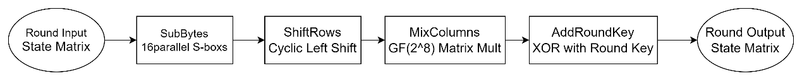
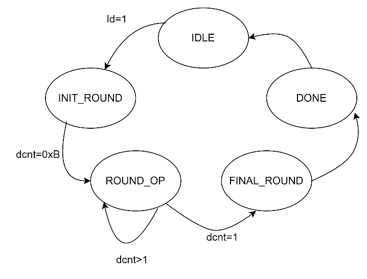
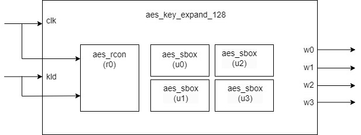
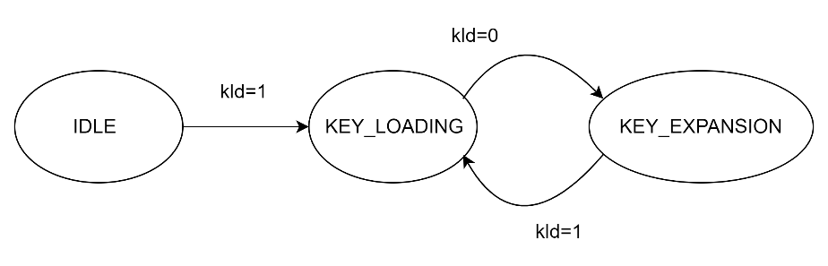
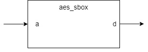
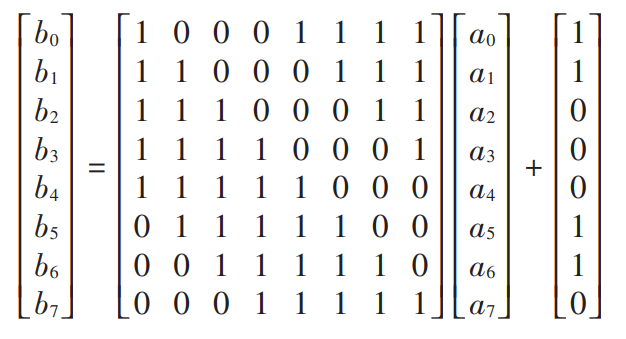
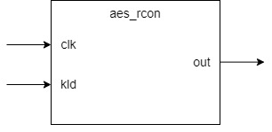
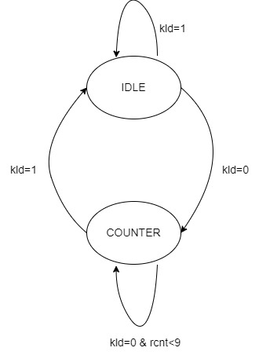

# aes_cipher_top Design Specification

## 1. Introduction

The aes_cipher_top module is the core control module of the entire AES
encryption system, responsible for coordinating and controlling the
entire encryption process. This module implements all round
transformations of the AES encryption algorithm, including SubBytes,
ShiftRows, MixColumns, and AddRoundKey.

## 2. Block Diagram

## 3. Interface

| **Signal Name** | **Direction** | **Width** | **Description** |
| --- | --- | --- | --- |
| clk | input | 1 | Clock signal |
| rst | input | 1 | Reset signal |
| ld | input | 1 | Load enable |
| done | output | 1 | Encryption complete |
| key | input | 128 | Input key |
| text_in | input | 128 | Input plaintext |
| text_out | output | 128 | Output ciphertext |

## 4. Registers

| **Register Name** | **Width** | **Type** | **Reset Value** | **Description** |
| --- | --- | --- | --- | --- |
| text_in_r | 128 | Data Buffer | 0 | Temporary storage register for input text during encryption process |
| sa[0:3][0:3] | 8 | State Matrix | 0 | 4×4 state matrix registers for storing and processing intermediate encryption results, arranged in column-major order |
| dcnt | 4 | Control | 0 | Round counter register for tracking encryption progress, initial value 11 (0xB) for 10 rounds plus initial round |
| ld_r | 1 | Control | 0 | Load operation flag register, synchronizes data loading with clock cycle |
| text_out | 128 | Output Buffer | 0 | Output register storing the final ciphertext result after complete encryption process |

## 5. Operation Principle

**5.1 Basic Principle**

AES encryption algorithm, based on the state matrix concept, performs 10
rounds of transformation on 128-bit input data. Each round includes:

1.  SubBytes - Non-linear byte substitution

2.  ShiftRows - Row shifting operation

3.  MixColumns - Column mixing operation (except final round)

4.  AddRoundKey - Round key addition

**5.2 Mathematical Principle**

1.  State Matrix Structure

$$\begin{matrix}
sa00 & sa01 & sa02 & sa03 \\
sa10 & sa11 & sa12 & sa13 \\
sa20 & sa21 & sa22 & sa23 \\
sa30 & sa31 & sa32 & sa33
\end{matrix}$$

-   4×4 byte matrix

-   Column-major order mapping

-   Each element is 8-bit data

2.  Round Transformations

a\) **SubBytes**: Non-linear transformation through S-box

-   Independent byte transformation

-   16 bytes processed in parallel

b\) **ShiftRows**: Cyclic left shift

Row 0: \[a b c d\] → \[a b c d\] // No shift

Row 1: \[a b c d\] → \[b c d a\] // Shift 1 byte

Row 2: \[a b c d\] → \[c d a b\] // Shift 2 bytes

Row 3: \[a b c d\] → \[d a b c\] // Shift 3 bytes

c\) **MixColumns**: Column mixing

$$\begin{bmatrix}
02 & 03 & 01 & 01 \\
01 & 02 & 03 & 01 \\
01 & 01 & 02 & 03 \\
03 & 01 & 01 & 02
\end{bmatrix} \times \begin{bmatrix}
s0 \\
s1 \\
s2 \\
s3
\end{bmatrix} = \begin{bmatrix}
out0 \\
out1 \\
out2 \\
out3
\end{bmatrix}$$

-   Operations in GF($2^{8}$)

-   ×2 requires special finite field multiplication

-   ×3 equals (×2)⊕(×1)

d\) **AddRoundKey**: Round key XOR

-   Byte-wise XOR with round key

-   Round key generated by key expansion module

## 6. Implementation Details

**6.1 Data Flow Diagram**

**6.2 State Transition Diagram**

IDLE: This is the initial reset state, waiting for the load signal ld=1.

INIT_ROUND: Loads the input data into the text_in_r register.Performs
the initial round key addition operation.Sets the round counter dcnt=0xB
(11), preparing for the following 10 encryption rounds.

ROUND_OP: Performs the standard round operations (Rounds 1-9).

FINAL_ROUND: Executes the final round operation (Round 10). The final
round does not include the MixColumns operation.

DONE: Indicates that encryption is complete.Sets the done signal.Holds
the final encryption result at the text_out output port.

**6.3 Data Loading Operation**

1.  Input Data Mapping:

-   128-bit input mapped to state matrix in column-major order

-   Fill matrix columns from MSB to LSB

-   One-to-one byte mapping

2.  Initial Round Key Addition:

-   Byte-wise XOR of input data with initial round key

-   Synchronous loading to state matrix registers

-   Loading controlled by load signal

**6.4 Round Transformation Implementation**

1.  **SubBytes Transformation**

-   16 parallel S-box units

-   Process all state matrix bytes simultaneously

-   Pure combinational logic implementation

2.  **ShiftRows Transformation**

-   Hardwired row shifting

-   Independent cyclic left shifts per row

-   Shift distances: 0,1,2,3 bytes

3.  **MixColumns Transformation**

-   Four columns processed in parallel

-   Matrix multiplication in GF(2\^8)

-   Finite field multiplication and XOR operations

4.  **AddRoundKey Transformation**

-   Byte-wise XOR with current round key

-   Round key provided by key expansion module

-   Parallel XOR operations

-   Results stored directly in state matrix registers

**6.5 Control Logic**

1.  **Round Counter Operation**

-   4-bit counter for round control

-   Initial value 11 (10 rounds + initial round)

-   Decrements until completion

2.  **Data Flow Control**

-   Load signal controls initial data input

-   One round per clock cycle

-   Synchronous updates on clock edge

**6.6 Output Generation**

Final Round Operations:

1.  Skip MixColumns transformation

2.  Complete ShiftRows operation

3.  XOR with final round key

4.  Organize output in column-major order

5.  Generate completion signal

## 7. Submodules

**7.1 aes_key_expand_128**

**7.1.1 Description**
The aes_key_expand_128 module is a crucial component
in the AES encryption algorithm, responsible for expanding a 128-bit
initial key into round keys for multiple encryption rounds. This
document describes the design principles, implementation methods, and
interface specifications of this module.

**7.1.2 Interface**
|**Signal** |     **Direction**   | **Width**  | **Description Name**    |                                  
|---|---|---|---|
|clk  |          input    |        1      |     Clock signal|
|kld  |          input    |        1      |     Key load enable|
|key  |          input    |        128    |     Input initial key|
|wo_0  |         output   |        32     |     Output round key word 0|
|wo_1 |          output   |        32     |     Output round key word 1|
|wo_2  |         output   |        32     |     Output round key word 2|
|wo_3  |         output   |        32     |     Output round key word 3|

**7.2 aes_sbox**

**7.2.1 Description**

The aes_sbox module is a crucial component in the AES
encryption algorithm, responsible for performing non-linear byte
substitution operations. This document describes the design principles,
implementation methods, and interface specifications of the S-box.

**7.2.2 Interface**

| **Signal Name** | **Direction** | **Width** | **Description** |
| ---             | ---           | ---       | ---             |
| a | input | 8 | Input byte |
| b | output | 8 | Substituted byte |

## 8. Corner Cases

1\. Timing Related:

-   Initial state after reset

-   State transition during new data loading

2\. Data Loading:

-   Data synchronization during load

-   Data stability assurance

3\. Completion Check:

-   Output control after final round

-   Proper done signal generation

## 9. Constraints

1\. Timing Constraints:

-   Register updates on clock rising edge

-   Critical path includes S-box lookup and column mixing

2\. Resource Constraints:

-   Requires 16 S-box modules

-   4×4 state matrix register array

-   Round counter and control logic

# aes_key_expand_128 Design Specification

## 1. Introduction

The aes_key_expand_128 module is a crucial component
in the AES encryption algorithm, responsible for expanding a 128-bit
initial key into round keys for multiple encryption rounds. This
document describes the design principles, implementation methods, and
interface specifications of this module.

## 2. Block Diagram

## 3. Interface

|**Signal** |     **Direction**   | **Width**  | **Description Name**    |                                  
|---|---|---|---|
|clk  |          input    |        1      |     Clock signal|
|kld  |          input    |        1      |     Key load enable|
|key  |          input    |        128    |     Input initial key|
|wo_0  |         output   |        32     |     Output round key word 0|
|wo_1 |          output   |        32     |     Output round key word 1|
|wo_2  |         output   |        32     |     Output round key word 2|
|wo_3  |         output   |        32     |     Output round key word 3|
  

## 4. Operation Principle

**4.1 Basic Principle**

AES-128 key expansion transforms a 128-bit initial key into 11 sets of
128-bit round keys (including the initial round key). Each round key
consists of four 32-bit words. The expansion process is iterative,
generating one new round key at a time.

**4.2 Mathematical Derivation**

**The key expansion process involves the following operations:**

1.  Word Rotation (RotWord)

-   Performs a cyclic left shift on input word

-   \[a0,a1,a2,a3\] → \[a1,a2,a3,a0\]

2.  S-box Substitution (SubWord)

-   Applies S-box transformation to each byte

-   Uses the same S-box as encryption process

3.  Round Constant XOR (Rcon)

-   XOR operation with round constant

-   Different constant value for each round

4.  Key Expansion Algorithm

-   W\[i\] = W\[i-4\]⊕T(W\[i-1\]), when i mod 4 = 0

-   W\[i\] = W\[i-4\]⊕W\[i-1\], otherwise where T(W) =
    SubWord(RotWord(W))⊕Rcon

## 5. Implementation Details

**5.1 State Transition Diagram**

**5.2 Key Loading Operation**

1.  When kld signal is active:

-   128-bit input key is divided into four 32-bit words

-   key\[127:96\] loads into first register

-   key\[95:64\] loads into second register

-   key\[63:32\] loads into third register

-   key\[31:0\] loads into fourth register

2.  Loading process:

-   Synchronous loading at clock rising edge

-   All registers update simultaneously

-   Immediately output to wo_0 to wo_3 ports after loading

**5.3 Key Expansion Operation**

1.  When kld signal is inactive, perform expansion:

-   Take the last word (fourth register value)

-   Perform byte reordering and S-box transformation

-   XOR with current round constant

2.  New round key generation sequence:

-   First word: XOR with previous round word and transformation result

-   Second word: XOR with previous round word, current round first word,
    and transformation result

-   Third word: XOR with previous round word, current round first two
    words, and transformation result

-   Fourth word: XOR with previous round word, current round first three
    words, and transformation result

**5.4 S-box Transformation**

1.  S-box transformation process:

-   Perform parallel S-box lookup on reordered bytes

-   First byte transformation result stores in highest 8 bits

-   Second byte transformation result stores in second highest 8 bits

-   Third byte transformation result stores in second lowest 8 bits

-   Fourth byte transformation result stores in lowest 8 bits

**5.5 Round Constant Operation**

1.  Round constant generation:

-   Starts from initial value, updates automatically each round

-   Only highest byte is valid, other bytes are 0

-   XORs with transformation result during each key expansion

2.  Round constant update:

-   Reset during initial key loading

-   Left shift each round, XOR with specific polynomial on overflow

## 6. Submodules

**6.1 aes_rcon**

**6.1.1 Description**
The aes_rcon module generates constant values used in the
AES key expansion process. For each round of key expansion, a different
constant value is needed. This module generates these round constants
through a counter-based lookup mechanism.

**6.1.2 Interface**

|**Signal Name**|      **Direction**|    **Width**|   **Description**|                                      
| --- | --- | --- | --- |
|clk    |        input      |      1       |    System clock|
|kld  |          iutput   |        1     |      Key load signal (active high)|
|out       |     output    |       32   |       Round constant value|

**6.2 aes_sbox**

**6.2.1 Description**

The aes_sbox module is a crucial component in the AES
encryption algorithm, responsible for performing non-linear byte
substitution operations. This document describes the design principles,
implementation methods, and interface specifications of the S-box.

**6.2.2 Interface**

| **Signal Name** | **Direction** | **Width** | **Description** |
| ---             | ---           | ---       | ---             |
| a | input | 8 | Input byte |
| b | output | 8 | Substituted byte |

## 7. Corner Cases

1.  Key loading timing:

-   kld signal rising edge must synchronize with clk

-   Ensure initial key remains stable when kld is active

2.  Special value handling:

-   All-zero initial key case

-   All-one initial key case

## 8. Constraints

1\. Timing constraints:

-   All registers update on clk rising edge

-   Combinational logic path must meet timing requirements

2\. Resource constraints:

-   Requires four 32-bit registers

-   Uses four S-box modules

-   Includes round constant generator

# aes_sbox Design Specification

## 1. Introduction

The aes_sbox module is a crucial component in the AES
encryption algorithm, responsible for performing non-linear byte
substitution operations. This document describes the design principles,
implementation methods, and interface specifications of the S-box.

## 2. Block Diagram

## 3. Interface

| **Signal Name** | **Direction** | **Width** | **Description** |
| ---             | ---           | ---       | ---             |
| a | input | 8 | Input byte |
| b | output | 8 | Substituted byte |

## 4. Operation Principle

**4.1 Basic Principle**

The S-box transformation is completed in two steps:

1.  Computing the multiplicative inverse in Galois Field GF($2^{8}$)

2.  Applying an affine transformation

Apart from the mathematical calculations, we can look up in the forward
S-box table in actual realization.

In this design, we uses a lookup table to store all the S-box outputs
values for their corresponding inputs.

**4.2 Mathematical Derivation**

**4.2.1 Multiplicative Inverse in GF(**$\mathbf{2}^{\mathbf{8}}$**)**

1.  GF($2^{8}$) Definition:

-   Irreducible polynomial:$\ x^{8} + x^{4} + x^{3} + x + 1$

-   Field elements representation:
    $b_{7}x^{7} + b_{6}x^{6} + b_{5}x^{5} + b_{4}x^{4} + b_{3}x^{3} + b_{2}x^{2} + b_{1}x + b_{0}$

2.  Inverse Calculation:

-   For non-zero element a, its inverse $a^{- 1}$ satisfies: a ×
    $a^{- 1}$ ≡ 1 (mod$x^{8} + x^{4} + x^{3} + x + 1$)

-   Special case: inverse of 0x00 is defined as 0x00

**4.2.2 Affine Transformation**

After computing the multiplicative inverse, an affine transformation is
applied:

$$b_{i}\  = \ a_{i} \oplus a_{i + 4} \oplus a_{i + 5} \oplus a_{i + 6} \oplus a_{i + 7} \oplus c_{i}$$

where:

-   $b_{i}\ $is the i-th bit of the result.

-   c = 0x63 is the transformation constant

-   All index additions are performed modulo 8

For example, for i = 0:

$$b_{0}\  = \ a_{0} \oplus a_{4} \oplus a_{5} \oplus a_{6} \oplus a_{7} \oplus c_{0}$$

For i = 7:

$$b_{7}\  = \ a_{7} \oplus a_{3} \oplus a_{4} \oplus a_{5} \oplus a_{6} \oplus c_{7}$$

This can be represented in matrix form as:

where c = 0x63 =
$\{c_{7},c_{6},c_{5},c_{4},c_{3},c_{2},c_{1},c_{0}\}$=
{0,1,1,0,0,0,1,1}

## 5. Corner Cases

1.  Zero Value Handling:

Input 0x00 must correctly output 0x63.

2.  All-Ones Handling:

Input 0xFF must correctly output 0x16.

## 6. Constraints

1.  Timing Constraints:

-   Combinational logic implementation, no clock required.

-   Output updates immediately after input changes.

2.  Resource Constraints:

-   ROM implementation: requires 256×8 bits storage.

-   Implementation method can be selected based on target device
    characteristics (ROM/LUT).

3.  Usage Guidelines:

-   Pure combinational logic module, consider setup and hold times.

-   Pipeline registers can be added externally if needed.

# aes_rcon Design Specification

## 1. Introduction

The aes_rcon module generates constant values used in the
AES key expansion process. For each round of key expansion, a different
constant value is needed. This module generates these round constants
through a counter-based lookup mechanism.

## 2. Block Diagram

## 3. Interface

|**Signal Name**|      **Direction**|    **Width**|   **Description**|                                      
| --- | --- | --- | --- |
|clk    |        input      |      1       |    System clock|
|kld  |          iutput   |        1     |      Key load signal (active high)|
|out       |     output    |       32   |       Round constant value|

## 4. Register

rcnt: Round counter for key expansion process. Counts from 0 to 9,
increments each clock cycle when kld is deasserted, resets to 0 when kld
is asserted. Controls round constant generation sequence.

## 5. Operation Principle

**5.1 Algebraic Structure of Round Constants**

Round constants are calculated in the finite field GF($2^{8}$).
According to the paper, this field is defined by the irreducible
polynomial m(x) = $x^{8} + x^{4} + x^{3} + x + 1$. In this field:

-   Each element can be represented as an 8-bit binary number

-   Addition operation is bitwise XOR

-   Multiplication must be performed under modulo m(x)

**5.2 Round Constant Generation Principle**

Round constants RC\[i\] are generated using the following recursive
formula:

1.  RC\[1\] = 01 (initial value)

2.  RC\[i\] = x·RC\[i-1\], i\>1

where x represents 02 in GF($2^{8}$). Therefore, each round constant is
the result of multiplying the previous round constant by 02 in
GF($2^{8}$).

**5.3 Round Constant Sequence Derivation**

**5.3.1 Basic Derivation Process**

The derivation process of round constants:

1.  RC\[1\] = 01

2.  RC\[2\] = 02 × 01 = 02

3.  RC\[3\] = 02 × 02 = 04

4.  RC\[4\] = 02 × 04 = 08

5.  RC\[5\] = 02 × 08 = 10

6.  RC\[6\] = 02 × 10 = 20

7.  RC\[7\] = 02 × 40 = 40

8.  RC\[8\] = 02 × 40 = 80

9.  RC\[9\] = 02 × 80 = 1B (requires reduction in GF($2^{8}$))

10. RC\[10\] = 02 × 1B = 36 (requires reduction in GF($2^{8}$))

**5.3.2 Special Value Processing**

When products exceed 8 bits (as in RC\[9\] and RC\[10\]), reduction in
GF($2^{8}$) is required:

-   100 = 1B (mod m(x))

-   1B × 02 = 36 (mod m(x))

## 6. Operation

**6.1 State Transition Diagram**

**6.2 Normal Operation**

1.  Upon Reset:

-   One time unit after the clock's rising edge, rcnt is cleared to zero

-   One time unit after the clock's rising edge, out outputs initial round constant (32\'h01_00_00_00)

2.  Counting Operation:

-   One time unit after the clock's rising edge, rcnt increments every clock cycle

-   One time unit after the clock's rising edge, out generates corresponding round constant based on rcnt value

**6.3 Round Constant Sequence**

-   RC\[0\] = 32\'h01_00_00_00

-   RC\[1\] = 32\'h02_00_00_00

-   RC\[2\] = 32\'h04_00_00_00

-   \...continues through RC\[9\]

## 7. Corner Cases

**7.1 Key load**

-   When kld=1, output must be 0x01000000

-   Counter must reset to 0

**7.2 Maximum Count**

-   When rcnt\>9, output should be 0x00000000

-   Counter continues to increment but output remains 0

## 8. Constraints

1.  Counter Size:

-   rcnt is 4 bits wide

-   Valid RCON values for rcnt range 0-9

2.  Output Format:

-   Only MSB changes

-   Lower 24 bits must always be 0x000000

-   Output is registered, changes on clock edge
