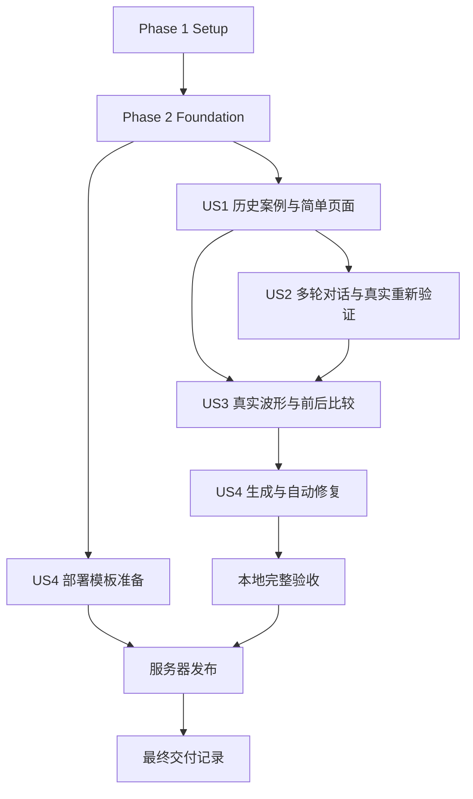

# Tasks: RTL Agent 投资人演示工作台

**Input**: `specs/001-rtl-agent-demo/` 中的设计文档。

**Prerequisites**: [plan.md](plan.md)、[spec.md](spec.md)、[research.md](research.md)、[data-model.md](data-model.md)、[Web接口契约](contracts/web-api.md)、[证据契约](contracts/evidence.md)、[部署方案](deployment.md)、[验收指南](quickstart.md)。

**Tests**: 规格已经定义独立验收、波形比较、五类验证结论和故障恢复场景；计划指定pytest、Vitest和Playwright。以下仅安排对应的必要行为测试和端到端验收，不为纯排版增加实现镜像式单测。测试任务先于对应实现，普通测试不自动调用收费模型、SSH或生产服务。测试替身不得作为投资人演示证据。

**Organization**: Setup → Foundation → US1(P1) → US2(P1) → US3(P1) → US4(P2) → 最终验收。US1用于先评审页面；完整首版包含四个故事，持续对话和真实波形不能省略。

## Format: `[ID] [P?] [Story] Description`

任务以 `- [ ] Tnnn` / `- [X] Tnnn` 标记实际进度；只有用户故事任务带 `[US1]`～`[US4]`。`[P]` 表示在列明依赖完成后可与其他不改相同文件的任务并行，不表示忽略依赖。

## Path Conventions

源码路径均相对仓库根目录；本文件位于 `specs/001-rtl-agent-demo/tasks.md`。前端使用 `web/rtl-demo/`，Web适配层使用 `zerorepo/rtl_web/`，后端测试位于 `tests/rtl_web/`。未存在的目标文件由对应任务创建。根目录已有Agent、RTL数据集和历史输出不作为脚手架覆盖目标。

实施过程中把实际命令、结果和证据ID写入 `specs/001-rtl-agent-demo/validation.md`；它是后续实施记录，不将本任务清单或规划中的PASS当作已完成测试。

## Phase 1: Setup (Shared Infrastructure)

**Purpose**: 建立最小开发结构与独立依赖，不升级整仓库的Agent环境。

- [X] T001 创建 `zerorepo/rtl_web/__init__.py`，在 `requirements-web.in`、`requirements-web.txt` 固定FastAPI/Uvicorn/Pydantic 2/vcdvcd及计划中的后端测试依赖；确认轻量环境可导入Web包且不加载现有完整Agent依赖，不改根目录 `requirements.txt`。
- [X] T002 [P] 初始化 `web/rtl-demo/package.json`、`web/rtl-demo/package-lock.json`、`web/rtl-demo/tsconfig.json`、`web/rtl-demo/vite.config.ts` 与 `web/rtl-demo/index.html`，配置原生TypeScript、同源 `/api` 开发代理及build/test/test:e2e命令；配置Vitest和Playwright，不引入UI框架、路由器或在线编辑器。
- [X] T003 [P] 在 `configs/rtl_demo.example.yaml` 定义无密钥配置与固定E203 registry，区分case_id、project_hint、planner_top和DUT别名，包含runtime解释器、oracle_root、data_root及预算；在 `.gitignore` 排除私有配置、SQLite、实时工作区和生成的演示包，不修改已有输出文件。

**Checkpoint**: 前后端目录及锁定依赖就绪；私有模型配置和服务凭据没有进入提交内容。

---

## Phase 2: Foundational (Blocking Prerequisites)

**Purpose**: 提供所有故事共用的实体、状态、证据存储和访问边界。完成本阶段后再接入用户故事。

- [X] T004 在 `zerorepo/rtl_web/schemas.py` 按数据模型和契约定义Case/Session/Message/Run/Operation/RTLVersion/Validation/Artifact/RepairAttempt/Event/Bundle及波形交换结构，区分operation完成与verdict、候选与最终系统验证，保留null统计和十进制字符串tick。（依赖T001、T003）
- [X] T005 [P] 在 `zerorepo/rtl_web/settings.py` 实现配置加载、路径归一化、固定案例registry、来源域名及生产/仅localhost开发模式；私密值从环境或私有配置读取，不采用本机 `/home/mokita` 路径作为服务器默认值。（依赖T004）
- [X] T006 [P] 在 `zerorepo/rtl_web/store.py` 建立同机SQLite表、外键/唯一约束、短事务与WAL，提供会话/消息/事件/快照读写及原子运行槽和幂等登记；同键异payload冲突、全局最多一个accepted/running操作，状态与事件一并提交。（依赖T004）
- [X] T007 在 `zerorepo/rtl_web/artifacts.py` 实现完整RTL树清单与SHA256、不可变快照、原子文件发布、artifact白名单、路径/符号链接边界和日志脱敏；区分source/display hash以及recorded_candidate/full_input_manifest绑定等级。（依赖T005、T006）
- [X] T008 在 `zerorepo/rtl_web/api.py`、`zerorepo/rtl_web/cli.py` 建立应用工厂、统一错误与request_id、网关凭据/Origin/会话cookie检查、显式开发豁免和单Uvicorn serve入口；health只返回已检查能力，不在请求或导入时启动Agent。（依赖T005～T007）
- [X] T009 [P] 在 `web/rtl-demo/src/state.ts`、`web/rtl-demo/src/api.ts` 定义与契约一致的类型、上下文引用、历史浏览选择和活动操作的独立状态，以及带幂等键的请求和统一错误处理；本任务不实现页面或发送真实任务。（依赖T002、T004）

**Checkpoint**: 身份、状态、错误与产物引用已统一；Web API不会因导入而要求完整模型栈，历史浏览选择不能改变活动操作目标。

---

## Phase 3: User Story 1 - 在一个页面讲清技术能力 (Priority: P1)

**Goal**: 用已有真实案例完成一个简洁的只读展示页，保留持续可见的对话区域，为后续交互和波形留出既定位置。

**Independent Test**: 不运行模型和仿真，加载E203已有记录，在1366×768视口浏览规格、模块树、只读RTL和报告；3分钟内完成可暂停的历史回放，来源模式和缺失阶段如实标注。

### Tests for User Story 1

- [X] T010 [US1] 在 `tests/rtl_web/test_case_import.py` 和 `web/rtl-demo/tests/e2e/history.spec.ts` 编写导入与展示验收：错误RTL/report/VCD关联、lint继承wave和冲突统计必须拒绝；页面三个标签保留上下文，回放不提前揭示结果，正常报告显示真实1/222与0/222；测试只使用白名单脱敏fixture，真实大产物可作为显式本地集成输入。（依赖Phase 2）

### Implementation for User Story 1

- [X] T011 [US1] 在 `zerorepo/rtl_web/import_case.py`、`zerorepo/rtl_web/waveform.py` 和 `zerorepo/rtl_web/cli.py` 实现历史import-case/export-static基础流程：按research导入trial5/trial9及独立final_verify，核对sim_completed、完整RTL树与已记录testbench绑定；解析唯一总行统计，并实现3488bit stats1布局及计数交叉校验；仅导出白名单元数据、RTL、脱敏报告和真实回放事件，不复制整个codex_private。（依赖T010）
- [X] T012 [US1] 在 `zerorepo/rtl_web/api.py` 接入案例、版本模块、验证摘要和artifact内容只读端点，返回实际来源、绑定等级、报告入口、缺失状态及版本引用；candidate通过与final-system通过分别展示，旧latest不能当归属证明。（依赖T011）
- [X] T013 [P] [US1] 在 `web/rtl-demo/src/main.ts`、`web/rtl-demo/src/styles.css` 和 `web/rtl-demo/index.html` 实现左侧持续对话区域、右侧三个标签、折叠规格摘要、文字阶段状态及播放/暂停/继续回放；1366×768可操作，不新增页面或配置面板。（依赖T010、T012）
- [X] T014 [P] [US1] 在 `web/rtl-demo/src/architecture.ts`、`web/rtl-demo/src/code.ts` 实现简单模块树、模块职责、版本对应的只读代码和证据跳转；按文本渲染代码与日志，不引入通用图谱或编辑器。（依赖T010、T012；可与T013并行）
- [X] T015 [US1] 在 `web/rtl-demo/src/verification.ts`、`web/rtl-demo/src/api.ts` 实现真实验证摘要和原始报告查看，区分采样统计与内部计数、历史与实时、未知与零；API不可用时读取已发布的静态案例manifest，实时能力明确不可用。（依赖T013、T014）
- [X] T016 [US1] 运行历史导入及页面验收，将bundle_id、候选/最终复验关联、测试结果、视口及回放时长记录到 `specs/001-rtl-agent-demo/validation.md`；确认 `web/rtl-demo/public/cases/e203/manifest.json` 引用真实可追溯产物，本阶段对话和波形尚未完成时不得标记完整demo已交付。（依赖T015）

**Checkpoint**: US1可独立评审页面与证据；这是展示预览，持续交互和可操作波形仍由US2、US3交付。

---

## Phase 4: User Story 2 - 通过对话提问并发起操作 (Priority: P1)

**Goal**: 提供真实多轮问答、证据跳转和一个可实际执行的重新验证动作；完整生成/修复处理器随后由US4补齐，避免把对话先做成空壳。

**Independent Test**: 使用已有案例进行10轮问答与标签切换，再通过对话发起一次实际SystemSimReviewer验证，获得新的实时验证记录；重复请求、刷新和短时断连不造成重复执行。

### Tests for User Story 2

- [X] T017 [US2] 在 `tests/rtl_web/test_chat_operations.py`、`tests/rtl_web/test_worker_lifecycle.py`、`web/rtl-demo/tests/e2e/chat.spec.ts` 编写必要接口/进程/浏览器验收：上下文固定、10轮对话、证据跳转、目标澄清、动作白名单、幂等冲突、忙状态、SSE补发、API重启不重跑、worker超时清理进程组；使用可控短子进程与模型替身，不真实调用收费服务。（依赖Phase 2、T016）

### Implementation for User Story 2

- [X] T018 [P] [US2] 在 `zerorepo/rtl_web/chat_runtime.py`、`zerorepo/rtl_web/chat.py` 实现限时独立问答子进程、现有LLMClient/Memory多轮上下文和受限证据输入，解析answer/clarify/open_artifact及三类操作意图；证据ID须有效，统计由真实记录提供，不能接收任意shell、路径或模型配置。（依赖T017）
- [X] T019 [P] [US2] 在 `zerorepo/rtl_web/runtime.py` 实现verify-only处理器：从所选完整RTL快照创建独立运行副本，使用固定registry的SystemSimReviewer.review和新的output_dir；保存完整受测环境指纹、本次报告/VCD及最终verdict，禁止进入PlannerRunner或自动修复。（依赖T017；可与T018并行）
- [X] T020 [US2] 在 `zerorepo/rtl_web/worker.py` 实现唯一worker锁、原子领取、固定argv的runtime子进程、阶段/终态事件及产物登记；超时终止进程组，worker重启将旧running标interrupted，API重启不终止worker；未实现的生成/修复处理器明确不可用。（依赖T019）
- [X] T021 [US2] 在 `zerorepo/rtl_web/api.py`、`zerorepo/rtl_web/store.py` 接入消息/操作POST、selection PATCH、会话快照与SSE端点，同一会话最多一个replying；校验意图后调用统一原子调度，15秒heartbeat与Last-Event-ID补发；未完成聊天在API恢复时标interrupted，不自动重提写入意图。（依赖T018、T020）
- [X] T022 [P] [US2] 在 `web/rtl-demo/src/chat.ts` 实现持续多轮输入、简短操作示例、回答、澄清、运行结果卡和证据按钮，按文本渲染内容；支持真实错误和不可用状态，不使用固定回答冒充Agent。（依赖T017；组件使用T009契约，可与后端T018～T021并行）
- [X] T023 [US2] 在 `web/rtl-demo/src/api.ts`、`web/rtl-demo/src/state.ts`、`web/rtl-demo/src/main.ts` 连接消息请求、会话恢复和单一SSE流；按事件ID去重，浏览历史不被实时结果强制覆盖，刷新只恢复观察不重新POST。（依赖T021、T022）
- [X] T024 [US2] 在 `zerorepo/rtl_web/api.py`、`web/rtl-demo/src/verification.ts` 补齐operation/run查询与实时验证结果联动，显示所选RTL版本的新报告与波形引用；把消息、operation、run和validation正确关联，不能用候选PASS或旧记录更新最终结果。（依赖T020、T023）
- [ ] T025 [US2] 运行 `web/rtl-demo/tests/e2e/chat.spec.ts` 的10轮对话、证据跳转和重连恢复验收，并在依赖准备好后完成一次真实问答及verify；把本次RTL hash、operation_id、validation_id和结果写入 `specs/001-rtl-agent-demo/validation.md`，区分替身测试与真实执行。（依赖T024）

**Checkpoint**: 对话框能实际问答并重新验证；后台尚未实现的生成/修复应明确不可用，US4完成后再验收三类动作全量能力。

---

## Phase 5: User Story 3 - 查看真实波形并对比修复前后 (Priority: P1)

**Goal**: 在验证标签内交互查看固定关键波形、测试采样marker及修复前后版本；不把原始组合差异误判为系统验证失败。

**Independent Test**: 用已导入trial5的1/222失败和最终复验的0/222通过，在两次点击内定位1125ps附近并切换修复前后，信号组和可比较窗口保持一致，原始波形照实显示。

### Tests for User Story 3

- [X] T026 [P] [US3] 在 `tests/rtl_web/test_waveform_evidence.py` 编写真实采样语义和窗口测试：stats1失败时间1125ps、成功记录raw不同而采样通过、carry-in、x/z、缺信号、错误布局/计数冲突、十进制tick和20000变化上限；不得通过增加valid/reset屏蔽改变原评分。（依赖T011）
- [X] T027 [P] [US3] 在 `web/rtl-demo/src/waveform.test.ts`、`web/rtl-demo/tests/e2e/waveform.spec.ts` 编写缩放/平移/游标读值、两次点击定位、版本切换保留窗口、范围不可比与缺失数据的验收；使用契约fixture，测试与后端T026分文件。（依赖T015）

### Implementation for User Story 3

- [X] T028 [P] [US3] 在 `zerorepo/rtl_web/waveform.py`、`zerorepo/rtl_web/api.py` 实现固定最多16信号的完整VCD窗口和验证waveform端点，返回起点值、全部变化、原始位宽/x/z/timescale与已校验marker；超限413提示缩小窗口，不静默下采样，不导入重型Debug包。（依赖T026、T024）
- [X] T029 [P] [US3] 在 `web/rtl-demo/src/waveform.ts` 实现固定关键组的SVG数字波形、十六进制总线、缩放、平移、游标和采样标记，安全处理tick数值；明确游标是波形显示值，不把tb_match低电平直接渲染成权威失败。（依赖T027；可与T028并行）
- [X] T030 [US3] 在 `web/rtl-demo/src/verification.ts` 接入修复前/后选择、差异跳转、对应版本/报告联动和同窗口比较；显示简短“结果按测试平台采样判定”，不增加通用信号管理或额外页面。（依赖T028、T029）
- [X] T031 [US3] 扩展 `zerorepo/rtl_web/cli.py`、`zerorepo/rtl_web/import_case.py`、`web/rtl-demo/src/api.ts` 的静态导出/读取流程，发布与实时接口相同语义的不可变真实波形窗口和marker，当前manifest引用正确bundle；只在计算后台保留原始VCD及私有依赖，后端不可用时仍可浏览历史波形。（依赖T030）
- [X] T032 [US3] 用真实before/after包执行波形验收并将源VCD hash、marker统计、缺失/冲突场景结果和交互步骤写入 `specs/001-rtl-agent-demo/validation.md`；核对trial5为1/222、独立最终复验为0/222，原始差异没有被隐藏或改写。（依赖T031）

**Checkpoint**: 硬性波形要求已满足；通过状态有独立报告和对应版本，交互波形能解释具体采样证据。

---

## Phase 6: User Story 4 - 现场执行生成、验证和自动修复 (Priority: P2)

**Goal**: 扩展已可用的verify为完整生成/修复闭环，并按用户确认的公网Caddy+私网大内存服务器部署。

**Independent Test**: 从对话启动E203新生成运行，再从失败版本派生修复，检查真实阶段、代码差异、候选接受/回滚和最终独立复验；通过受保护design域名执行真实问答/验证，主站与www保持原状。

### Tests for User Story 4

- [X] T033 [US4] 在 `tests/rtl_web/test_runtime_adapters.py`、`tests/rtl_web/test_access_boundary.py`、`tests/rtl_web/test_deploy_release.py` 编写生成/修复入口、独立workspace、外部verifier配置、只读golden/spec、最终结果归属及生产访问边界测试；覆盖merge完成/退出码0但系统FAIL、无报告、旧latest、错误版本和语法通过不能产生最终PASS，并在临时fixture目录验证design-only发布、备份、回滚不触及主站；不SSH或写实际服务器目录。（依赖T020、T032）

### Implementation for User Story 4

- [X] T034 [US4] 在 `zerorepo/rtl_web/runtime.py` 实现generate_and_verify处理器，按现有main.py配置构造PlannerTaskInput/PlannerRunner、Codex Debug和required KG，使用新的checkpoint/output/workspace；实现PlanningArtifactSink并发布真实阶段/模块事件，不复制或重写六阶段算法。（依赖T033）
- [X] T035 [US4] 在 `zerorepo/rtl_web/runtime.py` 实现fix处理器，从所选失败版本派生独立运行，向SystemDebugRunner提供规格、契约、merge records及受信验证环境；保存各候选快照与最终独立复验，沿用原有预算、accept/rollback及别名兼容，禁止原位修改历史或golden。（依赖T034）
- [X] T036 [US4] 在 `zerorepo/rtl_web/worker.py`、`zerorepo/rtl_web/artifacts.py`、`zerorepo/rtl_web/api.py` 完成三类处理器注册、候选journal增量采集与run/version/validation绑定，提供同案例版本diff端点；验证失败、执行异常和预算耗尽分开，所有完成事件引用本次运行的实际产物。（依赖T035）
- [X] T037 [US4] 在 `zerorepo/rtl_web/cli.py`、`zerorepo/rtl_web/settings.py` 和 `scripts/rtl_demo/preflight.sh` 实现无付费调用的部署预检：两个Python环境、后端CLI/profile、KG、Verilator/C++、完整RealBench两处目录及可写本地盘；health细分回放/问答/verify/生成/修复能力，不静默更换backend或禁用KG。（依赖T036）
- [X] T038 [P] [US4] 在 `deploy/rtl_demo/rtl-demo-api.service`、`deploy/rtl_demo/rtl-demo-worker.service`、`deploy/rtl_demo/environment.example` 编写普通用户systemd服务和无密钥环境示例，配置实际解释器/私网监听/持久目录、单worker锁与KillMode=control-group；API和worker同机共享SQLite，不能把数据库放网关或NFS。（依赖Phase 2；可与T034～T037并行编写模板）
- [X] T039 [P] [US4] 在 `deploy/rtl_demo/Caddyfile.design.example`、`deploy/rtl_demo/caddy-environment.conf.example` 编写仅design站点的共享访问保护、保留 `/api` 前缀的私网反代、网关头覆盖及SSE支持；校验和服务使用相同EnvironmentFile，后端地址保持部署参数，不添加公网模型端口或全局SPA回退。（依赖Phase 2；与T038改不同文件）
- [X] T040 [US4] 在 `scripts/rtl_demo/stage-release.sh`、`scripts/rtl_demo/install-as-root.sh` 实现完整dist/历史包及发布manifest的dev准备、root design-only安装、dry-run、备份与回滚；先assets后原子index/manifest，保留旧hash资源，禁止只复制index、同步主站、覆盖整个Caddyfile或覆盖原有部署脚本。（依赖T031、T037～T039）
- [X] T041 [US4] 在 `web/rtl-demo/src/chat.ts`、`web/rtl-demo/src/code.ts`、`web/rtl-demo/src/verification.ts` 展示真实生成模块进度、修复代码diff、候选验证与accept/rollback和最终复验，并接通两类新增对话动作；沿用现有三标签和简短操作卡，不增加任务管理页。（依赖T036）
- [ ] T042 [US4] 在准备好的Agent环境执行三类实际入口验收，记录至少一次真实verify通过及一次可审查的修复过程，核对输入只读文件hash和独立输出目录，将真实调用、失败原因或完成证据写入 `specs/001-rtl-agent-demo/validation.md`；缺依赖不能用替身结果将本任务勾完。（依赖T037、T041）
- [ ] T043 [US4] 按 `specs/001-rtl-agent-demo/deployment.md` 填写用户后续提供的私网连通参数及服务用户/路径，在大内存服务器部署完整运行依赖和两个服务，记录能力预检、端口监听及私网访问结果到 `specs/001-rtl-agent-demo/validation.md`；私网信息未到时仅此发布任务待执行，不阻塞本地实现。（依赖T038、T040、T042及实际私网信息）
- [ ] T044 [US4] 按 `specs/001-rtl-agent-demo/deployment.md` 在公网服务器dev准备完整发布包、root备份并发布design及评审后的Caddy变更，验证未认证拒绝/认证页面/API/SSE/真实问答复验及主站www原内容，记录发布ID与回滚位置到 `specs/001-rtl-agent-demo/validation.md`；后台端口仅允许已核对的私网网关来源。（依赖T039、T040、T043及root发布条件）

**Checkpoint**: 四个故事均能以真实证据演示；只有私网连通、服务就绪和design端到端验收完成，才能声称已部署。

---

## Phase 7: Polish & Cross-Cutting Concerns

**Purpose**: 完成整体验收和交付记录，不扩充产品功能。

- [X] T045 运行 `tests/rtl_web/`、`web/rtl-demo/src/waveform.test.ts` 及 `web/rtl-demo/tests/e2e/` 对应检查和前端build，覆盖本次实际修改的Agent接入点回归；将命令、结果和失败修复记录到 `specs/001-rtl-agent-demo/validation.md`，不扩大为全仓库收费模型实验。（依赖T042；本地检查不必等待服务器参数）
- [ ] T046 按SC-001～SC-005检查 `web/rtl-demo/src/main.ts`、`web/rtl-demo/src/state.ts`、`web/rtl-demo/src/waveform.ts` 的首屏、1366×768视口、3分钟回放、3秒接收/5秒更新和10轮对话；只对实测不达标路径调整，记录测量与测试环境到 `specs/001-rtl-agent-demo/validation.md`，不新增复杂UI。（依赖T045）
- [X] T047 根据实际实现和预检结果更新 `specs/001-rtl-agent-demo/quickstart.md`、`specs/001-rtl-agent-demo/deployment.md`、`specs/001-rtl-agent-demo/plan.md` 中的命令/锁定版本/发布与回滚步骤，写清现有服务、配置路径和未执行项目，不写入秘密。（依赖T046；上线相关事实待T044后补齐）
- [ ] T048 对照 `specs/001-rtl-agent-demo/spec.md` 的全部FR-001～FR-021及SC-001～SC-009，在 `specs/001-rtl-agent-demo/validation.md` 逐项登记真实通过/失败/未执行和证据引用，确认模型不可用仍可浏览历史、恢复不重跑、结果不串版本；缺少真实部署或必要验收时保留未完成项，不把规格质量清单当实现完成证明。（依赖T044、T047）

---

## Dependencies & Execution Order

### Phase Dependencies

- Phase 2完成前不接入用户故事；T005/T006/T009在契约T004固定后可并行。
- US1独立交付历史预览；US2复用US1证据，自己实现verify最小执行闭环，不等待完整生成/修复。
- US3的窗口和SVG可在US1后提前分支开发，但T028实际API联调需T024；按清单顺序执行最稳妥。
- US4生成/修复实现复用US2 worker和verify；部署模板T038/T039可提前编写，不等于提前操作线上服务。
- T043/T044依赖用户稍后提供的私网信息和真实root发布条件；其余本地实现和T045/T046可继续，不以等待信息为由停止可独立完成的工作。
- 同一文件在不同故事中扩展时串行合并；特别是api.py、runtime.py、cli.py、state.ts和verification.ts，不因不同故事标签而并行覆盖。

### Within Each User Story

先落实必要测试/验收约束，再实现对应服务、接口、组件和集成。测试替身验证边界，真实案例和现场执行验证结果可信度。每个checkpoint都写实际状态，不提前勾选任务。

### Parallel Opportunities

| 前置完成 | 可并行任务 | 文件边界 |
| --- | --- | --- |
| 开始Setup | T001 / T002 / T003 | Python依赖、前端初始化、配置与忽略规则 |
| T004 | T005 / T006 / T009 | settings、store、前端类型与客户端 |
| T012 | T013 / T014 | 页面壳与模块/代码组件 |
| T017 | T018 / T019 / T022 | 聊天runtime、verify runtime、聊天组件 |
| US1 | T026 / T027 | 后端波形测试、前端波形测试 |
| 对应测试及T024 | T028 / T029 | 后端窗口与API、独立SVG组件 |
| Phase 2 | T038 / T039 | systemd模板、Caddy模板，可与后续业务实现并行 |

`[P]` 是实施机会说明，本次任务生成不启动并行子代理，也不自动运行这些任务。

## Parallel Example: User Story 1

T010/T012完成后，并行实现T013的 `main.ts/styles.css/index.html` 与T014的 `architecture.ts/code.ts`；随后在T015按已定类型联调，T016执行历史页面验收。

## Parallel Example: User Story 2

T017完成后，T018实现问答进程，T019实现verify-only，T022实现独立聊天组件。三个分支不改共享API文件；T020/T021登记后台状态后，T023统一接入SSE和主页面。

## Parallel Example: User Story 3

先并行完成T026后端与T027前端测试；T024就绪后，T028完成窗口服务、T029完成SVG交互，两者按同一WaveWindow契约开发。T030统一接入验证页，再执行T031/T032。

## Parallel Example: User Story 4

T034/T035按顺序改runtime.py；T038编写systemd与环境示例，T039编写Caddy和drop-in示例。runtime接入和模板准备可同时进行；实际发布仍须按T042→T043→T044验证依赖。

## Implementation Strategy

### MVP First

第一评审里程碑为US1：先看到简洁页面与真实历史产物。面向投资人的最小演示必须再包含US2真实问答与重新验证、US3可交互真实波形；对外访问还必须落实US4的私网后台与受保护入口。不能把只有展示预览的US1当成满足全部硬性要求的交付。

完整第一版继续完成US4的实时生成与自动修复，并执行最终发布验收；不以“MVP”为由省略已授权范围。缺少服务器参数时先完成本地全部实现及验证。

### Incremental Delivery

1. T001～T009：轻量依赖、实体和共用状态边界。
2. T010～T016：可评审的历史案例页面。
3. T017～T025：真实对话与单独verify。
4. T026～T032：原始波形、采样marker和可信前后比较。
5. T033～T044：完整生成修复、部署材料、实际服务发布。
6. T045～T048：本地回归、目标测量、文档与逐项交付记录；允许本地部分在服务器参数到达前完成。

## Requirement Coverage

| 规格条目 | 主要任务 |
| --- | --- |
| FR-001～FR-004 / FR-020 | T011～T016、T022、T030、T046 |
| FR-005 / FR-006 | T018、T021～T025 |
| FR-007 | T018～T025、T034～T036、T041～T042 |
| FR-008 / FR-009 | T006、T020～T024、T036 |
| FR-010 / FR-019 | T007、T019、T034～T037、T042 |
| FR-011 | T035～T036、T041～T042 |
| FR-012 / FR-013 | T007、T010～T012、T019、T024、T033～T036 |
| FR-014 | T011、T015、T024、T032 |
| FR-015～FR-017 | T026～T032 |
| FR-018 | T008、T015、T017、T020～T025、T031、T045、T048 |
| FR-021 | T038～T044、T048 |
| SC-001 / SC-002 | T016、T046 |
| SC-003 / SC-004 | T025、T042、T046 |
| SC-005～SC-007 | T026～T032、T033、T045 |
| SC-008 | T017、T020～T025、T045、T048 |
| SC-009 | T043～T044、T048 |

## Notes

- 任务共48项：Setup 3、Foundation 6、US1 7、US2 9、US3 7、US4 12、收尾4；完成状态见各任务复选框；真实问答/生成修复和服务器发布须单独验收。
- E203导入基目录为 `rtl_outputs/e203_exu_alu_system/.zerorepo/workspace/debug_system/e203_exu_alu_system/`；before使用 `codex_private/candidates/candidate_ea234d9c8dd7/revision_001/`，after候选使用 `codex_private/candidates/candidate_e0e2441d4dfd/revision_001/` 内各自的merged与artifacts。独立最终复验读取 `codex_private/final_sim_output.json` 和 `codex_private/final_verify/wave.vcd`，核对accepted RTL快照；不能假设final_verify目录内另有同名报告。具体hash见research。
- 初始范围为固定E203，2026-10-16 按用户要求扩展至下述四个固定案例；不扩展到任意规格上传、账号注册、多项目管理、在线编辑、通用知识图谱或完整波形IDE。
- 最终报告和波形必须属于同一个受测版本；原始波形与testbench采样判定分开，不能调整golden或增加评分屏蔽使画面“看起来正确”。
- 当前constitution仍是模板，本清单不把其中示例当作强制规范；未发现需要执行的before_tasks或after_tasks扩展hook。

## 本次实施收尾状态（2026-10-15）

本地代码与自动化检查已完成，进度和逐项需求结果见 validation.md。T025（真实问答）、T042（真实生成/修复）、T043/T044（两台服务器发布）、T046（完整SC-001～005现场验收）、T048（全部FR/SC最终交付）保留未完成。缺少模型环境凭据、指定Codex profile和服务器私网发布参数；没有用替身或历史记录将这些项目勾完。

## 用户追加：四个预置案例（2026-10-16）

- [x] T049 明确 E203 历史失败与最终 PASS 的区别，增加返回最终结果入口，修正明确系统 PASS 不应依赖可选统计行的解析。
- [x] T050 注册 AES 加密、AES 解密、SDC 三例，校验真实规格/规划/受测 RTL/报告/VCD 哈希；缺失前后记录和统计如实展示。
- [x] T051 增加单一下拉框选择案例，保持三个标签和常驻对话；实现案例独立会话与执行上下文，沿用单一全局执行槽及真实验证器。
- [x] T052 显示新增案例的真实 DUT/Reference 信号；SDC 精确分窗和时间跳转；静态导出及发布回滚支持案例索引和所有案例指针。
- [x] T053 实际重新验证三个案例；增加解析/案例隔离/波形窗口/缺失契约/发布回滚和浏览器测试，更新运行说明及验收记录。

原48项的6项环境验收仍未完成；新增5项已完成，总计47/53。真实模型调用与服务器上线的限制未由此次多案例扩展解除。

## 用户追加：输入及真实交互修复（2026-10-16）

- [x] T054 修复离线禁用输入、草稿丢失及缺少重连入口；覆盖IME回车、刷新、案例隔离和发送期间的新草稿。
- [x] T055 修复恢复会话后context_ref多余字段导致真实API返回422；统一启动真实API/worker，完成真实浏览器对话发起的E203仿真及两轮有依据的模型问答、刷新恢复；增加JSON输出/历史契约和默认Agent行为回归。

当前49/55。原6项仍保留：本次真实问答为2轮，不能将T025的完整10轮验收勾完；生成/修复仍受指定profile阻塞。公网SSH已接通且静态包已暂存并校验，服务器仍缺计算机实际地址，Caddy及/srv发布需要root执行；不能将暂存当作T043/T044上线完成。详见validation.md最新记录。
