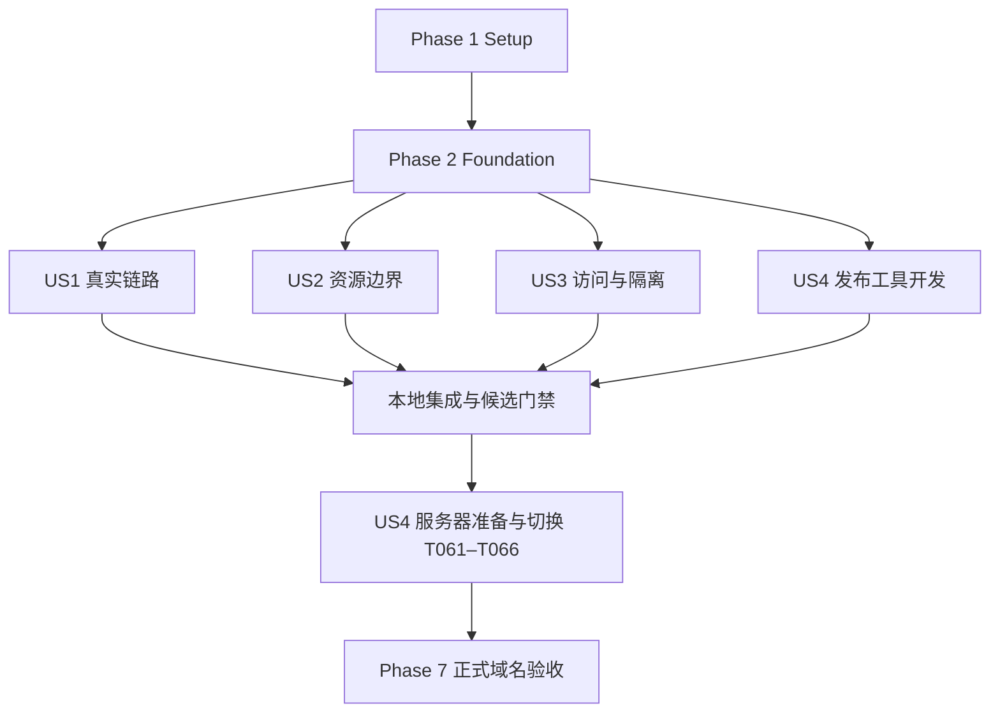

# Tasks: RTL Agent 单机安全部署

**Input**: `specs/002-secure-agent-deploy/`中的[规格](spec.md)、[计划](plan.md)、[研究](research.md)、[数据模型](data-model.md)、[发布契约](contracts/deployment.md)、[运行契约](contracts/runtime.md)、[验收指南](quickstart.md)及[上传清单](deployment-inventory.md)。

**Prerequisites**: 设计文档已完成；实际Git分支为main，逻辑特性为002-secure-agent-deploy。constitution未填写，不将模板示例视为额外政策。

**Tests**: 按规格独立验收及SC-001～012安排有意义的契约、集成、隔离和真实部署测试；涉及变更的契约测试先写并确认因缺少目标行为而失败，再实现。不得把环境缺失/import失败当作有效红灯，也不为简单模板写镜像测试。

**Organization**: Setup → Foundational → US1～US4（均P1，按规格顺序）→ 跨故事正式验收。本轮按实际实现更新勾选，不沿用001的完成状态；本地测试与目标服务器真实验收分开登记。

## Format and Path Conventions

每项格式为`- [ ] T编号 [P可选] [US编号可选] 描述及路径`；[P]仅表示满足注明前置后可在不同文件并行，不授权自动创建子代理。无[P]任务顺序执行；共享文件不同时修改。路径相对仓库根；`/opt`、`/etc`、`/var`、`/srv`是服务器目标路径，不是本机写入目标。

新增代码、测试、锁文件、运维说明及验收记录均为待创建路径。`.rtl-demo/deployment/`下保存私有演练证据且不提交/随seed上传；公开完成摘要写入本特性`validation.md`，不记录秘密或私有正文。

## Phase 1: Setup — 范围、配置与验收骨架

**Purpose**: 固定四例范围和文件边界，准备不携带实际秘密的输入及验收记录。

- [X] T001 在 `specs/002-secure-agent-deploy/validation.md` 建立SC-001～012逐项证据表，区分本地/候选/正式域名、ready/真实验收、未执行/失败/通过；登记现有静态暂存与本地验收事实，不将其写为上线。
- [X] T002 [P] 新增 `deploy/rtl_demo/package.example.yaml`，按发布契约定义schema、runtime_config/dist/oracle逻辑根、目标平台及五层include/exclude白名单；明确保留四例Markdown、grammar、运行资源、两份evidence JSON与许可，排除开发文档/会话/环境/无关历史，禁止整仓通配符绕过。
- [X] T003 [P] 在 `configs/rtl_demo.production.example.yaml`、`deploy/rtl_demo/environment.example`、`deploy/rtl_demo/runtime.env.example`及`deploy/rtl_demo/caddy.env.example`提供同机生产模板，分别映射四例bundle/spec/契约索引，关闭开发放行，限定正式origin及loopback，秘密只留变量名，不镜像本机实际配置。
- [X] T004 在 `tests/rtl_web/deployment_fixtures.py`准备独立临时Store、含嵌套wave tile的历史四例最小闭包、无契约AES加密案例及第二会话/私有run污染数据；复用现有测试工具，不访问实际密钥或修改真实历史。

**Checkpoint**: 范围、脱敏模板、测试材料和证据口径明确，未创建生产状态。

## Phase 2: Foundational — 共享数据与可移植输入

**Purpose**: 所有故事依赖的格式、历史数据、配置和生产依赖基础；完成本阶段后再开始故事实现。

- [X] T005 [P] 在 `tests/rtl_web/test_seed.py`编写seed契约测试：原始payload闭包含parent_version/索引内部tile/契约，拒绝owner非空与运行状态、越界/链接/摘要篡改，dry-run无Store/key副作用，同内容幂等、冲突无部分记录，生产会话/key升级保留。
- [X] T006 [P] 在 `tests/rtl_web/test_deployment_package.py`编写五层包/检查契约测试：四例缺件、公开私有混放、实际秘密样本、路径穿越/链接/特殊文件、大小hash不符均拒绝；去掉Git/仓库/第三方包后，标准库check仍能运行。
- [X] T007 新增 `zerorepo/rtl_web/deployment_models.py`，定义DeploymentRelease/FileEntry、HistoricalSeed/Input、JobDescriptor/Result、CapabilityCheck和AcceptanceRecord的版本/枚举/引用约束；发布协调器的启动导入不得因此依赖业务包。
- [X] T008 在 `zerorepo/rtl_web/store.py`实现向后兼容的seed_imports/historical_inputs索引及单事务历史登记接口，拒绝不可变冲突/owner记录覆盖，保留已有sessions/messages/operations/events及session.key；不使用普通upsert覆盖归档。
- [X] T009 新增 `zerorepo/rtl_web/seed.py`导出逻辑，从四例活跃bundle遍历原始records和文件引用闭包，展开wave索引内tile与版本父链；收集存在的可信契约及必要原始审计附件，记录缺失，秘密扫描失败不得改字节冒充原件。
- [X] T010 在 `zerorepo/rtl_web/seed.py`实现导入校验/预演、临时文件验证、不可变文件安装、事务提交和失败清理；只允许五类历史record与批准文件，重新核对artifact/snapshot/tree摘要，重复导入不重置生产状态。
- [X] T011 在 `zerorepo/rtl_web/cli.py`加入export-seed/import-seed及约定退出码；将Settings/Store的有副作用初始化延迟到正式执行，确保import-seed --dry-run不创建数据目录、数据库或签名秘密。
- [X] T012 在 `zerorepo/rtl_web/settings.py`实现固定四例服务端部署映射和历史输入解析，保留case/top/alias/reference注册限制；非E203也使用实际生产配置，生产不再依赖原source_output整目录，缺失契约保持可诊断。
- [X] T013 [P] 新增 `requirements-web-prod.in`和`requirements-web-prod.txt`，在干净CPython 3.13.11环境锁定现有Web必需及传递依赖/hash，排除pytest/构建工具；验证API/Store/波形导入而不加载完整Agent。
- [X] T014 [P] 新增 `requirements-agent-demo.in`和`requirements-agent-demo.txt`，沿当前Planner/Debug/LLMClient/KG真实路径解析并锁定传递依赖/hash，记录与根requirements的差异，保留当前provider及required KG；验证干净环境导入，不复制本机pip freeze或自动安装全部ML依赖。
- [X] T015 [P] 新增 `deploy/rtl_demo/toolchain.lock.json`，锁定受信uv/Python、Verilator基线、g++/make/git、bubblewrap、Neo4j及兼容JRE、Codex分发/必要运行时与grammar来源/构建配方；记录目标arch/glibc、获取来源及校验摘要，不使用未锁定latest或捏造版本/hash。
- [X] T016 新增 `scripts/rtl_demo/deployment.py`的build/check与标准库入口，结合白名单、seed及现有release.py生成五层包和deployment.json；逐文件登记来源/用途/可见性/大小/hash，拒绝公开秘密与引用缺件，build按需加载YAML，check不依赖Git/Settings/PyYAML且无副作用。
- [X] T017 新增 `zerorepo/rtl_web/jobs.py`，供可信worker将授权context、受测RTL、规格、契约和oracle适配索引物化为当前run只读job输入/描述符；校验IDs和hash，保持每run唯一实际路径，不写入cookie/gateway key/共享Store位置。

**Checkpoint**: seed与包契约测试通过；四例输入可独立迁移，生产依赖有可复现来源。该里程碑不表示运行隔离或正式上线已完成。

## Phase 3: User Story 1 — 从正式域名使用真实Agent (P1，首个功能里程碑)

**Goal**: 保留简洁页面、持续对话、四例证据及三类真实执行链，消除对开发机路径和共享Store的runtime依赖。

**Independent Test**: 在隔离测试目录用四例seed启动API/worker，浏览四例、连续问答并执行E203复验，打开绑定报告/波形；开发工作区不可见。可在测试受保护入口独立验证功能，但正式域名交付必须等US2/US3/US4及Phase 7通过，不能提前发布。

### Tests

- [X] T018 [P] [US1] 在 `tests/rtl_web/test_job_runtime.py`编写三类job运行契约及结果归档测试，确保runtime不打开Store、当前输入hash受保护、异常输出/假PASS不归档为通过、历史契约从seed取且AES缺失如实拒绝。
- [X] T019 [P] [US1] 在 `web/rtl-demo/tests/e2e/deployed-workspace.spec.ts`编写四例切换、常驻可输入对话、刷新会话、历史/实时标识、证据跳转、后端断开保留草稿及重连的浏览器场景；不新增页面，不以替身回复计入真实问答验收。

### Implementation

- [X] T020 [US1] 重构 `zerorepo/rtl_web/runtime.py`为固定--job入口，消费当前输入并复用Planner/SystemDebugRunner/SystemSimReviewer，移除生产执行对共享Store/原source_output的读取；修复契约使用job归档输入，生成/修复技术失败保留真实结果。
- [X] T021 [US1] 在 `zerorepo/rtl_web/worker.py`接入jobs准备、runtime事件/结果校验和Artifacts归档，绑定release/operation/run/version/validation及原始VCD；保留既有reviewer与采样规则，隔离未就绪时生产fail-closed，暂不将进程退出0当作PASS。
- [X] T022 [US1] 在 `zerorepo/rtl_impl/debug_agent/system_debug_runner.py`及`zerorepo/rtl_web/runtime.py`加入四例版本化验证器部署适配，仅配置oracle/tool路径及编译并发1；保留原件和适配件摘要、实际参数/工具版本，TB/刺激/比较规则不变，处理两例AES写死根路径。
- [X] T023 [US1] 在 `zerorepo/rtl_impl/rtl_kg/rtl_file_graph_builder.py`及`deploy/rtl_demo/build-parser.sh`实现只读源码下的目标语言库构建/缓存，保留grammar C源码/头文件/许可，修复无条件源码旁mkdir和tree-sitter API兼容问题，以真实Verilog AST解析证明可用。
- [X] T024 [US1] 在 `zerorepo/rtl_impl/codex_debug/runner.py`和`zerorepo/rtl_web/runtime.py`统一指定profile的实际配置层解析与预检，检查<profile>.config.toml、必需provider环境、CLI/认证及MCP；不因缺配置换backend或打印凭据。
- [X] T025 [US1] 在 `zerorepo/rtl_impl/rtl_kg_service.py`、`zerorepo/rtl_impl/rtl_kg/rtl_knowledge_graph.py`及`zerorepo/rtl_web/runtime.py`落实每run唯一KG分区和目标重建流程，从当前merged/规划刷新图，验证两个run不覆盖；不迁移本机整库、不禁用required KG。
- [X] T026 [US1] 在 `zerorepo/rtl_web/settings.py`、`zerorepo/rtl_web/api.py`、`zerorepo/rtl_web/cli.py`及`scripts/rtl_demo/preflight.sh`区分候选离线检查与生产完整就绪检查，加入--fail-if-unready/退出码4、实际API/worker release核对及安全能力摘要；缓存绑定配置/工具/材料版本，普通health不付费调用，ready与acceptance分开。
- [X] T027 [US1] 在 `web/rtl-demo/src/api.ts`、`web/rtl-demo/src/chat.ts`、`web/rtl-demo/src/state.ts`和`web/rtl-demo/src/main.ts`对接实际release/能力/恢复状态，保持架构/代码/验证三标签、输入与草稿和证据选择；不能把API错误页面当成功或显示伪实时结果。
- [X] T028 [US1] 执行 `tests/rtl_web/test_job_runtime.py`及`web/rtl-demo/tests/e2e/deployed-workspace.spec.ts`，在独立夹具环境验证四例/对话/操作/证据的完整功能契约，结果登记到`specs/002-secure-agent-deploy/validation.md`；生产隔离未就绪时验证其明确拒绝，真实问答/E203复验作为Phase 7单独门禁，不用替身测试勾选真实项。

**Checkpoint**: US1功能在受控测试环境可独立验证；模型、验证、版本和波形链路齐全，未以功能完成代替正式域名交付。

## Phase 4: User Story 2 — 保护已有业务并控制同机资源 (P1)

**Goal**: 一个RTL任务可与问答/历史浏览并行，预算和故障边界保护主站/www/CAD。

**Independent Test**: 在Linux隔离演练中运行任务、连续问答并触发第二任务/第二问答、超时及预算不足，核对拒绝/诊断和进程归属；目标服务器原业务连续性与资源峰值在Phase 7实测。

### Tests

- [X] T029 [P] [US2] 在 `tests/rtl_web/test_admission.py`编写跨会话/多连接并发测试，验证全局1问答/1执行、同请求幂等优先、同会话409、全局问答429/Retry-After且无replying残留和额外模型调用、执行期间问答仍可用。
- [X] T030 [P] [US2] 在 `tests/rtl_web/test_resource_budget.py`编写任务超时、磁盘水位/卷容量不足、有效cgroup配置缺失和子孙进程清理场景，断言只有所属任务中断、诊断真实且已归档证据不删除。

### Implementation

- [X] T031 [US2] 在 `zerorepo/rtl_web/store.py`、`zerorepo/rtl_web/chat.py`和`zerorepo/rtl_web/api.py`实现事务问答lease/全局准入及有界上游超时重试；先返回同幂等记录再判忙，lease绑定启动代际和进程身份，旧进程未确认结束不能释放槽后再启动第二个。
- [X] T032 [US2] 在 `zerorepo/rtl_web/settings.py`及`zerorepo/rtl_web/worker.py`落实timeout、compile_jobs=1、单job/宿主磁盘准入及运行监测，超限明确终态并回收所属进程/挂载；不删除VCD/已引用历史来释放预算，不终止其他业务。
- [X] T033 [US2] 修改 `deploy/rtl_demo/rtl-demo-api.service`、`deploy/rtl_demo/rtl-demo-worker.service`并新增`deploy/rtl_demo/rtl-demo-worker.slice`，配置普通账户、只读release、受限写目录、KillMode及CPU/Memory/Tasks预算，涵盖全部后代并保证API问答可并行。
- [X] T034 [US2] 新增 `deploy/rtl_demo/rtl-demo-kg.service`和`deploy/rtl_demo/neo4j.conf.example`，使用锁定Neo4j/JRE及独立账户/数据目录，仅localhost监听，显式heap/pagecache/进程预算和独立秘密；不采用开发compose默认密码、全网端口或整机不可承受预算。
- [X] T035 [US2] 新增 `scripts/rtl_demo/prepare-job-storage.sh`及`deploy/rtl_demo/job-storage.example.json`，提供root审阅的有总容量硬上限job存储准备/预演/恢复步骤，优先现有项目配额否则专用固定容量卷；不重分区现有业务盘，水位/单job监测不能冒充总容量硬边界。
- [X] T036 [US2] 在 `zerorepo/rtl_web/settings.py`和`zerorepo/rtl_web/runtime.py`预检实际cgroup/namespace/卷限制、模型与KG依赖及总内存余量，使用plan候选预算并与原业务基线比较；不可生效或容量不足时阻止完整能力，不静默缩减KG/生成能力。
- [X] T037 [US2] 在 `web/rtl-demo/src/api.ts`及`web/rtl-demo/src/chat.ts`处理429/409/503与Retry-After，保留草稿并显示具体繁忙/预算/依赖原因；禁止自动重发付费请求，不增加资源管理页面。
- [ ] T038 [US2] 在 `tests/rtl_web/test_resource_budget.py`执行真实Linux预算/进程归属演练并在`.rtl-demo/deployment/resource-rehearsal.json`记录实际限制与峰值；unsupported不能算通过，服务器原服务并发验收仍需Phase 7。

**Checkpoint**: 并发与预算边界在演练中生效；约2GB只是待验证条件，未证明可承载时保留阻塞并提出同机扩容数据。

## Phase 5: User Story 3 — 控制访问、凭据和执行范围 (P1)

**Goal**: 所有入口授权，真实工具仅访问当前任务，模型无法获取KG秘密或跨运行资料。

**Independent Test**: 使用未授权/跨会话/跨案例/异常路径请求与真实Linux沙箱负向操作，确认无模型/任务副作用；Codex嵌套沙箱/MCP及两KG分区仍可完成正常任务。

### Tests

- [X] T039 [P] [US3] 在 `tests/rtl_web/test_access_boundary.py`补充生产gateway/Origin/cookie/跨会话/跨案例/任意命令拒绝及无Content-Length/分块请求超过20,000字节场景，检查拒绝前不建立消息/任务、不启动模型。
- [X] T040 [P] [US3] 在 `tests/rtl_web/test_sandbox.py`编写固定挂载测试和真实Linux负向场景，覆盖Store/session.key/其他run/CAD不可见、spec/TB/reference只读、符号链接越界、全根挂载拒绝及不可用时fail-closed。
- [X] T041 [P] [US3] 在 `tests/rtl_web/test_tool_bridge.py`编写当前run工具桥接契约测试，拒绝伪造run、任意Cypher/路径/命令扩展、其他KG分区与私有descriptor读取，保留正常MCP工具语义。

### Implementation

- [X] T042 [US3] 加固 `zerorepo/rtl_web/api.py`及`zerorepo/rtl_web/schemas.py`的生产入口、请求流有界读取、上下文/会话/幂等边界与安全错误，确保20,000字节实际生效、开发环境不能绕过生产限制，模型回复不能改变端点/路径/结论。
- [X] T043 [US3] 新增 `zerorepo/rtl_web/sandbox.py`并接入`zerorepo/rtl_web/worker.py`与`zerorepo/rtl_web/chat.py`，使用固定argv/白名单环境和bubblewrap挂载当前任务，隐藏共享状态/宿主私有目录，维持唯一run路径和所属进程清理；禁止生产回退裸运行。
- [X] T044 [US3] 新增 `zerorepo/rtl_web/tool_bridge.py`，让可信runtime/MCP持有KG/验证私有配置，通过当前run绑定的受限本地通道提供既有固定工具；强制服务端分区/输入路径，禁止任意查询及外部监听，关闭时回收本任务通道。
- [X] T045 [US3] 在 `zerorepo/rtl_impl/codex_debug/runner.py`、`zerorepo/rtl_impl/codex_debug/mcp_server.py`和`zerorepo/rtl_impl/codex_debug/session.py`接入桥接客户端及更窄的Codex进程挂载/环境，拆出含KG秘密的私有descriptor；模型不见参考源码/DB凭据，保留workspace-write、评估/接受/回滚工具和MCP语义，不取消既有验证。
- [X] T046 [US3] 在 `zerorepo/rtl_web/artifacts.py`、`zerorepo/rtl_web/chat_runtime.py`、`zerorepo/rtl_web/runtime.py`及发布包扫描中统一秘密脱敏/下载白名单/非秘密诊断；只向需要的进程提供当前授权provider配置，不在argv/日志/发布摘要或产物中泄露秘密及其hash。
- [X] T047 [US3] 修改 `deploy/rtl_demo/Caddyfile.design.example`及`deploy/rtl_demo/caddy-environment.conf.example`，为design全站认证，原样代理/api到loopback并覆盖gateway header、移除Authorization，统一20,000字节、保留SSE/安全cookie同源行为；禁止示例片段覆盖完整站点配置。
- [X] T048 [US3] 执行 `tests/rtl_web/test_access_boundary.py`、`tests/rtl_web/test_sandbox.py`及`tests/rtl_web/test_tool_bridge.py`的契约/负向集成，检查所有拒绝无付费/任务副作用及规格/参考摘要不变，记录到`specs/002-secure-agent-deploy/validation.md`。
- [X] T049 [US3] 用实际Linux namespace、当前合法Codex profile及两个独立KG分区验证嵌套沙箱/桥接正常执行与越界拒绝，结果保存`.rtl-demo/deployment/sandbox-rehearsal.json`；仅使用已获授权端点/资料，缺认证或平台不兼容保持未通过，不能以mock替代。2026-10-19 在目标服务器使用用户指定 DeepSeek profile 通过，增量证据见 `server-runtime-20261019/server-codex-mcp.json`。
- [X] T050 [US3] 检查当前构建产物、五层包测试样本、白名单下载与普通日志，确认秘密/参考源码/私有会话不会公开输出，在`.rtl-demo/deployment/private-boundary-audit.json`记录文件摘要和安全结论；不得输出匹配秘密正文，最终实际上传候选另在发布及最终验收阶段重核。

**Checkpoint**: 访问、文件系统和KG分区边界有实际证据；仅提示词约束、Codex login成功或安装bubblewrap均不足以完成本故事。

## Phase 6: User Story 4 — 可控发布、持续运行与恢复 (P1)

**Goal**: 从完整候选到root封存、准备、切换、重启和回退均可审阅，升级保留生产数据。

**Independent Test**: 在独立目标目录完成首次准备、带已有会话的升级及受控失败回退，校验schema兼容/SQLite备份和旧资产保留；然后在安排的服务器窗口验证SSH断开/服务与主机重启及5分钟回退。

### Tests

- [X] T051 [P] [US4] 在 `tests/rtl_web/test_deployment_lifecycle.py`编写prepare/activate/status/rollback及最终验收登记契约，覆盖标准库启动、root封存后dev变更不生效、dry-run零副作用、候选离线/生产worker门禁分离、缺失或版本不匹配的验收证据不能accepted、Caddy失败恢复、旧assets保留及升级不覆盖会话/key。
- [X] T052 [P] [US4] 在 `tests/rtl_web/test_worker_lifecycle.py`补充旧accepted/running/replying/lease中断、启动代际准入竞争、旧PID重用、重连不重跑与schema兼容/SQLite WAL一致性恢复场景；不把正常历史任务重新入队。

### Implementation

- [X] T053 [US4] 新增 `scripts/rtl_demo/bootstrap-as-root.sh`及封存操作说明，从root持有且已重核摘要的候选准备锁定uv/CPython 3.13.11和基础构建工具，dry-run只预览；不执行dev可写二进制、不修改系统Python/Caddy/CAD环境，缺root使用约定退出码并输出具体交接步骤。
- [X] T054 [US4] 在 `scripts/rtl_demo/deployment.py`实现prepare，按固定目录/最小权限创建账户、最终路径Web/Agent环境、oracle、KG及job存储/units和私有配置引用；用临时Store核验候选，不覆盖已有生产状态/旧key、不启动第二worker，建好Web环境后才委托其解析SERVER_CONFIG。
- [X] T055 [US4] 在 `zerorepo/rtl_web/store.py`、`zerorepo/rtl_web/worker.py`和`zerorepo/rtl_web/api.py`实现维护标志、启动代际和持锁恢复事务，旧accepted/running及replying/lease明确interrupted，新请求在恢复期间503；保留已完成证据，严禁刷新/重启自动重发或重跑。
- [X] T056 [US4] 在 `scripts/rtl_demo/deployment.py`实现RecoverySet、SQLite backup API或停机WAL一致性备份、代码/静态/Caddy/units/环境版本引用及schema前后兼容门禁；秘密备份受限，回退代码不能用旧DB覆盖升级后消息/结果。
- [X] T057 [US4] 在 `scripts/rtl_demo/deployment.py`实现activate/rollback/status及约定退出码，按暂停准入/中断任务/停服务/备份/登记seed/切版本/启动预检/发布design和入口顺序协调现有`release.py`；validate同服务环境、保留main/www/CAD和旧hash资源，失败恢复并保留诊断。
- [X] T058 [US4] 在 `scripts/rtl_demo/deployment.py`实现staged/prepared/active_unverified/accepted/failed/rolled_back记录与SC证据汇总，提供受限管理员命令accept --release-id ID --evidence-index PATH及--dry-run并同步`specs/002-secure-agent-deploy/contracts/deployment.md`和`specs/002-secure-agent-deploy/quickstart.md`；status保持只读，accept核对当前host/release/origin及全部SC证据引用/hash后才登记，缺证据/版本不符返回4，不新增网页验收按钮。
- [ ] T059 [US4] 执行 `tests/rtl_web/test_deployment_lifecycle.py`和`tests/rtl_web/test_worker_lifecycle.py`，在目标兼容干净目录模拟首次bootstrap/prepare/升级/失败回退，记录`.rtl-demo/deployment/release-rehearsal.json`；证明无需原repo/Conda/.git、无生产会话覆盖、无root脚本审核后变动。
- [X] T060 [US4] 更新 `specs/001-rtl-agent-demo/deployment.md`、`specs/001-rtl-agent-demo/quickstart.md`和`specs/002-secure-agent-deploy/quickstart.md`，新增`deploy/rtl_demo/RUNBOOK.md`供ops随包，统一同机路径/命令/权限/排错/重启与回退；保留旧验收事实及未完成项，移除“两机地址必填”的过时前提。
- [X] T061 [US4] 用 `scripts/rtl_demo/deployment.py`实际构建并check完整候选，按既有SSH主机校验上传至`/home/dev/deepvalleychip-site/releases/<release-id>/`，记录`.rtl-demo/deployment/release-candidate.json`与逐文件hash；只传五层清单，不传原configs、开发文档、整个工作区或虚拟环境，不切正式服务。
- [X] T062 [US4] 重新预检服务器CPU/内存/磁盘、cgroup/namespace/工具及主站/www/CAD基线，保存`.rtl-demo/deployment/host-baseline.json`，输出可审阅`.rtl-demo/deployment/root-handoff.md`，列明封存、安装、私有配置权限、服务/路由变更与恢复步骤；容量或凭据缺口明确登记。
- [ ] T063 [US4] 由有权限维护者将候选封存到`/opt/rtl-agent/candidates/<release-id>/`，审核固定副本后执行bootstrap/prepare，准备本服务合法模型/profile/KG配置和只读材料；保存`.rtl-demo/deployment/server-prepare.json`，无root/配置/资源条件不能勾选，未切正式入口。
- [ ] T064 [US4] 由有权限维护者执行审核后的activate，备份并仅合并`/etc/caddy/Caddyfile`的design片段，validate通过后reload，发布完整`/srv/deepvalleychip/design/`并核对新API/worker四例完整就绪、loopback和28989归属；记录`.rtl-demo/deployment/server-activation.json`，状态仅active_unverified。
- [ ] T065 [US4] 在维护窗口退出SSH保持30分钟，再实际进行服务及主机重启，检查60秒/120秒恢复、原业务正常、生产会话/证据保留且未完成任务不重跑，保存`.rtl-demo/deployment/restart-evidence.json`；用系统units自启，不以nohup或无linger用户服务代替。
- [ ] T066 [US4] 在服务器以已有生产会话/运行结果完成一次升级与受控发布失败回退，≤5分钟恢复旧代码/静态/Caddy/units，验证新产生会话/key/证据仍在、旧assets可读和main/www/CAD基线一致，保存`.rtl-demo/deployment/rollback-evidence.json`；不得恢复旧DB抹掉新数据。

**Checkpoint**: 正式入口已受控切换并有恢复证据，但只有Phase 7全部真实验收通过后才能宣布交付。root或资源前置缺失保持对应任务未完成，可先完成本地实现与具体交接材料。

## Phase 7: Polish & Cross-Cutting — 正式域名完整验收

**Purpose**: 按quickstart逐项闭合27条FR和12项SC，所有真实结果绑定当前发布；不以模板测试替代线上交付。

- [X] T067 运行本次变更涉及的 `tests/rtl_web/`及`tests/test_llm_streaming.py`回归、`web/rtl-demo/package.json`已有前端检查/构建和浏览器场景，保存`specs/002-secure-agent-deploy/validation.md`的命令/版本/结果；测试依赖留构建环境，不带入生产包。
- [ ] T068 在正式design域名以四例浏览/常驻对话完成10轮真实问答、证据跳转和刷新恢复；一次实际RTL执行期间另完成3轮问答、主站/www各30次及CAD既有健康检查10次，重复点击/刷新/断连确认同请求只一个执行、结果5秒内可见，测接收/回答/浏览p95/资源峰值，记录`.rtl-demo/deployment/live-chat-business-evidence.json`，关闭开发机后台仍可使用。
- [ ] T069 在目标服务器经正式对话入口对四例逐一真实复验，E203受测版本必须PASS；打开DUT/Reference真实波形、差异定位/前后可比证据，核对报告/RTL/输入manifest/原件及适配摘要和工具参数，结果写`.rtl-demo/deployment/live-verification-evidence.json`；缺失历史失败资料保持未知。
- [ ] T070 经正式对话从预置规格生成并验证一次，再选具备完整受测依赖/契约的真实系统失败版本修复一次，记录`.rtl-demo/deployment/live-generation-repair-evidence.json`的实际终态、阶段、版本/报告/波形与KG/MCP证据；设计不收敛可如实失败，依赖/启动失败不能算能力验收，不能伪造失败或补造AES历史契约。
- [ ] T071 在正式部署验证未授权、直连、跨会话/案例、任意路径/命令五类拒绝及无调用副作用，并演练上游超时/中断、执行超限及磁盘不足，核对只有所属任务受影响、草稿与证据保留、现有业务不退出；记录`.rtl-demo/deployment/live-boundary-failure-evidence.json`，不通过破坏共享业务资源注入故障。
- [ ] T072 从清单在目标兼容干净目录冷启动并复核实际服务器升级后的四例输入/三类入口依赖、生产会话/key/结果完整性、公开包/下载/普通日志秘密及参考泄露为0，保存`.rtl-demo/deployment/final-inventory-state-evidence.json`；确认排除项/本地私有会话迁移数量为0、原spec/TB/reference摘要不变。
- [ ] T073 汇总 `specs/002-secure-agent-deploy/validation.md`与私有证据索引，逐项核对SC-001～012、真实release/host/origin/operation/validation ID及耗时，使用`scripts/rtl_demo/deployment.py`更新实际状态；全部通过才accepted，否则保留明确未完成/阻塞及同机扩容建议，不替换模型/禁用required KG或改写历史完成状态。

## Dependencies & Execution Order

### Phase Dependencies

故事按规格顺序列出；允许共享契约后的独立文件开发，但真实运行/发布具有必要集成依赖，不能机械地先做US1就公开上线。

| 区间/任务 | 必须完成的前置与限制 |
| --- | --- |
| T001～T004 | T001固定证据口径；T002/T003不同文件可并行；T004提供共享测试fixture |
| T005/T006 | Setup完成后并行写测试，不读真实历史/密钥 |
| T007～T012 | 格式→事务索引→导出→导入→CLI→每例配置，按序；T005先定义失败/幂等边界 |
| T013/T014/T015 | Setup及运行范围已明确后可独立锁定不同环境/工具；T016须等全部锁和seed可用 |
| T016/T017 | build/check依赖T006、T009～T015；job输入依赖T007/T008/T012；本阶段全部通过后进故事 |
| T018～T028 | T018/T019并行；T020～T027按运行/worker/适配/预检/界面依赖推进；T028只验收功能契约和未就绪拒绝，不等待后续故事、不标真实能力通过；真实项统一由Phase 7验证 |
| T029～T038 | T029/T030并行；T031～T037实现后T038演练；修改API/Store/worker/Settings时与US1、US3、US4串行 |
| T039～T050 | T039/T040/T041并行；T043依赖T017/T020/T021，T044/T045依赖job边界和实际MCP适配；T048～T050验证已实现边界/当前构建样本，最终实际候选由T061/T072重核 |
| T051～T060 | T051/T052并行；T053～T058顺序集成；T054/T057接入T033～T036/T047的资源与入口模板；T059须此前实现/测试完成 |
| T061～T064 | T061审阅候选暂存及T062只读基线/交接可在root/外部依赖阻塞时先完成，状态必须保持staged；T063/T064正式准备/切换仍受资源、隔离与依赖门禁约束，不能用旧worker证明候选ready |
| T065/T066 | T064后且安排维护窗口；先保存生产测试会话/结果作保留性对照，回退不恢复旧DB；主机重启不可与其他服务器操作并行 |
| T067～T073 | T067通过后T068～T072按单执行约束进行；T068的业务测量围绕T069或T070的一次任务采集，避免重复无效付费调用；T073等全部真实证据 |

### Within Each Story

契约测试先于对应实现；共享模型/服务先于入口与集成，单项失败路径与成功路径一起完成。不同故事共同编辑的文件（尤其store/settings/runtime/worker/api/deployment.py）必须串行合并，不能因[P]误判为无冲突。

US1功能可在受控环境先交付；US2资源测试、US3访问/沙箱测试、US4发布生命周期测试可使用独立夹具各自验证。四个P1故事全部是正式部署范围，最终正式域名验收在Phase 7统一完成，不省略安全/资源故事来缩小交付。

## Parallel Execution Examples

只列文件互不冲突的组合；先满足各组合前置，不自动启动代理，不同时运行真实RTL任务。

| 故事/阶段 | 可并行任务 | 前置 |
| --- | --- | --- |
| Setup | T002白名单模板 + T003生产模板 | T001 |
| Foundation | T005 seed测试 + T006包测试 | T004完成 |
| Foundation | T013 Web锁 + T014 Agent锁 + T015工具锁 | Setup及运行依赖范围明确 |
| US1 | T018 job契约测试 + T019浏览器契约测试 | Foundation完成 |
| US2 | T029准入测试 + T030预算测试 | Foundation完成 |
| US3 | T039访问测试 + T040文件隔离测试 + T041工具桥接测试 | Foundation完成 |
| US4 | T051发布生命周期测试 + T052重启生命周期测试 | Foundation完成，使用共享fixture既定接口 |

## Requirement and Acceptance Coverage

| 范围 | 主要任务 | 实际验收 |
| --- | --- | --- |
| FR-001/002/003/004/005 | T012、T017～T028、T047、T064 | T068～T070，SC-001/002/003/012 |
| FR-006/007/008/009/010/011/012 | T003、T017、T022、T039～T050 | T049、T064、T071/T072，SC-004/009 |
| FR-013/014/015/016 | T026、T029～T038、T062 | T065、T068/T071，SC-005/006/007 |
| FR-017/018/019/020/021/022 | T016、T026、T051～T066 | T065～T073，SC-007/008/010 |
| FR-023/024/025 | T002、T005～T012、T016、T054/T056 | T059/T061、T066/T072，SC-009/011/012 |
| FR-026/027 | T013～T015、T022～T026、T053/T054 | T059/T063、T069/T070/T072，SC-003/011/012 |

SC-001/002由T068验证；SC-003由T069/T070；SC-004由T071；SC-005由T068；SC-006由T029/T031与T068/T071的重复请求场景；SC-007由T065；SC-008由T066；SC-009由T050/T071/T072；SC-010由T058/T073并实测2分钟定位；SC-011由T059/T072；SC-012由T066/T069/T072。T073统一核验，不改变原始结论。

## Implementation Strategy

### MVP First

最小功能里程碑为Setup + Foundation + US1的四例浏览、连续对话、E203真实复验和版本波形绑定；可在受控环境演示。三类执行入口与required KG仍须保留，未验收的能力明确未完成。正式公网MVP还必须具备US2/US3防护及US4发布/恢复条件，不能仅完成US1就宣称部署交付。

### Incremental Delivery

先完成可移植输入与干净环境，再打通真实链路、补齐预算/隔离并通过本地集成，生成可审阅候选及root交接；然后在目标机准备、切换、恢复演练，最后执行正式域名完整验收。第一版不增加界面功能、队列产品或通用管理平台。

### Execution Notes

生成任务不等于授权本轮执行部署。后续实现可持续完成本地代码、可逆准备、具体发布/恢复材料；当真正需要尚不可用的root、合法凭据或同机扩容时，保留对应任务未完成并明确具体缺口，不把等待条件标成通过。测试或平台能力不足不能用跳过/替身冒充线上验收；全部真实操作遵循既有端点与资料授权范围。无自动提交要求。

## 2026-10-16 实施状态

已完成60/73任务；完整672文件候选demo-20261016-secure4已暂存dev目录并逐文件核对，未切正式站点。T061/T062为root审阅提前完成，不表示T038/T049已通过。T038（硬预算演练）、T049（真实Codex上游403）、T059（目标兼容bootstrap/升级演练）及T063～T066、T068～T073仍未完成。目标root和容量条件缺失，外部Responses403尚未解决，不以本地测试补勾。详细结果见validation.md及私有root-handoff.md。

## Phase 8: 普通 SSH 账户的私有预览（追加范围，不能替代正式部署门禁）

用户澄清没有 root 权限，要求先在现有约 2GB 机器运行。继续保持模型后台仅回环/私网监听，不修改 root 所有的 Caddy；完整生成/复验/修复仍需原资源和依赖门禁。

- [X] T074 在 `zerorepo/rtl_web/tunnel_gateway.py`、`settings.py`、`api.py` 实现全站认证的回环入口，SSH 模式限定本机 Origin 与 Cookie；默认公网模式继续使用 Secure Cookie。
- [X] T075 在 `chat.py`、`sandbox.py` 和 `scripts/rtl_demo/user-supervisor.py` 为受限问答入口施加硬地址空间上限和内存准入，保留进程隔离、单问答和原 worker 门禁；不能以用户 systemd 配置值冒充有效 cgroup。
- [X] T076 在 dev 私有目录安装独立 Python/uv/Web 环境、上传白名单覆盖层、导入四案例 seed；不传 SSH 私钥、开发会话或原始完整配置。仅在明确授权后传输选定模型密钥至 0600 文件。
- [X] T077 执行 `tests/rtl_web/test_tunnel_gateway.py` 和 Web 回归，通过真实 SSH 隧道浏览器检查四案例、输入/草稿、波形及 E203 修复前后定位，不伪造 API。
- [X] T078 在目标服务器完成哈希锁定 Agent 环境与预检，实际两轮模型问答，并记录真实结果、资源峰值与失败原因。
- [X] T079 安装仅属于 Demo 的普通用户恢复机制，验证进程重启与 SSH 断开后可访问；主机重启验收仍需维护窗口，不冒充已测。
- [X] T080 更新 `ssh-preview.md` 与 `validation.md`，交付本机隧道入口、私有登录文件及明确未完成的正式域名/完整 RTL 执行条件。

- [X] T081 按用户指定将私有预览切换至 DeepSeek V4 Pro，补齐 reasoning_effort 与对话 token 预算透传；保留原用户改动与原端点失败记录，通过参数/LLM 回归、完整 Web 回归及服务器两轮真实问答。

- [X] T082 按用户要求取消当前网站登录密码，保留回环、服务器 gateway、会话及 Origin 约束；部署并验证无凭据页面/API及新浏览器访问。

## Phase 9: 目标服务器实际执行依赖（2026-10-19 追加）

用户要求配置现场执行环境。此阶段在普通账户权限内补齐真实依赖；受控运维演练与网页公开执行、有效 cgroup/限容量卷和完整生成/修复验收分别登记。

- [X] T083 新增 `scripts/rtl_demo/install-user-tools.py`，按锁定官方档案和目标机信任的签名 RPM 在用户私有目录安装 g++、Verilator、Codex、JRE/Neo4j；不执行 RPM 安装脚本、不改系统 Python，单线程构建普通 Verilator 二进制并记录来源及版本。
- [X] T084 在服务器本机编译 grammar 并实际解析 Verilog；将四例原始验证器/参考设计及目标工具接入私有运行配置，不改 TB、刺激和比较规则，不复制本机语言库二进制。
- [X] T085 新增 `scripts/rtl_demo/user-kg.py`，启动独立 required KG，仅监听回环，使用独立凭据、JVM 预算、进程树监测和宿主余量；真实查询及两个 run 分区隔离通过，不把用户监测冒充内核 cgroup。
- [X] T086 在目标机依次执行四例受控 native 仿真，核对实际 PASS、RTL/输入摘要、原始报告与 VCD；保存 `server-runtime-20261019/server-four-verifications.json`，不替代正式域名 T069。
- [X] T087 使用服务专用 DeepSeek Codex profile 完成真实模型调用、MCP 状态/KG/验证工具调用及模型文件系统越界拒绝；保存 `server-runtime-20261019/server-codex-mcp.json`，满足 T049，不替代生成/修复 T070。
- [X] T088 为普通用户 supervisor 增加独立 worker 模式和恢复条目，启动真实 worker；在执行前重新核验生产能力，缺失资源边界时拒绝队列任务。实际受控退出后 3.502 秒恢复且 gateway 不变；补充准入回归。
- [X] T089 刷新四例 preflight 并更新 `runtime-environment.md`、`ssh-preview.md`、`validation.md`：原工具/KG/Codex/worker 缺失均已消除；完整执行仍因内存预算、有效 cgroup 和限容量卷未通过而阻止，不宣称公网切换或端到端生成修复验收完成。

## Phase 10: 用户开通 sudo 后的公网入口（2026-10-19 追加）

- [X] T090 为现有回环 gateway 增加正式 HTTPS 域名来源、Secure Cookie 与显式受限问答配置；新增回归验证免密码、跨来源拒绝和不放开 native worker，Web 103 项通过。
- [X] T091 新增 `scripts/rtl_demo/connect-public-ingress.py`，使用 root 所有的审阅副本安装 dev 身份的 systemd 服务，备份并仅替换 Caddy design 块，先 validate 再热加载，保留静态入口回退路径；兼容目标 cgroup v1 内存限制及 Caddy 2.6 的超长请求错误映射。
- [X] T092 实际切换 `https://design.deepvalleychip.cn`，无网站密码的浏览器验证四例、输入/草稿、真实波形和 E203 差异定位，Secure Cookie、跨来源 403、超长 413，以及两轮真实问答；主站/www/CAD 正常，后台仅回环监听。证据为私有 `public-ingress-browser.json` 及服务器系统检查，详情见 `public-ingress.md`。
- [X] T093 更新入口、运维/回退说明及真实验收记录；保留完整 worker 资源、生成修复、主机重启与全部 SC 的未完成状态，不将公网入口接通登记为完整部署 accepted。

- [X] T094 按用户指定切换至 agent.deepvalleychip.cn，验证现有 DNS，更新 gateway 单一 HTTPS Origin、Caddy 新站点和旧 design 的 URI 保留跳转；实际验证可信 HTTPS、四案例/波形、Cookie/来源边界和真实问答，记录私有 `agent-domain-browser.json`。
- [X] T095 定位并修复 vcdvcd 导入改变 SIGPIPE、导致后台信号 13 退出的偶发 502；先用真实子进程复现再修复应用信号保留，目标进程实际信号验证及完整 Web 105 项通过。保留真实失败记录，不修改验证规则、第三方包或资源门禁。
- [X] T096 按用户后续要求将 design 恢复原静态页面、取消到 agent 的跳转；同步接入脚本并热加载 Caddy，验证 design 响应原件 hash 完全一致，agent/main/www 配置不变且页面/API/CAD 正常，记录 `design-static-restored.json`。
