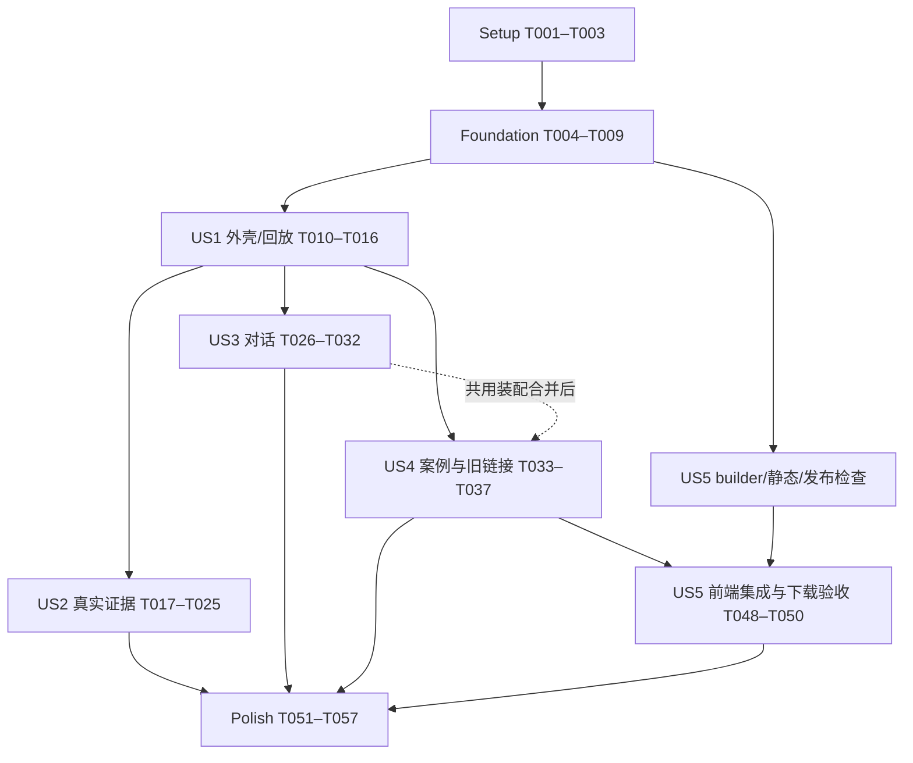

# Tasks: RTL Studio 参考页面改版

**Input**: `specs/004-redesign-rtl-studio/` 下的 spec、plan、research、data-model、contracts、quickstart。
**Created**: 2026-10-20
**Prerequisites**: [plan.md](plan.md)、[spec.md](spec.md)、[data-model.md](data-model.md)、[界面契约](contracts/workspace.md)、[下载契约](contracts/evidence-package.md)。
**Tests**: 规格的独立测试与 SC-001～008 明确要求验证，因此纳入必要的绑定、交互、下载和部署边界测试；测试替身仅用于验收，不进入投资人案例。无纯样式镜像测试，不要求真实模型、真实修复或仿真重跑。
**Organization**: 五个用户故事按 P1/P2 分组。初始化/基础/收尾任务无故事标签，故事任务都带 [USn]；所有任务初始未完成。

## Format: `[ID] [P?] [Story] Description`

- `[P]` 仅表示在任务标出的共同前置已完成后，可与明确列出的不同文件任务并行；不是绕过依赖。
- 路径均从仓库根目录起算，新增文件在任务中指明；不新建前后端项目，不升级既有锁文件。
- `.rtl-demo/validation/`、`.rtl-demo/staging/` 是本机私有验收/候选目录，不放入网页 public。
- 参考稿只读，不复制 vendor/support.js 进正式运行时。当前实际分支为 main，活动功能为 004-redesign-rtl-studio。
- 每个阶段的测试先建立契约并确认新增能力缺失时会失败，再完成实现和该阶段独立验收；已有通过测试不人为改坏。
- 只在实际完成且检查通过后勾选任务；不修改 reviewer-owned 质量清单代替验收。

## Phase 1: Setup — 复用项目与验收材料

**Goal**: 确认现有环境和真实案例基线，准备不调用模型的便携测试材料；不新建项目、不升级依赖。

**Independent Test**: 确认四案例公开包可读、当前分支/功能指针正确，并能区分真实归档与仅供测试的替身。

- [X] T001 在 `specs/004-redesign-rtl-studio/validation.md` 建立实施验收记录，记录参考稿路径、现有本地启动/依赖锁文件、四案例 bundle/来源指纹与 E203 9 模块/10 文件/9 候选/1→0 不匹配基线；不记录密钥，不运行模型或修改归档。
- [X] T002 [P] 在 `tests/rtl_web/evidence_fixtures.py` 准备可移植的公开/私有版本、单次/比较验证、分片波形及篡改/缺失材料 fixture，复用 `tests/rtl_web/conftest.py` 的临时 Store；fixture 明确仅供测试，不导出为案例证据（依赖 T001）。
- [X] T003 [P] 在 `web/rtl-demo/tests/fixtures/studio.ts` 准备四案例真实公开包加载器、问答/操作/SSE 可控回复和禁止未拦截模型/执行写请求的浏览器辅助；不在测试中写入真实演示答案（依赖 T001）。

**Checkpoint**: 已有可复用环境和测试来源；后续验收不需要模型、KG 或 Verilator。

---

## Phase 2: Foundational — 五页签、上下文和证据选择

**Goal**: 先稳定前后端共享契约和选择规则，作为所有用户故事的前置。

**Independent Test**: 五种 panel 可保存恢复，旧值兼容；跨案例、版本/验证冲突与私有分享被拒绝；没有数据库迁移。

- [X] T004 先在 `tests/rtl_web/test_workspace_selection.py`、`web/rtl-demo/src/router.test.ts` 和 `web/rtl-demo/src/evidence-selection.test.ts` 建立五 panel、旧 verification/RI/RSI 路由、发送时 panel、非法/跨案例选择及公开分享排除私有信息的契约测试（依赖 T002、T003）。
- [X] T005 [P] 在 `zerorepo/rtl_web/schemas.py` 扩展 Context 可选 workspace_panel 及 Selection 的 spec/architecture/code/verify/repair 枚举，保持旧默认与旧 view 读取；通过 `tests/rtl_web/test_workspace_selection.py` 确认不重写旧消息、不需表迁移（依赖 T004）。
- [X] T006 [P] 在 `web/rtl-demo/src/state.ts` 定义统一 Panel、八步/来源/播放位置/比较选择和公开下载索引类型，补齐 ReplayEvent 已有 origin/artifact_id/trial_no，context() 携带发送时 panel，区分规划模块与文件映射（依赖 T004）。
- [X] T007 [P] 在 `web/rtl-demo/src/evidence-selection.ts` 实现 case→run→version→validation→waveform 绑定校验、公开证据识别及失效 module/signal 清理；显式错误不可静默回退最终 PASS，复用已有 ID 和权限语义（依赖 T006）。
- [X] T008 [P] 在 `web/rtl-demo/src/router.ts` 和 `web/rtl-demo/src/api.ts` 统一五 panel 与 Selection 保存，旧 verification 归一 verify、旧 RI/RSI hash 归一 workspace、移除 story/memory 参数且保留合法工程参数；定义 step/比较参数的独立 UI 路由与 push/replace 规则（依赖 T006）。
- [X] T009 运行 T004 的基础契约测试并核对新旧 Context/Selection 和公开链接兼容，在 `specs/004-redesign-rtl-studio/validation.md` 记录结果；修复失败后再进入故事阶段（依赖 T005～T008）。

**Checkpoint**: 基础门通过。后续任务可按明确依赖推进；共用 state/api/workspace 的改动不能同时写入。

---

## Phase 3: User Story 1 — 参考稿三栏与八步回放 (Priority: P1)

**Goal**: 建立接近参考稿的深色工作台，八步、五页签和已有对话框可操作；本阶段可先复用旧证据组件并对新细节诚实显示缺失。

**Independent Test**: 加载 E203 静态材料，对照顶部/细进度条/三栏，操作八步与五页签及回放；无模型和执行写请求，输入区在桌面可见。

### Tests（先建立契约）

- [X] T010 [P] [US1] 先在 `web/rtl-demo/src/studio-model.test.ts` 覆盖 E203 13 条事件/9 次候选、只有三条详细验证、全部历史时间为空、AES/SDC 缺失步骤，以及状态/选择/播放位置不互相推导的投影契约（依赖 T009）。
- [X] T011 [P] [US1] 先在 `web/rtl-demo/tests/e2e/studio-layout.spec.ts`、`web/rtl-demo/tests/e2e/history.spec.ts` 和 `web/rtl-demo/playwright.config.ts` 建立三尺寸布局、八步五页签、暂停/继续/从头/手选、无 RI/RSI 导航及禁止执行写请求的浏览器契约；不为每条 CSS 声明写镜像断言（依赖 T009）。

### Implementation & Validation

- [X] T012 [US1] 在 `web/rtl-demo/src/studio-model.ts` 实现八步定义、真实事件/报告整理/当前快照的来源投影、候选分组、缺失说明和真实指标；不改不可变 bundle，不凭旧 stage 顺序涂满完成状态（依赖 T010、T011）。
- [X] T013 [US1] 在 `web/rtl-demo/src/timeline.ts` 实现纵向八步、默认折叠候选、手选停回放、暂停/继续/从头及按真实 sequence 推进；进度只表示回放位置，不补原始耗时或虚构阶段事件（依赖 T012）。
- [X] T014 [P] [US1] 在 `web/rtl-demo/src/styles.css` 提取参考稿深色/卡片/边框/绿色 tokens，建立顶部、3px 进度条、桌面三列和局部滚动；固定右侧输入区，窄屏折叠/重排，沿用系统字体回退（依赖 T010、T011）。
- [X] T015 [US1] 在 `web/rtl-demo/src/workspace.ts` 装配顶部案例/模式/所选记录状态/回放/下载入口、八步时间线、五个语义页签和右侧三指标/折叠动态/单实例 chat；移除主导航、hero、RI/RSI 渲染及 loadStories 前置，默认选历史最终 verify，下载未就绪时说明原因（依赖 T013、T014）。
- [X] T016 [US1] 运行 `web/rtl-demo/src/studio-model.test.ts`、`web/rtl-demo/tests/e2e/studio-layout.spec.ts` 和 `web/rtl-demo/tests/e2e/history.spec.ts`，核对缺失步骤、回放位置与当前结果分离及桌面输入区可见，在 `specs/004-redesign-rtl-studio/validation.md` 记录 US1 独立验收（依赖 T015）。

**Checkpoint**: 视觉 MVP 可本地预览，八步/五页签/回放可操作；尚不能据此宣称完整证据、对话与下载改版交付。

---

## Phase 4: User Story 2 — 真实代码、波形和修复对比 (Priority: P1)

**Goal**: 五页签展示真实规格与规划、完整文件、失败位置及前后验证，复用现有波形和报告逻辑。

**Independent Test**: E203 显示 9 模块/10 文件，trial5 为 1/222，定位 1125ps 的 wbck_o_wdat；最终为 0/222 PASS，代码/报告/波形各自绑定，90 秒内可走完证据路径。

### Tests（先建立契约）

- [X] T017 [P] [US2] 先在 `web/rtl-demo/src/evidence-selection.test.ts`、`web/rtl-demo/src/waveform.test.ts` 和 `web/rtl-demo/src/repair.test.ts` 覆盖定义文件映射、全部变更文件/新增删除、timescale 换算/窗口交集/信号缺失、候选与最终结果区别及瞬时游标值不能代替采样判定（依赖 T009）。
- [X] T018 [P] [US2] 先在 `web/rtl-demo/tests/e2e/evidence.spec.ts` 和 `web/rtl-demo/tests/e2e/waveform.spec.ts` 建立五页签来源、trial5→final 选择、1125ps 差异跳转、窗口保持、缺失根因/统计及版本绑定异常的浏览器场景（依赖 T016）。

### Implementation & Validation

- [X] T019 [P] [US2] 在 `web/rtl-demo/src/spec.ts` 从当前公开规格和已有规划呈现原文、摘要与有来源的约束；给整理摘要和缺失项明确标签，不请求模型补历史分析（依赖 T017、T018）。
- [X] T020 [P] [US2] 在 `web/rtl-demo/src/architecture.ts` 按参考稿重排真实规划的层次、职责及已有划分依据，模块点击联动 RTL；架构计数使用 Bundle.modules，不把定义文件算模块（依赖 T017、T018）。
- [X] T021 [P] [US2] 在 `web/rtl-demo/src/code.ts` 按 file_manifest 展示全部文件与只读代码、版本和文件指纹，包含 e203_defines.v；提供全部变更文件入口，离线 simpleDiff 标为对比片段，在线完整 diff 沿用现有接口（依赖 T017、T018）。
- [X] T022 [P] [US2] 在 `web/rtl-demo/src/verification.ts`、`web/rtl-demo/src/waveform.ts` 及 `web/rtl-demo/src/evidence-selection.ts` 复用真实报告/SVG/BigInt/分片读取，实现前后选择的兼容信号与物理时间窗口保留、无重叠说明和候选/最终范围标识；保留 20,000 transitions 上限与采样比较规则（依赖 T017、T018）。
- [X] T023 [US2] 在 `web/rtl-demo/src/repair.ts` 组合失败报告摘要、差异位置、全部变化文件、候选摘要/处置及最终复验，复用代码/验证选择；缺少原始根因或某轮产物就说明，不使用参考稿符号扩展案例（依赖 T021、T022）。
- [X] T024 [US2] 在 `web/rtl-demo/src/workspace.ts` 接入规格和修复新视图及架构/代码/仿真视图，统一模块、版本、验证、信号和时间窗口联动；不随页签重建对话，不把报告整理卡追加成回放事件（依赖 T019～T023）。
- [X] T025 [US2] 运行 `web/rtl-demo/tests/e2e/evidence.spec.ts`、`web/rtl-demo/tests/e2e/waveform.spec.ts` 和对应单元用例，以归档完成 E203 证据演示并核对 1→0 不匹配与完整文件，在 `specs/004-redesign-rtl-studio/validation.md` 记录 US2 结果（依赖 T024）。

**Checkpoint**: E203 真实设计与修复证据可独立演示，报告结论不依赖示意动画或模型解释。

---

## Phase 5: User Story 3 — 持续对话与真实执行动态 (Priority: P1)

**Goal**: 保留右侧输入、消息、草稿和操作能力，围绕五页签发送时上下文问答，并消除后端对故事页的无条件依赖。

**Independent Test**: 可控 provider 完成三轮问答与引用跳转，测试断线/IME/迟到回复/案例切换、能力分别就绪、两访客隔离；真实模型与执行不调用。

### Tests（先建立契约）

- [X] T026 [P] [US3] 先在 `tests/rtl_web/test_workspace_chat.py` 覆盖五 panel 的工程资料、故事损坏不阻塞 workspace、旧显式经验上下文兼容、发送快照、引用授权、能力准入和两访客隔离；provider/操作均为测试替身（依赖 T009）。
- [X] T027 [P] [US3] 先在 `web/rtl-demo/tests/e2e/chat.spec.ts`、`web/rtl-demo/tests/e2e/composer.spec.ts` 和 `web/rtl-demo/tests/e2e/studio-chat.spec.ts` 建立三轮/证据/IME/草稿/断线/延迟回复/独立浏览器/SSE 去重及模型不可用但显式验证可用的场景，去除依赖 RI/RSI 点击的旧断言（依赖 T016）。

### Implementation & Validation

- [X] T028 [P] [US3] 在 `zerorepo/rtl_web/chat.py` 和 `zerorepo/rtl_web/chat_runtime.py` 按 workspace_panel 组织工程证据，workspace 不无条件调用 story_view，旧显式经验分支仅读兼容；移除当前页面为 RSI 的提示预设，保留证据不足、采样、历史/实时及明确执行意图约束（依赖 T026、T027）。
- [X] T029 [P] [US3] 在 `web/rtl-demo/src/api.ts` 捕获发送时 case/session/context/幂等键，订阅回调接收白名单 SSE 字段并按 event id 去重/续传；重连刷新持久快照，错误或迟到返回不能覆盖其他案例，普通问题与三条准确操作句按各自能力发送（依赖 T026、T027）。
- [X] T030 [US3] 在 `web/rtl-demo/src/chat.ts` 保持单实例、每案例草稿/pending 重试、发送中新草稿和 IME 规则，证据回调传消息 context_ref、操作回调传所属 operation；输入一直可编辑，只有可完成的请求可发送，历史阅读时不被新消息强制拉到底部（依赖 T029）。
- [X] T031 [US3] 在 `web/rtl-demo/src/workspace.ts` 和 `web/rtl-demo/src/styles.css` 接入受控动态、最多 100 条记录和折叠区、真实指标、固定 composer、引用原案例导航及重连生命周期；快照摘要标来源，不展示硬编码推理或未提供的审批接管（依赖 T028、T030）。
- [X] T032 [US3] 运行 `tests/rtl_web/test_workspace_chat.py`、`web/rtl-demo/tests/e2e/studio-chat.spec.ts` 及修改后的 chat/composer 用例，检查消息引用/幂等/迟到/独立访客和 story 解耦，在 `specs/004-redesign-rtl-studio/validation.md` 记录 US3 为契约验收而非真实模型验收（依赖 T031）。

**Checkpoint**: 持续对话与操作交互契约通过；不把可控回复当真实模型连通性或真实修复验收。

---

## Phase 6: User Story 4 — 四案例与旧地址兼容 (Priority: P2)

**Goal**: 以一个顶部选择器呈现四个真实案例，清理旧故事页面导航，并保留原有效工程链接和会话归属。

**Independent Test**: 四案例分别查看规格/规划/代码/最终报告/波形，AES/SDC 缺失不补造；旧 RI/RSI 地址进入工作台，刷新/前后退和草稿归属正确。

### Tests（先建立契约）

- [X] T033 [US4] 先在 `web/rtl-demo/tests/e2e/catalog.spec.ts`、`web/rtl-demo/tests/e2e/navigation.spec.ts` 和 `web/rtl-demo/src/router.test.ts` 覆盖四案例 9/3/5/5 模块、缺失统计/前波形、整页切换草稿、旧 RI/RSI 归一、显式错误证据及刷新/前后退（依赖 T016）。

### Implementation & Validation

- [X] T034 [US4] 在 `web/rtl-demo/src/workspace.ts` 和 `web/rtl-demo/src/state.ts` 完成顶部四案例选择、整页切换前保存草稿、当前案例指标/时间线/验证重置与默认最终记录，已有旧消息证据保持原案例，不沿用上一案例结果（依赖 T032、T033，US3 集成完成后修改共用装配文件）。
- [X] T035 [US4] 在 `web/rtl-demo/src/api.ts`、`web/rtl-demo/src/router.ts` 和 `web/rtl-demo/src/workspace.ts` 完成公开 validation/run 链接加载与归属核对、旧 hash replace、新导航 push 和私有选择仅存会话；移除工作台对故事索引的依赖，无静态材料时明确不可用（依赖 T034）。
- [X] T036 [US4] 清理 `web/rtl-demo/src/shell.ts`、`web/rtl-demo/src/optimization.ts`、`web/rtl-demo/src/experience.ts` 的活动导入和旧页面专属测试，在 `web/rtl-demo/tests/e2e/optimization.spec.ts`、`web/rtl-demo/tests/e2e/stories.spec.ts` 中删除已取消页面断言或迁为旧地址归一验收；仅按引用清理未使用文件，不删除后台记忆账本/旧消息兼容测试（依赖 T035）。
- [X] T037 [US4] 运行 `web/rtl-demo/tests/e2e/catalog.spec.ts`、`web/rtl-demo/tests/e2e/navigation.spec.ts` 与现有 `web/rtl-demo/tests/e2e/deployed-workspace.spec.ts` 的本地契约检查，在 `specs/004-redesign-rtl-studio/validation.md` 记录四案例、SDC 长波形与旧链接结果（依赖 T036）。

**Checkpoint**: 同一参考布局覆盖四案例，RI/RSI 不再出现，原工程链接和访客体验保持可用。

---

## Phase 7: User Story 5 — 可追溯的公开证据下载 (Priority: P2)

**Goal**: 提供当前单次验证或前后比较的公开 ZIP，静态和 API 共用 builder，下载材料与页面选择精确绑定。

**Independent Test**: 下载 E203 单次/前后比较及 SDC 分片，核对清单/hash/全部 RTL；断开 API 仍能下载精确静态包，私有/跨案例/损坏/超限选择被拒绝。

### Tests（先建立契约）

- [X] T038 [P] [US5] 先在 `tests/rtl_web/test_evidence_package.py` 覆盖完整 RTL/defines、比较双版本、报告公开字节、SDC 全部 tiles/相对 index、源 VCD/派生/输出 hash 区分、可选缺失和必需损坏、私有排除及确定性 ZIP（依赖 T002、T009）。
- [X] T039 [P] [US5] 先在 `tests/rtl_web/test_evidence_api.py` 和 `tests/rtl_web/test_evidence_static.py` 覆盖公开 bundle 成员、最多两条同案例验证、路径/header 冲突、cookie 不扩大公开范围、状态码/content-type、并发/预算/异常取消清理及静态七包索引（依赖 T002、T009）。
- [X] T040 [P] [US5] 先在 `tests/rtl_web/test_evidence_release.py` 建立专用边界测试，并回归 `tests/rtl_web/test_deploy_release.py` 和 `tests/rtl_web/test_deployment_package.py`，覆盖限定 cases 路径 ZIP 的正例及越界路径、重复条目、symlink、无清单、额外文件、hash/来源不符、解压超限和 raw VCD/私有文件拒绝（依赖 T002、T009）。
- [X] T041 [P] [US5] 先在 `web/rtl-demo/tests/e2e/download.spec.ts` 覆盖单次/对比精确选择、静态优先、无静态包时 API 下载、错误不保存为 ZIP、离线不可用提示及私有选择不导出；禁止真实模型与执行请求（依赖 T003、T016）。

### Implementation & Validation

- [X] T042 [US5] 在 `zerorepo/rtl_web/evidence.py` 实现选择及公开闭包收集：从已发布历史 bundle 校验 validation/version/run/case，按 file_manifest 收齐公开 RTL/报告/规格/规划/波形及 tiles，复用安全路径/hash/owner 检查；不得用 public() 或 private seed 直接导出（依赖 T038～T041）。
- [X] T043 [US5] 在 `zerorepo/rtl_web/evidence.py` 实现 rtl-demo-evidence-v1 正向字段清单、中文 README、相对 tile 路径重写和实际字节 hash，标准库确定性 ZIP 分块写入；输入/输出各 64MiB、128 条目、压缩等级 1，拒绝敏感内容但不改 RTL 字节冒充原 hash（依赖 T042）。
- [X] T044 [P] [US5] 在 `zerorepo/rtl_web/api.py` 和 `zerorepo/rtl_web/evidence.py` 增加 GET /api/cases/{case_id}/evidence.zip，复用生产入口与公开成员校验、下载响应和错误信封；落实构建并发 1、私有临时目录/权限、在用临时包 128MiB 总量、成功/异常/断线/启动遗留清理，不触发模型或操作（依赖 T043）。
- [X] T045 [P] [US5] 在 `zerorepo/rtl_web/import_case.py` 的 export_static 复用 builder 生成全部详细验证单次包及默认有效比较包，仅在导出副本追加 evidence_packages 与内容寻址 URL/hash/大小；保留原 bundle/source_fingerprint 和原始 VCD 公开边界（依赖 T043）。
- [X] T046 [P] [US5] 在 `scripts/rtl_demo/release.py` 实现共用的受限 ZIP 验证并在 `scripts/rtl_demo/deployment.py` 的 design inventory 复用，只允许 cases/<registered_case>/evidence/<sha256>.zip；流式验证清单/来源/路径/hash/大小/条目与索引，不泛开所有 ZIP（依赖 T043）。
- [X] T047 [P] [US5] 在 `web/rtl-demo/src/evidence-download.ts` 实现当前单次/比较的精确静态描述符匹配与 API 文件下载，独立处理 ZIP 和 JSON 错误、生成安全下载文件名并释放 Blob URL；不在浏览器聚合全部 tiles，不降级到另一验证（依赖 T043）。
- [X] T048 [US5] 在 `web/rtl-demo/src/api.ts`、`web/rtl-demo/src/state.ts` 和 `web/rtl-demo/src/workspace.ts` 接入匹配 bundle_id/source_fingerprint 的下载索引，顶部按钮根据当前单次/比较选择下载、显示进行中/缺失/不可公开原因，不将 private live 记录作为公开包（依赖 T044、T045、T047；US4 共用文件修改完成后集成）。
- [X] T049 [US5] 按 `specs/004-redesign-rtl-studio/quickstart.md` 从已有归档重新导出 `web/rtl-demo/public/cases/`，核对 E203 三个单次加一个对比、其他案例各一个共七包与顶层/版本化索引；运行受限 ZIP 发布检查，不复制 runtime.env、seed、原始 VCD 或数据库到 public（依赖 T045、T046、T048）。
- [X] T050 [US5] 运行 `tests/rtl_web/test_evidence_package.py`、`tests/rtl_web/test_evidence_api.py`、`tests/rtl_web/test_evidence_static.py`、两组发布测试及 `web/rtl-demo/tests/e2e/download.spec.ts`，记录下载字节、选择、离线、预算/清理和排除项结果到 `specs/004-redesign-rtl-studio/validation.md`（依赖 T049）。

**Checkpoint**: 下载闭环完成：可公开、可核对、可离线，不把私有原始 VCD 或执行环境作为访客材料。

---

## Phase 8: Polish & Cross-Cutting Concerns — 完整验收与本地候选

**Goal**: 完成跨故事检查、视觉对照与本地发布候选；不做公网切换、不调用模型、不用外壳完成替代全部验收。

**Independent Test**: 所有要求均有对应任务和结果，构建/相关回归/三尺寸对照通过，候选文件可审查且不包含私有状态。

- [X] T051 在 `web/rtl-demo/src/timeline.ts`、`web/rtl-demo/src/workspace.ts`、`web/rtl-demo/src/chat.ts`、`web/rtl-demo/src/styles.css` 统一键盘页签/步骤、可见焦点、状态语义和长内容滚动，核对窄屏开关不销毁草稿、桌面输入不被动态挤出；仅修复跨故事实际发现的问题（依赖 T016、T025、T032、T037、T050）。
- [X] T052 [P] 运行 `web/rtl-demo/package.json` 的 test/build，确认旧三视图测试已按取消范围更新、无多余框架/外部字体依赖，输出结果到 `.rtl-demo/validation/004-redesign-rtl-studio/frontend-checks.json`；失败只修复相关实现并复查受影响项（依赖 T051）。
- [X] T053 [P] 运行新增 workspace/下载测试及 `tests/rtl_web/test_case_import.py`、`tests/rtl_web/test_access_boundary.py`、`tests/rtl_web/test_chat_operations.py`、`tests/rtl_web/test_waveform_evidence.py`、`tests/rtl_web/test_catalog.py` 和受影响发布测试，输出 `.rtl-demo/validation/004-redesign-rtl-studio/backend-checks.json`；记录跳过项，不执行外部模型/真实修复（依赖 T051）。
- [X] T054 按 `specs/004-redesign-rtl-studio/quickstart.md` 运行相关浏览器套件，覆盖三尺寸、五页签/八步、四案例、回放无写请求、三轮对话、离线、双访客、旧地址/前后退及两类下载；证据保存在 `.rtl-demo/validation/004-redesign-rtl-studio/browser/`，不运行线上模型验收脚本（依赖 T052、T053）。
- [X] T055 对照 `web/RTL Studio 演示-html/Demo.dc.html` 记录两种桌面尺寸的五页签画面和窄屏关键画面到 `.rtl-demo/validation/004-redesign-rtl-studio/screenshots/`，核对三栏/颜色/输入位置，记录必要偏离；实际计时 E203 归档 90 秒演示路径，结果写入 `specs/004-redesign-rtl-studio/validation.md`（依赖 T054）。
- [X] T056 使用 `scripts/rtl_demo/release.py`、`scripts/rtl_demo/deployment.py` 的本地校验能力，在 `.rtl-demo/staging/004-redesign-rtl-studio/` 准备增量发布候选和文件/hash清单，涵盖新 dist、必要 rtl_web 与发布检查脚本，列明服务器保留的 data/session.key/seed/配置及回滚入口；不上传、不改 Caddy、不切换域名或服务（依赖 T055）。
- [X] T057 在 `specs/004-redesign-rtl-studio/quickstart.md` 写入实际可运行的新增测试命令，并在 `specs/004-redesign-rtl-studio/validation.md` 汇总 FR/SC 验收、缺失/跳过与候选清单；仅在对应检查完成后更新 `specs/004-redesign-rtl-studio/spec.md` 实施状态，明确真实模型/修复和公网发布未执行（依赖 T056）。

**Checkpoint**: 完整功能可本地审查并具备发布候选；是否上线属于后续部署指令，不是本清单的自动动作。

---
## Dependencies & Execution Order

### Phase Dependencies

- Phase 1：T001 先确认基线，T002/T003 可并行准备两端 fixture。
- Phase 2：T004 先写基础契约；T005/T006 可分别修改后端 schema 和前端类型；T006 后 T007/T008 可并行，T009 是所有故事的基础门。
- Phase 3：T010/T011 先建立独立测试；T012→T013 为投影/回放链，T014 样式可独立推进；T015 集成、T016 验收。
- Phase 4～7：纯组件、后端或测试可按明确前置独立推进；最终页面集成依赖 US1 外壳。多个任务涉及 workspace.ts/api.ts/state.ts 时必须顺序合并，不把故事整体宣称为无冲突并行。
- Phase 8：T051 依赖全部故事检查点；T052/T053 可并行运行两端检查；T054→T055→T056→T057 依次形成完整验收及本地候选。

### User Story Dependencies

| 用户故事 | 完整验收前置 | 可提前独立推进的部分 | 检查点 |
| --- | --- | --- | --- |
| US1 参考布局 | 基础 T009 | 无需其他故事 | T016 |
| US2 真实证据 | T009、US1 外壳 T016 | T017 单元契约；外壳稳定后五页签组件可分文件实现 | T025 |
| US3 持续对话 | T009、US1 外壳 T016 | T026 后端契约；T028 工程 evidence/prompt 与前端组件无文件冲突 | T032 |
| US4 四案例/旧地址 | T009、US1 外壳 T016 | T033 兼容测试；最终共用装配按 US3 集成后的代码进行 | T037 |
| US5 公开下载 | 后端 T009；最终页面接入依赖 T016 和 US4 的共用文件修改 | T038～T040 导出测试；builder、静态导出和发布检查不依赖 US2/US3 完成 | T050 |

默认按文件中的阶段顺序实施最简单。若拆分并行，必须遵循任务明示前置和下图的装配合流，不同时修改共享文件。

### Within Each Story

先建立契约测试，再实现实体投影/组件/后端功能，最后集成与独立验收。测试以已固定的设计契约为依据；功能尚不存在时预期失败，完成后运行对应测试。不为样式写实现镜像测试，不借用线上模型补结果。

存在明确证据或环境缺失时，先完成不依赖该项的任务并记录限制；不把跳过、测试替身、候选验收当成真实模型或公网验收通过。检查通过后不无故扩大重跑范围；新修改/失败只重跑受影响检查。

## Parallel Examples per Story

下面只列文件不冲突的实际组合。29 个 `[P]` 是候选并行任务数量，不是可同时启动 29 项；所有组合先满足共同前置。

| 故事 | 前置 | 可并行任务 | 合流 |
| --- | --- | --- | --- |
| US1 | T009 | T010 投影契约 / T011 浏览器契约 | 契约就绪后再实现 |
| US1 | T010、T011 | T012 studio-model.ts（然后 T013 timeline.ts） / T014 styles.css | T015 装配 |
| US2 | T017、T018 | T019 spec.ts / T020 architecture.ts / T021 code.ts / T022 verification-waveform-selection | T023 修复页、T024 装配 |
| US3 | T026、T027 | T028 chat.py+chat_runtime.py / T029 api.ts | T030 composer、T031 装配 |
| US4 | US3 装配 T031 稳定 | T033 的 catalog.spec.ts 与 navigation.spec.ts 两组测试内容可分文件编写，router.test.ts 由同一任务负责人整合 | T034～T036 顺序修改共享文件 |
| US5 | T043、且四项测试已建立 | T044 API / T045 export_static / T046 发布检查 / T047 evidence-download.ts | T048 页面接入，T049 导出，T050 验收 |

US4 的实现集中修改同一装配/路由文件，因此未标 `[P]`；不要为了形式并行重复修改这些文件。并行示例说明可行工作划分，不要求启动子 Agent。

## Requirements Traceability

| 需求 | 实施任务 | 主要验证 |
| --- | --- | --- |
| FR-001、FR-024 参考视觉、三尺寸 | T014、T015、T031、T051 | T011、T016、T054、T055 |
| FR-002 顶部/取消 RI、RSI | T008、T015、T035、T036 | T004、T033、T037 |
| FR-003～005 八步/五签/回放 | T006、T008、T012、T013、T015 | T010、T011、T016 |
| FR-006 规格与来源 | T019、T024 | T018、T025 |
| FR-007 规划架构 | T020、T024 | T018、T025、T037 |
| FR-008 完整文件与差异 | T007、T021、T023 | T017、T018、T025 |
| FR-009～012 报告/波形/比较/修复 | T007、T022～T024 | T017、T018、T025、T053 |
| FR-013 指标与动态 | T012、T015、T029、T031 | T010、T027、T032 |
| FR-014、FR-015 对话/发送快照 | T006、T028～T031 | T026、T027、T032 |
| FR-016～018 动态来源/显式操作/能力 | T012、T028～T031 | T010、T026、T027、T032 |
| FR-019 私有隔离与归属 | T007、T028～T031、T034、T035 | T004、T026、T027、T032、T053 |
| FR-020、FR-021 真实数据与四案例 | T012、T019～T024、T034、T035 | T001、T010、T017、T018、T025、T033、T037 |
| FR-022、FR-023 下载与公开边界 | T042～T049 | T038～T041、T050、T053、T054 |
| FR-025 链接/导航恢复 | T008、T034～T036 | T004、T033、T037 |

| 成功标准 | 对应验收 |
| --- | --- |
| SC-001 桌面参考对照 | T016、T054、T055 |
| SC-002 90 秒证据路径 | T025、T055 |
| SC-003 E203 数字/绑定 | T001、T010、T017、T018、T025、T053 |
| SC-004 四案例与缺失说明 | T033、T037、T054 |
| SC-005 三轮/断线/迟到/隔离 | T026、T027、T032、T054 |
| SC-006 单次/比较 ZIP | T038～T041、T049、T050 |
| SC-007 窄屏可操作 | T011、T051、T054、T055 |
| SC-008 浏览不执行/旧入口/不补造 | T010、T011、T016、T033、T037、T054 |

## Implementation Strategy

### MVP First

先完成 T001～T016，得到贴近参考稿的三栏八步五页签和可保留输入的视觉 MVP，可在本地查看。然后完成 US2+US3，形成投资人演示的 P1 核心：真实验证/修复证据与持续对话。US1 的下载入口可暂时明确未就绪，不能把它或模拟回复包装为完整交付。

MVP 是实现顺序，不是缩减本次已确认范围。完整改版仍须完成四案例、下载与收尾验收，不因外壳能浏览就结束 speckit-implement。

### Incremental Delivery

1. 基础契约通过 → 参考布局本地预览。
2. 真实证据接入 → E203 失败/修复/通过故事可演示。
3. 对话和动态就位 → 持续交互与正确上下文契约通过。
4. 四案例与旧地址验收 → 现有材料和访客体验可延续。
5. ZIP 下载与发布检查通过 → 公开材料可核验且可静态下载。
6. 三尺寸视觉/完整回归通过 → 形成可审查的本地增量候选与验收记录。

实际公网发布、真实问答及真实修复均不是本清单的隐含动作；后续有对应明确指令时再执行。保持现有 agent 域名方案，不改其他站点，不传 SSH/模型凭据或私有运行状态。

## Task Summary & Notes

- 原清单共 **57 项**：Setup 3、Foundational 6、US1 7、US2 9、US3 7、US4 5、US5 13、Polish 7。
- 五故事合计 41 项，共享/收尾 16 项；29 项标 `[P]`，具体并行条件见上表。
- 所有任务使用 `- [ ] TNNN [P?] [USn?] 描述与文件路径`；编号连续，无预先勾选。
- 全部 57 项已完成本地实现、测试、公开材料导出与候选准备；验收结果见 validation.md。未调用真实模型、真实修复或执行公网部署。
- constitution.md 是未填充模板，不引入示例审批流程。已有 requirements 质量清单不代表实现完成。
- 生成前后均检查 `.specify/extensions.yml`；文件不存在，按 speckit-tasks 规则跳过钩子。
- 清单生成校验已通过：57 个连续编号、正确阶段/故事标签、精确文件路径、无前向或自身依赖、25 条 FR 与 8 项 SC 全覆盖；Spec Kit 已识别 tasks.md，可进入 speckit-implement。此结论只表示清单可执行，不代表任务已完成。

## 用户补充：逐步 Agent Trace 调试流程（2026-10-20）

- [X] T058 从 E203 原始验证日志导出有界、脱敏、正向字段投影，绑定案例、归档、来源指纹与 journal SHA-256；不修改不可变归档。文件：`zerorepo/rtl_web/agent_trace.py`、`zerorepo/rtl_web/import_case.py`。
- [X] T059 将右侧最近六条动态改为八步 Agent Trace，展开九轮目标/修改/检查/回溯/决策与工具日志，联动报告和波形，保留对话输入。文件：`web/rtl-demo/src/agent-trace.ts`、`workspace.ts`、`state.ts`、`api.ts`、`styles.css`。
- [X] T060 验证历史回放不透出未来修复、实时日志只属于当前任务、未知根因与其他案例不补造、脱敏及候选身份检查。文件：`web/rtl-demo/src/agent-trace.test.ts`、`web/rtl-demo/tests/e2e/agent-trace.spec.ts`、`tests/rtl_web/test_agent_trace.py`。
- [X] T061 完成构建、三尺寸浏览器复查、归档与发布回归、截图，更新本地增量候选及验收说明。文件：`specs/004-redesign-rtl-studio/validation.md`、`quickstart.md`。

补充后共 61 项全部完成；公网发布及真实模型/修复仍未执行。

## 用户纠正：当前阶段对应显示（2026-10-21）

- [X] T062 右栏只显示所选阶段的 Trace，移除八阶段重复列表，同步左侧/中央页签，区分共享页签步骤，验证八次选择、最终复验、回放/导航和草稿保留，更新本地候选与说明。文件：`web/rtl-demo/src/agent-trace.ts`、`studio-model.ts`、`workspace.ts`、`styles.css`、`agent-trace.test.ts`、`web/rtl-demo/tests/e2e/agent-trace.spec.ts`。

累计62项完成；最新候选仅本地，未上线。

## 用户补充：可点击卡片与按需对话（2026-10-21）

- [X] T063 以可点击摘要卡片替代右栏嵌套日志，详情按需打开并保留报告/波形跳转，统一滚动层级和深色细滚动条。文件：`web/rtl-demo/src/agent-trace.ts`、`styles.css`、`web/rtl-demo/tests/e2e/agent-trace.spec.ts`。
- [X] T064 将唯一聊天实例移入顶部统一入口的对话窗口，默认收起、支持关闭/重开、保留草稿和历史，适配既有多轮/重连/多访客测试，完成构建、完整浏览器与截图检查。文件：`web/rtl-demo/src/workspace.ts`、`chat.ts`、`styles.css`、`web/rtl-demo/tests/fixtures/studio.ts`、`web/rtl-demo/tests/e2e/`。

累计64项完成；对话默认可见要求以本次用户要求为准。

## 用户补充：完整修复过程与候选证据（2026-10-21）

- [X] T065 校验真实历史快照、报告、journal及VCD来源，生成不可变补充归档与脱敏投影，保留原bundle。文件：`configs/rtl_demo_e203.history.json`、`zerorepo/rtl_web/recorded_history.py`、`import_case.py`、`artifacts.py`。
- [X] T066 将来源统一为初始失败至最终通过的39次候选，移除运行分组与选择器，保留内部来源身份。文件：`web/rtl-demo/src/state.ts`、`timeline.ts`、`verification.ts`、`api.ts`。
- [X] T067 右侧候选点击联动中央实际基线代码Diff、报告、前后波形与日志，语法失败不复用旧波形，保留回退及诊断限制。文件：`agent-trace.ts`、`workspace.ts`、`history-repair.ts`、`history-diff.ts`、`waveform.ts`。
- [X] T068 绑定所选证据下载、私有seed闭包和在线新访客初始选择，保留旧链接及其他案例。文件：`zerorepo/rtl_web/evidence.py`、`seed.py`、`api.py`、`schemas.py`、`web/rtl-demo/src/evidence-download.ts`。
- [X] T069 完成真实归档/接口、前端与浏览器回归及截图，更新本地增量候选、启动与验收说明。文件：`tests/rtl_web/test_recorded_history.py`、`test_seed.py`、`web/rtl-demo/tests/e2e/recorded-history.spec.ts`、`history-diff.test.ts`、`agent-trace.test.ts`、`specs/004-redesign-rtl-studio/validation.md`、`quickstart.md`。

累计69项完成；最新本地候选r7，未上传或激活，真实模型/修复与新增仿真未执行。

## 用户补充：AES 加密运行与修复轨迹（2026-10-21）

- [X] T070 审核AES加密8次ReAct修改、前后部分快照、检查日志与真实VCD可用范围，固定来源SHA-256。文件：`configs/rtl_demo_aes_cipher.history.json`。
- [X] T071 还原完整RTL、核对接受/语法回退/退化回退与真实基线，按实际VCD生命周期归属离散探针；导入不可变补充归档，不重跑仿真。文件：`zerorepo/rtl_web/recorded_react_history.py`、`recorded_history.py`、`schemas.py`。
- [X] T072 接入仿真、定位、修复页面：各输出计数、候选中央Diff、离散探针筛选/分页/差异跳转和最终真实波形，标明缺失材料及最终报告范围。文件：`web/rtl-demo/src/verification.ts`、`history-repair.ts`、`probe-samples.ts`、`validation-summary.ts`、`state.ts`、`styles.css`。
- [X] T073 让所选证据ZIP包含真实输出计数及探针绑定，导出并dry-run验证新增私有seed，准备本地r8增量候选。文件：`zerorepo/rtl_web/evidence.py`及本地staging/validation材料。
- [X] T074 完成AES归档/篡改/回退/ZIP测试、三尺寸浏览器与四案例回归，保存截图并更新验收文档。文件：`tests/rtl_web/test_recorded_react_history.py`、`web/rtl-demo/tests/e2e/aes-recorded-history.spec.ts`、`validation-summary.test.ts`、`specs/004-redesign-rtl-studio/validation.md`、`quickstart.md`。

累计74项本地完成；本次只接AES加密轨迹，AES解密和SDC仍展示其原有材料。

## 用户补充：AES 解密运行与修复轨迹（2026-10-21）

- [X] T075 定位当前解密案例4次真实修改及原始/最终证据，固定部分RTL快照与未改动模块来源SHA-256，不混用其他规格。文件：`configs/rtl_demo_aes_inverse.history.json`。
- [X] T076 扩展ReAct导入器按案例读取清单、严格核对完整RTL与初始统计，增加edit_only未验证状态，保留真实仿真/探针绑定。文件：`zerorepo/rtl_web/recorded_react_history.py`、`recorded_history.py`、`schemas.py`。
- [X] T077 接入4张候选卡及中央Diff、诊断假设、检查状态、前后证据；未检查修改不显示语法失败或继承统计，保持按需对话。文件：`web/rtl-demo/src/state.ts`、`workspace.ts`、`agent-trace.ts`、`history-repair.ts`、`verification.ts`、`validation-summary.ts`、`probe-samples.ts`。
- [X] T078 导出解密逐候选ZIP与新增私有seed，执行闭包dry-run及公开材料检查，准备r9本地增量候选。文件：`web/rtl-demo/public/cases/aes_inv_cipher_top_system/`及本地validation/staging材料。
- [X] T079 完成未验证修改/真实仿真/在线初始选择与四案例浏览器回归、截图和文档。文件：`tests/rtl_web/test_recorded_react_history.py`、`web/rtl-demo/tests/e2e/aes-inverse-recorded-history.spec.ts`、`validation-summary.test.ts`、`specs/004-redesign-rtl-studio/validation.md`、`quickstart.md`。

累计79项本地完成；公网部署和新模型/仿真未执行，SDC仍使用原有材料。

## 用户补充：SDC 系统运行与修复记录（2026-10-22）

- [X] T080 审核SDC系统级17次候选、4次回退与最终独立验证，固定来源、完整RTL及真实报告/VCD哈希，标注初始VCD缺失。文件：`configs/rtl_demo_sdc.history.json`。
- [X] T081 复用不可变Codex历史导入，逐项核对报告输出计数/首次时刻与VCD计数，保持普通解析和原归档不变。文件：`zerorepo/rtl_web/recorded_history.py`、`import_case.py`、`artifacts.py`、`waveform.py`、`schemas.py`。
- [X] T082 接入17张候选卡、真实修改基线和中央前后Diff/报告/波形，显示输出计数核对状态及相关CMD/中断波形。文件：`web/rtl-demo/src/state.ts`、`verification.ts`、`web/rtl-demo/public/cases/sdc_controller_system/`。
- [X] T083 导出153个四案例公开ZIP，验证完整私有历史闭包；按实测大小将私有seed预算限定为1GiB并提前拒绝超额，准备r10本地候选。文件：`zerorepo/rtl_web/evidence.py`、`seed.py`及本地validation/staging材料。
- [X] T084 完成SDC真实归档、计数/首次时刻冲突、回退、跨案例、下载及三尺寸浏览器回归与截图，更新说明。文件：`tests/rtl_web/test_recorded_sdc_history.py`、`test_seed.py`、`web/rtl-demo/tests/e2e/sdc-recorded-history.spec.ts`、`specs/004-redesign-rtl-studio/validation.md`、`quickstart.md`。

累计84项本地完成；四案例均有可用历史展示，未执行新仿真、模型调用或公网更新。

## 用户授权：服务器与公网发布（2026-10-22）

- [X] T085 审核服务器现有发布、所有后端源差异、磁盘和任务状态；对比625条种子记录，确认97条同ID内容一致及528条新增，无覆盖冲突。材料：`.rtl-demo/deployment/studio-public-20261022/`。
- [X] T086 通过固定主机指纹SSH上传校验包，在服务器私有隔离状态副本完成种子合并、4案例API/初始失败/最终通过/波形索引及真实E203窗口接口验收。控制脚本：同目录`deploy.py`。
- [X] T087 保留数据库、模型/认证配置及59个既有会话，切换r10并恢复worker版本一致性和聊天离线预检；保留旧发布和配置回滚材料，主站/www/design/Caddy哈希不变。
- [X] T088 完成TLS开启的直接公网浏览器验收：四案例39/8/4/17张候选、真实修改基线、前后波形、SDC下载及文件哈希、私有VCD/配置拒绝访问、独立访客401与草稿输入；无模型/仿真调用，更新发布状态。材料：`public-check.mjs`、`public-acceptance.json`、`public-download-check.json`、`post-activation.json`。

累计88项完成；studio-20261022-r10-sdc-history已上线到agent域名。

- [X] T089 复核用户提供的完整公网旧链接；修复静态入口/清单200与304的缓存重验证，8项网关测试通过，原子发布并保留回退文件，真实公网确认新旧链接均为新版布局、新入口含39次候选Diff/波形，无模型调用。

- [X] T090 核对四案例原始journal和公开Agent消息，整理52条修改前判断、8条提交验证理由、8条缺失记录，保留源SHA/行号并审阅中文摘要。
- [X] T091 新增只读、严格绑定修改前版本的根因注释投影与可重建脚本；不改写历史run/validation/RTL，不将修改目标或后验结果提升为根因。
- [X] T092 根因定位独立联动中央判断、旧代码及前置验证；右侧卡片展示对应根因摘要，自动修复继续展示Diff和前后波形，下载和顶部状态指向正确基线。
- [X] T093 完成33项前端单元、16项相关后端回归、44项浏览器与153个公开ZIP校验，覆盖缺失根因、AES未验证修改、真实来源及错绑拒绝。
- [X] T094 在服务器副本验收四案例后发布studio-20261022-r11-root-causes，公网逐案例验证两视图分离、基线绑定、来源、刷新和原静态/API指纹一致；71个既有会话及受保护文件保持，无模型或仿真调用。

- [X] T095 排查线上消息完成状态与前端刷新并发，修复丢失刷新、增加回复期间的状态轮询和手动刷新，不重复发送问题或清除新草稿。
- [X] T096 三个分析入口按当前案例真实证据即时回答并标注归档来源，移除fix能力门槛；两项执行入口立即提示暂不支持，旧修复指令兼容为只读分析。
- [X] T097 自由问答保留模型；对话沙箱传递白名单短回答配置，DeepSeek问答独立关闭thinking并使用4096 Token、60秒上限，默认不允许模型决策启动实际执行。
- [X] T098 通过33项前端单元、46项完整浏览器、18项相关后端和23项模型客户端测试；四案例隔离检查后发布r12，公网12次快捷分析与1次真实模型问答通过，零生成/修复/仿真。

- [X] T099 按用户纠正删除快捷归档答案生成器；除两项不支持提示外，所有分析入口和自由问题统一调用真实模型，模型故障不使用摘要兜底。
- [X] T100 保留版本绑定的规格/代码/验证/根因证据与连续对话历史，旧摘要清楚标注非模型，前端显示模型来源；SDK用量回执独立于模型JSON，覆盖真实调用检查。
- [X] T101 通过33项前端单元、7项对话浏览器、16项聊天后端与5项SDK参数/回执测试；服务器四案例隔离副本检查全部模型路径及两项提示。
- [X] T102 发布studio-20261026-r13-model-chat，公网七次真实模型请求均answered且SDK输入/输出Token非零，覆盖三个分析按钮、连续追问及四案例；零执行操作，82个既有会话与受保护文件保持。

## 公网 503 故障修复（2026-10-27）

- [X] T103 定位 Uvicorn 16 个全局连接额度被通知流/keep-alive 占用导致所有入口 503；先重启恢复，再改为活动请求与 SSE 各 16 个独立名额，保留有界资源控制。
- [X] T104 SSE 每 60 秒正常结束，由浏览器携 Last-Event-ID 重连；增加重试间隔和禁用代理缓冲，保持数据库事件和会话身份不变。
- [X] T105 完成 11 项定向测试，包括真实 TCP 的 24 个空闲连接、16 个 SSE、溢出及取消释放、普通请求独立可用和游标续传；在服务器隔离副本再次通过容量测试及四案例接口，发布 r14，保留 87 个既有会话、凭据和其他站点。
- [X] T106 直接公网浏览器复核四案例和真实 60 秒 SSE 轮换后续传；不调用模型或执行 RTL 任务。

## DeepSeek 凭据更新与真实问答复验（2026-10-27）

- [X] T107 定位模型官方接口 401/密钥无效；验证用户新密钥的官方认证 200，仅更新服务器选定环境变量，0600 原子保存并重载网关/worker；保留 91 个既有会话，其他密钥、模型/Agent 配置、Caddy 与站点不变。
- [X] T108 严格 TLS 公网浏览器点击此前失败的“这个设计如何拆分模块？”，完成一次真实 DeepSeek 问答，核对 SDK 非零用量、模型来源和页面回答；零生成/修复/仿真。
